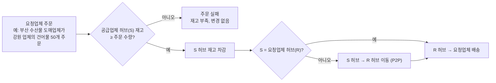
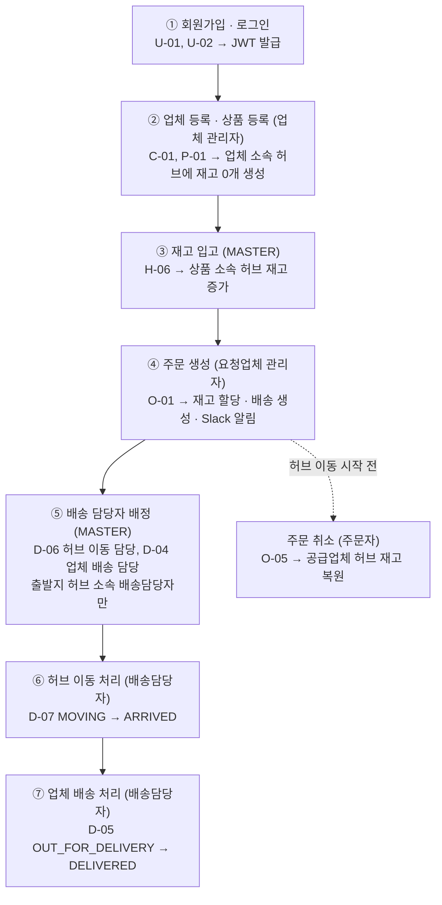

# 01. 프로젝트 개요

> 근거: [SA문서 §0, §1](reference/SA문서.md)

## 프로젝트 소개

| 항목 | 내용 |
| --- | --- |
| 주제 | 물류 관리 및 배송 시스템을 위한 MSA |
| 목표 | MSA의 복잡성을 이해하고, 팀원들과 MSA를 구축하며 실무에서 발생할 수 있는 문제를 간접 경험·해결 |
| 팀 | 3조 "로컬에선 되는데요?" (안준현, 권민혁, 지한얼, 김은지, 최승근, 김진우) |
| 기간 | 2026-10-12 ~ 2026-10-22 (발표 10/22 10:00) |
| 형태 | 프론트엔드 없음. REST API만 제공 (Swagger UI / Postman으로 확인) |

## 서비스 개요

- 스파르타 물류는 전국 **17개 허브**를 운영하는 B2B 물류 회사다. 각 허브는 소속 업체의 상품 재고를 보관한다.
- **상품은 그 상품을 소유한 업체(공급업체)의 소속 허브에만 존재**하며, 다른 허브에는 재고가 없다.
- 요청업체가 공급업체의 상품을 주문하면 **공급업체 허브 재고 차감 → 공급업체 허브에서 요청업체 허브로 이동(P2P) → 요청업체로 배송**한다.
  두 업체가 같은 허브 소속이면 허브 간 이동 없이 바로 업체 배송한다. 공급업체 허브 재고가 부족하면 주문은 실패한다.
- 구현 목표: 서비스 경계 설계, FeignClient 기반 서비스 간 통신, 서비스별 스키마 분리, 실패 시 보상(롤백) 처리, Docker Compose 오케스트레이션

## 핵심 업무 흐름

예: 강원도 허브 소속 업체의 건어물을 부산 업체가 50개 주문하면, 강원도 허브 재고 50개를 차감하고 강원도 허브 → 부산 허브로 옮긴 뒤 부산 업체로 배송한다.

## 역할별 사용 흐름 (와이어프레임 대체)

## 사용자 역할

| 역할 | 구분 방법 | 주요 기능 |
| --- | --- | --- |
| MASTER (관리자) | `role = MASTER` | 모든 기능. 사용자·권한 관리, 재고 입고, 배송 담당자 배정, 주문 삭제 |
| 업체 관리자 | `role = USER`, 업체의 `manager_id`가 본인 | 본인 업체·상품 등록·수정·삭제, 본인 업체 명의 주문, 본인 주문 조회·취소 |
| 배송담당자 | `role = USER` + `is_delivery_manager = true`, 소속 허브(`hub_id`) 보유 | 본인 담당 배송 조회, 허브 이동·업체 배송 상태 변경. 소속 허브에서 출발하는 구간만 배정받음 |
| 일반 사용자 | `role = USER` | 허브·경로·업체·상품 조회, 본인 정보 조회 |

> 권한은 `MASTER` / `USER` **2단계**뿐이다. 배송담당자는 별도 권한이 아니라 USER의 속성이다.

## 기술 스택

| 구분 | 기술 | 용도 |
| --- | --- | --- |
| Language | Java 17 | - |
| Framework | Spring Boot 3.5.16, Spring Cloud 2025.0.3 | 각 마이크로서비스 |
| API Gateway | Spring Cloud Gateway (WebFlux) | 단일 진입점, JWT 인증·인가, 라우팅 |
| Service Discovery | Spring Cloud Netflix Eureka | 서비스 등록·조회 |
| 서비스 간 통신 | Spring Cloud OpenFeign + LoadBalancer | 동기 REST 호출, 인스턴스 간 부하 분산 |
| Data Access | Spring Data JPA, QueryDSL 5.1.0 | ORM, 동적 검색 쿼리 |
| Database | PostgreSQL 16 | 서비스별 스키마 분리 |
| Security | Spring Security, JJWT 0.12.6, BCrypt | 인증, 토큰 발급·검증, 비밀번호 해시 |
| Validation | Bean Validation | 서버 측 요청 값 검증 |
| API 문서 | springdoc-openapi 2.8.13 (Swagger UI) | API 문서 자동화, Gateway에서 서비스별 조회 |
| Infra | Docker, Docker Compose | 로컬 컨테이너 오케스트레이션 |
| Build / VCS | Gradle 8.14.3 (멀티 모듈), Git / GitHub | 빌드, 버전 관리 |
| 외부 연동 | Slack Incoming Webhook | 주문 생성 알림 |
| 선택 | Resilience4j, Micrometer Tracing + Zipkin, Redis, Kafka | 장애 격리, 분산 추적, 캐싱, 비동기 메시징(고도화) |

> SA 문서는 "Spring Boot 3.x"로만 정했고, 구체 버전은 공통 인프라 단계에서 확정해 루트 `build.gradle`의 `ext`에서 관리한다 (CLAUDE.md §8-1).

## 서비스 구성

| 서비스 | 포트 | 책임 | DB 스키마 |
| --- | --- | --- | --- |
| eureka-server | 8761 | 서비스 등록·조회 | - |
| gateway-service | 8080 | 외부 요청 단일 진입점, JWT 검증, 권한 재확인, 라우팅, `/internal/**` 외부 차단 | - |
| user-service | 8081 | 회원가입, 로그인(JWT 발급), 사용자 관리, 배송담당자 지정(소속 허브 포함) | `user_schema` |
| hub-service | 8082 | 허브·허브 간 경로 조회, 상품 재고(입고·할당·복원) | `hub_schema` |
| company-service | 8083 | 업체 CRUD, 상품(업체 하위 리소스) CRUD | `company_schema` |
| order-service | 8084 | 주문 생성(Saga 오케스트레이션)·취소·삭제, Slack 알림 | `order_schema` |
| delivery-service | 8085 | 배송·배송 경로 생성, 담당자 배정, 상태 관리 | `delivery_schema` |

## 주요 설계 결정

| # | 결정 | 이유 |
| --- | --- | --- |
| 1 | 비즈니스 서비스 5개 + 인프라 서비스 2개(eureka, gateway). 상품은 company-service, 재고는 hub-service 소유 | 발제 가이드와 데이터 소유권 기준 경계 |
| 2 | 인증·인가는 Gateway에서 일괄 처리, 하위 서비스는 `X-User-*` 헤더를 신뢰 | 인증 로직 중복 제거, 서비스는 비즈니스 인가(소유자 검증)에 집중 |
| 3 | 권한 `MASTER`/`USER` 2단계, 배송담당자는 `is_delivery_manager` 속성 | 권한 2단계 안내와 배송담당자 부여 요구를 함께 충족 |
| 4 | 서비스 간 FK 없이 UUID 논리 참조, 존재 여부는 Feign으로 검증 | 스키마 분리, 독립 배포 |
| 5 | 주문 생성은 order-service가 오케스트레이터인 Saga + 보상 트랜잭션 | 분산 환경에서 단일 DB 트랜잭션 불가 |
| 6 | `orderId` 선발급, 재고 할당·복원·배송 생성·삭제를 orderId 기준 멱등 설계 | 타임아웃처럼 결과를 모르는 상황에서도 재시도·보상이 안전 |
| 7 | 배송 생성·삭제는 내부 API로만 제공 | 주문 없는 배송, 배송 없는 주문 방지 |
| 8 | PostgreSQL 컨테이너 1개 + 서비스별 스키마·전용 계정 | 로컬 리소스 절약과 논리적 DB 독립성 |
| 9 | 재고 할당 시 재고 행을 `SELECT ... FOR UPDATE`로 잠근 뒤 차감 | 동시 주문으로 인한 초과 차감(음수 재고) 방지 |
| 10 | 상품은 공급업체 허브에만 존재, 출고 허브 = 공급업체 허브, 재고 부족 시 주문 실패 | 회의 결정. 허브 간 이동은 배송 경로의 한 구간 |
| 11 | 주문은 한 번에 한 품목, 요청업체 관리자 본인(또는 MASTER)만 그 업체 명의로 주문 | 다른 업체 명의 주문 방지 |
| 12 | 모든 주요 엔티티 PK는 UUID | 서비스별 생성 시 충돌 없음, 순번 추측 불가 |
| 13 | 배송담당자는 소속 허브를 갖고, 출발지 허브 소속일 때만 MASTER가 수동 배정(자동 배정 없음) | 허브 이동 = 공급업체 허브, 업체 배송 = 목적지 허브가 출발지 |
