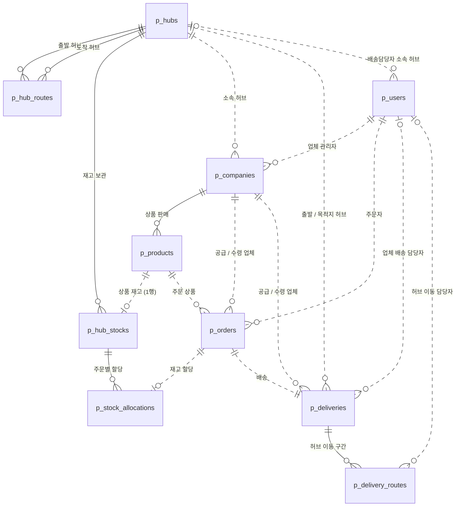
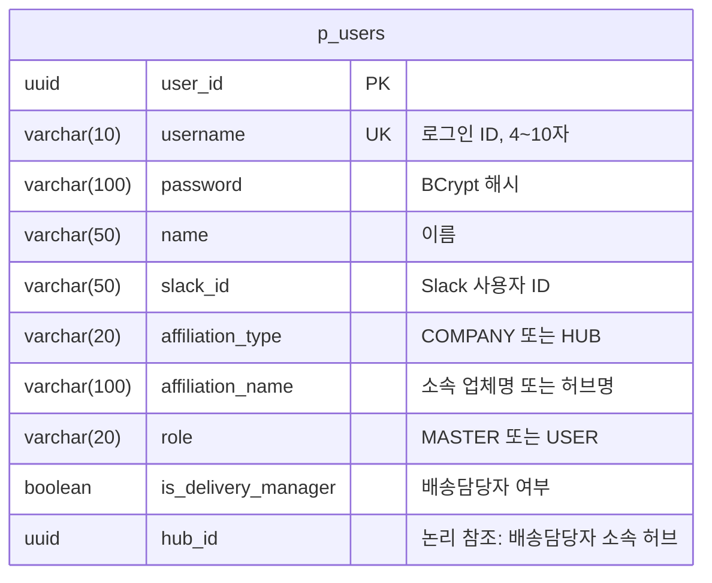
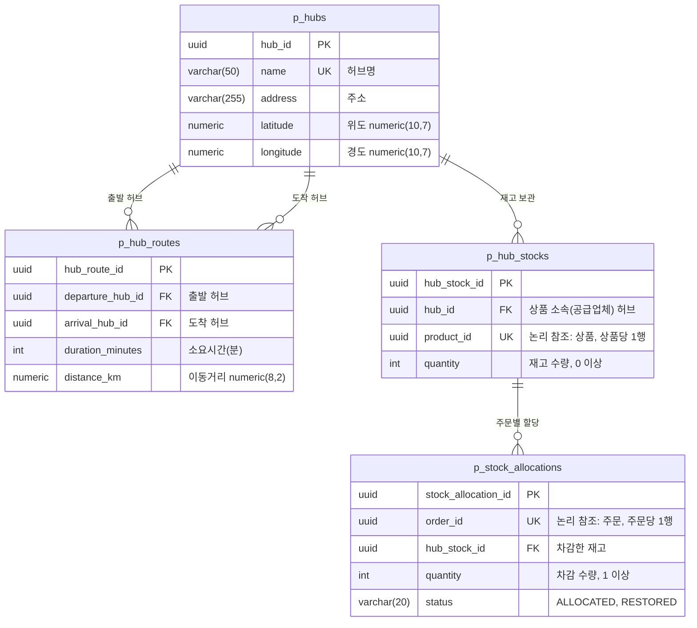
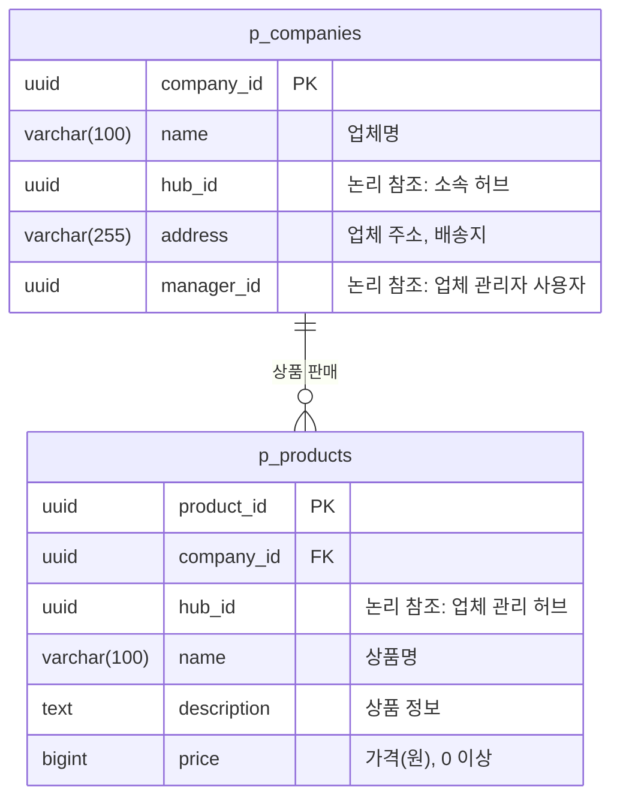
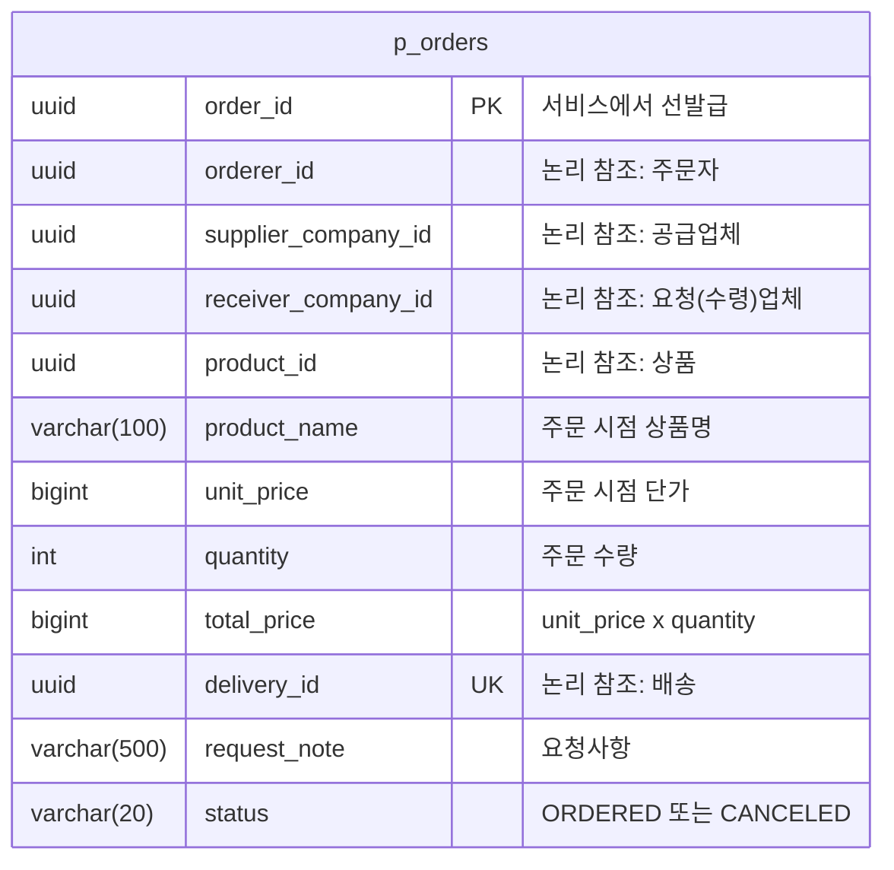
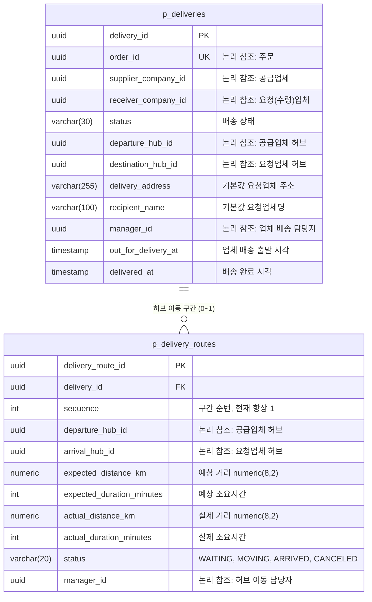

# 02. ERD

> 근거: [SA문서 §3 ERD DIAGRAM](reference/SA문서.md) · 컬럼 길이: 루트 `CLAUDE.md` §11 (임의 지정, 필요 시 조정)

## 공통 규칙

- 모든 PK는 **UUID**, 테이블명은 **`p_` 접두사**.
- **서비스 간 FK 금지.** 다른 서비스 데이터는 UUID 논리 참조만 하고, 존재 여부는 Feign 호출로 검증한다. 다른 스키마 직접 조회·조인 금지.
- Audit 컬럼은 `BaseEntity`로 모든 테이블에 공통 적용되므로 아래 ERD에는 표기하지 않는다.

  | 컬럼 | 타입 | 설명 |
  | --- | --- | --- |
  | `created_at` / `created_by` | `timestamp` / `uuid` | 생성 시각 / 생성자 (`X-User-Id`) |
  | `updated_at` / `updated_by` | `timestamp` / `uuid` | 수정 시각 / 수정자 |
  | `deleted_at` / `deleted_by` | `timestamp` / `uuid` | 논리 삭제 시각 / 삭제자 (null이면 활성) |

- 삭제는 전부 **논리 삭제**(`deleted_at`, `deleted_by`). 논리 삭제된 행은 조회되지 않는다(`@SQLRestriction("deleted_at IS NULL")`).
- 유니크 제약은 **`WHERE deleted_at IS NULL` 부분 인덱스**로 만든다 (각 서비스 `src/main/resources/db/indexes.sql`).
- 재고 변경 이력 `p_hub_stock_histories`는 **확장 기능으로 제외**. 할당·복원의 멱등성과 복원 근거는 `p_stock_allocations`가 담당한다.

## 전체 ERD (서비스 간 관계)

실선: 같은 스키마 안의 물리 FK / 점선: 서비스 간 UUID 논리 참조 (FK 없음, Feign 호출로 검증)



## 테이블 목록

| 스키마 | 테이블 | 설명 | 주요 제약 |
| --- | --- | --- | --- |
| `user_schema` | `p_users` | 사용자 (권한, 배송담당자 여부·소속 허브 포함) | `username` UNIQUE |
| `hub_schema` | `p_hubs` | 허브 17개 (초기 데이터, 조회 전용) | `name` UNIQUE |
| `hub_schema` | `p_hub_routes` | 허브 간 이동 경로 P2P 272건 (초기 데이터) | (출발, 도착) UNIQUE |
| `hub_schema` | `p_hub_stocks` | 상품 재고 (상품 소속 허브에만 존재, 상품당 1행) | `product_id` UNIQUE, 수량 ≥ 0 |
| `hub_schema` | `p_stock_allocations` | 주문별 재고 할당 내역 (할당·복원의 멱등성 키이자 복원 근거) | `order_id` UNIQUE, 수량 ≥ 1 |
| `company_schema` | `p_companies` | 업체 (공급·수령 구분 없음, 허브 1곳 소속) | - |
| `company_schema` | `p_products` | 상품 (업체 하위 리소스) | 가격 ≥ 0 |
| `order_schema` | `p_orders` | 주문 (한 번에 한 품목, 상품명·단가 스냅샷, 주문 금액) | `delivery_id` UNIQUE, 수량 ≥ 1, 금액 ≥ 0 |
| `delivery_schema` | `p_deliveries` | 업체 간 배송 (주문 1건 = 배송 1건) | `order_id` UNIQUE |
| `delivery_schema` | `p_delivery_routes` | 허브 이동 구간 (배송당 0~1건, 같은 허브면 없음) | (`delivery_id`, `sequence`) UNIQUE |

## 인덱스와 제약 작성 규칙

현재 스키마는 `ddl-auto: update`로 Hibernate가 만든다. JPA 어노테이션으로 만들 수 없는 제약은 각 서비스 `src/main/resources/db/indexes.sql`에 둔다 (COMMON-002).

| 제약 | 작성 위치 | 방법 |
| --- | --- | --- |
| PK(UUID) | 엔티티 | `@Id @GeneratedValue(strategy = GenerationType.UUID)`. **`p_orders`만 서비스에서 선발급** |
| 같은 스키마 FK | 엔티티 | `@ManyToOne(fetch = LAZY)` + `@JoinColumn` |
| 다른 서비스 참조 | 엔티티 | FK 없이 `UUID` 컬럼만 (`private UUID hubId;`) |
| NOT NULL·길이 | 엔티티 | `@Column(nullable = false, length = ...)` — 길이는 아래 명세(§11) 기준 |
| **유니크** | `db/indexes.sql` | `CREATE UNIQUE INDEX IF NOT EXISTS uk_{테이블}_{컬럼} ON {테이블} (...) WHERE deleted_at IS NULL;` — `@Column(unique = true)`·`@UniqueConstraint`는 쓰지 않는다 (논리 삭제 행까지 중복으로 막힘) |
| 논리 삭제 필터 | 엔티티 | `@SQLRestriction("deleted_at IS NULL")` — 엔티티마다 직접 선언 |

`indexes.sql`을 실행하려면 서비스 yml에 아래 설정이 필요하다 (user-service와 동일).

```yaml
spring:
  jpa:
    defer-datasource-initialization: true   # Hibernate DDL 이후 실행
  sql:
    init:
      mode: always
      data-locations: classpath:db/indexes.sql
```

서비스별로 만들어야 할 부분 유니크 인덱스 (아래 테이블 명세의 UNIQUE 기준):

| 서비스 | 인덱스 | 상태 |
| --- | --- | --- |
| user | `uk_p_users_username` ON `p_users (username)` | 완료 |
| hub | `p_hubs (name)`, `p_hub_routes (departure_hub_id, arrival_hub_id)`, `p_hub_stocks (product_id)`, `p_stock_allocations (order_id)` | 담당자 |
| order | `p_orders (delivery_id)` | 담당자 |
| delivery | `p_deliveries (order_id)`, `p_delivery_routes (delivery_id, sequence)` | 담당자 |

> 부분 인덱스이므로 논리 삭제된 행의 값은 재사용할 수 있다 (예: 탈퇴한 username 재가입). 멱등성 키(`order_id`)의 경우, 논리 삭제된 배송이 있는 orderId로 I-09가 다시 오면 새 행이 생긴다는 점에 유의한다.

### Audit 컬럼 채우는 방식 (`BaseEntity`)

| 컬럼 | 채우는 주체 |
| --- | --- |
| `created_at`, `updated_at` | JPA Auditing 자동 (`@CreatedDate`, `@LastModifiedDate`) |
| `created_by`, `updated_by` | JPA Auditing 자동. `HeaderAuditorAware`가 현재 요청의 `X-User-Id` 헤더를 읽음 |
| `deleted_at`, `deleted_by` | 서비스 코드에서 `entity.softDelete(user.userId())` 호출 |

- `X-User-Id`가 없는 요청(회원가입, 기동 시 MASTER 생성, `@Async` 작업, 시드 데이터)은 `created_by`가 **null**이다. 그래서 `created_by`·`updated_by`는 nullable이다.
- 내부 API 호출도 `FeignHeaderInterceptor`가 `X-User-*`를 전파하므로, 주문 생성 중 hub·delivery에 생기는 행의 `created_by`는 주문자 userId다.
- 하위 엔티티까지 논리 삭제할 때(업체 → 상품, 배송 → 경로)는 각각 `softDelete`를 호출해야 한다. JPA cascade는 논리 삭제에 적용되지 않는다.

---

> 아래 테이블 명세의 Null 여부는 SA 문서에 명시되지 않아 업무 흐름(생성 시점에 값이 있는지)을 기준으로 정리한 것이다. 구현 시 각 서비스 담당자가 확정하고, 다르면 이 문서를 고친다.

---

## user-service (`user_schema`)



**`p_users`**

| 컬럼 | 타입 | Null | 제약 | 설명 |
| --- | --- | --- | --- | --- |
| `user_id` | `uuid` | N | PK | |
| `username` | `varchar(10)` | N | UNIQUE (부분 인덱스) | 로그인 ID, 4~10자 |
| `password` | `varchar(100)` | N | | BCrypt 해시(60자) + 여유 |
| `name` | `varchar(50)` | | | 이름 |
| `slack_id` | `varchar(50)` | | | Slack 사용자 ID |
| `affiliation_type` | `varchar(20)` | | | `COMPANY` / `HUB` |
| `affiliation_name` | `varchar(100)` | | | 소속 업체명 또는 허브명 |
| `role` | `varchar(20)` | N | | `MASTER` / `USER` (가입 시 항상 `USER`) |
| `is_delivery_manager` | `boolean` | N | | 배송담당자 여부 (기본 false) |
| `hub_id` | `uuid` | | 논리 참조 → `p_hubs` | 배송담당자 소속 허브 (배송담당자 지정 시 필수) |

## hub-service (`hub_schema`)



**`p_hubs`** — 초기 데이터 17건, 조회 전용

| 컬럼 | 타입 | Null | 제약 | 설명 |
| --- | --- | --- | --- | --- |
| `hub_id` | `uuid` | N | PK | |
| `name` | `varchar(50)` | N | UNIQUE | 허브명 |
| `address` | `varchar(255)` | N | | 주소 |
| `latitude` | `numeric(10,7)` | N | | 위도 |
| `longitude` | `numeric(10,7)` | N | | 경도 |

**`p_hub_routes`** — 초기 데이터 272건 (17 × 16, P2P)

| 컬럼 | 타입 | Null | 제약 | 설명 |
| --- | --- | --- | --- | --- |
| `hub_route_id` | `uuid` | N | PK | |
| `departure_hub_id` | `uuid` | N | FK → `p_hubs`, UNIQUE(출발, 도착) | 출발 허브 |
| `arrival_hub_id` | `uuid` | N | FK → `p_hubs` | 도착 허브 |
| `duration_minutes` | `int` | N | | 소요시간(분) |
| `distance_km` | `numeric(8,2)` | N | | 이동거리(km) |

**`p_hub_stocks`**

| 컬럼 | 타입 | Null | 제약 | 설명 |
| --- | --- | --- | --- | --- |
| `hub_stock_id` | `uuid` | N | PK | |
| `hub_id` | `uuid` | N | FK → `p_hubs` | 상품 소속(공급업체) 허브 |
| `product_id` | `uuid` | N | UNIQUE, 논리 참조 → `p_products` | 상품당 1행 |
| `quantity` | `int` | N | CHECK ≥ 0 | 재고 수량 |

**`p_stock_allocations`**

| 컬럼 | 타입 | Null | 제약 | 설명 |
| --- | --- | --- | --- | --- |
| `stock_allocation_id` | `uuid` | N | PK | |
| `order_id` | `uuid` | N | UNIQUE, 논리 참조 → `p_orders` | 주문당 1행 (멱등성 키) |
| `hub_stock_id` | `uuid` | N | FK → `p_hub_stocks` | 차감한 재고 |
| `quantity` | `int` | N | CHECK ≥ 1 | 차감 수량 |
| `status` | `varchar(20)` | N | | `ALLOCATED` / `RESTORED` |

> 할당(I-05)·복원(I-06) 시 락 순서는 항상 **재고 행 → 할당 내역**이다. 순서를 바꾸면 교착 위험 (CLAUDE.md §4).

## company-service (`company_schema`)



**`p_companies`**

| 컬럼 | 타입 | Null | 제약 | 설명 |
| --- | --- | --- | --- | --- |
| `company_id` | `uuid` | N | PK | |
| `name` | `varchar(100)` | N | | 업체명 |
| `hub_id` | `uuid` | N | 논리 참조 → `p_hubs` | 소속(관리) 허브. 상품이 있으면 변경 불가 (409 `HUB_CHANGE_NOT_ALLOWED`) |
| `address` | `varchar(255)` | N | | 업체 주소 (배송지 기본값) |
| `manager_id` | `uuid` | N | 논리 참조 → `p_users` | 업체 관리자 |

**`p_products`**

| 컬럼 | 타입 | Null | 제약 | 설명 |
| --- | --- | --- | --- | --- |
| `product_id` | `uuid` | N | PK | |
| `company_id` | `uuid` | N | FK → `p_companies` | 공급업체 |
| `hub_id` | `uuid` | N | 논리 참조 → `p_hubs` | 업체 관리 허브 (재고가 존재하는 허브) |
| `name` | `varchar(100)` | N | | 상품명 |
| `description` | `text` | | | 상품 정보 |
| `price` | `bigint` | N | CHECK ≥ 0 | 가격(원) |

## order-service (`order_schema`)



**`p_orders`**

| 컬럼 | 타입 | Null | 제약 | 설명 |
| --- | --- | --- | --- | --- |
| `order_id` | `uuid` | N | PK | **Saga를 위해 서비스에서 선발급** (`@GeneratedValue` 미사용) |
| `orderer_id` | `uuid` | N | 논리 참조 → `p_users` | 주문자 |
| `supplier_company_id` | `uuid` | N | 논리 참조 → `p_companies` | 공급업체 |
| `receiver_company_id` | `uuid` | N | 논리 참조 → `p_companies` | 요청(수령)업체 |
| `product_id` | `uuid` | N | 논리 참조 → `p_products` | 상품 (한 번에 한 품목) |
| `product_name` | `varchar(100)` | N | | 주문 시점 상품명 스냅샷 |
| `unit_price` | `bigint` | N | | 주문 시점 단가 스냅샷 |
| `quantity` | `int` | N | CHECK ≥ 1 | 주문 수량 (주문 후 변경 불가) |
| `total_price` | `bigint` | N | CHECK ≥ 0 | 서버가 `unit_price × quantity` 계산 (`Math.multiplyExact`, 오버플로 시 400 `INVALID_REQUEST`) |
| `delivery_id` | `uuid` | N | UNIQUE, 논리 참조 → `p_deliveries` | 배송 (주문 1건 = 배송 1건, 배송 생성 후 주문 저장) |
| `request_note` | `varchar(500)` | | | 요청사항 (O-04로 수정 가능) |
| `status` | `varchar(20)` | N | | `ORDERED` / `CANCELED` |

## delivery-service (`delivery_schema`)



**`p_deliveries`**

| 컬럼 | 타입 | Null | 제약 | 설명 |
| --- | --- | --- | --- | --- |
| `delivery_id` | `uuid` | N | PK | |
| `order_id` | `uuid` | N | UNIQUE, 논리 참조 → `p_orders` | 멱등성 키 (같은 orderId면 기존 배송 반환) |
| `supplier_company_id` | `uuid` | N | 논리 참조 → `p_companies` | 공급업체 |
| `receiver_company_id` | `uuid` | N | 논리 참조 → `p_companies` | 요청(수령)업체 |
| `status` | `varchar(30)` | N | | `HUB_WAITING` / `HUB_MOVING` / `DEST_HUB_ARRIVED` / `OUT_FOR_DELIVERY` / `DELIVERED` / `CANCELED` |
| `departure_hub_id` | `uuid` | N | 논리 참조 → `p_hubs` | 출발 허브 (공급업체 허브) |
| `destination_hub_id` | `uuid` | N | 논리 참조 → `p_hubs` | 목적지 허브 (요청업체 허브) |
| `delivery_address` | `varchar(255)` | N | | 배송지, 기본값 요청업체 주소 (D-03 수정) |
| `recipient_name` | `varchar(100)` | N | | 수령인, 기본값 요청업체명 (D-03 수정) |
| `manager_id` | `uuid` | | 논리 참조 → `p_users` | 업체 배송 담당자 (목적지 허브 소속, D-04) |
| `out_for_delivery_at` | `timestamp` | | | 업체 배송 출발 시각 |
| `delivered_at` | `timestamp` | | | 배송 완료 시각 |

**`p_delivery_routes`** — 허브 이동 구간, 배송당 0~1행 (같은 허브면 0행)

| 컬럼 | 타입 | Null | 제약 | 설명 |
| --- | --- | --- | --- | --- |
| `delivery_route_id` | `uuid` | N | PK | |
| `delivery_id` | `uuid` | N | FK → `p_deliveries` | |
| `sequence` | `int` | N | UNIQUE(`delivery_id`, `sequence`) | 구간 순번 (현재 항상 1, 중계 허브 확장 대비) |
| `departure_hub_id` | `uuid` | N | 논리 참조 → `p_hubs` | 공급업체 허브 |
| `arrival_hub_id` | `uuid` | N | 논리 참조 → `p_hubs` | 요청업체 허브 |
| `expected_distance_km` | `numeric(8,2)` | N | | 예상 거리 (I-03 경로 조회 결과) |
| `expected_duration_minutes` | `int` | N | | 예상 소요시간 |
| `actual_distance_km` | `numeric(8,2)` | | | 실제 거리 (D-07 `ARRIVED` 시 입력) |
| `actual_duration_minutes` | `int` | | | 실제 소요시간 |
| `status` | `varchar(20)` | N | | `WAITING` / `MOVING` / `ARRIVED` / `CANCELED` |
| `manager_id` | `uuid` | | 논리 참조 → `p_users` | 허브 이동 담당자 (공급업체 허브 소속, D-06) |
