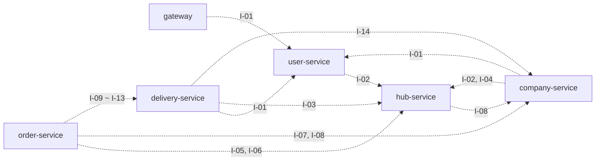

# 03. API 명세

> 근거: [SA문서 §2 API](reference/SA문서.md) · 구현 컨벤션: 루트 `CLAUDE.md` §6, §8-1

## 공통 규약

| 항목 | 규칙 |
| --- | --- |
| Base URL | `http://localhost:8080` (모든 외부 요청은 Gateway 경유) |
| 외부 경로 | `/api/v1/**` |
| 내부 경로 | `/internal/**` — 서비스 간 Feign 전용, **Gateway에서 라우팅하지 않음(외부 차단)** |
| 인증 | 회원가입·로그인 외 모든 API는 `Authorization: Bearer {accessToken}` (Gateway 공개 경로는 `/api/v1/auth/signup`, `/api/v1/auth/login`과 Swagger 문서 경로뿐) |
| 사용자 전달 | Gateway가 JWT 검증 후 `X-User-Id`, `X-Username`, `X-User-Role`, `X-Delivery-Manager` 헤더 주입 (클라이언트가 보낸 동명 헤더는 제거). 값은 토큰이 아니라 I-01로 조회한 DB 기준 |
| 사용자 식별 | 컨트롤러에서 `@CurrentUser UserContext user`, MASTER 전용은 `@MasterOnly` (아니면 403) |
| 페이징 | `page`(0부터), `size`(10/30/50만 허용, 그 외 10), `sort`(기본 `createdAt,DESC`) |
| 논리 삭제 | 삭제된 데이터는 조회되지 않음 |

### 응답 형식

외부 API는 `ApiResponse`로 감싸고, **내부 API는 DTO를 래퍼 없이 그대로 반환**한다.

| 구분 | 필드 |
| --- | --- |
| 성공 | `status`, `message`, `data` |
| 목록 | `data`에 `PageResponse` (`PageResponse.from(page, mapper)`) |
| 에러 | `status`, `code`, `message`, `path`, `timestamp` |

세부 필드 표기는 `common` 모듈의 `ApiResponse`, `PageResponse`, `ErrorResponse` 구현을 따른다. 실제 형식은 다음과 같다.

**성공 (단건)** — `ApiResponse.ok(data)` 200 / `ApiResponse.created(data)` 201 / 데이터 없으면 `ApiResponse.ok()`(`data: null`)

```json
{
  "status": 201,
  "message": "생성되었습니다.",
  "data": { "userId": "3f2c...", "username": "user01", "role": "USER", "isDeliveryManager": false }
}
```

> 기본 메시지: `ok` → `"요청이 성공했습니다."`, `created` → `"생성되었습니다."`. 다른 문구가 필요하면 `ApiResponse.ok(message, data)`.
> `created`를 쓸 때는 컨트롤러에 `@ResponseStatus(HttpStatus.CREATED)`도 붙여야 HTTP 상태가 201이 된다 (본문의 `status`만으로는 바뀌지 않음).

**성공 (목록)** — `data`에 `PageResponse` (Spring `Page`를 그대로 직렬화하지 않음)

```json
{
  "status": 200,
  "message": "요청이 성공했습니다.",
  "data": {
    "content": [ { "hubId": "...", "name": "서울특별시 센터" } ],
    "page": 0,
    "size": 10,
    "totalElements": 17,
    "totalPages": 2,
    "last": false
  }
}
```

**에러** — 비즈니스 서비스(`GlobalExceptionHandler`)와 Gateway(`GatewayErrorWriter`)가 같은 형식. 내부 API도 같은 형식이라 `FeignErrorDecoder`가 `code`를 읽어 그대로 전파한다.

```json
{
  "status": 409,
  "code": "STOCK_INSUFFICIENT",
  "message": "재고가 부족합니다.",
  "path": "/api/v1/orders",
  "timestamp": "2026-10-13T15:30:00.123"
}
```

> `VALIDATION_ERROR`의 `message`는 Bean Validation 실패 시 `"필드명: 메시지"` 형식이다 (예: `"username: 크기가 4에서 10 사이여야 합니다"`). `timestamp`는 타임존 없는 `LocalDateTime`.

**JSON 필드 이름 규칙**: camelCase. boolean은 `is` 접두사를 붙인 이름 그대로 노출한다 (`isDeliveryManager`). Java record 컴포넌트 이름이 곧 JSON 필드 이름이다.

### JWT

| 항목 | 값 |
| --- | --- |
| 알고리즘 | HS256, 키는 `JWT_SECRET` (Base64, 32바이트 이상) |
| Claims | `sub` = userId(UUID), `username`, `role`(MASTER/USER), `iat`, `exp` |
| 만료 | `JWT_EXPIRATION_MS` (기본 60분) |
| 권한 재확인 | Gateway가 I-01로 사용자 존재·권한 확인, userId 기준 **60초 캐시** (탈퇴 → 401, 권한 불일치 → 401 `TOKEN_ROLE_MISMATCH`, user-service 장애 → 503) |

---

## 외부 API

### 사용자 (user-service)

| ID | Method | URL | 설명 | 권한 | Request | Response |
| --- | --- | --- | --- | --- | --- | --- |
| U-01 | POST | `/api/v1/auth/signup` | 회원가입 (권한은 항상 USER) | Public | Body: username(4~10자), password, name, slackId, affiliationType, affiliationName | 201 userId, username, role, isDeliveryManager |
| U-02 | POST | `/api/v1/auth/login` | 로그인 (JWT 발급) | Public | Body: username, password | 200 accessToken, tokenType, expiresIn |
| U-03 | GET | `/api/v1/users/me` | 내 정보 조회 | 로그인 | - | 200 UserResponse |
| U-04 | GET | `/api/v1/users/{userId}` | 사용자 단건 조회 | 본인, MASTER | Path: userId | 200 UserResponse |
| U-05 | GET | `/api/v1/users` | 사용자 검색 | MASTER | Query: username, name, role, isDeliveryManager, hubId + 페이징 | 200 UserResponse 목록 |
| U-06 | PATCH | `/api/v1/users/{userId}` | 사용자 정보 수정 | MASTER | Body(선택): name, slackId, affiliationType, affiliationName | 200 UserResponse |
| U-07 | PATCH | `/api/v1/users/{userId}/role` | 권한·배송담당자 지정 | MASTER | Body(선택): role, isDeliveryManager, hubId(배송담당자 지정 시 필수) | 200 UserResponse |
| U-08 | DELETE | `/api/v1/users/{userId}` | 사용자 비활성화 (논리 삭제) | MASTER | Path: userId | 200 |

> 구현 현황 (2026-10-13): U-01, U-02, U-03, U-08, I-01 구현 완료 (공통 인프라 단계). U-08 선구현은 USER-003에서 리뷰 확인 중.
>
> | 필드 | 실제 구현 |
> | --- | --- |
> | U-01 요청 검증 | `username` 필수·4~10자, `password` 필수, `name` 필수·50자 이하, `slackId` 50자 이하, `affiliationType` `COMPANY`/`HUB`, `affiliationName` 100자 이하. 그 외 형식 규칙은 미정(USER-002) |
> | U-02 응답 | `accessToken`, `tokenType`(`Bearer`), `expiresIn`(**초** 단위, 기본 3600) |
> | UserResponse | `userId`, `username`, `name`, `slackId`, `affiliationType`, `affiliationName`, `role`, `isDeliveryManager`, `hubId`, `createdAt` |
> | 로그인 실패 | 아이디·비밀번호 구분 없이 401 `LOGIN_FAILED` |

### 허브 (hub-service)

| ID | Method | URL | 설명 | 권한 | Request | Response |
| --- | --- | --- | --- | --- | --- | --- |
| H-01 | GET | `/api/v1/hubs` | 허브 검색 | 로그인 | Query: keyword + 페이징 | 200 HubResponse 목록 |
| H-02 | GET | `/api/v1/hubs/{hubId}` | 허브 단건 조회 | 로그인 | Path: hubId | 200 HubResponse |
| H-03 | GET | `/api/v1/hub-routes` | 허브 간 경로 검색 | 로그인 | Query: departureHubId, arrivalHubId + 페이징 | 200 HubRouteResponse 목록 |
| H-04 | GET | `/api/v1/hub-routes/{hubRouteId}` | 허브 간 경로 단건 조회 | 로그인 | Path: hubRouteId | 200 HubRouteResponse |
| H-06 | POST | `/api/v1/hubs/{hubId}/stocks/inbound` | 재고 입고 (레코드 없으면 생성). `hubId`가 상품 소속 허브와 다르면 400 `INVALID_REQUEST` | MASTER | Body: productId, quantity | 200 hubStockId, quantity |

> H-05 허브 재고 검색은 **구현 범위에서 제외**한다 (재고는 공급업체 허브에만 존재).

### 업체·상품 (company-service)

| ID | Method | URL | 설명 | 권한 | Request | Response |
| --- | --- | --- | --- | --- | --- | --- |
| C-01 | POST | `/api/v1/companies` | 업체 생성 | 로그인 (USER는 본인이 관리자) | Body: name, hubId, address, managerId(MASTER는 필수) | 201 CompanyResponse |
| C-02 | GET | `/api/v1/companies` | 업체 검색 | 로그인 | Query: name, hubId, managerId + 페이징 | 200 CompanyResponse 목록 |
| C-03 | GET | `/api/v1/companies/{companyId}` | 업체 단건 조회 | 로그인 | Path: companyId | 200 CompanyResponse |
| C-04 | PATCH | `/api/v1/companies/{companyId}` | 업체 수정 (상품이 있는데 허브 변경 시 409 `HUB_CHANGE_NOT_ALLOWED`) | 업체 관리자, MASTER | Body(선택): name, hubId, address, managerId(MASTER만) | 200 CompanyResponse |
| C-05 | DELETE | `/api/v1/companies/{companyId}` | 업체 삭제 (상품 포함 논리 삭제) | 업체 관리자, MASTER | Path: companyId | 200 |
| P-01 | POST | `/api/v1/companies/{companyId}/products` | 상품 생성 (업체 허브에 재고 0개 생성, I-04) | 업체 관리자, MASTER | Body: name, description, price | 201 ProductResponse |
| P-02 | GET | `/api/v1/products` | 상품 검색 | 로그인 | Query: name, companyId, hubId + 페이징 | 200 ProductResponse 목록 |
| P-03 | GET | `/api/v1/companies/{companyId}/products/{productId}` | 상품 단건 조회 | 로그인 | Path: companyId, productId | 200 ProductResponse |
| P-04 | PATCH | `/api/v1/companies/{companyId}/products/{productId}` | 상품 수정 | 업체 관리자, MASTER | Body(선택): name, description, price | 200 ProductResponse |
| P-05 | DELETE | `/api/v1/companies/{companyId}/products/{productId}` | 상품 삭제 | 업체 관리자, MASTER | Path: companyId, productId | 200 |

### 주문 (order-service)

| ID | Method | URL | 설명 | 권한 | Request | Response |
| --- | --- | --- | --- | --- | --- | --- |
| O-01 | POST | `/api/v1/orders` | 주문 생성 (재고 할당 + 배송 생성 + Slack 알림, Saga는 05-시스템-구조 참고) | 요청업체 관리자, MASTER | Body: supplierCompanyId, receiverCompanyId, productId, quantity, requestNote | 201 OrderResponse (deliveryId 포함) / 409 `STOCK_INSUFFICIENT` |
| O-02 | GET | `/api/v1/orders` | 주문 검색 | 로그인 (USER는 본인 주문만) | Query: status, supplierCompanyId, receiverCompanyId, productId, startDate, endDate + 페이징 | 200 OrderResponse 목록 |
| O-03 | GET | `/api/v1/orders/{orderId}` | 주문 단건 조회 | 주문자, MASTER | Path: orderId | 200 OrderResponse |
| O-04 | PATCH | `/api/v1/orders/{orderId}` | 요청사항 수정 (수량 변경 불가) | 주문자, MASTER | Body: requestNote | 200 OrderResponse |
| O-05 | POST | `/api/v1/orders/{orderId}/cancel` | 주문 취소 (공급업체 허브 재고 복원) | 주문자, MASTER | Path: orderId | 200 orderId, status / 409 `INVALID_STATUS_TRANSITION` |
| O-06 | DELETE | `/api/v1/orders/{orderId}` | 주문 삭제 (배송 포함 논리 삭제, 취소 또는 배송 완료 주문만) | MASTER | Path: orderId | 200 / 409 `ORDER_NOT_DELETABLE` |

> `total_price`는 클라이언트가 보내지 않는다. 서버가 `unit_price × quantity`로 계산한다.

### 배송 (delivery-service)

| ID | Method | URL | 설명 | 권한 | Request | Response |
| --- | --- | --- | --- | --- | --- | --- |
| D-01 | GET | `/api/v1/deliveries` | 배송 검색 | MASTER 전체 / 배송담당자는 본인 담당만 / 업체 관리자는 공급·수령업체가 본인 업체인 배송만(I-14) | Query: status, supplierCompanyId, receiverCompanyId, departureHubId, destinationHubId, managerId, orderId + 페이징 | 200 DeliveryResponse 목록 |
| D-02 | GET | `/api/v1/deliveries/{deliveryId}` | 배송 단건 조회 (허브 이동 구간 포함) | D-01과 동일 | Path: deliveryId | 200 DeliveryResponse + 허브 이동 구간(0~1건) |
| D-03 | PATCH | `/api/v1/deliveries/{deliveryId}` | 배송지·수령인 수정 | 배송 담당자, MASTER | Body(선택): deliveryAddress, recipientName | 200 DeliveryResponse |
| D-04 | PATCH | `/api/v1/deliveries/{deliveryId}/manager` | 업체 배송 담당자 배정 (목적지 허브 소속만) | MASTER | Body: managerId | 200 DeliveryResponse / 404 `DELIVERY_MANAGER_NOT_FOUND`, 400 `MANAGER_HUB_MISMATCH` |
| D-05 | PATCH | `/api/v1/deliveries/{deliveryId}/status` | 업체 배송 상태 변경 (`OUT_FOR_DELIVERY`는 `DEST_HUB_ARRIVED` + 담당자 배정 필수) | 배송 담당자, MASTER | Body: status (`OUT_FOR_DELIVERY`, `DELIVERED`) | 200 deliveryId, status |
| D-06 | PATCH | `/api/v1/deliveries/{deliveryId}/routes/{routeId}/manager` | 허브 이동 담당자 배정 (공급업체 허브 소속만) | MASTER | Body: managerId | 200 DeliveryResponse / 404 `DELIVERY_MANAGER_NOT_FOUND`, 400 `MANAGER_HUB_MISMATCH` |
| D-07 | PATCH | `/api/v1/deliveries/{deliveryId}/routes/{routeId}/status` | 허브 이동 상태 변경 (`MOVING`은 담당자 배정 필수, 배송 상태 자동 연동) | 경로 담당자, MASTER | Body: status (`MOVING`, `ARRIVED`), actualDistanceKm, actualDurationMinutes | 200 DeliveryResponse |

> 담당자 배정(D-04, D-06)은 MASTER가 `isDeliveryManager = true`인 사용자 중에서 **수동**으로 한다. 자동 배정·배정용 내부 API는 없다.

---

## 내부 API (서비스 간 Feign 전용)

- 경로는 `/internal/**`, Gateway가 라우팅하지 않으므로 외부에서 호출할 수 없다.
- 응답은 `ApiResponse` 래퍼 없이 DTO 그대로. `X-User-*` 헤더는 `FeignHeaderInterceptor`가 자동 전파한다.
- **orderId 기준 멱등**: I-05, I-06, I-09, I-13은 같은 orderId 재요청 시 기존 결과 반환 / 대상 없으면 no-op.

| ID | 제공 | Method | URL | Request | Response | 호출자 |
| --- | --- | --- | --- | --- | --- | --- |
| I-01 | user | GET | `/internal/users/{userId}` | - | userId, username, role, isDeliveryManager, hubId, slackId (탈퇴 시 404) | gateway, company, delivery |
| I-02 | hub | GET | `/internal/hubs/{hubId}` | - | hubId, name, address | company, user |
| I-03 | hub | GET | `/internal/hub-routes?departureHubId=&arrivalHubId=` | - | hubRouteId, distanceKm, durationMinutes (P2P 단일 경로) | delivery |
| I-04 | hub | POST | `/internal/stocks` | hubId, productId | hubStockId, quantity(0). 이미 있으면 기존 값 반환 | company |
| I-05 | hub | POST | `/internal/stocks/allocate` | orderId, productId, quantity | hubId, quantity. 재고 행 `FOR UPDATE` 후 차감, `p_stock_allocations`에 `ALLOCATED` 기록. 부족 시 409. 같은 orderId면 기존 할당 반환 | order |
| I-06 | hub | POST | `/internal/stocks/restore` | orderId | restoredQuantity. 할당 내역 기준 복원 후 `RESTORED` (재고 행 → 할당 내역 순 잠금). 내역 없음·이미 복원이면 0 | order |
| I-07 | company | GET | `/internal/companies/{companyId}` | - | companyId, name, hubId, address, managerId | order |
| I-08 | company | GET | `/internal/products/{productId}` | - | productId, companyId, hubId, name, price | order, hub |
| I-09 | delivery | POST | `/internal/deliveries` | orderId, supplierCompanyId, receiverCompanyId, departureHubId, destinationHubId, deliveryAddress, recipientName | deliveryId, status. 두 허브가 다르면 I-03으로 경로 조회 후 허브 이동 구간 1건 생성. 같은 orderId면 기존 값 반환 | order |
| I-10 | delivery | GET | `/internal/deliveries/{deliveryId}` | - | deliveryId, orderId, status | order |
| I-11 | delivery | POST | `/internal/deliveries/{deliveryId}/cancel` | - | status=`CANCELED`. `HUB_WAITING` 또는 허브 이동 없이 `DEST_HUB_ARRIVED`인 경우만, 그 외 409 | order |
| I-12 | delivery | POST | `/internal/deliveries/{deliveryId}/cancel-revert` | - | 취소 전 상태로 원복 (취소 보상) | order |
| I-13 | delivery | DELETE | `/internal/deliveries/orders/{orderId}` | - | 204. 배송·경로 논리 삭제, 대상이 없어도 204 | order |
| I-14 | company | GET | `/internal/companies?managerId=` | - | 해당 사용자가 관리하는 companyId 목록 (없으면 빈 목록) | delivery |

### 내부 호출 관계



### Feign 에러 전파·타임아웃

| 상황 | 처리 |
| --- | --- |
| 하위 서비스 4xx | 코드·상태 그대로 전달 (예: hub의 409 `STOCK_INSUFFICIENT` → order 응답도 409) |
| 5xx·연결 실패·타임아웃 | 503 `SERVICE_UNAVAILABLE` |
| 재시도 | 기본 꺼짐. GET과 orderId 멱등 API만 최대 3회, 100ms부터 지수 백오프 |

타임아웃 값은 [04-인프라-구성도](04-인프라-구성도.md)의 "장애 대응과 운영 설정"을 본다.

---

## 에러 코드

| HTTP | code | 설명 |
| --- | --- | --- |
| 400 | `VALIDATION_ERROR` | 요청 값 검증 실패 |
| 400 | `INVALID_REQUEST` | 비즈니스 규칙 위반 (예: 상품이 공급업체 소속이 아님, 금액 오버플로) |
| 400 | `MANAGER_HUB_MISMATCH` | 배송담당자 소속 허브가 출발지 허브와 다름 (허브 이동: 공급업체 허브, 업체 배송: 목적지 허브) |
| 401 | `UNAUTHORIZED` | 토큰 누락, 위조, 만료 |
| 401 | `TOKEN_ROLE_MISMATCH` | 토큰의 권한과 저장된 권한이 다름 (재로그인 필요) |
| 401 | `LOGIN_FAILED` | 아이디 또는 비밀번호 불일치 |
| 403 | `FORBIDDEN` | 권한 없음 (MASTER 전용 API, 소유자 아님) |
| 404 | `{리소스}_NOT_FOUND` | 리소스가 없거나 논리 삭제됨 (예: `USER_NOT_FOUND`) |
| 404 | `DELIVERY_MANAGER_NOT_FOUND` | 배정하려는 배송담당자가 없음 (없음·탈퇴·배송담당자 아님) |
| 409 | `DUPLICATE_USERNAME` | username 중복 |
| 409 | `STOCK_INSUFFICIENT` | 공급업체 허브 재고 부족 |
| 409 | `INVALID_STATUS_TRANSITION` | 허용되지 않는 상태 변경 (예: 이미 출발한 배송의 주문 취소) |
| 409 | `HUB_CHANGE_NOT_ALLOWED` | 상품이 등록된 업체의 관리 허브 변경 |
| 409 | `ORDER_NOT_DELETABLE` | 취소 또는 배송 완료 전 주문 삭제 |
| 503 | `SERVICE_UNAVAILABLE` | 하위 서비스 호출 실패 또는 타임아웃 |

SA 표에는 없지만 `CommonErrorCode`에 구현돼 있는 코드:

| HTTP | code | 설명 |
| --- | --- | --- |
| 404 | `API_NOT_FOUND` | 존재하지 않는 경로 (서비스까지 도달한 경우) |
| 405 | `METHOD_NOT_ALLOWED` | 지원하지 않는 HTTP 메서드 |
| 500 | `INTERNAL_ERROR` | 처리되지 않은 예외. 주문 Saga의 "주문 저장 실패 → 500"도 이 코드 |

### 예외 → 에러 코드 매핑 (`GlobalExceptionHandler`)

| 예외 | 응답 |
| --- | --- |
| `BusinessException(errorCode)` | `errorCode`의 상태·코드 |
| `MethodArgumentNotValidException` (`@Valid` 본문 검증) | 400 `VALIDATION_ERROR`, 메시지 `"필드: 사유"` |
| 경로·쿼리 검증 실패, JSON 파싱 실패, 타입 불일치, 필수 파라미터 누락 | 400 `VALIDATION_ERROR` |
| `MissingRequestHeaderException` | 401 `UNAUTHORIZED` |
| `NoResourceFoundException` / `HttpRequestMethodNotSupportedException` | 404 `API_NOT_FOUND` / 405 `METHOD_NOT_ALLOWED` |
| `FeignException` (연결 실패·타임아웃 등 I/O 오류) | 503 `SERVICE_UNAVAILABLE` |
| Feign 하위 4xx (공통 에러 형식) | `FeignErrorDecoder` → `RemoteErrorCode`로 **하위 상태·코드 그대로** |
| Feign 하위 5xx 또는 본문 해석 불가 | 503 `SERVICE_UNAVAILABLE` |
| 그 외 `Exception` | 500 `INTERNAL_ERROR` (ERROR 로그) |

> 하위 4xx가 그대로 전파되므로 호출하는 쪽에서 의미를 바꿔야 할 때(예: I-01 404 `USER_NOT_FOUND`를 D-04에서 404 `DELIVERY_MANAGER_NOT_FOUND`로)는 `BusinessException`을 잡아 `getErrorCode().getCode()`로 확인한 뒤 다시 던진다.
> 서로 다른 서비스가 같은 코드명을 다른 의미로 쓰지 않도록 도메인 코드는 리소스명을 접두어로 쓰자는 제안이 COMMON-001(OPEN)에 있다.

> 공통 코드는 `common`의 `CommonErrorCode`, 도메인 코드는 서비스별 `ErrorCode` 구현 enum에 둔다 (예: `UserErrorCode.USER_NOT_FOUND`).
