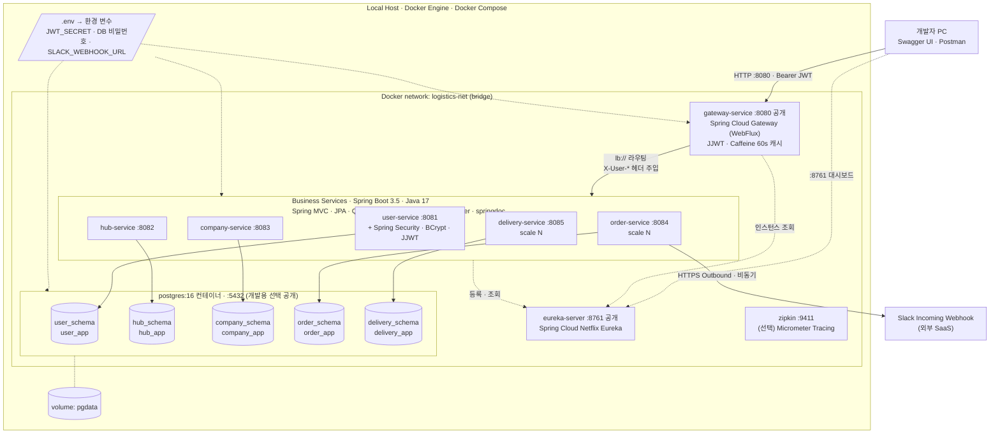
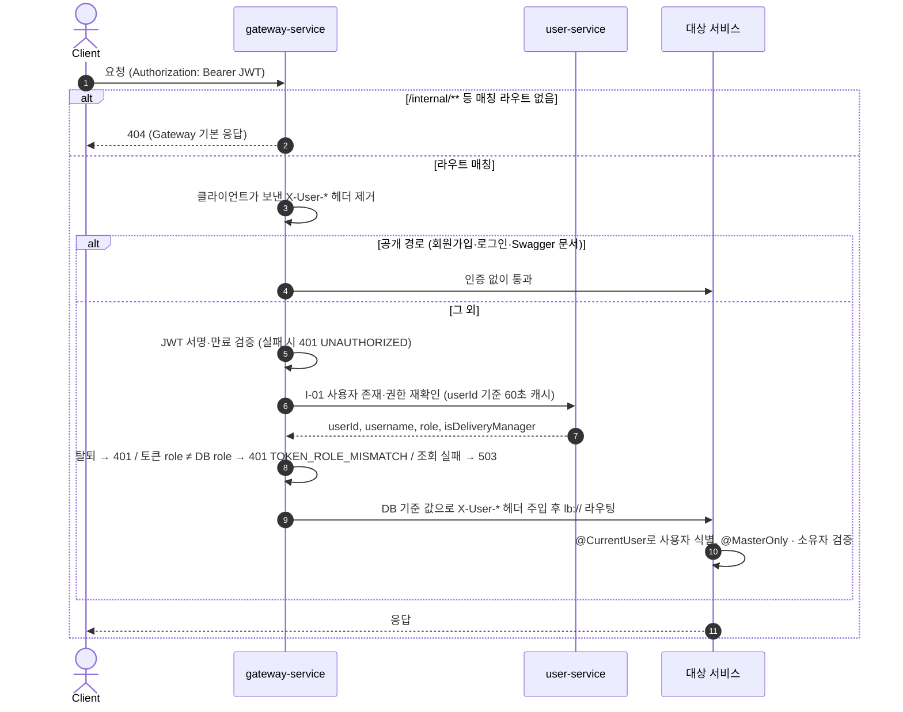

# 04. 인프라 구성도

> 근거: [SA문서 §4 인프라 설계도](reference/SA_Document.md) · 실제 설정: 루트 `docker-compose.yml`, `Dockerfile`, `infra/postgres/init.sh`, `.env.example`

서버 배포 없이 **로컬에서 모든 애플리케이션을 Docker 컨테이너로 실행**한다. 외부에는 Gateway(8080)와 Eureka 대시보드(8761)만 공개한다.

## 인프라 구성도 (기술 스택 표기)



- 실선: 요청·데이터 흐름 / 점선: 등록·조회, 설정 주입, 볼륨 연결
- 각 서비스는 **자기 스키마 전용 계정**으로만 접속한다. 다른 스키마 조회·조인은 권한상 불가능하다.

## 컨테이너 구성

| 컨테이너 | 이미지 | 내부 포트 | 호스트 공개 | depends_on | 비고 |
| --- | --- | --- | --- | --- | --- |
| postgres | `postgres:16` | 5432 | 5432 (개발용, 선택) | - | `init.sh`로 스키마·계정 생성, `pgdata` 볼륨으로 데이터 유지, healthcheck(`pg_isready`) |
| eureka-server | 빌드 (멀티 스테이지 → `eclipse-temurin:17-jre`) | 8761 | 8761 | - | 등록 현황 대시보드 |
| gateway-service | 빌드 | 8080 | **8080** | eureka | 유일한 외부 API 진입점 |
| user-service | 빌드 | 8081 | 미공개 | postgres(healthy), eureka | JWT 발급, 초기 MASTER 계정 생성 |
| hub-service | 빌드 | 8082 | 미공개 | postgres(healthy), eureka | 기동 시 허브 17개·경로 272개 시드 적재 |
| company-service | 빌드 | 8083 | 미공개 | postgres(healthy), eureka | - |
| order-service | 빌드 | 8084 | 미공개 | postgres(healthy), eureka | `SLACK_WEBHOOK_URL` 환경 변수 |
| delivery-service | 빌드 | 8085 | 미공개 | postgres(healthy), eureka | - |
| zipkin (선택) | `openzipkin/zipkin` | 9411 | 9411 | - | 분산 추적. **현재 `docker-compose.yml`에는 없음** (도입 시 추가) |

> 모든 애플리케이션 이미지는 루트의 **공용 멀티 스테이지 `Dockerfile`** 하나로 빌드한다 (`MODULE` 빌드 인자로 모듈 선택, 컨테이너 안에서 Gradle 빌드하므로 호스트에 JDK 불필요).

### Compose 구성 세부

| 항목 | 설정 | 이유 |
| --- | --- | --- |
| 비즈니스 서비스 공통 블록 | `x-business-service`(restart·network·depends_on), `x-business-env`(`DB_HOST`, `DB_PORT`, `DB_NAME=logistics`, `EUREKA_URL`) YAML 앵커 | 5개 서비스 설정 중복 제거. 새 서비스 설정은 앵커를 그대로 재사용 |
| `container_name` | postgres·eureka·gateway에만 지정 (`logistics-postgres` 등) | 비즈니스 서비스에 지정하면 `--scale`이 불가능 |
| 재시작 정책 | gateway·비즈니스 서비스 `restart: unless-stopped` | Eureka가 늦게 떠도 재시작으로 복구 |
| 빌드 캐시 | Dockerfile에서 `--mount=type=cache,target=/root/.gradle,sharing=locked` | 두 번째 빌드부터 의존성 재다운로드 없음. `locked`는 7개 이미지 동시 빌드 시 캐시 충돌 방지 |
| `.dockerignore` | `.git`, `.gradle`, `.idea`, `**/build`, `.env`, `infra`, `script` 제외 | 빌드 컨텍스트 축소, **`.env`가 이미지에 들어가지 않도록** |
| IDE 실행 지원 | 각 yml의 `spring.config.import: optional:file:.env[.properties],optional:file:../.env[.properties]` | IDE에서 실행해도 루트 `.env`를 읽음. `DB_HOST` 등은 기본값 `localhost` |

### Eureka 설정 (로컬 개발용으로 단축)

| 항목 | 값 | 기본값 | 효과 |
| --- | --- | --- | --- |
| `eureka.server.enable-self-preservation` | `false` | `true` | 컨테이너 재시작이 잦아도 죽은 인스턴스를 바로 정리 |
| `eureka.server.eviction-interval-timer-in-ms` | 5000 | 60000 | 만료 인스턴스 정리 주기 |
| `eureka.instance.lease-renewal-interval-in-seconds` | 5 | 30 | 하트비트 주기 |
| `eureka.instance.lease-expiration-duration-in-seconds` | 15 | 90 | 하트비트가 없으면 15초 후 만료 |
| `eureka.client.registry-fetch-interval-seconds` | 5 | 30 | 클라이언트(Gateway·서비스)의 목록 갱신 주기 |
| `spring.cloud.loadbalancer.cache.ttl` | 5s | 35s | LoadBalancer 인스턴스 캐시 |
| `eureka.instance.instance-id` | `${spring.application.name}:${random.uuid}` | 호스트명 기반 | 같은 서비스의 여러 인스턴스 구분 |
| `eureka.instance.prefer-ip-address` | `true` | `false` | 컨테이너 IP로 등록 |

> 운영 환경이라면 self-preservation을 켜고 기본 주기로 되돌린다. 이 값들은 로컬에서 재기동·스케일 결과를 빨리 보기 위한 설정이다.

## 요청 처리 흐름 (Gateway)



### 인증 필터 세부 동작 (`AuthenticationFilter`, order -1)

| 항목 | 실제 동작 |
| --- | --- |
| 공개 경로 | `/api/v1/auth/signup`, `/api/v1/auth/login`, `/docs/**`, `/swagger-ui.html`, `/swagger-ui/**`, `/v3/api-docs/**`, `/webjars/**` (`PUBLIC_PATHS`). `/api/v1/auth/**` 전체가 아니므로 새 공개 API가 생기면 목록에 추가해야 한다 |
| `/internal/**` 차단 | 1차: 라우트가 없어 Gateway 기본 404 (공통 에러 형식 아님, GATEWAY-001에서 현행 유지 결정). 2차: 실수로 라우트가 생겨도 필터가 403 `FORBIDDEN` |
| 헤더 위조 방지 | 공개 경로 포함 **모든 요청**에서 클라이언트의 `X-User-*` 헤더를 먼저 제거 |
| 주입 값 | 토큰이 아니라 **I-01 응답(DB 기준)** 값. `X-User-Id`(UUID), `X-Username`, `X-User-Role`(`MASTER`/`USER`), `X-Delivery-Manager`(`true`/`false`) |
| 권한 재확인 캐시 | Caffeine, userId 기준 60초, 최대 10,000건. **조회 성공한 사용자만** 캐시(없는 사용자는 캐시 안 함). I-01 호출 타임아웃 3초 |
| 에러 응답 | 비즈니스 서비스와 같은 형식 `{status, code, message, path, timestamp}` (`GatewayErrorWriter`) |

| 상황 | 응답 |
| --- | --- |
| 토큰 없음·`Bearer ` 접두사 없음·서명 위조·만료 | 401 `UNAUTHORIZED` |
| 토큰은 유효하지만 사용자가 없거나 탈퇴(I-01 404) | 401 `UNAUTHORIZED` |
| 토큰의 role ≠ DB role (권한 변경 후 옛 토큰) | 401 `TOKEN_ROLE_MISMATCH` |
| user-service 장애·타임아웃 | 503 `SERVICE_UNAVAILABLE` |
| MASTER 전용 API를 USER가 호출 | Gateway는 통과, 서비스의 `@MasterOnly`가 403 `FORBIDDEN` |

## Gateway 라우팅 규칙

| Path | 대상 |
| --- | --- |
| `/api/v1/auth/**`, `/api/v1/users/**` | `lb://user-service` |
| `/api/v1/hubs/**`, `/api/v1/hub-routes/**` | `lb://hub-service` |
| `/api/v1/companies/**`, `/api/v1/products/**` | `lb://company-service` |
| `/api/v1/orders/**` | `lb://order-service` |
| `/api/v1/deliveries/**` | `lb://delivery-service` |
| `/docs/{service}/v3/api-docs` | 각 서비스 `/v3/api-docs` (Gateway Swagger UI에서 서비스별 조회) |
| `/internal/**` | **라우팅하지 않음** (외부 접근 차단, 서비스 간 Feign 전용) |

## 서비스 디스커버리와 수평 확장

- 모든 서비스는 기동 시 `spring.application.name`으로 Eureka에 등록한다. `instance-id`에 랜덤 값을 붙여 같은 서비스의 여러 인스턴스를 구분한다.
- Gateway 라우팅(`lb://`)과 Feign(`@FeignClient(name = "hub-service")`)은 Spring Cloud LoadBalancer가 Eureka 목록을 기반으로 라운드로빈 분산한다.
- 비즈니스 서비스는 호스트 포트를 공개하지 않으므로 `docker compose up -d --scale order-service=2`처럼 수평 확장할 수 있다.
- 서비스는 **Stateless**다. 인증 정보는 JWT, 데이터는 DB에만 둔다.
- 로컬 개발용으로 Eureka 레지스트리 갱신 5초 + LoadBalancer 캐시 5초로 단축해 두었다 (새 인스턴스 반영까지 최대 수십 초).

## DB 분리 전략

- PostgreSQL 인스턴스 1개에 **서비스별 스키마 + 전용 계정**을 만들고, 각 계정은 자기 스키마에만 권한을 갖는다.
- 서비스 간에는 FK를 두지 않는다(UUID 논리 참조). 정합성은 Feign 검증과 Saga 보상으로 보장한다.
- 각 서비스는 `currentSchema` 또는 `hibernate.default_schema`로 자기 스키마를 지정한다.
- 운영 환경으로 확장할 때는 스키마를 서비스별 DB 인스턴스로 옮기고 읽기 복제본을 추가한다. 코드 변경 없이 DataSource 설정만 바꾸면 된다.

| 스키마 | 계정 | 비밀번호 환경 변수 | 사용 서비스 |
| --- | --- | --- | --- |
| `user_schema` | `user_app` | `USER_DB_PASSWORD` | user-service |
| `hub_schema` | `hub_app` | `HUB_DB_PASSWORD` | hub-service |
| `company_schema` | `company_app` | `COMPANY_DB_PASSWORD` | company-service |
| `order_schema` | `order_app` | `ORDER_DB_PASSWORD` | order-service |
| `delivery_schema` | `delivery_app` | `DELIVERY_DB_PASSWORD` | delivery-service |

> SA 문서의 `init.sql`은 비밀번호를 환경 변수로 받기 위해 `infra/postgres/init.sh`(셸)로 작성했다. postgres 컨테이너 **최초 기동 시 1회** 실행된다.

`init.sh`가 서비스마다 실행하는 SQL (SA 예시의 `GRANT` 대신 스키마 소유자로 지정):

```sql
CREATE USER hub_app WITH PASSWORD '${HUB_DB_PASSWORD}';
CREATE SCHEMA IF NOT EXISTS hub_schema AUTHORIZATION hub_app;  -- hub_app이 스키마 소유자
ALTER ROLE hub_app SET search_path = hub_schema;
```

| 항목 | 내용 |
| --- | --- |
| DB 이름 | `logistics` (슈퍼유저 `postgres`, 비밀번호 `POSTGRES_PASSWORD`) |
| 스키마 지정 | JDBC URL `?currentSchema={schema}` + `hibernate.default_schema` 둘 다 설정 |
| 테이블 생성 | `ddl-auto: update` (개발용). 부분 유니크 인덱스는 각 서비스 `db/indexes.sql` ([02-ERD](02-ERD.md#인덱스와-제약-작성-규칙)) |
| 다시 초기화 | `init.sh`는 **빈 볼륨에서만** 실행된다. 비밀번호를 바꾸거나 스키마를 처음부터 다시 만들려면 `docker compose down -v`로 `pgdata` 볼륨을 지운 뒤 다시 올린다 (데이터 전부 삭제) |
| 직접 접속 | `docker exec -it logistics-postgres psql -U postgres -d logistics` 또는 호스트 `localhost:${POSTGRES_HOST_PORT}` |

## 장애 대응과 운영 설정

### Feign 타임아웃

Feign 대상은 모두 내부 서비스이며, **바깥 호출 타임아웃 > 안쪽 호출 타임아웃**을 유지한다.

| 대상 | connect | read | 비고 |
| --- | --- | --- | --- |
| 기본값(조회) | 1초 | 3초 | |
| I-05 재고 할당 (order → hub) | 1초 | 5초 | DB `lock_timeout` 3초 |
| I-09 배송 생성 (order → delivery) | 1초 | 5초 | 내부에서 I-03 호출 |
| I-03 경로 조회 (delivery → hub) | 1초 | 2초 | I-09 안쪽 호출 |
| Slack Webhook (외부, 비동기) | 2초 | 3초 | 실패해도 주문 유지 |
| Gateway 응답 타임아웃 | - | 30초 | 주문 생성 전체 흐름(재시도 포함) 최악 시간보다 길게 |

> **공통 기본값**: 각 서비스 yml의 `spring.cloud.openfeign.client.config.default`(connect 1000 / read 3000). Gateway는 `httpclient.connect-timeout: 1000`, `response-timeout: 30s`.
> I-05·I-09·I-03 개별 타임아웃과 재시도는 **호출하는 서비스 담당자**가 FeignClient를 만들 때 설정한다 (설정 방법: [06-개발-가이드](06-개발-가이드.md#feignclient-작성)).

### 기타

| 항목 | 설계 |
| --- | --- |
| 에러 변환 | `FeignErrorDecoder`가 하위 4xx는 코드·상태 그대로, 5xx·연결 실패·타임아웃은 503 `SERVICE_UNAVAILABLE`로 변환 |
| 재시도 | GET과 orderId 멱등 API(재고 할당·복원, 배송 생성·삭제)만 최대 3회 시도, 100ms부터 지수 백오프 |
| 서킷브레이커 (선택) | Resilience4j로 하위 서비스 장애 시 빠르게 실패 |
| Health check | Spring Boot Actuator `/actuator/health`. postgres는 compose healthcheck 통과 후 서비스 기동 |
| 분산 추적 (선택) | Micrometer Tracing + Zipkin, 로그에 traceId 포함 |
| 설정·비밀 정보 | JWT secret, DB 비밀번호, Slack Webhook URL은 `.env` → 환경 변수로 주입, **Git 커밋 금지** |
| API 문서 | 각 서비스 springdoc 문서를 Gateway Swagger UI(`/swagger-ui.html`)에서 서비스별로 선택해 조회 |

## 환경 변수 (`.env.example`)

| 변수 | 용도 | 사용처 |
| --- | --- | --- |
| `POSTGRES_PASSWORD`, `POSTGRES_HOST_PORT` | postgres 슈퍼유저 비밀번호, 호스트 공개 포트 | postgres |
| `USER/HUB/COMPANY/ORDER/DELIVERY_DB_PASSWORD` | 서비스별 DB 계정 비밀번호 | postgres(`init.sh`), 각 서비스 |
| `JWT_SECRET` | HS256 키 (Base64, 32바이트 이상, `openssl rand -base64 32`) | gateway, user |
| `JWT_EXPIRATION_MS` | 토큰 만료 (기본 3600000 = 60분) | user |
| `MASTER_USERNAME`, `MASTER_PASSWORD` | 초기 MASTER 계정 (없으면 생성, 비우면 생략) | user |
| `SLACK_WEBHOOK_URL` | Slack 알림 (비우면 생략) | order |

## 실행 방법

| 목적 | 명령 |
| --- | --- |
| 최초 1회 | `cp .env.example .env` 후 `JWT_SECRET` 채우기 |
| 전체 실행 | `docker compose up -d --build` (또는 `script/run.sh`) |
| 수평 확장 | `docker compose up -d --scale order-service=2` |
| 일부만 IDE 실행 | `docker compose up -d postgres eureka-server` 후 IDE에서 서비스 실행 (yml이 루트 `.env`를 자동으로 읽음) |
| 확인 | Eureka `http://localhost:8761`, Swagger `http://localhost:8080/swagger-ui.html` |
| 상태·로그 | `docker compose ps`, `docker compose logs -f user-service` |
| 한 서비스만 재빌드 | `docker compose up -d --build hub-service` |
| 중지 / 데이터까지 삭제 | `docker compose down` / `docker compose down -v` (`pgdata` 볼륨 삭제 → `init.sh` 재실행) |

- 빈 빌드 캐시에서 첫 `docker compose up -d --build`는 약 4분 걸린다 (2026-10-13 측정). 이후에는 BuildKit 캐시로 빨라진다.
- 서비스가 Eureka에 뜨고 Gateway가 인식하기까지 수십 초 걸릴 수 있다. 그 사이 Gateway 호출은 503이 날 수 있다.

## 자주 겪는 문제

| 증상 | 원인 | 해결 |
| --- | --- | --- |
| Windows Git Bash에서 한글 JSON을 `curl -d '...'`로 보내면 400 | 셸 인코딩 문제로 UTF-8이 깨짐 | UTF-8 파일로 저장 후 `--data-binary @file.json`, 또는 Swagger·Postman 사용 |
| `.env`의 DB 비밀번호를 바꿨더니 서비스가 DB 인증 실패 | `init.sh`는 최초 1회만 실행돼 계정 비밀번호가 그대로 | `docker compose down -v` 후 재기동 (데이터 삭제) |
| 기동 직후 Gateway 호출 503 | 대상 서비스가 아직 Eureka 등록·LB 캐시 반영 전 | 수십 초 대기, `http://localhost:8761`에서 등록 확인 |
| 권한을 바꿨는데 반영이 안 됨 / 탈퇴했는데 토큰이 동작 | Gateway 권한 재확인 60초 캐시 | 최대 60초 대기 (의도된 동작) |
| 권한 변경 후 401 `TOKEN_ROLE_MISMATCH` | 옛 토큰의 role이 DB와 다름 | 다시 로그인해 새 토큰 발급 |
| 외부에서 `/internal/**` 호출 시 404 | 의도된 차단 (라우트 없음) | 내부 API는 Feign으로만 호출. 단독 확인은 IDE 실행 서비스 포트로 직접 호출 |
