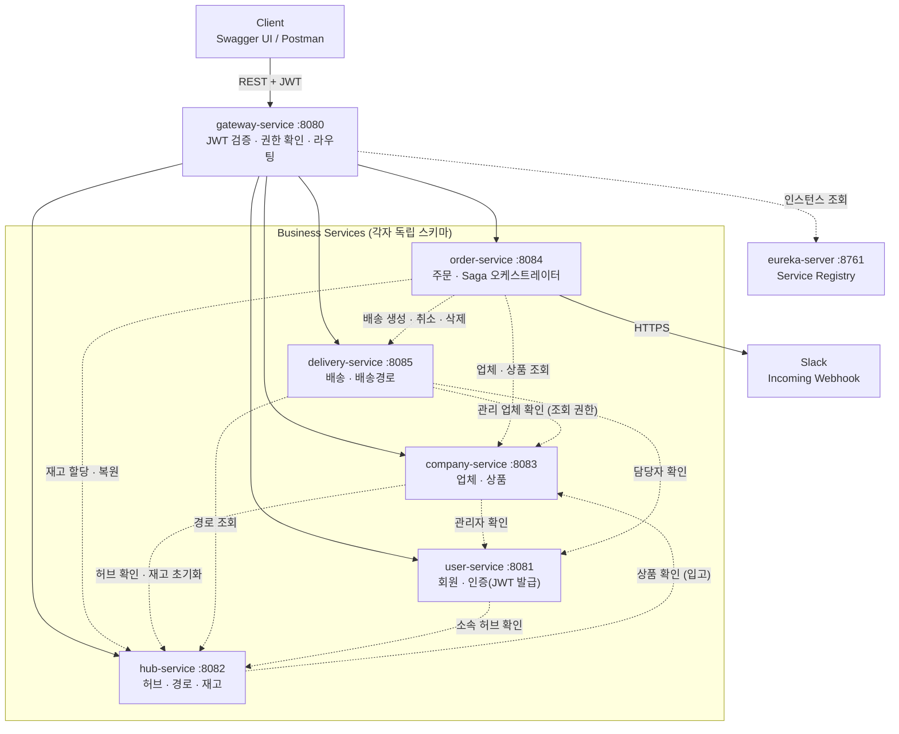
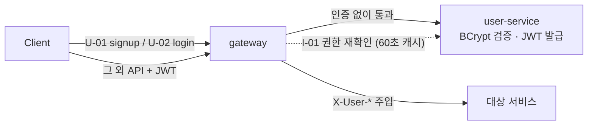
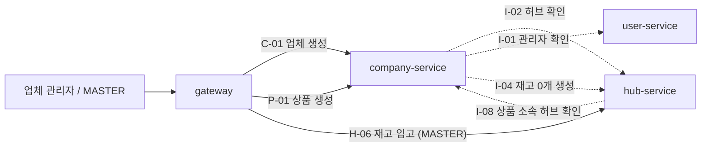
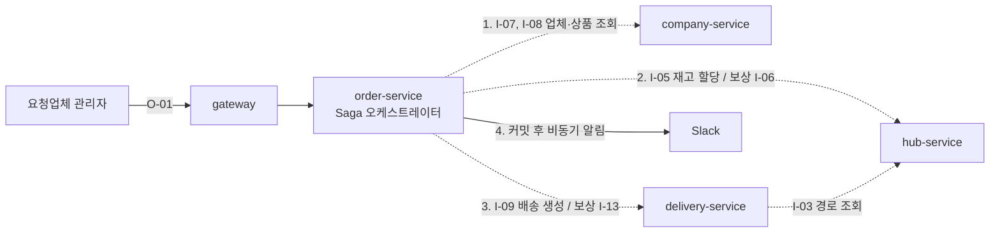
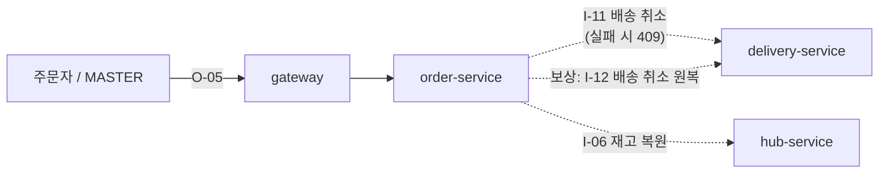
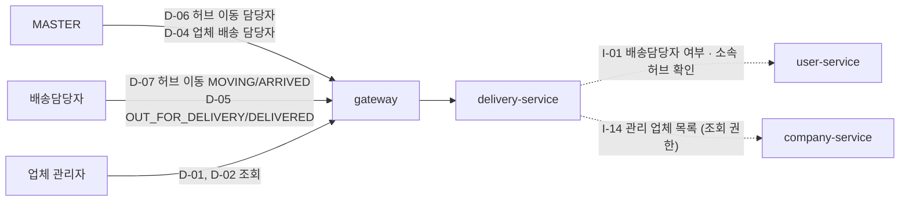
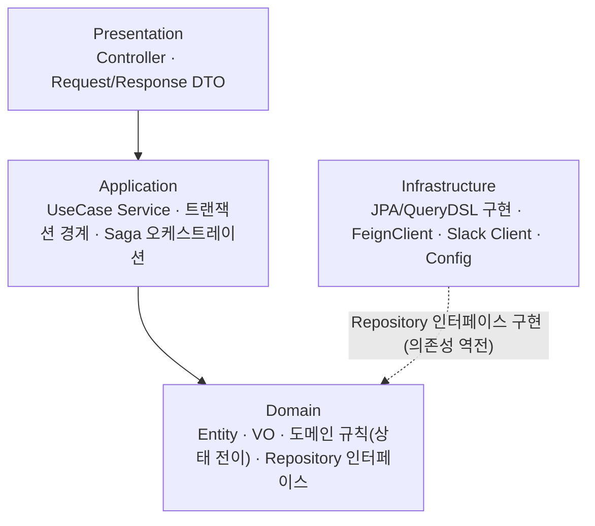
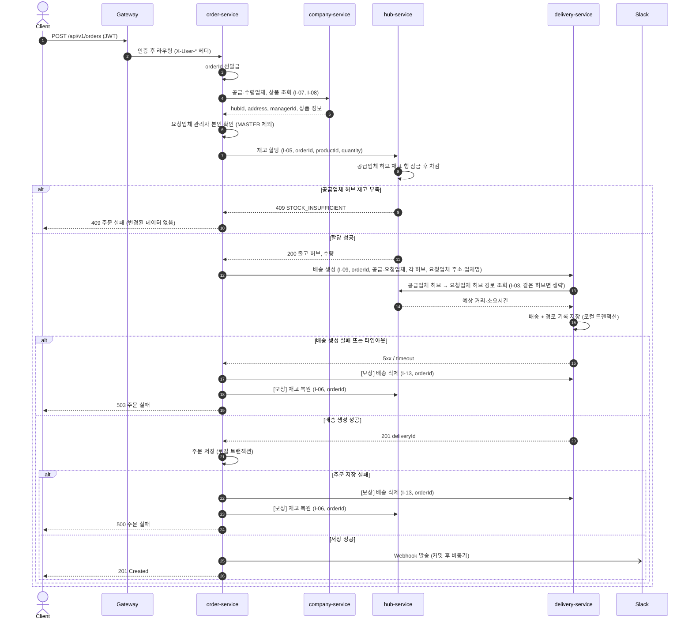
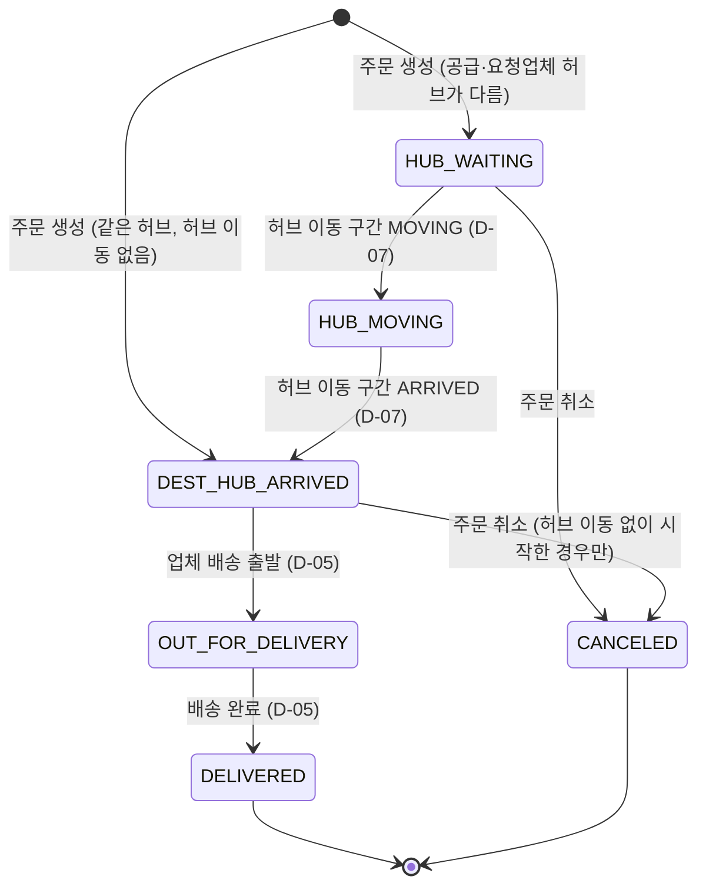
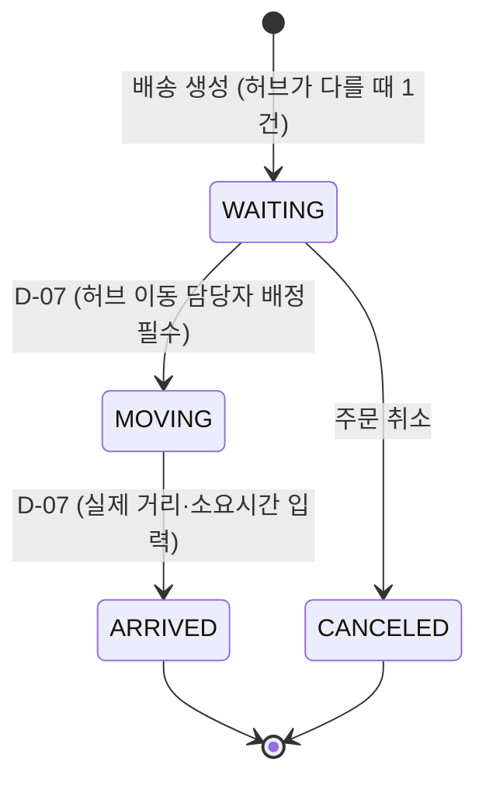

# 05. 시스템 구조

> 근거: [SA문서 §5 시스템 구조도](reference/SA문서.md) · 루트 `CLAUDE.md` §5, §7, §8

## 전체 시스템 구조도



- 실선은 Gateway를 통한 외부 요청 라우팅, 점선은 서비스 간 내부 Feign 호출이다.
- 모든 서비스는 Eureka에 등록되고, Gateway와 Feign은 `lb://서비스명`으로 대상 인스턴스를 찾는다.
- 인증·인가는 Gateway에서 처리하고, 각 서비스는 `X-User-*` 헤더로 사용자를 식별해 소유자 검증만 한다.

## 유즈케이스별 구조도

전체 그림은 화살표가 많아 흐름을 따라가기 어렵다. 유즈케이스마다 관여하는 서비스와 호출만 뽑아 본다.

### ① 회원가입·로그인·인증



### ② 업체·상품 등록, 재고 입고



### ③ 주문 생성 (Saga)



### ④ 주문 취소



> 취소 단계 순서와 보상(I-12) 시점은 SA 내부 API 구성(I-11, I-06, I-12)에서 정리한 것이다. 세부 순서는 order-service 담당자가 확정한다.

### ⑤ 배송 담당자 배정·배송 처리



## 프로젝트 구조 (Gradle 멀티 모듈)

```text
sparta-logistics/                   # Gradle 루트 (rootProject.name)
├── common/                         # 공통 라이브러리 (CommonAutoConfiguration 자동 등록)
│   └── src/main/java/com/sparta/logistics/common/
│       ├── config/                 # CommonAutoConfiguration (Auditing, QueryDSL, Swagger, 아래 빈 등록)
│       ├── context/                # UserContext, @CurrentUser, @MasterOnly, UserHeaders, UserRole
│       ├── exception/              # ErrorCode, CommonErrorCode, BusinessException, ErrorResponse,
│       │                           # RemoteErrorCode, GlobalExceptionHandler
│       ├── feign/                  # FeignHeaderInterceptor(헤더 전파), FeignErrorDecoder(에러 전파)
│       ├── jpa/                    # BaseEntity(Audit + Soft Delete), HeaderAuditorAware
│       └── response/               # ApiResponse, PageResponse, Pageables
├── eureka-server/
├── gateway-service/                # WebFlux → common 의존 안 함
│   └── .../gateway/                # auth/(AuthenticationFilter, JwtVerifier, UserClient), error/, config/
├── user-service/
├── hub-service/
├── company-service/
├── order-service/
├── delivery-service/
│   └── src/main/java/com/sparta/logistics/delivery/
│       ├── presentation/           # controller, dto(request/response)
│       ├── application/            # service, dto(command/result), 트랜잭션, Saga
│       ├── domain/                 # entity, enum, VO, repository(interface)
│       └── infrastructure/         # jpa, querydsl, client(feign), config
├── infra/postgres/init.sh          # 스키마·계정 생성 (비밀번호는 .env 환경 변수)
├── Docs/                           # 설계 문서 (이 디렉터리, 원본은 Docs/reference/)
├── Dockerfile                      # 전 모듈 공용 멀티 스테이지 (MODULE 인자)
├── .dockerignore                   # .env·build 산출물 등 빌드 컨텍스트 제외
├── docker-compose.yml
├── .env.example                    # 복사해서 .env 생성 (.env는 Git 제외)
├── CLAUDE.md                       # 구현 규칙 요약
└── script/run.sh

# 각 서비스 모듈 최상위에는 협업 로그 agent.md가 있다 (06-개발-가이드 참고)
```

## 서비스 내부 구조 (Layered Architecture)



- 의존은 Presentation → Application → Domain 방향. Infrastructure는 Domain의 Repository 인터페이스를 구현한다(의존성 역전).
- **Entity는 Controller 밖으로 노출하지 않고**, 계층마다 DTO를 분리한다.
- 상태 전이 규칙은 **Entity 메서드**에 둬서 도메인 계층에서 검증한다 (위반 시 409 `INVALID_STATUS_TRANSITION`).

---

## 주문 생성 Saga

order-service가 순서를 지휘하는 **오케스트레이션** Saga다. 동기 Feign 중심 스택이고 Kafka는 고도화 단계이며, 주문 → 재고 → 배송이 직선 흐름이기 때문이다.
내부적으로는 실패한 단계까지 **역순으로 하나씩 보상**하고, 클라이언트에는 **최종 에러 하나만** 응답한다.

순서: `orderId 선발급` → 업체·상품 조회(I-07, I-08) → 요청업체 관리자 본인 확인 → 재고 할당(I-05) → 배송 생성(I-09) → 주문 저장 → 커밋 후 Slack 비동기 발송



### 실패 지점별 처리

| 단계 | 실패 상황 | 처리 | 응답 |
| --- | --- | --- | --- |
| ① 업체·상품 조회 | 없음 / 타임아웃 | 아무것도 변경하지 않았으므로 즉시 실패 | 404 / 503 |
| ② 재고 할당 | 재고 부족 | 롤백 후 즉시 실패 | 409 |
| ② 재고 할당 | 타임아웃 (차감 여부 모름) | 재고 복원(I-06). 할당 내역이 없으면 no-op이라 안전 | 503 |
| ③ 배송 생성 | 실패 / 타임아웃 | 배송 삭제(I-13) → 재고 복원(I-06). 둘 다 orderId 기준 멱등 | 503 |
| ④ 주문 저장 | DB 오류 | 로컬 롤백 → 배송 삭제(I-13) → 재고 복원(I-06) | 500 |
| ⑤ Slack 발송 | 실패 | 주문 유지, 에러 로그만 (`@TransactionalEventListener(AFTER_COMMIT)` + `@Async`) | 201 |
| 보상 자체 실패 | 보상 API 호출 실패 | 최대 3회 재시도, 그래도 실패하면 orderId 포함 ERROR 로그 → 수동 재처리 | - |

### 재고 할당·복원 (hub-service, I-05 / I-06)

| API | 처리 순서 |
| --- | --- |
| I-05 할당 | ① 상품 재고 행 `FOR UPDATE` → ② `order_id`로 기존 할당 조회, 있으면 그대로 반환 → ③ 없으면 수량 검사(부족 시 409) 후 차감 + `ALLOCATED` 저장 |
| I-06 복원 | ① 락 없이 `order_id`로 할당 조회, 없으면 0 반환 → ② 해당 재고 행 `FOR UPDATE` → ③ `ALLOCATED`면 복원 후 `RESTORED`, 이미 복원됐으면 0 |

> 락 순서는 항상 **재고 행 → 할당 내역**. 순서를 바꾸면 교착 위험.

---

## 상태 전이

### 주문

| 상태 | 의미 | 규칙 |
| --- | --- | --- |
| `ORDERED` | 주문 완료 | 생성 시 |
| `CANCELED` | 주문 취소 | 허브 이동 시작 전 + 업체 배송 출발 전에만 가능. 취소 시 공급업체 허브 재고 복원 |

- 주문 삭제(O-06)는 MASTER만, **취소 또는 배송 완료된 주문만** 가능 (그 외 409 `ORDER_NOT_DELETABLE`).

### 배송 (업체 간 배송)

배송 구조: **공급업체 → 공급업체 허브 → (허브 이동) → 요청업체 허브 → 요청업체**



| 배송 상태 | 의미 | 변경 방식 · 전제 조건 |
| --- | --- | --- |
| `HUB_WAITING` | 공급업체 허브에서 출발 대기 | 주문 생성 시 자동 (두 허브가 다를 때) |
| `HUB_MOVING` | 허브 간 이동 중 | 허브 이동 구간을 `MOVING`으로 바꾸면 자동 (D-07). 허브 이동 담당자 배정 필수 |
| `DEST_HUB_ARRIVED` | 요청업체 허브 도착 | 허브 이동 구간을 `ARRIVED`로 바꾸면 자동 (D-07). 같은 허브면 생성 시 바로 이 상태 |
| `OUT_FOR_DELIVERY` | 요청업체로 배송 중 | D-05. `DEST_HUB_ARRIVED` + 업체 배송 담당자 배정 필수. `out_for_delivery_at` 기록 |
| `DELIVERED` | 배송 완료 | D-05. `delivered_at` 기록 |
| `CANCELED` | 주문 취소 | I-11. `HUB_WAITING`, 또는 허브 이동 구간 없이 `DEST_HUB_ARRIVED`인 경우만 |

- 허브 이동을 마치고 도착한 배송은 **취소할 수 없다.** 재고는 공급업체 허브로 복원되는데 실물은 요청업체 허브에 있어 불일치가 생기기 때문이다.
- 조건을 어기는 전이는 409 `INVALID_STATUS_TRANSITION`.

### 허브 이동 구간 (`p_delivery_routes`)



구간이 1개뿐이므로 구간 상태가 배송 상태와 1:1로 연동된다: `WAITING` ↔ `HUB_WAITING`, `MOVING` ↔ `HUB_MOVING`, `ARRIVED` ↔ `DEST_HUB_ARRIVED`, `CANCELED` ↔ `CANCELED`.

### 배송담당자 배정 규칙

| 배정 대상 | API | 담당자 소속 허브 조건 | 실패 |
| --- | --- | --- | --- |
| 허브 이동 구간 | D-06 | 출발지 = **공급업체 허브** | 담당자 없음 404 `DELIVERY_MANAGER_NOT_FOUND`, 허브 불일치 400 `MANAGER_HUB_MISMATCH` |
| 업체 배송 | D-04 | 출발지 = **목적지(요청업체) 허브** | 동일 |
