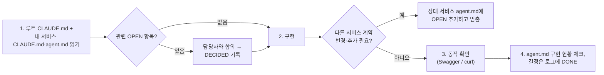

# 06. 개발 가이드

> 근거: 루트 `CLAUDE.md` §8, 공통 인프라 구현 코드(`common`, `gateway-service`, `user-service`) · 대상: 10/14부터 각 서비스를 구현하는 담당자
> 이 문서는 **공통 인프라를 어떻게 쓰는지**를 정리한 것이다. 규칙 자체는 `CLAUDE.md`가 우선한다.

## 작업 흐름



| 규칙 | 내용 |
| --- | --- |
| 다른 서비스 코드 | 수정하지 않는다. 필요하면 **요청받는 서비스의 `agent.md`** 로그에 `OPEN` |
| `common`·루트 공유 파일 | `build.gradle`, `settings.gradle`, `docker-compose.yml`, `Dockerfile`, `.env.example`, `infra/` 변경 전 `common/agent.md`에 기록 |
| 내부 API 계약 변경 | 제공하는 쪽이 자기 `agent.md`에 기록 → 호출자와 합의(`DECIDED`) 후 변경 |
| 로그 작성 | 맨 아래에만 추가, ID `{서비스}-{번호}`, 상태 `OPEN` → `DECIDED` → `DONE` |
| 브랜치 | 공통 인프라 단계 `{이름}/base-setting`. 이후 규칙은 팀 결정 |
| 문서 | 결정이 SA 문서나 `CLAUDE.md` 규칙을 바꾸면 `Docs/reference/SA문서.md` → `Docs/` 정리본 → `CLAUDE.md` 순으로 함께 고친다 |

## 서비스 모듈 구조

새 서비스는 `common` 하나만 의존하면 Web·Validation·JPA·OpenFeign·QueryDSL·Swagger·Eureka Client·PostgreSQL이 함께 들어온다 (루트 `build.gradle`이 주입). `CommonAutoConfiguration`이 자동 등록되므로 **`scanBasePackages`를 지정하지 않는다.**
Application 클래스에는 `@EnableFeignClients`가 이미 붙어 있다.

user-service의 실제 구조를 기준으로 한다.

```text
com/sparta/logistics/user/
├── UserServiceApplication.java          # @EnableFeignClients @SpringBootApplication
├── presentation/
│   ├── AuthController.java              # 외부 API: ApiResponse로 감쌈
│   ├── UserController.java
│   ├── InternalUserController.java      # /internal/** : DTO 그대로 반환
│   └── dto/                             # *Request(→ toCommand()), *Response(from(result))
├── application/
│   ├── AuthService.java, UserService.java   # 트랜잭션 경계
│   ├── TokenIssuer.java                 # 외부 기술 의존은 인터페이스로 (구현은 infrastructure)
│   └── dto/                             # *Command, *Result
├── domain/
│   ├── User.java                        # 엔티티 + 정적 팩토리 + 상태 변경 메서드
│   ├── UserErrorCode.java               # ErrorCode 구현 enum
│   └── UserRepository.java              # 저장소 인터페이스
└── infrastructure/
    ├── persistence/                     # UserJpaRepository(Spring Data) + UserRepositoryImpl
    ├── security/                        # JwtTokenIssuer, PasswordEncoderConfig
    └── init/                            # MasterAccountInitializer
```

DTO 흐름: `Request` → (`toCommand()`) → `Command` → Service → `Result` → (`from(result)`) → `Response`. **Entity는 Controller 밖으로 나가지 않는다.**

## 공통 모듈 사용법

### Entity

```java
@Getter
@Entity
@Table(name = "p_companies")
@SQLRestriction("deleted_at IS NULL")              // 엔티티마다 직접 선언 (상속 안 됨)
@NoArgsConstructor(access = AccessLevel.PROTECTED)
public class Company extends BaseEntity {          // Audit + softDelete

    @Id
    @GeneratedValue(strategy = GenerationType.UUID) // Order만 예외: 서비스에서 선발급
    @Column(name = "company_id")
    private UUID id;

    @Column(nullable = false, length = 100)
    private String name;

    @Column(name = "hub_id", nullable = false)      // 다른 서비스 참조: FK 없이 UUID만
    private UUID hubId;

    public static Company create(...) { ... }        // 생성은 정적 팩토리로

    public void changeHub(UUID hubId, boolean hasProducts) {
        if (hasProducts) {                             // 도메인 규칙은 엔티티 메서드에
            throw new BusinessException(CompanyErrorCode.HUB_CHANGE_NOT_ALLOWED);
        }
        this.hubId = hubId;
    }
}
```

- 상태 전이 검증도 엔티티 메서드에 둔다. 위반 시 `throw new BusinessException(CommonErrorCode.INVALID_STATUS_TRANSITION)`.
- 유니크 제약은 `db/indexes.sql`에 부분 인덱스로 ([02-ERD](02-ERD.md#인덱스와-제약-작성-규칙)).
- 삭제는 `company.softDelete(user.userId())`. 하위 엔티티(상품 등)도 각각 호출한다.

### 에러 코드

```java
@Getter
@RequiredArgsConstructor
public enum CompanyErrorCode implements ErrorCode {

    COMPANY_NOT_FOUND(HttpStatus.NOT_FOUND, "업체를 찾을 수 없습니다."),
    HUB_CHANGE_NOT_ALLOWED(HttpStatus.CONFLICT, "상품이 등록된 업체의 허브는 변경할 수 없습니다.");

    private final HttpStatus status;
    private final String message;

    @Override
    public String getCode() {
        return name();
    }
}
```

- 공통 코드(`VALIDATION_ERROR`, `INVALID_REQUEST`, `UNAUTHORIZED`, `FORBIDDEN`, `INVALID_STATUS_TRANSITION`, `SERVICE_UNAVAILABLE` 등)는 `CommonErrorCode`를 쓰고 서비스 enum에 다시 만들지 않는다.
- 메시지를 바꿔야 하면 `new BusinessException(code, "상세 메시지")`.

### Controller

```java
@RestController
@RequestMapping("/api/v1/companies")
@RequiredArgsConstructor
public class CompanyController {

    private final CompanyService companyService;

    @PostMapping
    @ResponseStatus(HttpStatus.CREATED)                       // 201은 이걸로 정한다
    public ApiResponse<CompanyResponse> create(@Valid @RequestBody CompanyCreateRequest request,
                                               @CurrentUser UserContext user) {
        return ApiResponse.created(CompanyResponse.from(companyService.create(request.toCommand(), user)));
    }

    @GetMapping
    public ApiResponse<PageResponse<CompanyResponse>> search(CompanySearchCondition condition,
                                                             Pageable pageable) {
        return ApiResponse.ok(PageResponse.from(companyService.search(condition, pageable), CompanyResponse::from));
    }

    @MasterOnly                                               // MASTER 아니면 403 (클래스에도 가능)
    @DeleteMapping("/{companyId}")
    public ApiResponse<Void> delete(@PathVariable UUID companyId, @CurrentUser UserContext user) {
        companyService.delete(companyId, user);
        return ApiResponse.ok();
    }
}
```

| 도구 | 동작 |
| --- | --- |
| `@CurrentUser UserContext user` | `X-User-*` 헤더로 `UserContext(userId, username, role, deliveryManager)` 생성. 헤더가 없거나 형식이 틀리면 401 |
| `user.isMaster()`, `user.isSelf(id)`, `user.deliveryManager()` | 소유자 검증용. **"본인 또는 MASTER" 같은 검증은 서비스 계층에서 직접** 한다 |
| `@MasterOnly` | `MasterOnlyInterceptor`가 `X-User-Role`을 확인. 헤더 없음 401, MASTER 아님 403 |
| `ApiResponse.ok/created` | 외부 API 응답 래퍼 |
| `PageResponse.from(page, mapper)` | 목록 응답. Spring `Page`를 그대로 반환하지 않는다 |

### 서비스 계층

```java
@Service
@RequiredArgsConstructor
@Transactional(readOnly = true)
public class CompanyService {

    public Page<CompanyResult> search(CompanySearchCondition condition, Pageable pageable) {
        Pageable normalized = Pageables.normalize(pageable);   // size 10/30/50 외 → 10, 정렬 없으면 createdAt DESC
        return companyRepository.search(condition, normalized).map(CompanyResult::from);
    }

    @Transactional
    public void delete(UUID companyId, UserContext user) {
        Company company = findCompany(companyId);
        if (!user.isMaster() && !user.isSelf(company.getManagerId())) {
            throw new BusinessException(CommonErrorCode.FORBIDDEN);
        }
        company.softDelete(user.userId());
    }
}
```

- QueryDSL은 `JPAQueryFactory` 빈이 common에 등록돼 있으므로 `infrastructure/persistence`의 Repository 구현체에서 주입받아 쓴다. Q클래스는 빌드 시 생성된다.
- 정렬 키는 엔티티 필드명(`createdAt`)이다. QueryDSL로 직접 정렬할 때는 `Pageable.getSort()`를 `OrderSpecifier`로 변환해야 한다.

### 내부 API (`/internal/**`)

```java
@RestController
@RequestMapping("/internal/companies")
@RequiredArgsConstructor
public class InternalCompanyController {

    @GetMapping("/{companyId}")
    public InternalCompanyResponse get(@PathVariable UUID companyId) {   // ApiResponse로 감싸지 않음
        return InternalCompanyResponse.from(companyService.getCompany(companyId));
    }
}
```

- 응답은 DTO 그대로, 에러는 공통 에러 형식(`BusinessException`)으로 던진다. 호출자의 `FeignErrorDecoder`가 `code`를 읽어 그대로 전파한다.
- 계약(경로·필드·상태 코드)은 [03-API 내부 API](03-API.md#내부-api-서비스-간-feign-전용)와 일치해야 하고, 바꾸려면 자기 `agent.md`에 `OPEN`.
- 멱등 API(I-04, I-05, I-06, I-09, I-13)는 같은 키로 다시 와도 기존 결과를 돌려주도록 구현한다.

## FeignClient 작성

FeignClient는 **호출하는 서비스**의 `infrastructure/client`에 둔다. 응답 DTO도 호출하는 쪽에 필요한 필드만 정의한다 (제공 서비스의 클래스를 공유하지 않음).

```java
@FeignClient(name = "hub-service", contextId = "hubStockClient",   // name = Eureka 서비스명
             configuration = HubStockClientConfig.class)
public interface HubStockClient {

    @PostMapping("/internal/stocks/allocate")
    StockAllocationResponse allocate(@RequestBody StockAllocateRequest request);   // I-05

    @PostMapping("/internal/stocks/restore")
    StockRestoreResponse restore(@RequestBody StockRestoreRequest request);       // I-06
}
```

자동으로 적용되는 것 (common):

| 항목 | 동작 |
| --- | --- |
| `FeignHeaderInterceptor` | 현재 요청의 `X-User-*` 헤더를 그대로 전파 → 하위 서비스의 Audit·소유자 검증에 사용 |
| `FeignErrorDecoder` | 하위 4xx → 같은 상태·코드의 `BusinessException`, 5xx → 503 `SERVICE_UNAVAILABLE` |
| `GlobalExceptionHandler` | 연결 실패·타임아웃(`FeignException`) → 503 |
| 기본 타임아웃 | 각 서비스 yml `config.default`: connect 1초 / read 3초 |
| 재시도 | 기본 꺼짐 (`Retryer.NEVER_RETRY`) |

### 개별 타임아웃

설정 키는 `contextId`(없으면 `name`)다. 같은 서비스의 API마다 타임아웃이 다르면 `contextId`로 클라이언트를 나눈다.

```yaml
spring:
  cloud:
    openfeign:
      client:
        config:
          default:            # 이미 들어 있음
            connect-timeout: 1000
            read-timeout: 3000
          hubStockClient:     # I-05 재고 할당 (order → hub)
            read-timeout: 5000
          deliveryClient:     # I-09 배송 생성 (order → delivery)
            read-timeout: 5000
```

| 호출 | 서비스 | read |
| --- | --- | --- |
| I-05 재고 할당 | order → hub | 5초 (hub DB `lock_timeout` 3초) |
| I-09 배송 생성 | order → delivery | 5초 |
| I-03 경로 조회 | delivery → hub | 2초 (I-09 안쪽 호출이므로 더 짧게) |
| 그 외 | - | 기본 3초 |

### 재시도 (GET과 orderId 멱등 API만)

```java
// @Configuration을 붙이지 않는다. 붙이면 컴포넌트 스캔으로 모든 FeignClient에 적용된다.
public class HubStockClientConfig {

    @Bean
    public Retryer retryer() {
        return new Retryer.Default(100, 1000, 3);   // 100ms부터 증가, 최대 1초 간격, 총 3회 시도
    }
}
```

- `Retryer`는 **I/O 오류·타임아웃**(`RetryableException`)만 재시도한다. common의 `FeignErrorDecoder`는 4xx·5xx 응답을 `BusinessException`으로 바꾸므로 HTTP 에러 응답은 재시도하지 않는다.
- 재시도 대상: GET 조회, I-05·I-06·I-09·I-13. **I-11 배송 취소·I-12 취소 원복은 재시도하지 않는다** (order-service `agent.md` 표).
- 재시도를 넣으면 최악 응답 시간이 늘어난다. 주문 생성 전체가 Gateway 응답 타임아웃(30초) 안에 끝나는지 확인한다.

## 그 밖의 공통 사항

| 항목 | 내용 |
| --- | --- |
| Gateway 라우팅 | 새 외부 경로 prefix가 생기면 `gateway-service/agent.md`에 라우팅 추가 요청. 새 **공개** 경로(토큰 불필요)는 `AuthenticationFilter.PUBLIC_PATHS`에 추가 필요 |
| Swagger | common의 `OpenAPI` 빈이 서비스별 문서·Bearer 인증 버튼을 만든다. Gateway `/swagger-ui.html` 우측 상단에서 서비스 선택 후 **Authorize**에 토큰 입력 |
| 비동기 (`@Async`) | common에는 `@EnableAsync`가 없다. Slack 알림처럼 필요한 서비스가 자기 config에 선언한다. 비동기 스레드에는 요청 헤더가 없으므로 `created_by`가 null이고 Feign 헤더도 전파되지 않는다 |
| Actuator | 모든 애플리케이션에 `/actuator/health`, `/actuator/info` 노출 |
| 설정 값 | 비밀 값은 `.env` → 환경 변수. 새 환경 변수는 `.env.example`과 `docker-compose.yml`에 함께 추가 (`common/agent.md`에 기록) |

## 동작 확인 시나리오

공통 인프라 완료 기준 6가지를 다시 확인하는 순서다. Swagger UI로 해도 되고, curl은 아래처럼 한다.

> Windows Git Bash에서는 한글 JSON을 `-d '...'`로 보내면 깨진다. UTF-8 파일로 저장 후 `--data-binary @file.json`을 쓴다.

```bash
BASE=http://localhost:8080

# 1. 회원가입 (signup.json: {"username":"user01","password":"pw1234","name":"홍길동","affiliationType":"COMPANY","affiliationName":"테스트업체"})
curl -s -X POST $BASE/api/v1/auth/signup -H "Content-Type: application/json" --data-binary @signup.json

# 2. 로그인 → 토큰
TOKEN=$(curl -s -X POST $BASE/api/v1/auth/login -H "Content-Type: application/json" \
  -d '{"username":"user01","password":"pw1234"}' | sed -E 's/.*"accessToken":"([^"]+)".*/\1/')

# 3. 내 정보 (@CurrentUser) → 200
curl -s $BASE/api/v1/users/me -H "Authorization: Bearer $TOKEN"

# 4-1. 토큰 없음 / 위조 → 401 UNAUTHORIZED
curl -s -o /dev/null -w "%{http_code}\n" $BASE/api/v1/users/me
curl -s -o /dev/null -w "%{http_code}\n" $BASE/api/v1/users/me -H "Authorization: Bearer abc.def.ghi"

# 4-2. USER가 MASTER 전용 API(U-08) → 403 FORBIDDEN
curl -s -o /dev/null -w "%{http_code}\n" -X DELETE $BASE/api/v1/users/00000000-0000-0000-0000-000000000000 \
  -H "Authorization: Bearer $TOKEN"

# 5. /internal/** 외부 호출 → 404 (라우트 없음)
curl -s -o /dev/null -w "%{http_code}\n" $BASE/internal/users/00000000-0000-0000-0000-000000000000

# 6. X-User-Role 위조 → 무시되어 여전히 403
curl -s -o /dev/null -w "%{http_code}\n" -X DELETE $BASE/api/v1/users/00000000-0000-0000-0000-000000000000 \
  -H "Authorization: Bearer $TOKEN" -H "X-User-Role: MASTER"
```

MASTER 토큰은 `.env`의 `MASTER_USERNAME`/`MASTER_PASSWORD`(기본 `master` / `master_local_pw`)로 로그인해 받는다.

## 열린 논의 (2026-10-13 기준)

원본과 최신 상태는 각 `agent.md` 로그다. 아래는 서비스 구현 시작 전에 확인할 항목의 목록일 뿐이다.

| ID | 제목 | 관련 |
| --- | --- | --- |
| COMMON-001 | 에러 코드 이름의 서비스 간 중복 방지 (리소스명 접두어 제안) | 전 서비스 `*ErrorCode` |
| USER-001 / GATEWAY-002 | JWT 키 관리 방식 | user, gateway |
| USER-002 | 회원가입 입력 형식 규칙 (username 문자 구성, 비밀번호 규칙) | U-01 |
| USER-003 | U-08 선구현 유지 여부 (리뷰 확인) | U-08 |
| HUB-001 | 허브 17개·경로 272개 시드 데이터 출처·적재 방식 | hub |
| COMPANY-001 | P-01 상품 생성 중 I-04 재고 초기화 실패 처리 | company, hub |
| ORDER-001 | 주문 취소(O-05) 처리 순서와 보상 (I-11 → I-06 → 저장, 실패 시 I-12) | order, delivery, hub |
| ORDER-002 | Slack 알림 내용과 수신 대상 | order |
| DELIVERY-001 | I-12 취소 원복 시 "취소 전 상태" 보관 방식 | delivery, order |
