# SA

## ◾ 0. 프로젝트 소개

**프로젝트 주제: 물류 관리 및 배송 시스템을 위한 MSA  프로젝트**

**프로젝트 목표: MSA의 복잡성을 이해**하고, **팀원들과 함께 MSA를 구축하며 실무에서 발생할 수 있는 문제를 간접적으로 경험하고 해결하는 것**

- **팀:** 3조 "로컬에선 되는데요?" (안준현, 권민혁, 지한얼, 김은지, 최승근, 김진우)
- **기간:** 2026년 10월 12일 → 2026년 10월 22일 (발표 10/22 10:00)

### 서비스 개요

- 스파르타 물류는 전국 17개 허브를 운영하는 B2B 물류 회사다. 각 허브는 소속 업체의 상품 재고를 보관한다.
- **상품은 그 상품을 소유한 업체(공급업체)의 소속 허브에만 존재**하며, 다른 허브에는 재고가 없다.
- 요청업체가 공급업체의 상품을 주문하면 **공급업체 허브 재고에서 차감 → 공급업체 허브에서 요청업체 허브로 이동(P2P) → 요청업체로 배송**한다. 두 업체가 같은 허브 소속이면 허브 간 이동 없이 바로 업체 배송한다. 공급업체 허브 재고가 부족하면 주문은 실패한다.
- 구현 목표: 서비스 경계 설계, FeignClient 기반 서비스 간 통신, 서비스별 스키마 분리, 실패 시 보상(롤백) 처리, Docker Compose 오케스트레이션

### 핵심 업무 흐름

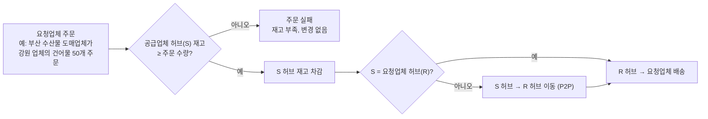

예: 강원도 허브 소속 업체의 건어물을 부산 업체가 50개 주문하면, 강원도 허브 재고 50개를 차감하고 강원도 허브 → 부산 허브로 옮긴 뒤 부산 업체로 배송한다.

### 기술 스택

| 구분 | 기술 | 용도 |
| --- | --- | --- |
| Language | Java 17 | - |
| Framework | Spring Boot 3.x | 각 마이크로서비스 (Spring Cloud는 Boot 버전과 호환되는 릴리스 트레인 사용) |
| API Gateway | Spring Cloud Gateway | 단일 진입점, JWT 인증·인가, 라우팅 |
| Service Discovery | Spring Cloud Netflix Eureka | 서비스 등록·조회 |
| 서비스 간 통신 | Spring Cloud OpenFeign + LoadBalancer | 동기 REST 호출, 인스턴스 간 부하 분산 |
| Data Access | Spring Data JPA, QueryDSL | ORM, 동적 검색 쿼리 |
| Database | PostgreSQL 16 | 서비스별 스키마 분리 |
| Security | Spring Security, JJWT, BCrypt | 인증, 토큰 발급·검증, 비밀번호 해시 |
| Validation | Spring Validation (Bean Validation) | 서버 측 요청 값 검증 |
| API 문서 | springdoc-openapi (Swagger UI) | API 문서 자동화 |
| Infra | Docker, Docker Compose | 로컬 컨테이너 오케스트레이션 |
| Build / VCS | Gradle (멀티 모듈), Git / GitHub | 빌드, 버전 관리 |
| 외부 연동 | Slack Incoming Webhook | 주문 생성 알림 |
| 선택 | Resilience4j, Micrometer Tracing + Zipkin, Redis, Kafka | 장애 격리, 분산 추적, 캐싱, 서비스 간 비동기 메시징 (Kafka는 고도화 단계) |

### 주요 설계 결정

| # | 결정 | 이유 |
| --- | --- | --- |
| 1 | 비즈니스 서비스 5개(user, hub, company, order, delivery) + 인프라 서비스 2개(eureka, gateway)로 분리. 상품은 company-service, 재고는 hub-service가 소유 | 발제 가이드(상품은 업체 하위 리소스, 재고는 허브 소유)와 데이터 소유권 기준으로 경계 설정 |
| 2 | 인증·인가는 Gateway에서 일괄 처리하고, 하위 서비스는 Gateway가 주입한 `X-User-*` 헤더를 신뢰 | 인증 로직 중복 제거, 각 서비스는 소유자 검증 같은 비즈니스 인가에 집중 |
| 3 | 권한은 `MASTER` / `USER` 2단계, 배송담당자는 USER에게 부여하는 `is_delivery_manager` 속성 | “권한 2단계” 진행 안내와 “배송담당자는 권한으로 부여” 요구를 함께 충족 |
| 4 | 서비스 간 참조는 FK 없이 UUID 논리 참조, 존재 여부는 Feign 호출로 검증 | 스키마 분리 원칙 준수, 서비스 독립 배포 |
| 5 | 주문 생성은 order-service가 오케스트레이터인 Saga + 보상 트랜잭션으로 처리 | 분산 환경에서는 단일 DB 트랜잭션이 불가능하므로 실패 지점별 보상으로 일관성 확보 |
| 6 | `orderId`를 주문 저장 전에 선발급하고, 재고 차감·복원·배송 생성·삭제 API를 orderId 기준으로 멱등하게 설계 | 타임아웃처럼 결과를 알 수 없는 상황에서도 재시도·보상을 안전하게 수행 |
| 7 | 배송은 주문의 생명주기를 따르므로 배송 생성·삭제는 내부 API로만 제공 | 주문 없는 배송, 배송 없는 주문 방지 |
| 8 | PostgreSQL 컨테이너 1개 + 서비스별 스키마·전용 계정 분리 | 로컬 리소스 절약과 논리적 DB 독립성 동시 확보 |
| 9 | 재고 할당은 해당 상품의 재고 행(공급업체 허브 1행)을 비관적 락(`SELECT ... FOR UPDATE`)으로 잠근 뒤 차감 | 동시 주문으로 인한 초과 차감(음수 재고) 방지 |
| 10 | 상품은 공급업체 소속 허브에만 존재하고, 출고 허브는 항상 공급업체 허브. 재고가 부족하면 주문 실패 | 회의 결정. 상품은 한 업체만 소유하고 업체는 한 허브에서 관리되므로, 허브 간 이동은 배송 경로의 한 구간으로 처리 |
| 11 | 주문은 한 번에 한 품목만, 요청업체 관리자 본인(또는 MASTER)만 그 업체 명의로 주문 | SA 제작 미팅 결정. 다른 업체 명의로 주문하는 것을 막음 |
| 12 | 모든 주요 엔티티의 PK는 UUID | SA 제작 미팅 결정 + 발제 요구사항. 서비스마다 따로 생성해도 충돌하지 않고, 외부에 노출돼도 순번을 추측할 수 없음 |
| 13 | 배송담당자는 소속 허브(`hub_id`)를 갖고, 출발지 허브 소속일 때만 MASTER가 수동 배정한다(자동 배정 없음). 허브 이동 구간은 공급업체 허브, 업체 배송은 목적지(요청업체) 허브가 출발지 | 추가 요구사항(소속 허브는 출발지 기준). 담당자 배정 시 검증하고, 배송담당자가 없으면 404 `DELIVERY_MANAGER_NOT_FOUND`, 소속 허브가 다르면 400 `MANAGER_HUB_MISMATCH` |

## ◾ 1. 와이어프레임

---

이번 프로젝트는 프론트엔드 없이 REST API만 제공한다. 화면 대신 Swagger UI·Postman으로 호출하는 **역할별 API 사용 흐름**으로 와이어프레임을 대체한다.

### 주문부터 배송 완료까지의 흐름

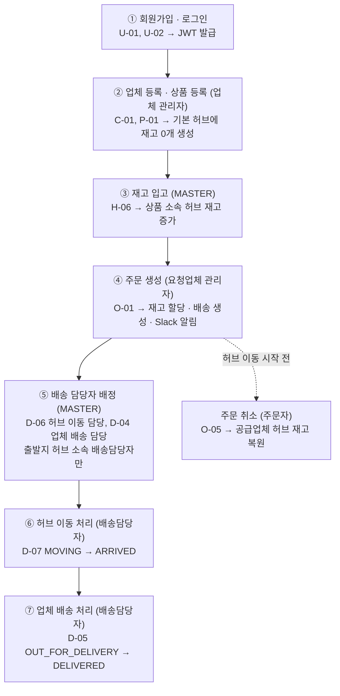

### 사용자 역할

| 역할 | 구분 방법 | 주요 기능 |
| --- | --- | --- |
| MASTER (관리자) | `role = MASTER` | 모든 기능. 사용자·권한 관리, 재고 입고, 배송 담당자 배정, 주문 삭제 |
| 업체 관리자 | `role = USER`, 업체의 `manager_id`가 본인 | 본인 업체·상품 등록·수정·삭제, 본인 업체 명의 주문, 본인 주문 조회·취소 |
| 배송담당자 | `role = USER`이면서 `is_delivery_manager = true`, 소속 허브(`hub_id`) 보유 | 본인 담당 배송 조회, 허브 이동·업체 배송 상태 변경. 소속 허브에서 출발하는 허브 이동 구간·업체 배송만 배정받음 |
| 일반 사용자 | `role = USER` | 허브·경로·업체·상품 조회, 본인 정보 조회 |

## ◾ 2. API

---

### 공통 규약

- **Base URL:** `http://localhost:8080` (모든 외부 요청은 Gateway 경유), 경로는 `/api/v1`로 시작
- **인증:** 회원가입·로그인을 제외한 모든 API는 `Authorization: Bearer {accessToken}` 필요
- **사용자 전달:** Gateway가 JWT를 검증한 뒤 `X-User-Id`, `X-Username`, `X-User-Role`, `X-Delivery-Manager` 헤더를 넣어 각 서비스로 전달 (클라이언트가 보낸 같은 이름의 헤더는 제거)
- **응답 형식:** 성공 `status`, `message`, `data` / 에러 `status`, `code`, `message`, `path`, `timestamp`
- **검색:** `page`(0부터), `size`(10, 30, 50), `sort`(기본 `createdAt,DESC`). 논리 삭제된 데이터는 조회되지 않는다
- **서비스 간 호출:** `/internal/**` 경로는 Gateway에서 차단하고 Feign 호출에만 사용

### 사용자 (user-service)

| ID | Method | URL | 설명 | 권한 | Request | Response |
| --- | --- | --- | --- | --- | --- | --- |
| U-01 | POST | `/api/v1/auth/signup` | 회원가입 | Public | Body: username, password, name, slackId, affiliationType, affiliationName | 201 userId, username, role, isDeliveryManager |
| U-02 | POST | `/api/v1/auth/login` | 로그인 (JWT 발급) | Public | Body: username, password | 200 accessToken, tokenType, expiresIn |
| U-03 | GET | `/api/v1/users/me` | 내 정보 조회 | 로그인 | - | 200 UserResponse |
| U-04 | GET | `/api/v1/users/{userId}` | 사용자 단건 조회 | 본인, MASTER | Path: userId | 200 UserResponse |
| U-05 | GET | `/api/v1/users` | 사용자 검색 | MASTER | Query: username, name, role, isDeliveryManager, hubId + 페이징 | 200 UserResponse 목록 |
| U-06 | PATCH | `/api/v1/users/{userId}` | 사용자 정보 수정 | MASTER | Body(선택): name, slackId, affiliationType, affiliationName | 200 UserResponse |
| U-07 | PATCH | `/api/v1/users/{userId}/role` | 권한·배송담당자 지정 | MASTER | Body(선택): role, isDeliveryManager, hubId(배송담당자 지정 시 필수) | 200 UserResponse |
| U-08 | DELETE | `/api/v1/users/{userId}` | 사용자 비활성화 (논리 삭제) | MASTER | Path: userId | 200 |

### 허브 (hub-service)

| ID | Method | URL | 설명 | 권한 | Request | Response |
| --- | --- | --- | --- | --- | --- | --- |
| H-01 | GET | `/api/v1/hubs` | 허브 검색 | 로그인 | Query: keyword + 페이징 | 200 HubResponse 목록 |
| H-02 | GET | `/api/v1/hubs/{hubId}` | 허브 단건 조회 | 로그인 | Path: hubId | 200 HubResponse |
| H-03 | GET | `/api/v1/hub-routes` | 허브 간 경로 검색 | 로그인 | Query: departureHubId, arrivalHubId + 페이징 | 200 HubRouteResponse 목록 |
| H-04 | GET | `/api/v1/hub-routes/{hubRouteId}` | 허브 간 경로 단건 조회 | 로그인 | Path: hubRouteId | 200 HubRouteResponse |
| H-06 | POST | `/api/v1/hubs/{hubId}/stocks/inbound` | 재고 입고 (재고 레코드 없으면 생성). `hubId`가 상품의 소속 허브와 다르면 400 `INVALID_REQUEST` | MASTER | Body: productId, quantity | 200 hubStockId, quantity |

> 결정: H-05 허브 재고 검색은 구현 범위에서 제외한다. 상품은 한 업체만 소유하고 업체는 한 허브에서 관리되므로 재고는 공급업체 허브에만 존재하며, 허브 간 이동은 배송 경로의 한 구간으로 처리한다.

### 업체·상품 (company-service)

| ID | Method | URL | 설명 | 권한 | Request | Response |
| --- | --- | --- | --- | --- | --- | --- |
| C-01 | POST | `/api/v1/companies` | 업체 생성 | 로그인 (USER는 본인이 관리자) | Body: name, hubId, address, managerId(MASTER는 필수) | 201 CompanyResponse |
| C-02 | GET | `/api/v1/companies` | 업체 검색 | 로그인 | Query: name, hubId, managerId + 페이징 | 200 CompanyResponse 목록 |
| C-03 | GET | `/api/v1/companies/{companyId}` | 업체 단건 조회 | 로그인 | Path: companyId | 200 CompanyResponse |
| C-04 | PATCH | `/api/v1/companies/{companyId}` | 업체 수정 | 업체 관리자, MASTER | Body(선택): name, hubId, address, managerId(MASTER만) | 200 CompanyResponse |
| C-05 | DELETE | `/api/v1/companies/{companyId}` | 업체 삭제 (상품 포함 논리 삭제) | 업체 관리자, MASTER | Path: companyId | 200 |
| P-01 | POST | `/api/v1/companies/{companyId}/products` | 상품 생성 | 업체 관리자, MASTER | Body: name, description, price | 201 ProductResponse |
| P-02 | GET | `/api/v1/products` | 상품 검색 | 로그인 | Query: name, companyId, hubId + 페이징 | 200 ProductResponse 목록 |
| P-03 | GET | `/api/v1/companies/{companyId}/products/{productId}` | 상품 단건 조회 | 로그인 | Path: companyId, productId | 200 ProductResponse |
| P-04 | PATCH | `/api/v1/companies/{companyId}/products/{productId}` | 상품 수정 | 업체 관리자, MASTER | Body(선택): name, description, price | 200 ProductResponse |
| P-05 | DELETE | `/api/v1/companies/{companyId}/products/{productId}` | 상품 삭제 | 업체 관리자, MASTER | Path: companyId, productId | 200 |

### 주문 (order-service)

| ID | Method | URL | 설명 | 권한 | Request | Response |
| --- | --- | --- | --- | --- | --- | --- |
| O-01 | POST | `/api/v1/orders` | 주문 생성 (재고 할당 + 배송 생성 + Slack 알림) | 요청업체 관리자, MASTER | Body: supplierCompanyId, receiverCompanyId, productId, quantity, requestNote | 201 OrderResponse (deliveryId 포함) / 409 STOCK_INSUFFICIENT |
| O-02 | GET | `/api/v1/orders` | 주문 검색 | 로그인 (USER는 본인 주문만) | Query: status, supplierCompanyId, receiverCompanyId, productId, startDate, endDate + 페이징 | 200 OrderResponse 목록 |
| O-03 | GET | `/api/v1/orders/{orderId}` | 주문 단건 조회 | 주문자, MASTER | Path: orderId | 200 OrderResponse |
| O-04 | PATCH | `/api/v1/orders/{orderId}` | 요청사항 수정 | 주문자, MASTER | Body: requestNote | 200 OrderResponse |
| O-05 | POST | `/api/v1/orders/{orderId}/cancel` | 주문 취소 (공급업체 허브 재고 복원) | 주문자, MASTER | Path: orderId | 200 orderId, status / 409 INVALID_STATUS_TRANSITION |
| O-06 | DELETE | `/api/v1/orders/{orderId}` | 주문 삭제 (배송 포함 논리 삭제) | MASTER | Path: orderId | 200 / 409 ORDER_NOT_DELETABLE |

### 배송 (delivery-service)

| ID | Method | URL | 설명 | 권한 | Request | Response |
| --- | --- | --- | --- | --- | --- | --- |
| D-01 | GET | `/api/v1/deliveries` | 배송 검색 | MASTER 전체 / 배송담당자는 본인 담당(업체 배송 또는 허브 이동)만 / 업체 관리자는 공급·수령업체가 본인 업체인 배송만 | Query: status, supplierCompanyId, receiverCompanyId, departureHubId, destinationHubId, managerId, orderId + 페이징 | 200 DeliveryResponse 목록 |
| D-02 | GET | `/api/v1/deliveries/{deliveryId}` | 배송 단건 조회 (허브 이동 구간 포함) | D-01과 동일 | Path: deliveryId | 200 DeliveryResponse + 허브 이동 구간(0~1건) |
| D-03 | PATCH | `/api/v1/deliveries/{deliveryId}` | 배송지·수령인 수정 | 배송 담당자, MASTER | Body(선택): deliveryAddress, recipientName | 200 DeliveryResponse |
| D-04 | PATCH | `/api/v1/deliveries/{deliveryId}/manager` | 업체 배송 담당자 배정 (목적지 허브 소속만) | MASTER | Body: managerId | 200 DeliveryResponse / 404 DELIVERY_MANAGER_NOT_FOUND, 400 MANAGER_HUB_MISMATCH |
| D-05 | PATCH | `/api/v1/deliveries/{deliveryId}/status` | 업체 배송 상태 변경 (OUT_FOR_DELIVERY는 DEST_HUB_ARRIVED + 업체 배송 담당자 배정 상태에서만) | 배송 담당자, MASTER | Body: status (OUT_FOR_DELIVERY, DELIVERED) | 200 deliveryId, status |
| D-06 | PATCH | `/api/v1/deliveries/{deliveryId}/routes/{routeId}/manager` | 허브 이동 담당자 배정 (공급업체 허브 소속만) | MASTER | Body: managerId | 200 DeliveryResponse / 404 DELIVERY_MANAGER_NOT_FOUND, 400 MANAGER_HUB_MISMATCH |
| D-07 | PATCH | `/api/v1/deliveries/{deliveryId}/routes/{routeId}/status` | 허브 이동 상태 변경 (MOVING은 허브 이동 담당자 배정 상태에서만, 배송 상태 자동 연동) | 경로 담당자, MASTER | Body: status (MOVING, ARRIVED), actualDistanceKm, actualDurationMinutes | 200 DeliveryResponse |

> 결정: D-04, D-06 담당자 배정은 PATCH를 유지한다. 배정은 MASTER가 `isDeliveryManager = true`인 사용자 중에서 수동으로 한다.

### 공통 에러 코드

| HTTP | code | 설명 |
| --- | --- | --- |
| 400 | `VALIDATION_ERROR` | 요청 값 검증 실패 |
| 400 | `INVALID_REQUEST` | 비즈니스 규칙 위반 (예: 상품이 공급업체 소속이 아님) |
| 400 | `MANAGER_HUB_MISMATCH` | 배송담당자의 소속 허브가 출발지 허브와 다름 (허브 이동: 공급업체 허브, 업체 배송: 목적지 허브) |
| 401 | `UNAUTHORIZED` | 토큰 누락, 위조, 만료 |
| 401 | `TOKEN_ROLE_MISMATCH` | 토큰의 권한과 저장된 권한이 다름 (재로그인 필요) |
| 401 | `LOGIN_FAILED` | 아이디 또는 비밀번호 불일치 |
| 403 | `FORBIDDEN` | 권한 없음 (MASTER 전용 API, 소유자 아님) |
| 404 | `USER_NOT_FOUND` 등 `{리소스}_NOT_FOUND` | 리소스가 없거나 논리 삭제됨 |
| 404 | `DELIVERY_MANAGER_NOT_FOUND` | 배정하려는 배송담당자가 없음 (사용자가 없거나, 탈퇴했거나, 배송담당자가 아님) |
| 409 | `DUPLICATE_USERNAME` | username 중복 |
| 409 | `STOCK_INSUFFICIENT` | 공급업체 허브 재고 부족 |
| 409 | `INVALID_STATUS_TRANSITION` | 허용되지 않는 상태 변경 (예: 이미 출발한 배송의 주문 취소) |
| 409 | `HUB_CHANGE_NOT_ALLOWED` | 상품이 등록된 업체의 관리 허브 변경 |
| 409 | `ORDER_NOT_DELETABLE` | 취소 또는 배송 완료 전 주문 삭제 |
| 503 | `SERVICE_UNAVAILABLE` | 하위 서비스 호출 실패 또는 타임아웃 |

### 내부 API (서비스 간 Feign 전용)

> 결정: 배송담당자 자동 배정은 하지 않으므로 담당자 배정용 내부 API는 두지 않는다.

| ID | 제공 | Method | URL | Request | Response | 호출자 |
| --- | --- | --- | --- | --- | --- | --- |
| I-01 | user | GET | `/internal/users/{userId}` | - | userId, username, role, isDeliveryManager, hubId, slackId (탈퇴 시 404) | gateway, company, delivery |
| I-02 | hub | GET | `/internal/hubs/{hubId}` | - | hubId, name, address | company, user |
| I-03 | hub | GET | `/internal/hub-routes?departureHubId=&arrivalHubId=` | - | hubRouteId, distanceKm, durationMinutes (P2P 단일 경로) | delivery |
| I-04 | hub | POST | `/internal/stocks` | hubId, productId | hubStockId, quantity(0). 이미 있으면 기존 값 반환 | company |
| I-05 | hub | POST | `/internal/stocks/allocate` | orderId, productId, quantity | hubId, quantity. 상품 재고 행(공급업체 허브 1행)을 FOR UPDATE로 잠근 뒤 차감하고 `p_stock_allocations`에 ALLOCATED로 기록. 재고가 부족하면 409. 같은 orderId 재요청 시 기존 할당 반환 | order |
| I-06 | hub | POST | `/internal/stocks/restore` | orderId | restoredQuantity. `p_stock_allocations` 기준으로 차감분을 복원하고 RESTORED로 변경 (재고 행 → 할당 내역 순으로 잠금). 할당 내역이 없거나 이미 복원했으면 0 | order |
| I-07 | company | GET | `/internal/companies/{companyId}` | - | companyId, name, hubId, address, managerId | order |
| I-08 | company | GET | `/internal/products/{productId}` | - | productId, companyId, hubId, name, price | order, hub |
| I-09 | delivery | POST | `/internal/deliveries` | orderId, supplierCompanyId, receiverCompanyId, departureHubId(공급업체 허브), destinationHubId(요청업체 허브), deliveryAddress(요청업체 주소), recipientName(요청업체명). 두 허브가 다르면 I-03으로 경로를 조회해 허브 이동 구간 1건 생성 | deliveryId, status. 같은 orderId 배송이 있으면 기존 값 반환 | order |
| I-10 | delivery | GET | `/internal/deliveries/{deliveryId}` | - | deliveryId, orderId, status | order |
| I-11 | delivery | POST | `/internal/deliveries/{deliveryId}/cancel` | - | status=`CANCELED`. 배송 상태가 `HUB_WAITING`이거나, 허브 이동 구간 없이 `DEST_HUB_ARRIVED`인 경우만 가능. 그 외 409 | order |
| I-12 | delivery | POST | `/internal/deliveries/{deliveryId}/cancel-revert` | - | 취소 전 상태로 원복 (취소 보상) | order |
| I-13 | delivery | DELETE | `/internal/deliveries/orders/{orderId}` | - | 204. 배송·경로 논리 삭제, 대상이 없어도 204 | order |
| I-14 | company | GET | `/internal/companies?managerId=` | - | 해당 사용자가 관리하는 companyId 목록 (없으면 빈 목록) | delivery (D-01, D-02 업체 관리자 조회 권한 판단) |

## ◾ 3. ERD DIAGRAM

---

ERD는 상세 컬럼이 같이 표시된 그림으로 바꾸는 게 좋음

<aside>

**전체 ERD (서비스 간 관계)** · 실선: 같은 스키마 안의 물리 FK / 점선: 서비스 간 UUID 논리 참조 (FK 없음, Feign 호출로 검증)

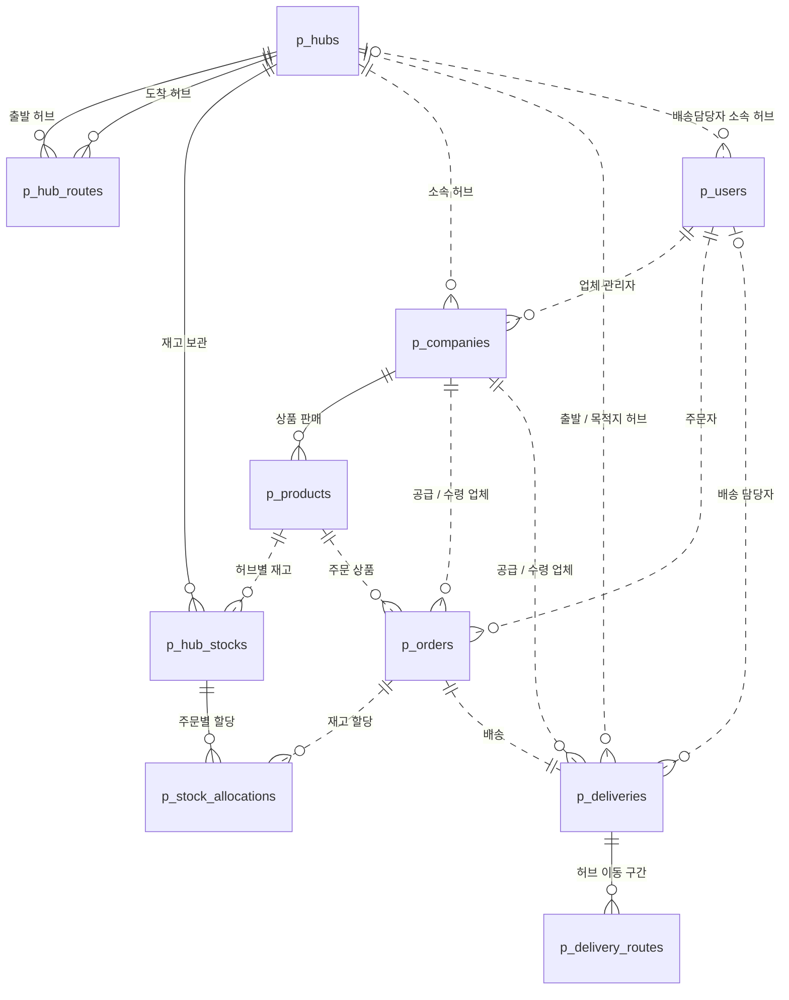

</aside>

- 모든 PK는 UUID다. 테이블명은 `p_` 접두사를 쓴다.
- Audit 컬럼(`created_at`, `created_by`, `updated_at`, `updated_by`, `deleted_at`, `deleted_by`)은 `BaseEntity`로 공통 관리하므로 ERD에는 표기하지 않는다. (재고 변경 이력 `p_hub_stock_histories`는 확장 기능으로 제외. 도입 시 update가 없는 기록형이므로 `created_*`만 둔다.)
- 삭제는 `deleted_at`, `deleted_by`를 채우는 논리 삭제이며, 유니크 제약은 `WHERE deleted_at IS NULL` 부분 인덱스로 만든다.

### 서비스별 ERD

Note: 서비스별 테이블 명세가 좋음 → length까지 같이 정하는게 편함

#### user-service (`user_schema`)

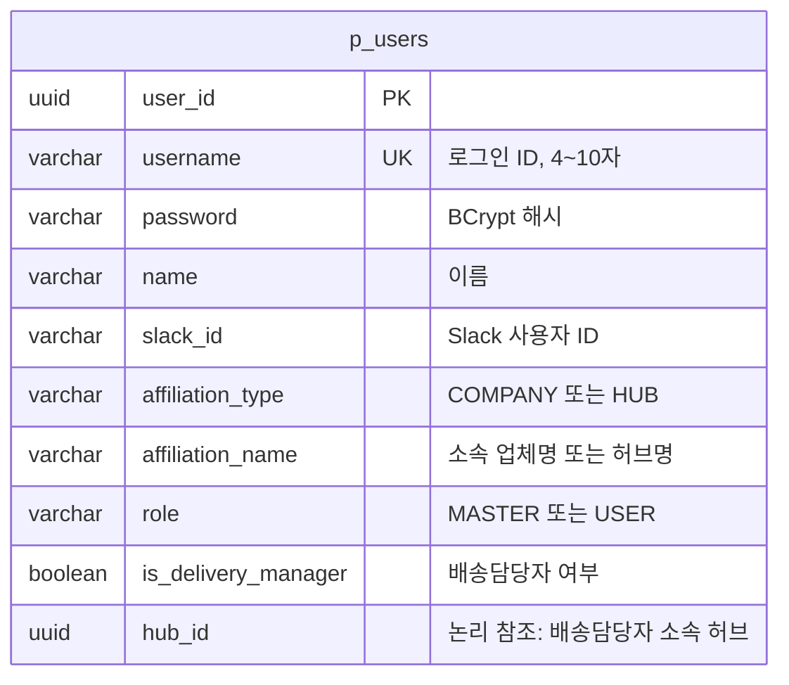

#### hub-service (`hub_schema`)

> 결정: 재고 변경 이력(`p_hub_stock_histories`)은 확장 기능으로 제외한다. 재고 할당·복원의 멱등성과 복원 근거는 `p_stock_allocations`(주문별 재고 할당 내역)가 담당한다.

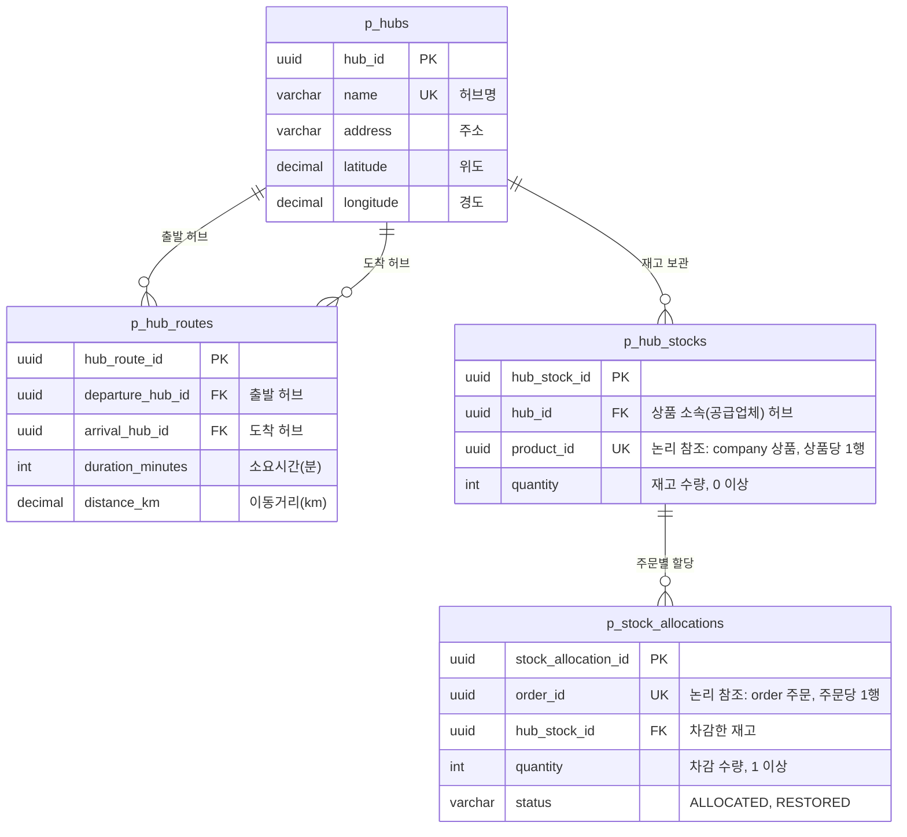

#### company-service (`company_schema`)

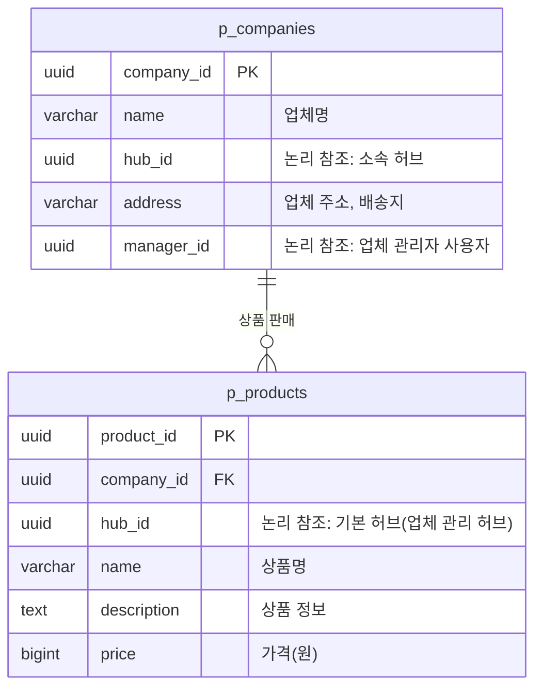

#### order-service (`order_schema`)

> 결정: `total_price`를 저장한다. 주문 생성 시 서버가 `unit_price × quantity`를 계산해 넣고(클라이언트 입력 금지, `Math.multiplyExact`로 오버플로 시 400 `INVALID_REQUEST`), 수량은 주문 후 변경할 수 없으므로 이후 바뀌지 않는다.

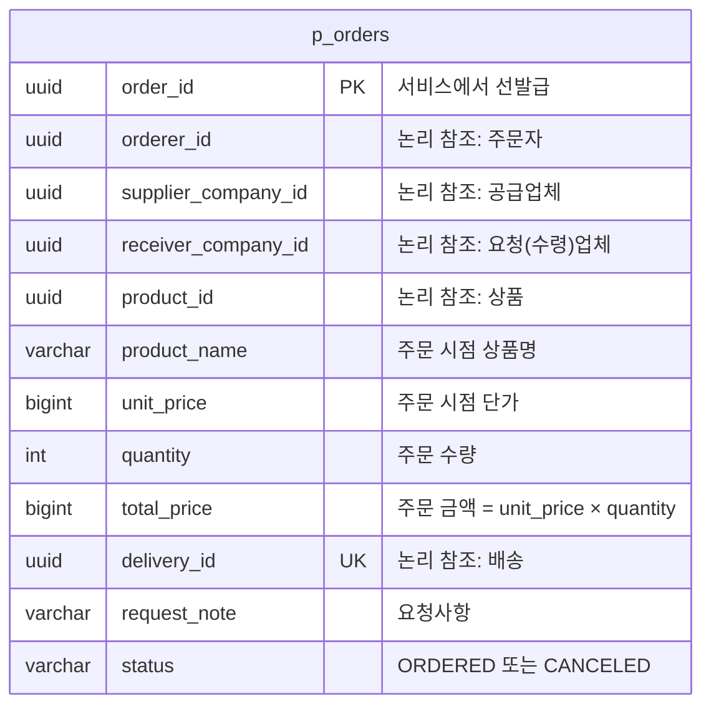

#### delivery-service (`delivery_schema`)

> 결정 (업체 간 배송):
> - 배송은 **공급업체 → 공급업체 허브 → (허브 이동) → 요청업체 허브 → 요청업체** 흐름이다. 두 업체가 같은 허브면 허브 이동 구간이 없다.
> - `p_delivery_routes`는 유지하고 허브 이동 구간을 **0~1행**으로 기록한다(같은 허브면 0행). `sequence`는 추후 중계 허브 경로 확장을 위해 남긴다.
> - `p_deliveries`에 공급·요청업체 ID와 업체 배송 출발·완료 시각을 추가한다. 배송지·수령인은 생성 시 요청업체 주소·업체명으로 채우고 D-03으로 수정할 수 있다.

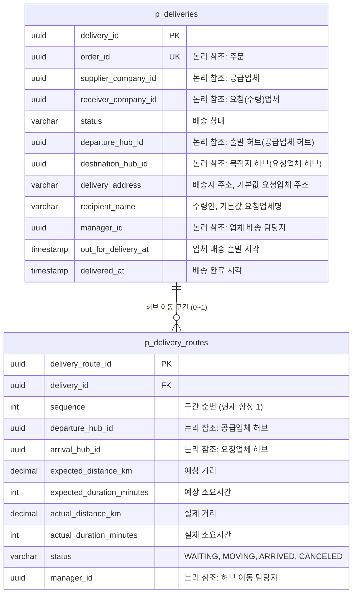

### 테이블 목록

| 스키마 | 테이블 | 설명 | 주요 제약 |
| --- | --- | --- | --- |
| `user_schema` | `p_users` | 사용자 (권한, 배송담당자 여부·소속 허브 포함) | `username` UNIQUE |
| `hub_schema` | `p_hubs` | 허브 17개 (초기 데이터, 조회 전용) | `name` UNIQUE |
| `hub_schema` | `p_hub_routes` | 허브 간 이동 경로 P2P 272건 (초기 데이터) | (출발, 도착) UNIQUE |
| `hub_schema` | `p_hub_stocks` | 상품 재고 (상품 소속 허브에만 존재, 상품당 1행) | `product_id` UNIQUE, 수량 0 이상 |
| `hub_schema` | `p_stock_allocations` | 주문별 재고 할당 내역 (할당·복원의 멱등성 키이자 복원 근거) | `order_id` UNIQUE, 수량 1 이상 |
| `company_schema` | `p_companies` | 업체 (생산·수령 구분 없음, 허브 1곳 소속) | - |
| `company_schema` | `p_products` | 상품 (업체 하위 리소스) | 가격 0 이상 |
| `order_schema` | `p_orders` | 주문 (한 번에 한 품목, 상품명·단가 스냅샷, 주문 금액) | `delivery_id` UNIQUE, 수량 1 이상, 금액 0 이상 |
| `delivery_schema` | `p_deliveries` | 업체 간 배송 (주문 1건 = 배송 1건) | `order_id` UNIQUE |
| `delivery_schema` | `p_delivery_routes` | 허브 이동 구간 기록 (배송당 0~1건, 같은 허브면 없음) | (`delivery_id`, `sequence`) UNIQUE |

## ◾ 4. 인프라 설계도

---

<aside>

**인프라 구성도** · 서버 배포 없이 로컬에서 모든 애플리케이션을 Docker 컨테이너로 실행한다. 외부에는 Gateway(8080)와 Eureka 대시보드(8761)만 공개한다.

이 프로젝트를 처음보는 사람들을 위해서 스택을 명시할 수 있는 다이어그램으로 발전시켜서 그려보자.

<aside>

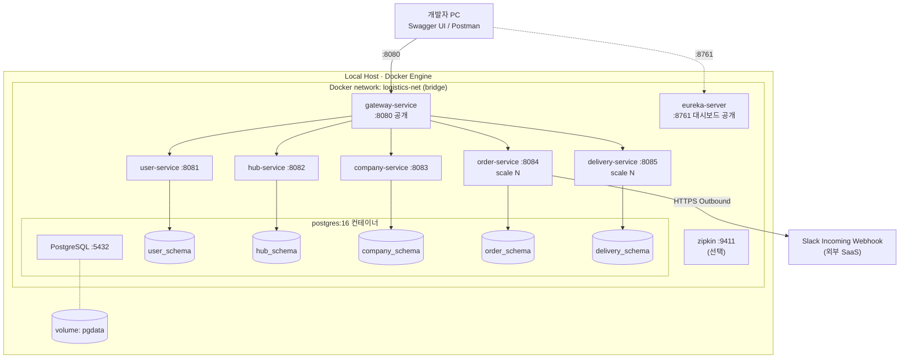

</aside>

</aside>

### 컨테이너 구성

| 컨테이너 | 이미지 | 내부 포트 | 호스트 공개 | depends_on | 비고 |
| --- | --- | --- | --- | --- | --- |
| postgres | postgres:16 | 5432 | 5432 (개발용, 선택) | - | `init.sql`로 스키마·계정 생성, `pgdata` 볼륨으로 데이터 유지 |
| eureka-server | 빌드 (eclipse-temurin:17-jre) | 8761 | 8761 | - | 등록 현황 대시보드 |
| gateway-service | 빌드 | 8080 | **8080** | eureka | 유일한 외부 API 진입점 |
| user-service | 빌드 | 8081 | 미공개 | postgres, eureka | JWT 발급 |
| hub-service | 빌드 | 8082 | 미공개 | postgres, eureka | 기동 시 허브 17개·경로 272개 시드 적재 |
| company-service | 빌드 | 8083 | 미공개 | postgres, eureka | - |
| order-service | 빌드 | 8084 | 미공개 | postgres, eureka | `SLACK_WEBHOOK_URL` 환경 변수 |
| delivery-service | 빌드 | 8085 | 미공개 | postgres, eureka | - |
| zipkin (선택) | openzipkin/zipkin | 9411 | 9411 | - | 분산 추적 |

### Gateway 라우팅 규칙

| Path | 대상 |
| --- | --- |
| `/api/v1/auth/**`, `/api/v1/users/**` | `lb://user-service` |
| `/api/v1/hubs/**`, `/api/v1/hub-routes/**` | `lb://hub-service` |
| `/api/v1/companies/**`, `/api/v1/products/**` | `lb://company-service` |
| `/api/v1/orders/**` | `lb://order-service` |
| `/api/v1/deliveries/**` | `lb://delivery-service` |
| `/internal/**` | 라우팅하지 않음 (외부 접근 차단, 서비스 간 Feign 전용) |

### 서비스 디스커버리와 수평 확장

- 모든 서비스는 기동 시 `spring.application.name`으로 Eureka에 등록한다. `instance-id`에 랜덤 값을 붙여 같은 서비스의 여러 인스턴스를 구분한다.
- Gateway 라우팅(`lb://`)과 Feign(`@FeignClient(name = "hub-service")`)은 Spring Cloud LoadBalancer가 Eureka 목록을 기반으로 라운드로빈 분산한다.
- 비즈니스 서비스는 호스트 포트를 고정 공개하지 않으므로 `docker compose up --scale order-service=2`처럼 수평 확장할 수 있다.
- 서비스는 상태를 갖지 않는다(Stateless). 인증 정보는 JWT, 데이터는 DB에만 둔다.

### DB 분리 전략

- PostgreSQL 인스턴스 1개에 **서비스별 스키마 + 전용 계정**을 만들고, 각 계정은 자기 스키마에만 권한을 갖는다. 다른 서비스 테이블을 직접 조회하거나 조인할 수 없다.
- 서비스 간에는 FK를 두지 않는다(UUID 논리 참조). 정합성은 Feign 검증과 Saga 보상으로 보장한다.
- 각 서비스는 JDBC URL의 `currentSchema` 또는 `hibernate.default_schema`로 자기 스키마를 지정한다.
- 운영 환경으로 확장할 때는 스키마를 서비스별 DB 인스턴스로 옮기고 읽기 복제본을 추가한다. 코드 변경 없이 DataSource 설정만 바꾸면 된다.

```sql
-- infra/postgres/init.sql (로컬 전용 비밀번호)
CREATE SCHEMA IF NOT EXISTS user_schema;
CREATE SCHEMA IF NOT EXISTS hub_schema;
CREATE SCHEMA IF NOT EXISTS company_schema;
CREATE SCHEMA IF NOT EXISTS order_schema;
CREATE SCHEMA IF NOT EXISTS delivery_schema;

-- 서비스별 계정 (hub 예시, 나머지 서비스도 같은 패턴)
CREATE USER hub_app WITH PASSWORD 'hub_local_pw';
GRANT USAGE, CREATE ON SCHEMA hub_schema TO hub_app;
ALTER ROLE hub_app SET search_path = hub_schema;
```

### 장애 대응과 운영 설정

| 항목 | 설계 |  |
| --- | --- | --- |
| Feign 타임아웃 | 기본 connect 1초 / read 3초. I-05 재고 할당 read 5초(DB `lock_timeout` 3초), I-09 배송 생성 read 5초, I-03(delivery → hub) read 2초. **바깥 호출 타임아웃 > 안쪽 호출 타임아웃** 유지. 하위 서비스 실패는 `ErrorDecoder`에서 도메인 예외 또는 503 `SERVICE_UNAVAILABLE`로 변환 | Feign 대상은 모두 내부 서비스. 외부 호출인 Slack은 비동기로 분리(connect 2초 / read 3초) |
| Gateway 응답 타임아웃 | 30초 | 주문 생성 전체 흐름(재시도 포함) 최악 시간보다 길게 |
| 재시도 | GET 요청과 orderId 기반 멱등 API(재고 할당·복원, 배송 생성·삭제)만 최대 3회 시도, 100ms부터 지수 백오프 |  |
| 서킷브레이커 (선택) | Resilience4j로 하위 서비스 장애 시 빠르게 실패 처리 |  |
| Health check | Spring Boot Actuator `/actuator/health`. postgres는 compose healthcheck 후 서비스 기동 |  |
| 분산 추적 (선택) | Micrometer Tracing + Zipkin, 로그에 traceId 포함 |  |
| 설정·비밀 정보 | JWT secret, DB 비밀번호, Slack Webhook URL은 `.env` → 환경 변수로 주입하고 Git에서 제외 |  |
| API 문서 | 각 서비스 springdoc 문서를 Gateway Swagger UI에서 서비스별로 선택해 조회 |  |

## ◾ 5. 시스템 구조도

그림을 유즈케이스에 맞게 분리해서 그리는 것도 좋을듯

보기 좋게 그려보는 게 좋습니당

---

<aside>

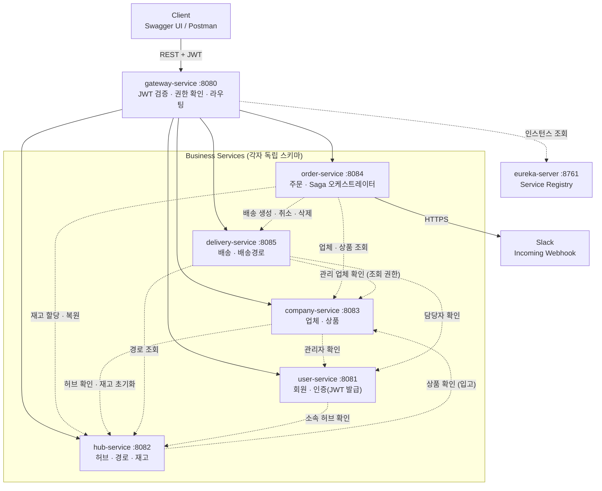

</aside>

<aside>

- 실선은 Gateway를 통한 외부 요청 라우팅, 점선은 서비스 간 내부 Feign 호출이다.
- 모든 서비스는 Eureka에 등록되고, Gateway와 Feign은 `lb://서비스명`으로 대상 인스턴스를 찾는다.
- 인증·인가는 Gateway에서 처리하고, 각 서비스는 Gateway가 넣어 준 `X-User-*` 헤더로 사용자를 식별해 소유자 검증만 한다.
- 서비스마다 DB 스키마를 분리하고, 서비스 간 참조는 FK 없이 UUID로만 연결한다.
</aside>

**프로젝트 구조 (Gradle 멀티 모듈)**

```bash
sparta-logistics/
├── common/                         # 공통 라이브러리 모듈
│   ├── BaseEntity                  # Audit + Soft Delete 필드
│   ├── ApiResponse, PageResponse   # 공통 응답 포맷
│   ├── GlobalExceptionHandler, ErrorCode
│   ├── UserContext, @CurrentUser   # X-User-* 헤더 → 사용자 정보 주입
│   └── FeignHeaderInterceptor      # 내부 호출 시 사용자 헤더 전파
├── eureka-server/
├── gateway-service/
├── user-service/
├── hub-service/
├── company-service/
├── order-service/
├── delivery-service/
│   └── src/main/java/com/sparta/logistics/delivery/
│       ├── presentation/           # controller, dto(request/response)
│       ├── application/            # service, dto(command/result)
│       ├── domain/                 # entity, enum, repository(interface)
│       └── infrastructure/         # jpa, querydsl, client(feign), config
├── infra/postgres/init.sh          # 스키마·계정 생성 (비밀번호는 .env 환경 변수)
└── docker-compose.yml
script/run.sh
```

### 서비스 구성

| 서비스 | 포트 | 책임 | DB 스키마 |
| --- | --- | --- | --- |
| eureka-server | 8761 | 서비스 등록·조회 | - |
| gateway-service | 8080 | 외부 요청 단일 진입점, JWT 검증, 권한 재확인, 라우팅, `/internal/**` 외부 차단 | - |
| user-service | 8081 | 회원가입, 로그인(JWT 발급), 사용자 관리, 배송담당자 지정(소속 허브 포함) | `user_schema` |
| hub-service | 8082 | 허브·허브 간 경로 조회, 허브별 상품 재고(입고·할당·복원) | `hub_schema` |
| company-service | 8083 | 업체 CRUD, 상품(업체 하위 리소스) CRUD | `company_schema` |
| order-service | 8084 | 주문 생성(Saga 오케스트레이션)·취소·삭제, Slack 알림 | `order_schema` |
| delivery-service | 8085 | 배송·배송 경로 기록 생성, 담당자 배정, 상태 관리 | `delivery_schema` |

### 서비스 내부 구조 (Layered Architecture)

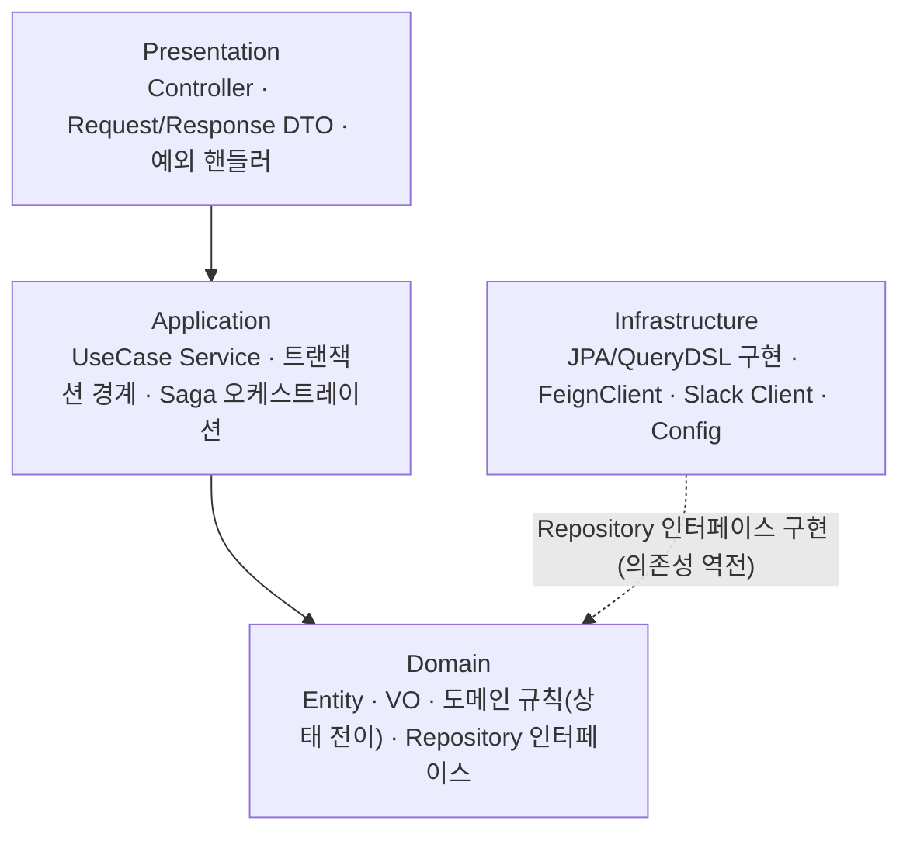

- 의존은 Presentation → Application → Domain 방향으로 흐른다. Infrastructure는 Domain이 정의한 Repository 인터페이스를 구현하므로 Domain 쪽으로 의존한다(의존성 역전). 그래서 Domain은 DB 접근·외부 호출을 어떻게 구현하는지 몰라도 된다.
- Entity는 Controller 밖으로 노출하지 않고, 계층마다 DTO를 분리한다.
- 상태 전이 규칙(예: 업체 배송 출발 전에만 취소 가능)은 Entity 메서드에 둬서 도메인 계층에서 검증한다.

### 주문 생성 흐름 (필수 롤백 시나리오)

주문 생성은 order-service가 순서를 지휘하는 Saga로 처리한다. 실패하면 앞 단계를 보상 트랜잭션으로 되돌린다.

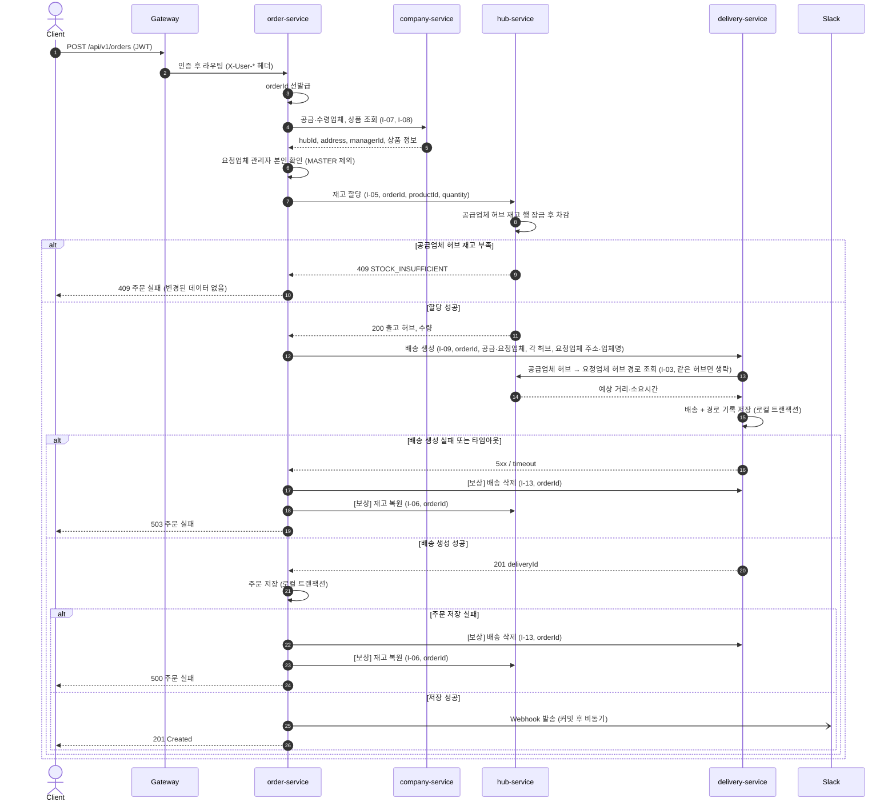

**실패 지점별 처리**

> 결정: Saga는 **오케스트레이션**(order-service가 지휘)으로 확정한다. 동기 Feign 중심 스택이고 Kafka는 고도화 단계이며, 주문 → 재고 → 배송이 순서가 정해진 직선 흐름이기 때문이다. 내부적으로는 실패한 단계까지 역순으로 하나씩 보상하고, 클라이언트에는 최종 에러 하나만 응답한다.

| 단계 | 실패 상황 | 처리 | 응답 |
| --- | --- | --- | --- |
| ① 업체·상품 조회 | 없음 / 타임아웃 | 아무것도 변경하지 않았으므로 즉시 실패 | 404 / 503 |
| ② 재고 할당 | 공급업체 허브 재고 부족 | 잠근 재고 행의 수량이 주문 수량보다 적음 → 롤백 후 즉시 실패 | 409 |
| ② 재고 할당 | 타임아웃 (차감 여부 모름) | 재고 복원(I-06) 호출. 할당 내역이 없으면 no-op이라 안전 | 503 |
| ③ 배송 생성 | 실패 / 타임아웃 | 배송 삭제(I-13) → 재고 복원(I-06). 둘 다 orderId 기준 멱등 | 503 |
| ④ 주문 저장 | DB 오류 | 로컬 롤백 후 배송 삭제(I-13) → 재고 복원(I-06) | 500 |
| ⑤ Slack 발송 | 실패 | 주문은 유지, 에러 로그만 기록 (`@TransactionalEventListener(phase = AFTER_COMMIT)`와 `@Async`) | 201 |
| 보상 자체 실패 | 보상 API 호출 실패 | 최대 3회 재시도. 그래도 실패하면 orderId와 함께 ERROR 로그를 남겨 수동 재처리 (선택: 스케줄러 재시도) | - |

### 배송 상태 전이 (업체 간 배송)

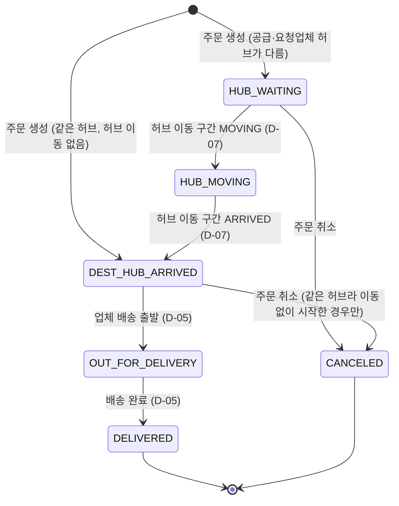

| 배송 상태 | 의미 | 변경 방식 · 전제 조건 |
| --- | --- | --- |
| `HUB_WAITING` | 공급업체 허브에서 출발 대기 | 주문 생성 시 자동 (두 허브가 다를 때) |
| `HUB_MOVING` | 허브 간 이동 중 | 허브 이동 구간을 `MOVING`으로 바꾸면 자동 (D-07). 허브 이동 담당자 배정 필수 |
| `DEST_HUB_ARRIVED` | 요청업체 허브 도착 | 허브 이동 구간을 `ARRIVED`로 바꾸면 자동 (D-07). 같은 허브면 생성 시 바로 이 상태 |
| `OUT_FOR_DELIVERY` | 요청업체로 배송 중 | 배송 담당자가 변경 (D-05). `DEST_HUB_ARRIVED` + 업체 배송 담당자 배정 필수. `out_for_delivery_at` 기록 |
| `DELIVERED` | 배송 완료 | 배송 담당자가 변경 (D-05). `delivered_at` 기록 |
| `CANCELED` | 주문 취소 | 주문 취소 시 내부 API(I-11)로 변경. `HUB_WAITING`, 또는 허브 이동 구간 없이 `DEST_HUB_ARRIVED`인 경우만 |

- 허브 이동을 마치고 요청업체 허브에 도착한 배송은 **취소할 수 없다.** 재고는 공급업체 허브에 복원되는데 실물은 요청업체 허브에 있어 불일치가 생기기 때문이다.
- 조건을 어기는 전이는 409 `INVALID_STATUS_TRANSITION`.

허브 이동 구간 상태: `WAITING` → `MOVING` → `ARRIVED` (주문 취소 시 `CANCELED`). 구간이 1개뿐이므로 구간 상태가 배송 상태(`HUB_WAITING` / `HUB_MOVING` / `DEST_HUB_ARRIVED`)와 1:1로 연동된다.

### 추가 논의:

2개 이상의 서비스를 동시에 호출해야하는 경우가 있을까?

- 순서를 정할 것인가
- 동시에 처리를 할 것인가

주문과 배송이 같이 생성되어야할때, 트랜잭션으로 처리해야하지 않나

→ 이를 방지하기 위해서 saga 패턴 사용하는 듯

업체 주문 → 주문생성 → 배송 생성 → 성공

업체 주문 →주문생성 → 성공 // 트랜잭션이 다른 서비스로 전파되는지 확인 필요

               →배송생성

조회해서 생성해야하는 정보에 대해서, 다른 서비스에 미리 일부를 넘겨주고 이를 이용해서 처리하도록

SAGA → 공부해봐야징 / 외부서비스 롤백 처리를 해줘야해서 

이거 쓸지 다른걸 쓸지 만들고 나서 생각하는게 좋을듯