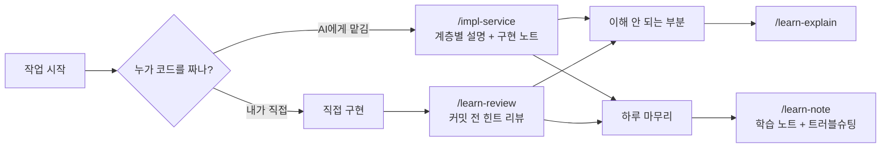

# AI 학습·구현 skill 가이드

> 이 프로젝트는 **학습이 주 목적**이다. AI(Claude Code)에게 일을 맡기더라도 "무엇을, 왜 이렇게 만들었는지" 팀원이 설명할 수 있도록 공용 skill을 둔다.
> 이 디렉터리는 **사람이 읽는 사용 설명서**다. AI가 따르는 절차 원본은 `.claude/skills/{이름}/SKILL.md`이고, 둘이 어긋나면 `SKILL.md`가 우선한다.

## skill이란
- Claude Code가 **필요할 때만 불러오는 작업 절차**다. 항상 읽히는 `CLAUDE.md`(규칙)와 달리, 호출했을 때만 동작한다.
- 저장소의 `.claude/skills/`에 있으므로 이 저장소를 Claude Code로 열면 팀원 누구나 바로 쓸 수 있다 (추가·수정 후에는 Claude Code 재시작).
- 호출 방법
  - **직접 호출**: 프롬프트에 `/impl-service hub-service H-06`처럼 입력
  - **자동 선택**: "H-06 구현해줘", "이거 왜 이렇게 돼?"처럼 요청하면 AI가 맞는 skill을 고른다
  - **AI 제안**: 정리·점검이 필요한 순간에 AI가 답변 끝에 한 줄로 제안한다 (아래 "AI가 먼저 제안하는 순간"). "응"이라고 답하면 실행된다

## 분류와 목록

| 분류 | skill | 한 줄 설명 | 남는 기록 |
| --- | --- | --- | --- |
| 구현 `impl-` | [impl-service](impl-service.md) | AI가 기능을 구현하되 **계층마다 멈추고 설명**한다 | `Docs/team/구현-노트/{서비스}.md` |
| 학습 `learn-` | [learn-explain](learn-explain.md) | 개념·코드·설계 이유를 **우리 코드에 연결해** 설명한다 | 없음 (대화) |
| 학습 `learn-` | [learn-review](learn-review.md) | 직접 짠 코드를 **힌트부터 단계적으로** 리뷰한다 | 없음 (대화) |
| 학습 `learn-` | [learn-note](learn-note.md) | 하루 동안 배운 것과 해결한 문제를 정리한다 | `Docs/team/학습-노트/{이름}.md`, `Docs/07-트러블슈팅.md` |

## 언제 무엇을 쓰나

| 상황 | 쓰는 skill |
| --- | --- |
| API·엔티티·Feign 구현을 AI와 함께 진행 | `impl-service` |
| 처음 보는 개념, 남이 짠 코드, 설계 이유가 궁금함 | `learn-explain` |
| 직접 짠 코드를 커밋하기 전에 점검 | `learn-review` |
| 오늘 작업을 마치며 정리 | `learn-note` |

## AI가 먼저 제안하는 순간
일일이 호출하지 않아도 되도록, 아래 순간에는 AI가 답변 끝에 **한 줄로 제안**한다. 기준은 루트 `CLAUDE.md` "학습·구현 skill 제안"에 있다.

| 이런 순간 | AI 제안 |
| --- | --- |
| 구현·버그 수정 후 커밋, "오늘은 여기까지" 같은 마무리 발언 | "오늘 내용을 `/learn-note`로 정리할까요?" |
| 오래 막혔던 문제를 해결 | "트러블슈팅으로 남겨 둘까요?" |
| 직접 짠 코드를 커밋하려 할 때 | "커밋 전에 `/learn-review`로 점검할까요?" |
| 구현을 맡겼는데 `impl-service` 절차 밖에서 진행될 때 | "`impl-service` 절차로 진행할까요?" |
| 설명을 듣고도 헷갈려할 때 | "`/learn-explain`으로 우리 코드와 연결해서 볼까요?" |

- **응**이라고 답하면 실행된다. 기록을 남기는 `learn-note`는 실행 전에 무엇을 정리할지 먼저 보여 주고 한 번 더 확인받는다.
- 거절하면 같은 대화에서 그 제안은 다시 하지 않는다.
- **"제안 그만"** 이라고 하면 그 대화에서는 모든 제안을 멈춘다 (새 대화에서는 다시 제안).

## 공통 원칙
- skill은 **절차**만 담는다. 규칙 본문은 루트·모듈 `CLAUDE.md`에 있고 skill은 그 위치를 가리킨다.
- skill을 써도 협업 규칙은 그대로다. 다른 서비스 코드는 고치지 않고, 계약 변경은 상대 `agent.md`에 `OPEN`으로 요청한다.
- AI가 만든 결과물(코드, 노트)은 **본인이 읽고 설명할 수 있을 때** 커밋한다.

## skill 추가·수정 방법
1. `.claude/skills/{분류}-{이름}/SKILL.md` 작성 (분류 접두어: 학습 `learn-`, 구현 `impl-`)
   - 맨 위 frontmatter: `name`, `description`(AI가 언제 쓸지 판단하는 문장), 필요하면 `argument-hint`, `disable-model-invocation: true`(AI가 실행할 수 없고 직접 호출만 가능 — 제안 후 "응"으로 실행하는 흐름이 막히므로 꼭 필요할 때만)
   - 특정 순간에 AI가 제안하게 하려면 루트 `CLAUDE.md` "학습·구현 skill 제안" 표에 한 줄 추가
2. 이 디렉터리에 `{이름}.md` 사용 설명서를 추가하고 위 목록 표에 한 줄 추가
3. `common/agent.md` 로그에 기록 (`.claude/`는 모든 팀원에게 영향을 주는 공유 파일)
4. `SKILL.md`의 동작을 바꾸면 이 디렉터리의 설명서도 함께 고친다
