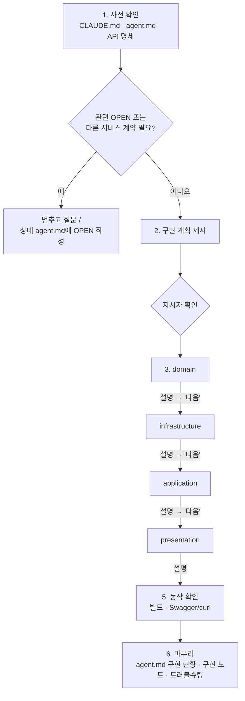

# impl-service — 학습형 서비스 구현

> 분류: 구현 · 절차 원본: [`.claude/skills/impl-service/SKILL.md`](../../.claude/skills/impl-service/SKILL.md)

## 목적
AI에게 기능 구현을 맡기면 코드는 빨리 나오지만 **무엇을 왜 만들었는지가 남지 않는다.** 이 skill은 AI가 정해진 순서로 계층마다 멈추며 설명하게 하고, 끝나면 처리 과정과 핵심을 구현 노트로 남기게 한다.

## 이럴 때 쓴다
- 외부 API(U/H/C/P/O/D-xx)나 내부 API(I-xx) 구현
- 엔티티·상태 전이 메서드, FeignClient 작성
- 쓰지 않는 경우: 오타 수정·설정값 변경 같은 작은 수정, 문서 작업

## 호출
```
/impl-service hub-service H-06
/impl-service delivery-service 배송 엔티티와 상태 전이
```
"H-06 재고 입고 구현해줘"처럼 말해도 AI가 이 skill을 고를 수 있다.

## 진행 흐름



| 단계 | AI가 하는 일 | 지시자가 할 일 |
| --- | --- | --- |
| 1. 사전 확인 | 규칙·계약·명세 확인, 관련 `OPEN` 있으면 멈춤 | 결정이 필요하면 답하거나 담당자와 합의 |
| 2. 계획 | API 요약, 계층별 파일 목록, Feign 의존 제시 | 계획 확인 또는 수정 요청 |
| 3. 계층별 구현 | 한 계층 구현 후 **만든 것 / 핵심 / 연결된 규칙 / 생각해 볼 질문** 설명 | 읽고 이해되면 "다음", 궁금하면 질문 |
| 4. 체크리스트 | 논리 삭제, 응답 래핑, 페이징, 권한, 멱등, 타임아웃 등 점검 | - |
| 5. 동작 확인 | 빌드, 정상·에러 케이스 호출 결과 제시 | 결과 확인 |
| 6. 마무리 | `agent.md` §5 체크, 결정은 로그에, 구현 노트 작성 | 노트를 읽고 확인 질문에 답해 보기 |

## 설명을 줄이고 싶을 때
- 기본은 **같은 설명이 반복되더라도 계층마다 설명**한다.
- 이미 아는 주제는 이렇게 말하면 그 주제만 생략된다 (이후 계층·이후 API까지).
  - "Entity 설명은 이제 그만"
  - "소프트 삭제랑 `@SQLRestriction`은 알아"
- 생략한 주제는 구현 노트 `메모`에 `설명 생략: ○○`으로 남는다. **새 대화에서는 다시 설명**하므로 필요하면 다시 말한다.
- 계층마다 멈추지 않고 끝까지 진행하려면 "한 번에 끝까지 해줘" → 구현 후 계층별 설명을 몰아서 한다.

## 남는 결과물: 구현 노트
`Docs/team/구현-노트/{서비스}.md` 맨 아래에 API마다 섹션이 추가된다.

```markdown
## H-06 재고 입고 (2026-10-15)
### 처리 과정
- domain: HubStock에 increase(quantity) 추가 ...
- application: 상품 소속 허브 확인(I-08) → 재고 행 잠금 → 증가 ...
### 핵심
- 입고는 상품 소속 허브로만 가능 → 아니면 400 INVALID_REQUEST (hub-service/CLAUDE.md §1)
- ...
### 확인 질문
- 입고 중에 같은 상품으로 할당(I-05)이 동시에 들어오면?
### 메모
- 설명 생략: Entity 기본 구조
```
(위 내용은 형식 예시다.)

## 팁과 주의
- 계층 설명에서 이해가 안 되는 부분은 바로 물어보거나 `/learn-explain`으로 깊게 파고든다.
- 구현 노트의 **핵심**은 발표 자료로 그대로 쓸 수 있다. 확인 질문에 답하지 못하면 커밋 전에 다시 물어본다.
- AI가 "다른 서비스 계약이 필요하다"며 멈추면, 상대 서비스 `agent.md`에 남긴 `OPEN`을 담당자에게 공유한다.
