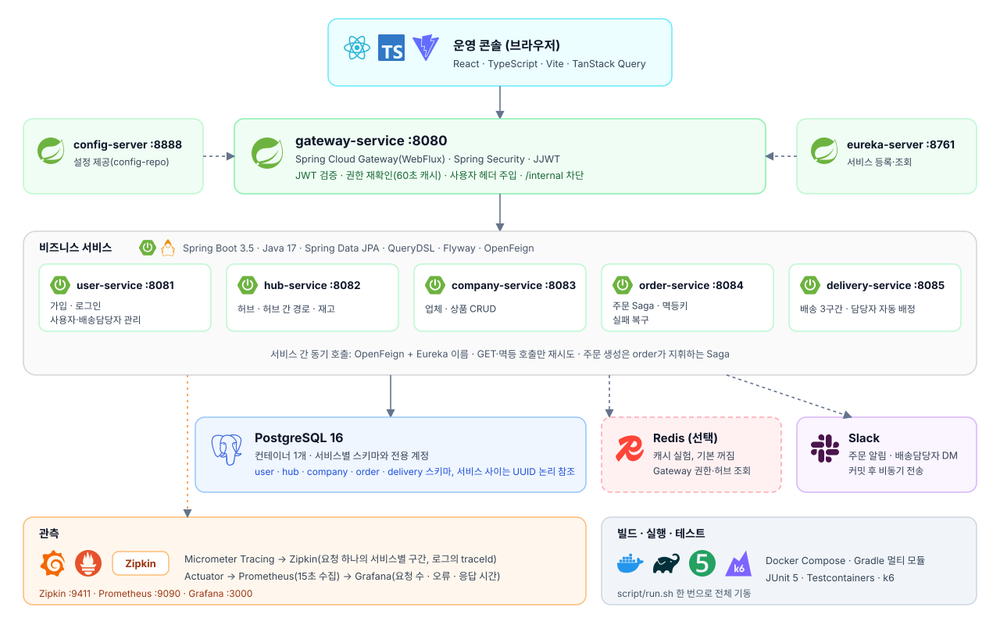
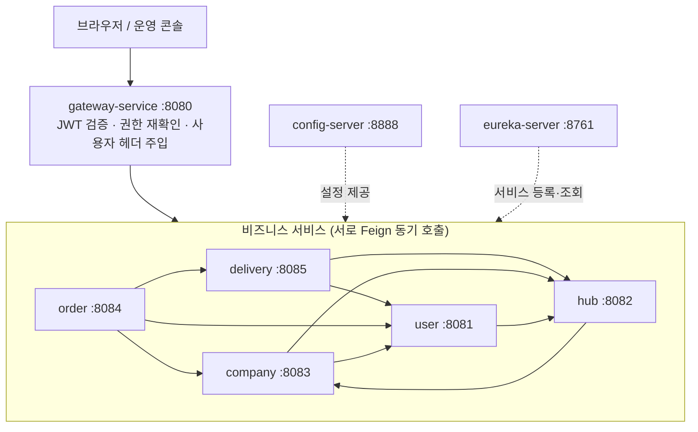
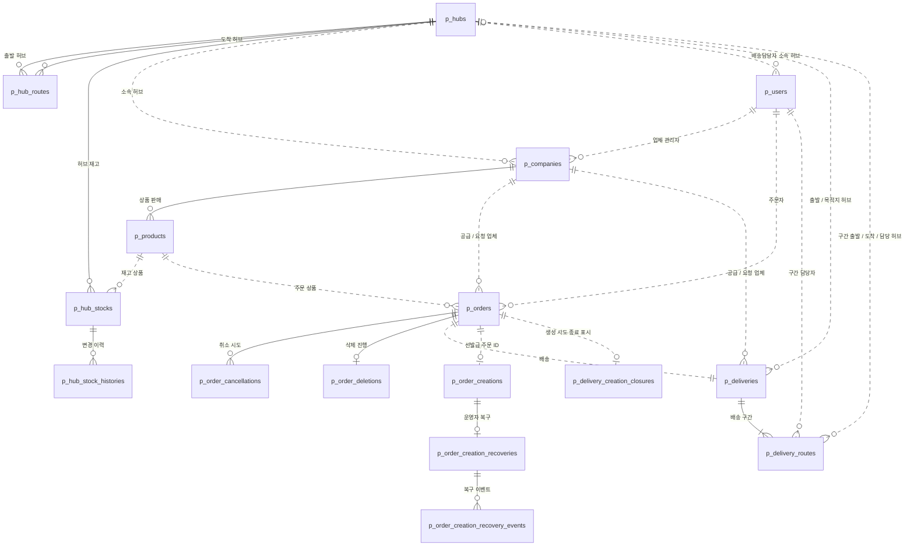
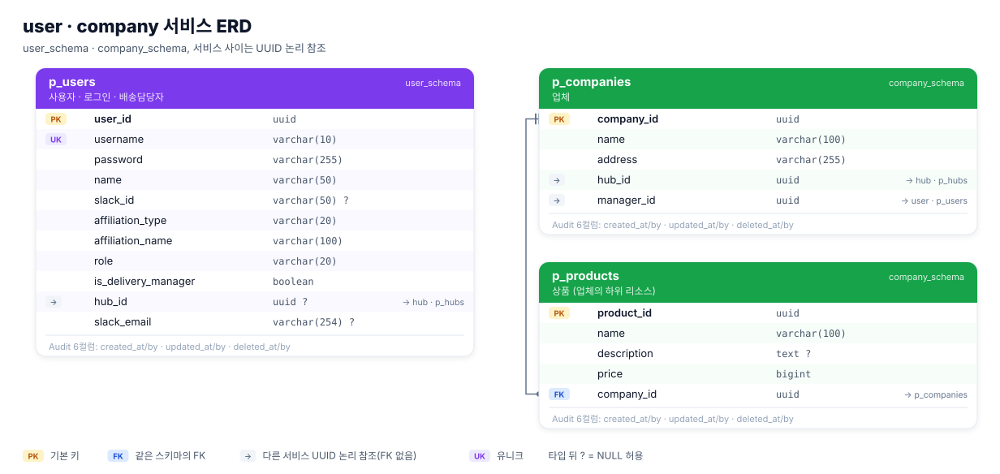
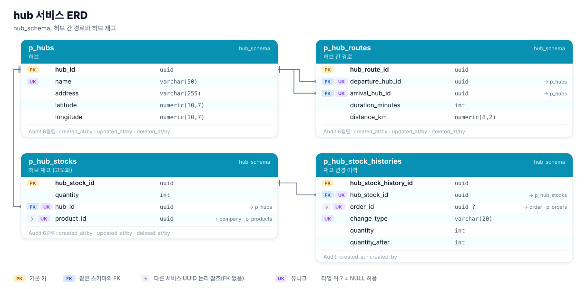
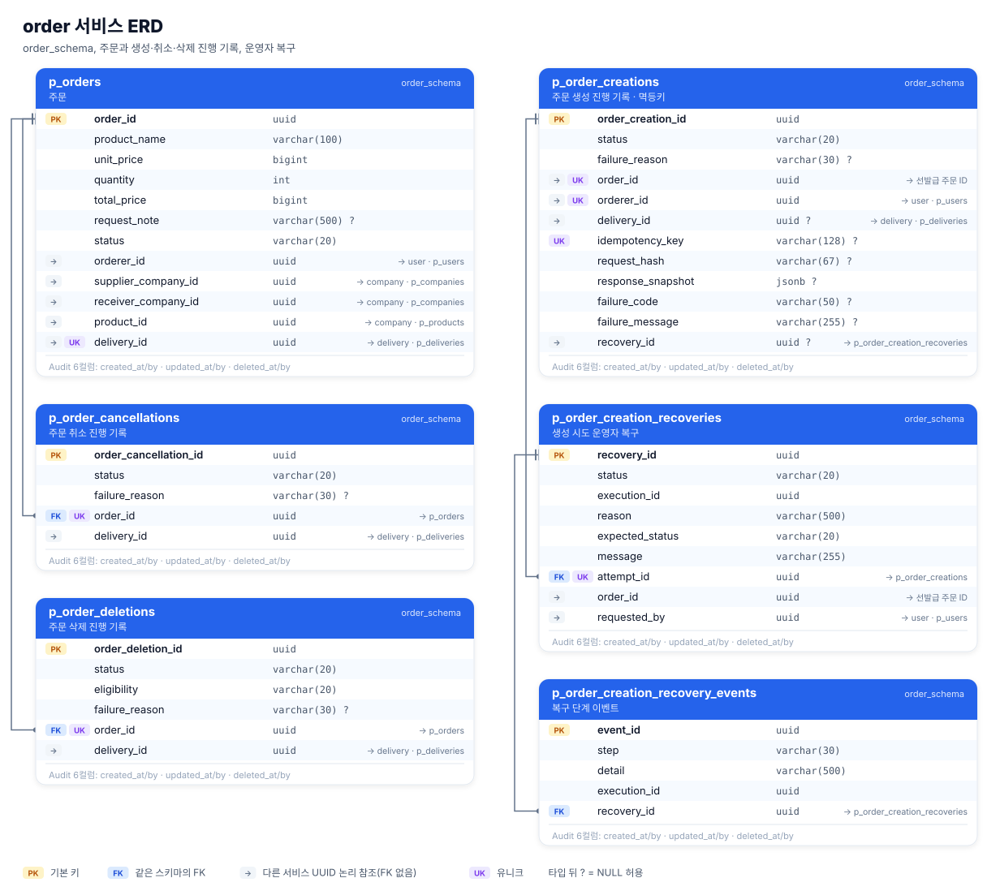
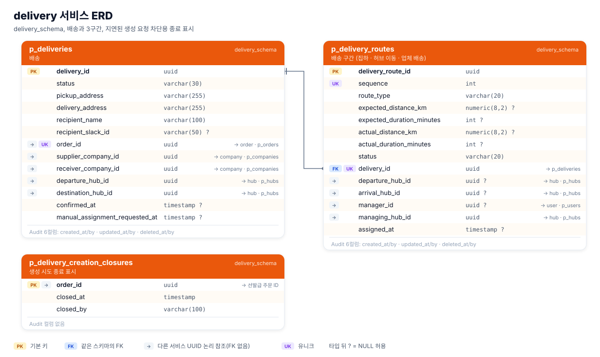
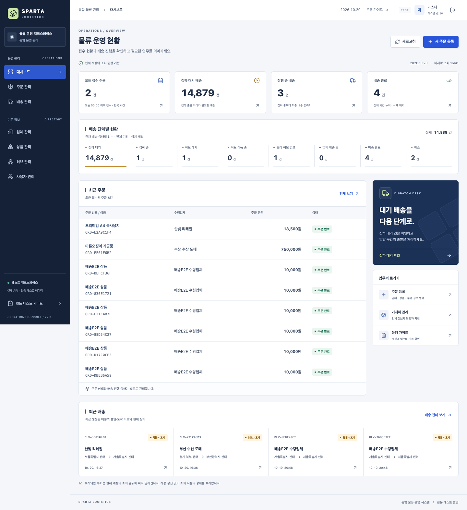
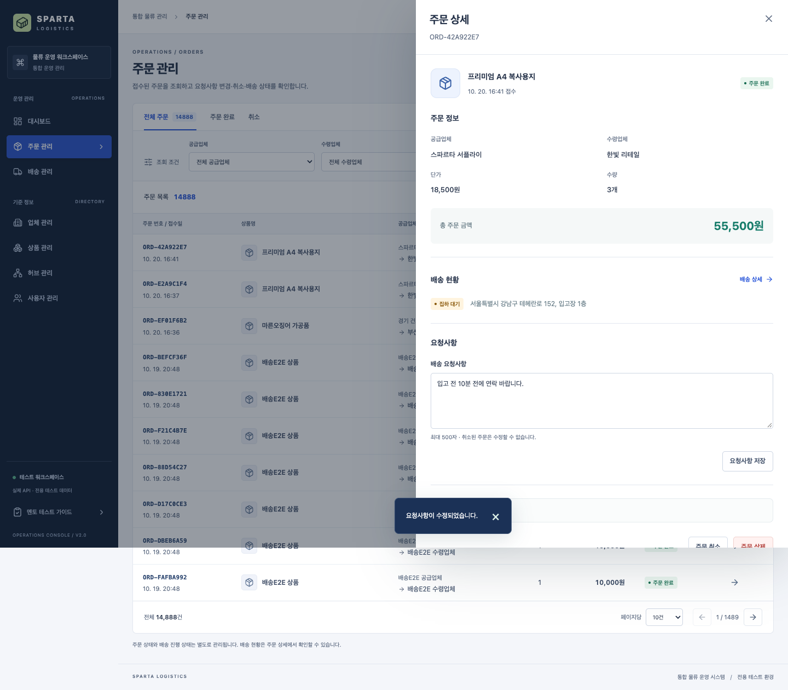
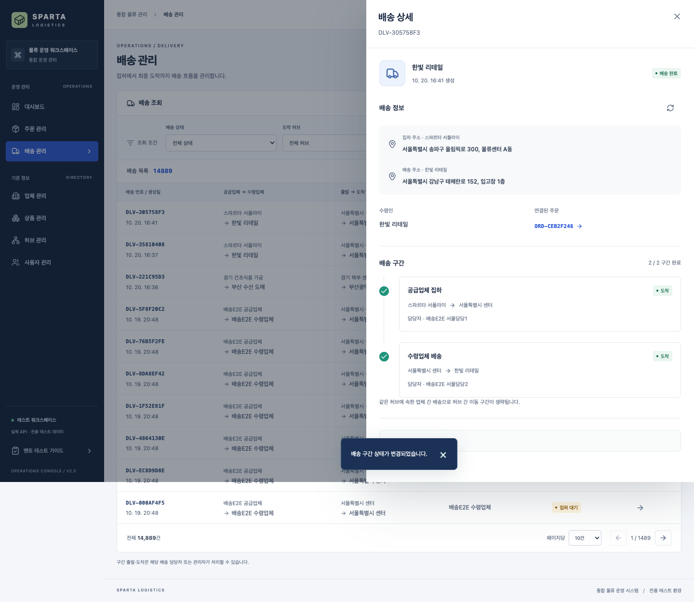

# logistics-management

물류 관리 MSA 프로젝트. Java 17, Spring Boot 3.5.16, Spring Cloud 2025.0.3, PostgreSQL 16.

`frontend/`의 React·TypeScript·Vite 운영 콘솔은 Node.js 24·npm으로 별도 빌드한다. **Gradle 빌드에는 프런트가 포함되지 않는다.** 전체 검증 명령은 [백엔드·프런트 빌드 기준](docs/guides/full-build.md), 화면 실행은 [frontend README](frontend/README.md)를 따른다. AI 에이전트는 루트 `AGENTS.md`와 `CLAUDE.md`에서 같은 기준을 읽는다.

## 프로젝트 목적

전국 허브를 거쳐 업체 사이에 물건을 옮기는 B2B 물류 시스템을 마이크로서비스로 만든다. 요청업체가 공급업체의 상품을 주문하면 공급업체 → 공급업체 허브 → 요청업체 허브 → 요청업체 순서로 배송이 만들어지고, 구간마다 배송담당자가 배정된다.

기능 구현보다 마이크로서비스에서 어렵다고 알려진 부분을 직접 다뤄 보는 데 더 무게를 뒀다. 서비스 경계와 데이터 소유권을 나누는 일, 하나의 DB 트랜잭션으로 묶을 수 없는 주문 생성을 Saga와 보상으로 처리하는 일, 타임아웃처럼 결과를 알 수 없는 상황에서 중복 없이 재시도하고 복구하는 일이 그것이다. 재고는 무한하다고 가정해 기본 범위에서 뺐고, 허브 재고와 캐시, 분산 추적, 메트릭은 기본 기능을 마친 뒤 고도화로 붙였다.

## 팀원과 역할

3조 6명이 서비스를 나눠 맡았다. 역할은 PR·커밋 이력과 서비스별 협업 문서를 기준으로 정리했다.

| 팀원 | 맡은 일 |
|---|---|
| 안준현 | order-service(주문 생성 Saga, 멱등키, 취소·삭제, 운영자 복구), 운영 콘솔(frontend), 공통 인프라 통합(common·common-core·gateway·config), Micrometer Tracing·Zipkin과 Prometheus·Grafana 도입, 코드 품질 감사와 수정 |
| 권민혁 | user-service(가입·로그인·사용자 관리·배송담당자 지정), Redis 캐시 A·B·C 구현과 성능 측정 |
| 지한얼 | delivery-service(배송·구간 생성, 담당자 자동 배정, 상태 관리), 구간 담당자 배정의 비동기 전환, k6 부하 테스트 |
| 김은지 | company-service(업체·상품 CRUD, 내부 조회 API) |
| 최승근 | hub-service(허브·허브 간 경로 조회, 재고 관리 고도화) |
| 김진우 | 공통 인프라 설계 참여 |

각자 배운 내용은 [학습 노트](docs/learning/README.md)에 질문과 답으로 남겼다.

## 기술 스택

| 구분 | 기술 |
|---|---|
| 언어·빌드 | Java 17, Gradle 8.14 멀티 모듈(JDK 17 toolchain으로 고정) |
| 프레임워크 | Spring Boot 3.5.16, Spring Cloud 2025.0.3(Gateway, Eureka, Config Server, OpenFeign) |
| 인증·보안 | Spring Security, JJWT 0.13.0, BCrypt. 인증은 Gateway(WebFlux)에서 한 번만 처리 |
| 데이터 | PostgreSQL 16(서비스별 스키마·계정), Spring Data JPA, QueryDSL 7.7, Flyway |
| 캐시(선택) | Caffeine(기본), Redis(실험, 기본 꺼짐) |
| 관측 | Micrometer Tracing + Zipkin, Prometheus + Grafana, 로그의 traceId |
| API 문서 | springdoc-openapi 2.8.17(Swagger UI) |
| 외부 연동 | Slack Incoming Webhook, Slack Web API(배송담당자 DM) |
| 테스트 | JUnit 5, Mockito, Testcontainers(PostgreSQL 16), k6(부하) |
| 프런트 | React 19, TypeScript, Vite, TanStack Query, Tailwind CSS 4, Playwright |
| 실행 | Docker, Docker Compose |

## 서비스 구성



서비스 사이의 Feign 호출 방향만 따로 그리면 다음과 같다.



모든 외부 요청은 Gateway 하나로 들어오고, 서비스끼리는 Eureka 이름으로 Feign 동기 호출을 한다. `/internal` API는 Gateway가 외부에서 막는다.

| 모듈 | 포트 | 역할 |
|---|---|---|
| config-server | 8888 | 설정 제공(`config-repo/`) |
| eureka-server | 8761 | 서비스 디스커버리 |
| gateway-service | 8080 | Spring Security(WebFlux): JWT 검증, 권한 재확인(60초 캐시), 사용자 헤더 주입, `/internal` 차단 |
| user-service | 8081 | 회원가입, 로그인(JWT 발급), 사용자·배송담당자 관리, 내부 사용자 조회 |
| hub-service | 8082 | 허브·허브 간 경로 조회, 재고 입고·검색·할당 |
| company-service | 8083 | 업체·상품 CRUD와 내부 조회 |
| order-service | 8084 | 주문 생성(Saga)·조회·수정·취소·삭제, 생성 실패 복구, Slack 알림 |
| delivery-service | 8085 | 배송과 3구간 생성, 담당자 자동 배정, 구간 상태 관리 |
| common-core | - | 웹 스택과 무관한 공통 계약: 에러 코드, 에러·성공 응답, 사용자 헤더 이름 (gateway와 서비스가 함께 사용) |
| common | - | MVC 서비스 공통: 예외 처리기, BaseEntity, `@CurrentUser`, `@RequireRole`, Feign 오류·헤더 처리, 페이지 규칙 |

## 시나리오 테스트
저장소를 받은 사람이 필수 기능을 직접 확인해 볼 수 있다. 전용 테스트 환경을 띄우고 http://127.0.0.1:5174/guide 에서 기능별 시나리오를 계정 버튼으로 차례로 확인한다. 실행 명령 4줄과 데이터는 [시나리오 테스트 안내](docs/guides/scenario-test.md)에 있다.

## 빠른 실행
```bash
script/run.sh                 # .env가 없으면 .env.example을 복사하고, 빌드 후 전체 기동(빌드는 Dockerfile 안에서 한다)
script/run.sh --check         # 기동 후 공통 인프라 완료 기준 6개 자동 확인(script/e2e-check.sh)
script/run.sh --reset         # DB 볼륨까지 지우고 새로 시작
script/run.sh hub-service     # 지정한 서비스만 다시 빌드·기동 (--scale hub-service=2도 된다)
script/db-check.sh            # 서비스 계정 5개의 실제 인증·스키마 접근 권한 확인
script/delivery-e2e-check.sh  # 배송 시드 데이터를 넣고 주문 → 배송 완료 전체 연결과 배송 API 규칙 확인(delivery-service/docs/e2e.md)
# 배송 부하 테스트(k6)는 delivery-service/docs/load-test.md
# 권한 재확인 60초 캐시와 만료 후 재조회까지 보려면 script/e2e-check.sh --with-cache-ttl (약 65초)
```
자세한 실행 방법(IDE 병행, 바꾼 것만 다시 올리기)은 [로컬 실행 가이드](docs/guides/local-run.md)에 있다.
- Eureka 대시보드: http://localhost:8761 (관리용 포트는 이 PC에서만 열린다)
- 분산 추적(Zipkin): http://localhost:9411 (로그 줄의 traceId로 요청 하나의 서비스별 구간을 본다)
- 메트릭 대시보드(Grafana): http://localhost:3000 (로그인 없이 보기. 요청 수·오류·응답 시간, [메트릭 모니터링](docs/guides/monitoring.md))
- API 진입점(Gateway): http://localhost:8080
- 종료: `docker compose down` (DB까지 지우려면 `docker compose down -v` 또는 다음 기동 때 `script/run.sh --reset`)
- 서비스 스키마·계정은 `infra/postgres/init.sh`가 빈 DB에서 처음 한 번 만들고, 테이블 변경은 Flyway가 관리한다(`*/src/main/resources/db/migration`).
- `.env`의 DB 비밀번호는 초기화 스크립트와 서비스 접속 설정에 함께 사용된다. 기존 볼륨의 계정 비밀번호는 `.env`를 바꿔도 자동 갱신되지 않는다.
- **공통 인프라 통합 후 처음 실행할 때는 DB를 새로 시작한다.** 개인 브랜치에서 쓰던 볼륨은 스키마·계정·마이그레이션 이력이 달라 이어 쓰지 않는다(팀 결정). `script/run.sh --reset`(또는 `docker compose down -v` 후 기동)으로 시작한다. `--reset` 없이는 기존 볼륨을 지우지 않는다.
- MASTER 계정: user-service가 기동할 때 `.env`의 `MASTER_USERNAME`/`MASTER_PASSWORD`(기본 `master` / `Master!2026`)로 만든다. 이미 있으면 그대로 둔다. 가입한 계정을 승격하려면 `script/promote-master.sh <username>` 실행 후 다시 로그인한다.

## 기존 환경과 병행하기

`.env`의 `COMPOSE_PROJECT_NAME`과 `POSTGRES_PORT`, `CONFIG_SERVER_PORT`, `EUREKA_PORT`, `GATEWAY_PORT`를 다르게 지정한다. 예를 들어 프로젝트 이름은 `logistics-integration`, 포트는 각각 `15432`, `18888`, `18761`, `18080`로 정한다. 컨테이너 내부 포트와 서비스 간 주소는 그대로다.

검증 스크립트는 현재 Compose 프로젝트를 사용하며 E2E는 실제 공개 포트를 조회한다. `GATEWAY`·`EUREKA` 환경 변수로 검증 URL을 직접 지정할 수도 있다. IDE에서 서비스를 함께 띄우면 실행 설정에 `DB_PORT`, `CONFIG_SERVER_URL`, `EUREKA_URL`을 바꾼 포트에 맞게 넣는다([로컬 실행 가이드](docs/guides/local-run.md) 3.4).

## 직접 확인하기
```bash
docker compose ps                         # postgres, config-server가 healthy인지
open http://localhost:8761                # Eureka: 서비스 6개 UP
open http://localhost:8080/swagger-ui.html

# 회원가입 → 로그인 → 토큰을 변수에 저장
curl -s -X POST localhost:8080/api/v1/auth/signup -H 'Content-Type: application/json' \
  -d '{"username":"hong01","password":"Sparta!2026","name":"홍길동","slackEmail":"hong@example.com","affiliationType":"COMPANY","affiliationName":"부산수산도매"}'
TOKEN=$(curl -s -X POST localhost:8080/api/v1/auth/login -H 'Content-Type: application/json' \
  -d '{"username":"hong01","password":"Sparta!2026"}' | python3 -c "import sys,json;print(json.load(sys.stdin)['data']['accessToken'])")

curl -s localhost:8080/api/v1/users/me    -H "Authorization: Bearer $TOKEN"   # 200, 내 정보
curl -s localhost:8080/api/v1/users -H "Authorization: Bearer $TOKEN"   # 403 FORBIDDEN (USER)
curl -s localhost:8080/api/v1/users/me                                        # 401 UNAUTHORIZED (토큰 없음)
curl -s localhost:8080/internal/users/x          -H "Authorization: Bearer $TOKEN"   # 404 (외부 차단)

MASTER=$(curl -s -X POST localhost:8080/api/v1/auth/login -H 'Content-Type: application/json' \
  -d '{"username":"master","password":"Master!2026"}' | python3 -c "import sys,json;print(json.load(sys.stdin)['data']['accessToken'])")
curl -s localhost:8080/api/v1/users -H "Authorization: Bearer $MASTER"  # 200 (기동 시 만든 MASTER)

docker compose logs -f user-service                                                  # 로그 보기
docker compose exec gateway-service curl -s http://user-service:8081/actuator/health # 내부 헬스 체크
```

## ERD

서비스마다 스키마를 따로 두고, 서비스 사이의 참조는 FK 없이 UUID로만 잇는다. 아래 그림에서 실선은 같은 스키마 안의 FK, 점선은 서비스 사이의 논리 참조다. 테이블은 모두 18개다.



컬럼을 모두 보여 주는 서비스별 ERD는 아래와 같다. 마이그레이션(`*/src/main/resources/db/migration`)을 임시 PostgreSQL 16에 적용해서 뽑은 현재 스키마다. Audit 컬럼 6개(`created_at`, `created_by`, `updated_at`, `updated_by`, `deleted_at`, `deleted_by`)는 `BaseEntity`가 넣는 공통 컬럼이라 테이블마다 한 줄로 줄였다. 설계 문서의 ERD와 컬럼 설명은 [SA 문서 4장](docs/SA/sparta-logistics-sa.md), dbdiagram.io용 DBML은 같은 문서의 부록 10.2에 있다.









## 화면

운영 콘솔은 `frontend/`의 React 앱이다. 아래는 전용 테스트 환경에서 실제 서버와 연결해 찍은 화면(2026-10-20)이다.

| 대시보드 | 주문 상세 |
|---|---|
|  |  |



## 설계에서 신경 쓴 부분

- **주문 생성은 Saga로 처리한다.** 주문, 배송, 업체가 서로 다른 DB를 쓰므로 하나의 트랜잭션으로 묶지 않는다. order-service가 흐름을 지휘하고 저장이 실패하면 배송 생성을 닫는 보상 호출을 보낸다. 2PC는 코디네이터가 단일 장애점이 되고 HTTP 서비스 사이에서는 현실적이지 않아 대안에서 뺐다([order ADR 0001](docs/services/order/decisions/0001-order-creation-orchestration-saga.md), [Saga와 분산 트랜잭션 질문 노트](docs/learning/junhyun/qna/2026-10-21-saga-vs-distributed-transaction.md)).
- **결과를 모를 때를 먼저 생각했다.** 주문 번호를 저장 전에 발급해 배송 생성·확정·종료를 같은 번호로 재시도해도 안전하게 만들고, 주문 생성에는 `Idempotency-Key`를 필수로 받는다. 응답이 끊겨 결과를 모르면 실패로 단정하지 않고 `RECOVERY_REQUIRED`로 남겨 운영자가 확인한 뒤 복구한다([멱등성 노트](docs/learning/kmh/qna/2026-10-19-idempotency.md), [order ADR 0008](docs/services/order/decisions/0008-order-idempotency-key.md)).
- **동시 수정을 잠금으로 막았다.** 코드 품질 감사에서 상품 수정이 업체 삭제를 되돌리고, 업체명 수정이 관리자 이전을 되돌리는 경쟁을 재현했다. 업체 행을 먼저 잠그도록 고치고 PostgreSQL 통합 테스트로 잠금 대기를 확인했다. delivery에서는 늦게 도착한 생성 요청을 종료 표시와 advisory lock으로 막는다([감사 기록](docs/reviews/2026-10-20-code-quality-audit.md)).
- **배송담당자 배정은 비동기로 바꿨다.** 배송을 만들 때 동기로 잠금을 걸고 배정했더니 부하에서 서비스가 멈췄다. 배정을 허브별 배치로 분리하고 담당자가 없는 구간은 출발하지 못하게 했다([지한얼 학습 노트](docs/learning/haneol/qna/2026-10-19-sync-lock-vs-async-assignment.md)).
- **인증은 Gateway 한 곳에서 한다.** Gateway(WebFlux)가 JWT를 검증하고 실제 권한을 다시 확인한 뒤 `X-User-*` 헤더를 넣는다. 그래서 웹 스택과 무관한 계약은 `common-core`, MVC 서비스 공통은 `common`으로 나눴다([common과 common-core](docs/learning/kmh/qna/2026-10-19-common-vs-common-core.md), [Gateway 인증·인가 흐름](docs/learning/kmh/qna/2026-10-19-gateway-user-auth-flow.md)).
- **캐시는 측정으로 판단했다.** Redis 캐시를 기본 꺼짐으로 넣고, 같은 조건에서 3회씩 측정해 채택 여부를 제안했다. Gateway 권한 캐시를 Redis로 두면 권한 변경 반영이 60초에서 수 ms로 줄었고, 허브 조회는 로컬 캐시에서 p50이 3.2ms에서 2.3ms, hub CPU가 20%에서 10%로 줄었다. 업체·상품 캐시는 차이가 편차 안이라 기각을 제안했다. 로컬 Docker의 상대 비교이며 팀 리뷰 전의 제안이다([ADR 0019](docs/decisions/0019-redis-cache-measured-adoption.md), [성능 측정 기록](docs/reviews/performance/README.md)).
- **요청 하나를 따라갈 수 있게 했다.** 로그의 traceId로 Zipkin에서 서비스별 구간을 보고, Prometheus·Grafana로 요청 수·오류·응답 시간을 본다([메트릭 모니터링](docs/guides/monitoring.md)).

## 문서
[문서 지도](docs/README.md)에서 시작한다. 무엇을 어디에 쓰고, 상황마다 무엇을 읽는지 정리돼 있다.

- 설계: `docs/SA/sparta-logistics-sa.md`
- 팀 가이드(구현 순서, 리뷰, 로컬 실행, 설정 보안, Git, 문서 작성): `docs/guides/`
- 서비스 협업 창구(API 계약, 구현 현황, 요청 기록): `docs/services/`
- 결정 기록: `docs/decisions/`, 서비스 결정은 `docs/services/{service}/decisions/`
- 에러 코드: `docs/error-codes.md`, 문제 해결 기록: `docs/troubleshooting.md`
- AI 에이전트 규칙: `AGENTS.md`, `docs/agents/`, 모듈별 `{module}/AGENTS.md`, 공용 스킬 `.agents/skills/`
- 학습 노트(사람별): `docs/learning/`
- 공통 인프라 범위와 통합 검토: `docs/progress/공통 인프라 개발 범위.md`, `docs/reviews/`
