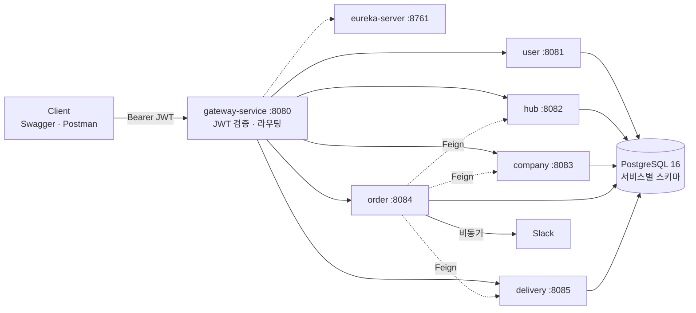

# logistics-management

> 내배캠 3조 "로컬에선 되는데요?" · 2026-10-12 ~ 10-22 (발표 10/22)

전국 17개 허브를 운영하는 B2B 물류 회사의 **주문·재고·배송 MSA**입니다.
업체가 상품을 주문하면 공급업체 허브의 재고를 할당하고, 허브 간 이동을 거쳐 요청업체까지 배송합니다. 프론트엔드 없이 REST API만 제공합니다 (Swagger UI / Postman).

```
주문 생성(order) → 재고 할당(hub) → 배송 생성(delivery) → 허브 이동 → 업체 배송 → 배송 완료
                    └─ 실패 시 역순 보상 (Saga 오케스트레이션)
```

## 아키텍처



- 외부 진입점은 Gateway(8080) 하나입니다. 인증은 Gateway에서만 하고, 하위 서비스는 Gateway가 넣어 준 `X-User-*` 헤더를 신뢰합니다.
- 서비스끼리는 OpenFeign으로 호출하고(`/internal/**`, 외부 차단), 서로의 DB에 접근하지 않습니다 (스키마·계정 분리).
- 자세한 구성: [Docs/04-인프라-구성도](Docs/04-인프라-구성도.md), [Docs/05-시스템-구조](Docs/05-시스템-구조.md)

## 서비스 구성

| 서비스 | 포트 | 책임 |
| --- | --- | --- |
| eureka-server | 8761 | 서비스 등록·조회 |
| gateway-service | 8080 | 단일 진입점, JWT 검증, 라우팅, `/internal/**` 차단 |
| user-service | 8081 | 회원가입·로그인(JWT 발급), 사용자·권한·배송담당자 관리 |
| hub-service | 8082 | 허브·허브 경로 조회, 재고(입고·할당·복원) |
| company-service | 8083 | 업체·상품 관리 |
| order-service | 8084 | 주문 생성(Saga 오케스트레이터)·취소·삭제, Slack 알림 |
| delivery-service | 8085 | 배송·허브 이동 구간 생성, 담당자 배정, 상태 관리 |

## 기술 스택

Java 17 · Spring Boot 3.5 · Spring Cloud 2025.0 (Gateway, Eureka, OpenFeign) · Spring Data JPA + QueryDSL · PostgreSQL 16 · Spring Security · JJWT · springdoc-openapi · Docker Compose · Slack Incoming Webhook

## 빠른 실행

호스트에 JDK가 없어도 됩니다 (Dockerfile이 컨테이너 안에서 Gradle 빌드).

```bash
cp .env.example .env            # JWT_SECRET 채우기: openssl rand -base64 32
docker compose up -d --build    # 전체 기동 (빈 캐시 첫 빌드 약 4분)
```

| 확인 | 주소 |
| --- | --- |
| Swagger UI (우측 상단에서 서비스 선택) | http://localhost:8080/swagger-ui.html |
| Eureka 대시보드 | http://localhost:8761 |
| 초기 MASTER 계정 | `.env`의 `MASTER_USERNAME` / `MASTER_PASSWORD` (기본 `master` / `master_local_pw`) |

일부 서비스만 IDE에서 실행하기, 수평 확장, 자주 겪는 문제는 [Docs/04-인프라-구성도 › 실행 방법](Docs/04-인프라-구성도.md#실행-방법)을 참고하세요.

## 문서 지도

| 문서 | 언제 보나 |
| --- | --- |
| [Docs/](Docs/README.md) | 설계(개요·ERD·API·인프라·시스템 구조), 개발 가이드, 트러블슈팅 |
| [Docs/reference/SA_Document.md](Docs/reference/SA_Document.md) | SA 원본 — **모든 설계의 최종 근거** |
| [CLAUDE.md](CLAUDE.md) | 전 서비스 공통 구현 규칙 (사람·AI 공용) |
| `{모듈}/CLAUDE.md` | 그 서비스의 세부 규칙 (도메인 규칙, 상태 전이, 컬럼 길이) |
| `{모듈}/agent.md` | 그 서비스의 API 계약, 구현 현황, 결정·논의 로그 (`OPEN` → `DECIDED` → `DONE`) |

## 협업 방식

- 작업 전에 루트 `CLAUDE.md`와 내 서비스의 `CLAUDE.md`·`agent.md`를 읽습니다.
- 다른 서비스의 코드는 고치지 않습니다. 계약 변경이 필요하면 상대 서비스 `agent.md` 로그에 `OPEN`으로 요청합니다.
- 브랜치: 공통 인프라 단계는 `{이름}/base-setting`. 이후 브랜치·커밋 규칙은 팀 결정 후 기재합니다.
- 자세한 흐름: [Docs/06-개발-가이드 › 작업 흐름](Docs/06-개발-가이드.md#작업-흐름)

## 팀

| 담당 | 이름 |
| --- | --- |
| 공통 인프라 (common, gateway, eureka) | (리뷰 후 기재) |
| user-service | (미정) |
| hub-service | (미정) |
| company-service | (미정) |
| order-service | (미정) |
| delivery-service | (미정) |
