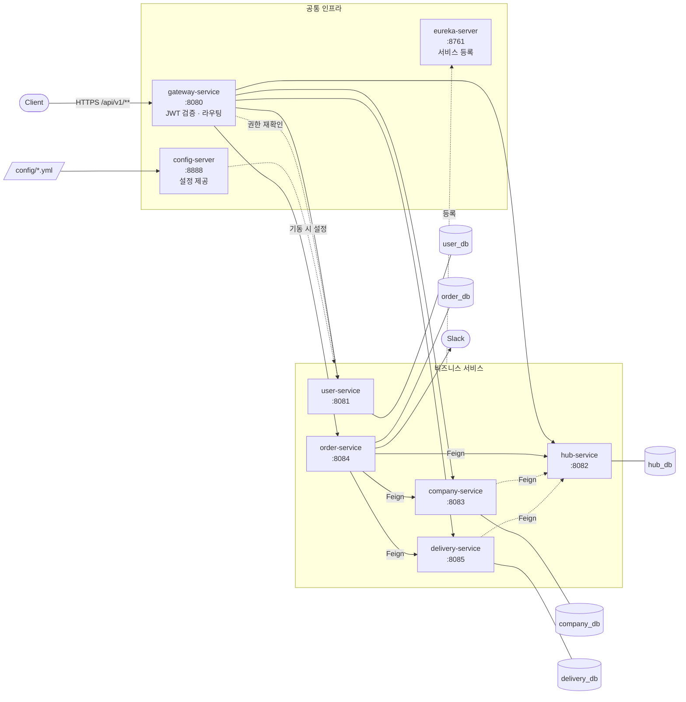
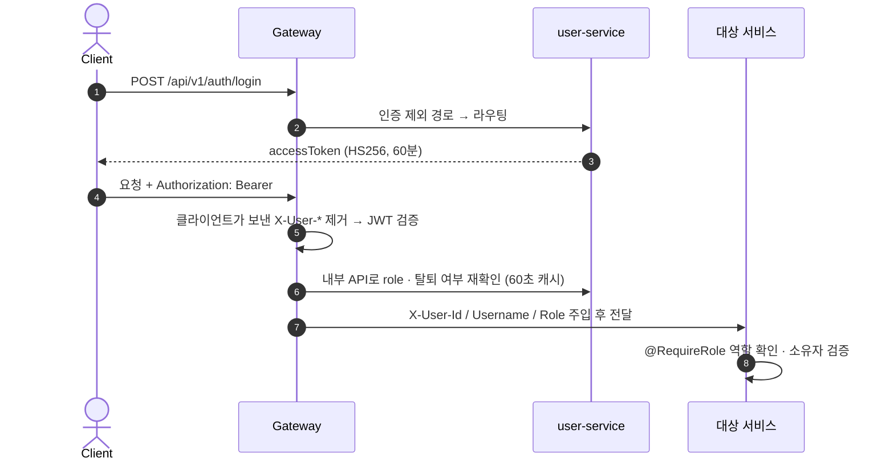
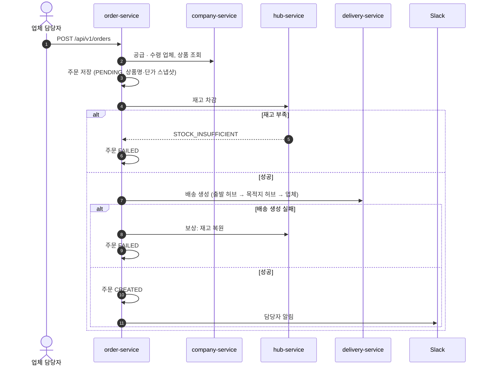
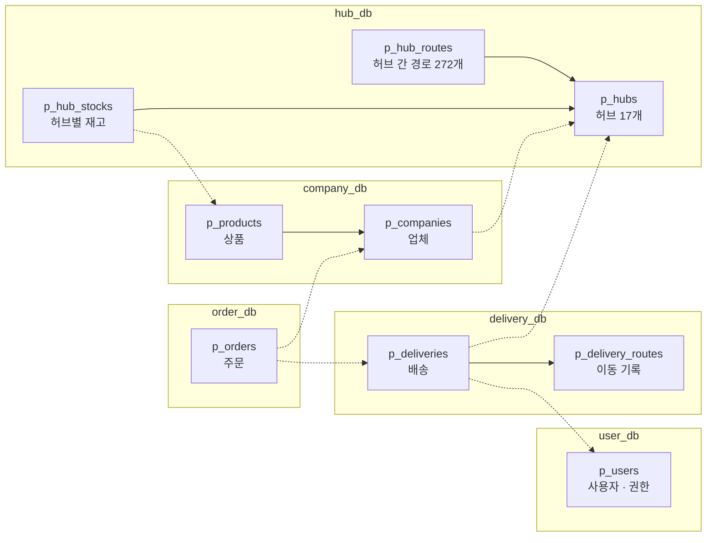

<div align="center">

# 🚚 스파르타 물류

**MSA 기반 국내 B2B 물류 관리 · 배송 시스템**

전국 17개 허브 · 허브 간 P2P 이동 · 업체 간 주문과 배송을 서비스 단위로 나눠 처리합니다

3조 「로컬에선 되는데요?」 · 2026.10.13 ~ 10.22


</div>

---

## 📌 프로젝트 소개

여러 업체가 전국 허브를 거쳐 물건을 주고받는 **B2B 물류 흐름**을 다룹니다.
업체가 다른 업체의 상품을 주문하면, 공급 업체 쪽 허브의 재고를 차감하고, 목적지 허브를 거쳐 수령 업체까지 가는 배송을 만들고, 담당자에게 Slack으로 알립니다.

이 과정을 **사용자 · 허브 · 업체 · 주문 · 배송** 5개 서비스로 나누고, 각 서비스가 자기 DB만 가지도록 설계했습니다.

### 이 프로젝트에서 풀고 싶은 문제

| 주제 | 어떻게 |
|---|---|
| 서비스 경계 | 도메인별 5개 서비스, 서비스마다 PostgreSQL 컨테이너 1개 (Database per Service) |
| 서비스 간 통신 | OpenFeign + Eureka 기반 로드밸런싱, `/internal/**` 내부 API |
| 분산 트랜잭션 | 주문 생성 Saga (재고 차감 → 배송 생성), 실패 시 보상 처리 |
| 인증 · 인가 | Gateway에서 JWT 검증 + 권한 재확인, 서비스는 `@RequireRole`로 역할 확인 |
| 설정 관리 | Spring Cloud Config로 공통·환경별·서비스별 설정을 한 폴더에서 |
| 실행 환경 | Docker Compose 한 번으로 전체 기동, 서비스 수평 확장 (`--scale`) |

### 주요 기능

| 영역 | 기능 | 상태 |
|---|---|---|
| 🔐 인증 | 회원가입, 로그인(JWT), Gateway 인증 · 권한 재확인 | ✅ 완료 |
| 👤 사용자 | 사용자 관리, 권한 · 배송담당자 지정 (MASTER) | 🛠 구현 중 |
| 🏢 허브 | 17개 허브 · 272개 허브 간 경로 조회, 허브별 재고 | 🛠 구현 중 |
| 🏭 업체 | 업체 · 상품 CRUD | 🛠 구현 중 |
| 📦 주문 | 주문 생성(Saga) · 취소(재고 복원), Slack 알림 | 🛠 구현 중 |
| 🚚 배송 | 배송 생성 · 상태 변경, 허브 간 이동 기록(예상 vs 실제) | 🛠 구현 중 |

---

## 🏗 아키텍처



| 구성 요소 | 역할 |
|---|---|
| **gateway-service** | 유일한 외부 진입점. JWT 검증, 사용자 헤더(`X-User-*`) 재주입, `/internal/**` 차단, 권한 재확인(60초 캐시) |
| **eureka-server** | 서비스 등록 · 조회. 같은 서비스 여러 인스턴스를 구분해 로드밸런싱 |
| **config-server** | 루트 `config/` 폴더의 설정을 각 서비스에 제공 (프로파일 `local` / `docker`) |
| **common 모듈** | 공통 응답 · 예외 · Audit(BaseEntity) · `@CurrentUser` · `@RequireRole` · Feign 헤더 전달 · 에러 변환 |
| **서비스별 DB** | 서비스마다 PostgreSQL 컨테이너. 다른 서비스 DB는 접근 불가, 참조는 UUID + Feign 검증 |

### 요청 흐름 — 인증



### 핵심 흐름 — 주문 생성 (Saga, 설계)



---

## 🗂 도메인 · 데이터



실선 = 같은 DB 안의 참조 · 점선 = 다른 서비스 ID 참조 (FK 없음, Feign으로 검증)

공통 규칙: PK는 UUID · 테이블 `p_` 접두사 · Audit 6컬럼 · 논리 삭제(`deleted_at`) · 주문 시점 상품명 · 단가는 스냅샷 저장.
테이블 상세는 [`doc/design/03-erd.md`](doc/design/03-erd.md), DDL 원본은 [`doc/sql/`](doc/sql/)

---

## 🛠 기술 스택

| 분류 | 사용 |
|---|---|
| Language | Java 17 |
| Framework | Spring Boot 3.3.5, Spring Data JPA, QueryDSL 5.1.0, Bean Validation |
| MSA | Spring Cloud 2023.0.3 — Gateway(WebFlux), Netflix Eureka, Config Server, OpenFeign, LoadBalancer |
| 인증 | JWT (jjwt 0.12.6, HS256), BCrypt |
| DB | PostgreSQL 16 (서비스별 컨테이너) |
| 문서 | springdoc-openapi 2.6.0 (Gateway에서 서비스별 Swagger 통합) |
| 인프라 | Docker, Docker Compose, Gradle 멀티 모듈 |
| 협업 | GitHub, Notion, Slack, Claude Code (`.claude/rules`) |

---

## 🚀 빠른 시작

```bash
cp .env.example .env          # 값 확인 (JWT_SECRET은 32자 이상)
script/run.sh                 # bootJar → user-db + eureka + config-server + gateway + user 실행
script/run.sh --profile domain   # 도메인 서비스까지 전부
script/run.sh --reset            # DB 볼륨 삭제 후 재실행 (DDL 변경 시)
```

| 확인 | 주소 |
|---|---|
| Swagger (Gateway 통합) | http://localhost:8080/swagger-ui.html |
| Eureka 대시보드 | http://localhost:8761 |
| Config Server | http://localhost:8888/user-service/docker |

```bash
# 동작 확인 — 최초 MASTER 계정은 .env의 MASTER_USERNAME / MASTER_PASSWORD로 자동 생성
curl -s -X POST localhost:8080/api/v1/auth/login -H 'Content-Type: application/json' \
  -d '{"username":"master01","password":"Master!234"}'
curl -s localhost:8080/internal/users/x            # → 404 (외부 차단)
curl -s localhost:8080/api/v1/users/me             # → 401 UNAUTHORIZED
```

IDE에서 서비스 하나만 실행: `docker compose up -d user-db eureka-server config-server` 후 Application 실행 (`local` 프로파일, DB는 localhost:5433~5437).
서버 올리는 방법(일부 서비스만, IDE, 바꾼 것만 다시 올리기)은 [로컬 실행 가이드](doc/guide/16-local-run.md), 막히면 [문제 해결](doc/guide/15-troubleshooting.md)

---

## 📁 프로젝트 구조

```
logistics-management/
├── backend/
│   ├── common/             # 공통 라이브러리 (응답 · 예외 · Audit · 인증 헤더 · Feign)
│   ├── eureka-server/      # :8761
│   ├── config-server/      # :8888
│   ├── gateway-service/    # :8080
│   ├── user-service/       # :8081  (user-db :5433)
│   ├── hub-service/        # :8082  (hub-db :5434)
│   ├── company-service/    # :8083  (company-db :5435)
│   ├── order-service/      # :8084  (order-db :5436)
│   └── delivery-service/   # :8085  (delivery-db :5437)
│       └── src/main/java/com/sparta/logistics/{service}/
│           ├── presentation/    # Controller, Request/Response
│           ├── application/     # Service, Command/Result
│           ├── domain/          # Entity, Repository 인터페이스, ErrorCode
│           └── infrastructure/  # JPA · QueryDSL, Feign, 설정
├── config/                 # Spring Cloud Config 설정 저장소
├── doc/                    # 설계 문서 · 가이드 · 서비스별 DDL
├── .claude/rules/          # 코드 컨벤션 (레이어별)
├── script/                 # run.sh, docs-check.sh
└── docker-compose.yml
```

---

## 📚 문서

| 문서 | 내용 |
|---|---|
| [01 개요](doc/design/01-overview.md) | 범위 · 일정 · 담당 |
| [02 아키텍처](doc/design/02-architecture.md) | 서비스 구성, common 모듈, 인증/인가, 통신, 인프라 |
| [03 ERD](doc/design/03-erd.md) | 테이블 규칙 · DB별 테이블 |
| [04 API](doc/design/04-api.md) | 공통 규약 · 서비스별 API |
| [06 ADR](doc/etc/06-adr.md) | 설계 결정 기록 |
| [가이드](doc/README.md#역할별로-먼저-볼-문서) | 서비스 개발 순서 · Config 운영 · Git 규칙 · 리뷰 체크리스트 · 문제 해결 |
| [코드 컨벤션](.claude/rules/README.md) | Controller · Service · Domain · Repository · DDL · 테스트 규칙 |

기준 문서는 Notion SA 문서이고, `doc/`은 그중 **코드로 구현된 내용**을 관리합니다.

---

## 👥 팀

| 이름 | 역할 | 담당 |
|---|---|---|
| 한얼 | | 공통 인프라 |
| | | user-service |
| | | hub-service |
| | | company-service |
| | | order-service |
| | | delivery-service |

### 일정

| 날짜 | 내용 |
|---|---|
| 10/13(화) | SA 제출 · 공통 인프라 구현 |
| 10/14(수) | 공통 인프라 채택 · 도메인 구현 시작 |
| 10/21(화) 20:00 | 제출 |
| 10/22(수) 10:00 | 발표 |
