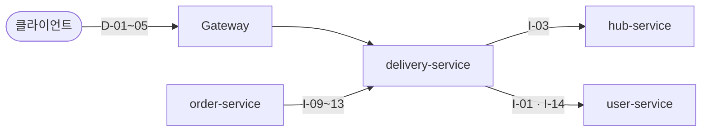

# 배송 API 명세 (delivery-service)

> 최종 수정: 2026-10-19 · 담당: 한얼 · 상태: **구현 (D-01~05, I-09~13. I-03·I-14 제공 전이라 Gateway 경유 미확인)**
> 기준: Notion SA(스파르타물류_SA문서_Master) v2.0 — 6.1 공통 규약 · 6.2 외부 API · 6.3 내부 API · 6.8 배송 API 상세 · 7.3 멱등성
> 표기 — [SA] SA 원문 그대로 · [제안] SA에는 필드 목록만 있어 형식(JSON·상태 코드)을 채운 것, 구현하며 확정 · [미정] 상대 담당과 확인
> 설계 배경(상태·배정 규칙)은 [`delivery.md`](delivery.md)

배송 서비스가 **제공하는 API**(외부 D-01~05, 내부 I-09~13)와 **사용하는 API**(user I-01·I-14, hub I-03)를 요청·응답까지 한 곳에 모았다.

## 목차
0. [한눈에 보기](#0-한눈에-보기)
1. [공통 규약](#1-공통-규약)
2. [제공 — 외부 API (Gateway 경유)](#2-제공--외부-api-gateway-경유)
3. [제공 — 내부 API (order 전용)](#3-제공--내부-api-order-전용)
4. [사용 — 다른 서비스 API](#4-사용--다른-서비스-api)
5. [호출 순서 — 배송 생성(I-09) 한 번에 일어나는 일](#5-호출-순서--배송-생성i-09-한-번에-일어나는-일)

---

## 0. 한눈에 보기



| 구분 | ID | Method · URL | 누가 부르나 | 상세 |
|---|---|---|---|---|
| 제공·외부 | D-01 | `GET /api/v1/deliveries` | 클라이언트 | [SA] |
| 제공·외부 | D-02 | `GET /api/v1/deliveries/{deliveryId}` | 클라이언트 | [SA] |
| 제공·외부 | D-03 | `PATCH /api/v1/deliveries/{deliveryId}` | 현재 배송담당자인 업체 배송 구간 담당자, MASTER | [SA] |
| 제공·외부 | D-04 | `POST /api/v1/deliveries/{deliveryId}/routes/{routeId}/manager` | MASTER | [SA] |
| 제공·외부 | D-05 | `PATCH /api/v1/deliveries/{deliveryId}/routes/{routeId}/status` | 현재 배송담당자인 구간 담당자, MASTER | [SA] |
| 제공·내부 | I-09 | `POST /internal/deliveries` | order (주문 생성) | [제안] |
| 제공·내부 | I-10 | `GET /internal/deliveries/{deliveryId}` | order | [제안] |
| 제공·내부 | I-11 | `POST /internal/deliveries/{deliveryId}/cancel` | order (주문 취소) | [제안] |
| 제공·내부 | I-12 | `POST /internal/deliveries/{deliveryId}/cancel-revert` | order (취소 보상) | [제안] |
| 제공·내부 | I-13 | `DELETE /internal/deliveries/orders/{orderId}` | order (주문 삭제·생성 보상) | [제안] |
| 사용 | I-01 | `GET /internal/users/{userId}` (user) | 배송 → user | [제안] |
| 사용 | I-03 | `GET /internal/hub-routes?departureHubId=&arrivalHubId=` (hub) | 배송 → hub | [제안] |
| 사용 | I-14 | `GET /internal/users/delivery-managers?hubId=` (user) | 배송 → user | [제안] |

---

## 1. 공통 규약

### 1-1. 헤더
| 헤더 | 외부 요청 | 내부 요청 | 설명 |
|---|---|---|---|
| `Authorization: Bearer {token}` | 필수 | - | Gateway가 검증 |
| `X-User-Id` · `X-Username` · `X-User-Role` · `X-Delivery-Manager` | Gateway가 주입 | `FeignHeaderInterceptor`가 그대로 전달 | 서비스는 이 헤더만 신뢰 (`@CurrentUser UserContext`) |

### 1-2. 응답 형식
- **외부 API**: `ApiResponse` 래퍼 `{ "status", "message", "data" }`, 목록은 `data = { content, page, size, totalElements, totalPages, sort }`
- **내부 API**: 래퍼 없이 DTO 그대로 ([ADR 0010](../../../docs/decisions/0010-internal-api-unwrapped-response.md))
- **에러 (공통)**: `{ "status", "code", "message", "path", "timestamp", "errors"? }` — `errors`는 `VALIDATION_ERROR`일 때만
- 목록 공통 쿼리: `page`(0부터), `size`(10/30/50, 그 외 10), `sort`(기본 `createdAt,DESC`)

### 1-3. 배송에서 쓰는 에러 코드
| HTTP | code | 언제 |
|---|---|---|
| 400 | `VALIDATION_ERROR` | 형식 오류, 허브 이동 도착 시 실제 값 누락 |
| 400 | `MANAGER_HUB_MISMATCH` | 재배정 대상 소속 허브 ≠ 구간 담당 허브 |
| 403 | `FORBIDDEN` | 담당 구간이 아님, MASTER 전용 |
| 404 | `DELIVERY_NOT_FOUND` · `DELIVERY_ROUTE_NOT_FOUND` | 없음 / 다른 배송의 구간 |
| 404 | `DELIVERY_MANAGER_NOT_FOUND` | 구간 담당 허브에 배송담당자 0명, 재배정 대상이 없거나 배송담당자 아님 |
| 409 | `INVALID_STATUS_TRANSITION` | 앞 구간 도착 전 출발, 도착·취소된 구간, 집하 시작 후 취소, 업체 배송 출발 후 배송지 수정 |
| 503 | `SERVICE_UNAVAILABLE` | hub·user 호출 실패·타임아웃, user 서킷 브레이커·벌크헤드 거절 |

### 1-4. DeliveryResponse [SA] (SA 6.8)
D-02·D-03·D-04·D-05가 돌려주는 객체. D-01은 `routes`를 뺀 것.

| 필드 | 타입 | 설명 |
|---|---|---|
| deliveryId · orderId | UUID | |
| status | String | `PICKUP_WAITING` `PICKING_UP` `HUB_WAITING` `HUB_MOVING` `DEST_HUB_ARRIVED` `OUT_FOR_DELIVERY` `DELIVERED` `CANCELED` |
| supplierCompanyId · receiverCompanyId | UUID | 공급업체 · 요청업체 |
| departureHubId · destinationHubId | UUID | 공급업체 허브 · 요청업체 허브 |
| pickupAddress · deliveryAddress | String | 집하지 · 배송지 |
| recipientName · recipientSlackId | String | 수령인 |
| routes[] | Array | 단건 조회류만 |
| routes[].deliveryRouteId · sequence · routeType | UUID · Integer · String | `PICKUP` `HUB_TRANSFER` `LAST_MILE` |
| routes[].departureHubId · arrivalHubId | UUID | 집하는 출발 null, 업체 배송은 도착 null |
| routes[].expectedDistanceKm · expectedDurationMinutes | Decimal · Integer | 허브 이동만 |
| routes[].actualDistanceKm · actualDurationMinutes | Decimal · Integer | 도착 시 입력 |
| routes[].status · managerId | String · UUID | `WAITING` `MOVING` `ARRIVED` `CANCELED` · 구간 담당자 |
| createdAt · updatedAt | DateTime | |

---

## 2. 제공 — 외부 API (Gateway 경유)

### D-01. 배송 검색 [SA]
`GET /api/v1/deliveries` · 로그인

**조회 범위**: MASTER 전체 / 배송담당자(`X-Delivery-Manager=true`)는 담당 구간이 하나라도 있는 배송만 / 일반 USER 전체 (발제 기준)

| Query | 타입 | 필수 | 설명 |
|---|---|---|---|
| status | String | X | 배송 상태 |
| departureHubId · destinationHubId | UUID | X | 출발 · 목적지 허브 |
| managerId | UUID | X | 담당 구간이 있는 배송 |
| orderId | UUID | X | |
| supplierCompanyId · receiverCompanyId | UUID | X | |
| page · size · sort | | X | 정렬 허용: `createdAt`, `status` |

```http
GET /api/v1/deliveries?status=HUB_MOVING&size=10&sort=createdAt,DESC
Authorization: Bearer {accessToken}
```
Response `200 OK`
```json
{
  "status": 200, "message": "SUCCESS",
  "data": {
    "content": [
      { "deliveryId": "f9c8a7b6-…", "orderId": "e8b7f6a5-…", "status": "HUB_MOVING",
        "supplierCompanyId": "b5e4c3d2-…", "receiverCompanyId": "c6f5d4e3-…",
        "departureHubId": "0c6f1a52-…", "destinationHubId": "7d2e9b14-…",
        "pickupAddress": "경기도 고양시 일산동구 중앙로 1234", "deliveryAddress": "부산광역시 중구 자갈치해안로 52",
        "recipientName": "부산수산도매", "recipientSlackId": "U02BCDEF3GH",
        "createdAt": "2026-10-14T14:30:00", "updatedAt": "2026-10-15T09:00:00" }
    ],
    "page": 0, "size": 10, "totalElements": 1, "totalPages": 1, "sort": "createdAt,DESC"
  }
}
```
Error: 400 `VALIDATION_ERROR`

### D-02. 배송 단건 (구간 포함) [SA]
`GET /api/v1/deliveries/{deliveryId}` · 로그인 (배송담당자는 본인 담당 건만)

Response `200 OK`
```json
{
  "status": 200, "message": "SUCCESS",
  "data": {
    "deliveryId": "f9c8a7b6-5e4d-4c3b-9b0a-0f9e8d7c6b54", "orderId": "e8b7f6a5-4d3c-4b2a-8a9f-9e8d7c6b5a43",
    "status": "HUB_MOVING",
    "supplierCompanyId": "b5e4c3d2-…", "receiverCompanyId": "c6f5d4e3-…",
    "departureHubId": "0c6f1a52-…", "destinationHubId": "7d2e9b14-…",
    "pickupAddress": "경기도 고양시 일산동구 중앙로 1234", "deliveryAddress": "부산광역시 중구 자갈치해안로 52",
    "recipientName": "부산수산도매", "recipientSlackId": "U02BCDEF3GH",
    "routes": [
      { "deliveryRouteId": "1b0a9c8d-…", "sequence": 1, "routeType": "PICKUP",
        "departureHubId": null, "arrivalHubId": "0c6f1a52-…",
        "expectedDistanceKm": null, "expectedDurationMinutes": null,
        "actualDistanceKm": 12.40, "actualDurationMinutes": 35,
        "status": "ARRIVED", "managerId": "4ab96a75-…" },
      { "deliveryRouteId": "0a9d8c7b-…", "sequence": 2, "routeType": "HUB_TRANSFER",
        "departureHubId": "0c6f1a52-…", "arrivalHubId": "7d2e9b14-…",
        "expectedDistanceKm": 398.50, "expectedDurationMinutes": 290,
        "actualDistanceKm": null, "actualDurationMinutes": null,
        "status": "MOVING", "managerId": "4ab96a75-…" },
      { "deliveryRouteId": "3d2c1b0a-…", "sequence": 3, "routeType": "LAST_MILE",
        "departureHubId": "7d2e9b14-…", "arrivalHubId": null,
        "expectedDistanceKm": null, "expectedDurationMinutes": null,
        "actualDistanceKm": null, "actualDurationMinutes": null,
        "status": "WAITING", "managerId": "9b8a7c6d-…" }
    ],
    "createdAt": "2026-10-14T14:30:00", "updatedAt": "2026-10-15T09:00:00"
  }
}
```
Error: 403 `FORBIDDEN` (담당하지 않은 배송) · 404 `DELIVERY_NOT_FOUND`

### D-03. 배송지·수령인 수정 [SA]
`PATCH /api/v1/deliveries/{deliveryId}` · 현재 배송담당자인 업체 배송(`LAST_MILE`) 구간 담당자 본인, MASTER
업체 배송 출발(`OUT_FOR_DELIVERY`) 전까지만.

| Body | 타입 | 필수 | 설명 |
|---|---|---|---|
| deliveryAddress | String | X | 최대 255자 |
| recipientName | String | X | 최대 100자 |

보낸 필드만 수정. 둘 다 없거나 공백만 보내면 400 `VALIDATION_ERROR` (구현으로 확정)
```http
PATCH /api/v1/deliveries/f9c8a7b6-…
Content-Type: application/json

{ "deliveryAddress": "부산광역시 중구 자갈치해안로 60", "recipientName": "부산수산도매 2창고" }
```
Response `200 OK`: 수정된 `DeliveryResponse`
Error: 403 `FORBIDDEN` · 404 `DELIVERY_NOT_FOUND` · 409 `INVALID_STATUS_TRANSITION`

### D-04. 구간 담당자 재배정 [SA]
`POST /api/v1/deliveries/{deliveryId}/routes/{routeId}/manager` · MASTER

| Body | 타입 | 필수 | 설명 |
|---|---|---|---|
| managerId | UUID | O | 새 담당자. I-01로 배송담당자 여부·소속 허브 확인 |

```http
POST /api/v1/deliveries/f9c8a7b6-…/routes/0a9d8c7b-…/manager
Content-Type: application/json

{ "managerId": "5c4d3e2f-1a0b-4c9d-8e7f-6a5b4c3d2e1f" }
```
처리: I-01 조회(트랜잭션·잠금 밖) → 배송 행 잠금 → 배송담당자인가 → 소속 허브 = 구간 담당 허브인가 → 구간이 `WAITING`·`MOVING`인가 → `manager_id` 변경
같은 배송의 다른 변경과 겹치면 나중 요청이 기다렸다가 먼저 끝난 상태로 판단한다(도착·취소 뒤면 409). I-01 조회가 먼저라 없는 구간·배송이어도 `DELIVERY_MANAGER_NOT_FOUND`가 먼저 나올 수 있다.
Response `200 OK`: 수정된 `DeliveryResponse` (구간 포함)
Error: 400 `MANAGER_HUB_MISMATCH` · 403 `FORBIDDEN` · 404 `DELIVERY_NOT_FOUND` · `DELIVERY_ROUTE_NOT_FOUND` · `DELIVERY_MANAGER_NOT_FOUND` · 409 `INVALID_STATUS_TRANSITION` (도착·취소된 구간)

### D-05. 구간 상태 변경 [SA]
`PATCH /api/v1/deliveries/{deliveryId}/routes/{routeId}/status` · 현재 배송담당자인 그 구간 담당자 본인, MASTER

지정 해제 후 배정 ID만 남은 사용자는 D-03·D-05에서 403이다. 권한 캐시 반영 지연과 MASTER 수동 인계 절차는 [서비스 계약 DELIVERY-007](../../../docs/services/delivery/README.md#delivery-007-배송담당자-지정-해제-시-진행-중-구간-처리)을 따른다.

| Body | 타입 | 필수 | 설명 |
|---|---|---|---|
| status | String | O | `MOVING`, `ARRIVED`. 앞 구간이 `ARRIVED`여야 `MOVING` 가능 |
| actualDistanceKm | Decimal | △ | 허브 이동 `ARRIVED`면 필수, 나머지 선택 |
| actualDurationMinutes | Integer | △ | 〃 |

```http
PATCH /api/v1/deliveries/f9c8a7b6-…/routes/0a9d8c7b-…/status
Content-Type: application/json

{ "status": "ARRIVED", "actualDistanceKm": 402.30, "actualDurationMinutes": 305 }
```
같은 트랜잭션에서 배송 상태가 따라 바뀐다.

| 구간 | MOVING → 배송 | ARRIVED → 배송 |
|---|---|---|
| `PICKUP` | `PICKING_UP` | `HUB_WAITING` (같은 허브면 `DEST_HUB_ARRIVED`) |
| `HUB_TRANSFER` | `HUB_MOVING` | `DEST_HUB_ARRIVED` |
| `LAST_MILE` | `OUT_FOR_DELIVERY` | `DELIVERED` |

Response `200 OK`: 수정된 `DeliveryResponse` (구간 포함)
Error: 400 `VALIDATION_ERROR` (허브 이동 도착 시 실제 값 누락) · 403 `FORBIDDEN` · 404 `DELIVERY_ROUTE_NOT_FOUND` · 409 `INVALID_STATUS_TRANSITION` (`status`에 `WAITING`·`CANCELED`를 보낸 경우 포함)

---

## 3. 제공 — 내부 API (order 전용)

`/internal/**`은 Gateway에 라우트가 없어 외부에서 부를 수 없다. SA 6.3에는 필드 목록만 있어 JSON 형식은 [제안].

### I-09. 배송 생성 + 구간 담당자 자동 배정
`POST /internal/deliveries` · 호출: order (주문 생성 Saga ②) · 멱등키 `orderId`

| Body | 타입 | 필수 | 설명 |
|---|---|---|---|
| orderId | UUID | O | 선발급된 주문 ID |
| supplierCompanyId · receiverCompanyId | UUID | O | |
| departureHubId | UUID | O | 공급업체 허브 (I-07 `hubId`) |
| destinationHubId | UUID | O | 요청업체 허브 |
| pickupAddress · deliveryAddress | String | O | 공급업체 주소 · 요청업체 주소 |
| recipientName | String | O | 기본값 요청업체명 |
| receiverManagerId | UUID | O | 요청업체 관리자 → 배송이 I-01로 Slack ID 조회 |

```json
{
  "orderId": "e8b7f6a5-4d3c-4b2a-8a9f-9e8d7c6b5a43",
  "supplierCompanyId": "b5e4c3d2-…", "receiverCompanyId": "c6f5d4e3-…",
  "departureHubId": "0c6f1a52-…", "destinationHubId": "7d2e9b14-…",
  "pickupAddress": "경기도 고양시 일산동구 중앙로 1234",
  "deliveryAddress": "부산광역시 중구 자갈치해안로 52",
  "recipientName": "부산수산도매",
  "receiverManagerId": "a1b2c3d4-…"
}
```
Response `201 Created`, 같은 `orderId` 재요청·동시 요청이면 `200 OK` + 기존 값 (구현으로 확정). 응답은 I-10~I-12와 같은 DTO라 `orderId`도 담는다
```json
{ "deliveryId": "f9c8a7b6-5e4d-4c3b-9b0a-0f9e8d7c6b54", "orderId": "e8b7f6a5-4d3c-4b2a-8a9f-9e8d7c6b5a43", "status": "PICKUP_WAITING" }
```
Error: 404 `DELIVERY_MANAGER_NOT_FOUND` (저장 전 확인 → 남는 데이터 없음, order는 그대로 404) · 400 `VALIDATION_ERROR` · 503 `SERVICE_UNAVAILABLE` (I-03·I-14 실패 → order가 I-13 보상)

### I-10. 배송 조회
`GET /internal/deliveries/{deliveryId}` · 호출: order
Response `200 OK`
```json
{ "deliveryId": "f9c8a7b6-…", "orderId": "e8b7f6a5-…", "status": "HUB_MOVING" }
```
Error: 404 `DELIVERY_NOT_FOUND`

### I-11. 배송 취소
`POST /internal/deliveries/{deliveryId}/cancel` · 호출: order (주문 취소) · 멱등키 `deliveryId`
`PICKUP_WAITING`일 때만. 배송·구간 모두 `CANCELED`.
Response `200 OK` (이미 `CANCELED`여도 200)
```json
{ "deliveryId": "f9c8a7b6-…", "orderId": "e8b7f6a5-…", "status": "CANCELED" }
```
Error: 404 `DELIVERY_NOT_FOUND` · 409 `INVALID_STATUS_TRANSITION` (집하 시작)

### I-12. 취소 원복 (보상)
`POST /internal/deliveries/{deliveryId}/cancel-revert` · 호출: order (주문 취소 저장 실패 시) · 멱등키 `deliveryId`
취소는 `PICKUP_WAITING`에서만 일어나므로 `PICKUP_WAITING` + 구간 전부 `WAITING`으로 되돌린다. 취소 상태가 아니면(원복 후 재요청 등) no-op으로 현재 상태를 돌려준다.
Response `200 OK`
```json
{ "deliveryId": "f9c8a7b6-…", "orderId": "e8b7f6a5-…", "status": "PICKUP_WAITING" }
```
Error: 404 `DELIVERY_NOT_FOUND`

### I-13. 배송 삭제 (주문 삭제·생성 보상)
`DELETE /internal/deliveries/orders/{orderId}` · 호출: order · 멱등키 `orderId`
배송·구간 논리 삭제. 대상이 없거나 이미 삭제여도 성공. 어느 경우든 같은 orderId의 **종료 표시**를 남겨, 이후 같은 orderId의 I-09는 배송을 만들지 않고 409 `DELIVERY_CREATION_CLOSED`로 거절한다(이슈 #14). 반복 호출해도 표는 한 번만 남는다.
Response `204 No Content`

### I-17. 주문 생성 시도의 배송 결과 조회 (이슈 #14)
`GET /internal/deliveries/orders/{orderId}` · 호출: order

배송 ID를 받지 못한 생성 시도의 결과를 orderId로 확인한다.
Response `200 OK`
```json
{ "orderId": "e8b7f6a5-…", "state": "ACTIVE", "deliveryId": "f9c8a7b6-…", "status": "PICKUP_WAITING" }
```
| state | 의미 |
|---|---|
| `ACTIVE` | 배송이 있다. `deliveryId`, `status`가 채워진다 |
| `CLOSED` | 시도가 종료됐다(I-13). 이후 I-09는 거절되므로 활성 배송이 생기지 않는다고 단정할 수 있다. `deliveryId`, `status`는 null |
| `NONE` | 배송도 종료 표시도 없다. 원래 I-09가 실행 중이거나 아직 도착하지 않았을 수 있어 종료로 단정할 수 없다 |

I-09 Error에 409 `DELIVERY_CREATION_CLOSED`가 추가됐다.

---

### I-15. 주문 알림 수신자 조회 [로컬 확장·팀 리뷰 대기]

`GET /internal/deliveries/{deliveryId}/notification-recipients`, 호출자 order. [ADR 0016](../../../docs/decisions/0016-delivery-manager-slack-dm.md).

Response `200 OK` — 감싸지 않은 `{deliveryId, orderId, status, managerIds: [UUID]}`다. WAITING·MOVING 구간의 담당자만 중복 제거해 제공한다. 완료·취소 배송이면 managerIds는 빈 배열이고, 없음·논리 삭제는 404 `DELIVERY_NOT_FOUND`다.
I-10, 상태 전이, 담당자 배정 규칙은 유지한다. 알림용 이메일은 user I-16에서 조회하고 Slack 호출은 order가 맡는다. 조회 이후 재배정·취소까지 원자적으로 묶는 API는 아니다.

## 4. 사용 — 다른 서비스 API

배송이 부르는 쪽. 응답은 Feign DTO(infrastructure)에서 받아 **배송 용어로 바꿔** application에 넘긴다 (`delivery.md` §2-2).
- Feign 공통: `FeignHeaderInterceptor`가 `X-User-*` 전달, `FeignErrorDecoder`가 4xx는 상대 code 그대로, 5xx·타임아웃은 503 `SERVICE_UNAVAILABLE`
- 타임아웃: delivery는 user·hub 호출을 connect 1초 / read 2초로 덮어쓴다(`config-repo/delivery-service.yml`, 결정 로그 26). 평소 내부 조회는 수십 ms다. 공통값은 connect 5초 / read 20초(SA v2.0, `config-repo/application.yml`)
- 재시도: 연결 실패(거부, 연결 타임아웃)만 1번 더 보낸다(`ConnectFailureRetryConfig`). 읽기 타임아웃은 다시 보내지 않는다
- user 호출 보호(`UserClientAdapter`, Resilience4j): 벌크헤드 동시 10·대기 0, 서킷 브레이커는 최근 10초(최소 20건)에서 실패 50% 또는 1.5초 넘는 호출 80%면 열고 10초 뒤 3번 시험한다. 4xx는 실패로 세지 않는다. 거절은 503 `SERVICE_UNAVAILABLE`

### I-01. 사용자 단건 (user) [제안]
`GET /internal/users/{userId}`

Response `200 OK` (SA 6.3 필드)
```json
{
  "userId": "5c4d3e2f-1a0b-4c9d-8e7f-6a5b4c3d2e1f",
  "username": "gbn01",
  "role": "USER",
  "isDeliveryManager": true,
  "hubId": "0c6f1a52-8d3e-4a7b-9f21-5e8d7c6b4a31",
  "slackId": "U03CDEFG4HI"
}
```
Error: 404 `USER_NOT_FOUND` (없거나 탈퇴)

| 배송에서 쓰는 곳 | 쓰는 필드 | 결과 처리 |
|---|---|---|
| I-09 수령인 Slack ID | `receiverManagerId` → `slackId` | 성공 → `recipient_slack_id`. 404면 Slack ID 없이(NULL) 진행한다(구현으로 확정). user 장애(5xx·타임아웃·서킷/벌크헤드 거절)여도 Slack ID 없이 진행한다(부분 저하, 결정 로그 24) |
| D-04 재배정 검증 | `isDeliveryManager`, `hubId` | 404 또는 `isDeliveryManager=false` → 404 `DELIVERY_MANAGER_NOT_FOUND` / `hubId` ≠ 구간 담당 허브 → 400 `MANAGER_HUB_MISMATCH` / user 장애 → 503 `SERVICE_UNAVAILABLE` |

> 10/15 저장소 확인: user `InternalUserResult`에 `hubId`가 있다

### I-03. 허브 간 경로 (hub) [제안]
`GET /internal/hub-routes?departureHubId={공급업체 허브}&arrivalHubId={요청업체 허브}`
출발 허브 ≠ 목적지 허브일 때만 부른다 (허브 이동 구간 예상 값).

Response `200 OK`
```json
{ "hubRouteId": "2e1d0c9b-…", "distanceKm": 398.50, "durationMinutes": 290 }
```
| 쓰는 필드 | 저장 위치 |
|---|---|
| distanceKm · durationMinutes | `HUB_TRANSFER` 구간 `expected_distance_km` · `expected_duration_minutes` |

Error: [미정] 경로 없음 404 코드명(예: `HUB_ROUTE_NOT_FOUND`) — P2P 272건이 다 있으면 생기지 않음. 생기면 그대로 order에 전달 (주문 실패, `FeignErrorDecoder`가 코드를 보존)

> 10/15 기준 hub 미구현 → hub 담당. delivery는 이 계약대로 `HubClient`를 만들어 두었다 (SA 04 외부 `GET /api/v1/hub-routes/search`와 별개의 **내부** 경로)

### I-14. 허브별 배송담당자 목록 (user) [제안]
`GET /internal/users/delivery-managers?hubId={구간 담당 허브}`

Response `200 OK` — 배열 그대로 (래퍼 없음)
```json
[
  { "userId": "4ab96a75-6828-4673-a4fd-3da74f77bfb7", "slackId": "U01ABCDE2FG" },
  { "userId": "5c4d3e2f-1a0b-4c9d-8e7f-6a5b4c3d2e1f", "slackId": "U03CDEFG4HI" }
]
```
- 조건(user 쪽): `is_delivery_manager = true AND hub_id = :hubId AND deleted_at IS NULL`
- 없으면 **빈 배열** `[]` (404 아님) → 배송이 404 `DELIVERY_MANAGER_NOT_FOUND`로 바꿔 던진다
- [미정] 응답에 `name`이 없다 — 화면에 담당자 이름이 필요하면 추가 요청

| 배송에서 쓰는 곳 | 처리 |
|---|---|
| I-09 구간별 후보 | 후보마다 담당 건수(`WAITING`·`MOVING` 구간 수)를 세고 최소인 사람, 동점이면 userId 순 |

> 10/15 기준 user 미구현 → **user 담당**. delivery는 이 계약대로 `UserClient`를 만들어 두었다

---

## 5. 호출 순서 — 배송 생성(I-09) 한 번에 일어나는 일

```
order ──I-09──▶ delivery
                 1. orderId로 기존 배송 조회 → 있으면 바로 반환 (멱등)
                 2. 같은 허브?  아니면  I-03 (공급업체 허브 → 요청업체 허브)   ─▶ hub
                 3. 구간 담당 허브 목록 = {공급업체 허브, 요청업체 허브} (같으면 1개)
                    허브마다       I-14 (후보 목록)                         ─▶ user
                    후보 0명인 허브가 하나라도 → 404 DELIVERY_MANAGER_NOT_FOUND
                 4. I-01 (receiverManagerId → 수령인 Slack ID, user 장애면 NULL) ─▶ user
                 5. 구간별 담당자 선택 (담당 건수 최소, 동점 userId)
                 6. 배송 + 구간 2~3개 저장 (한 로컬 트랜잭션)
                 7. 201 { deliveryId, status: PICKUP_WAITING }
```
| 단계 | 실패 | 배송이 돌려주는 것 | order가 하는 것 (SA 7.1) |
|---|---|---|---|
| 2 · 3 | 5xx·타임아웃·서킷/벌크헤드 거절 | 503 `SERVICE_UNAVAILABLE` | I-13 보상 후 503 |
| 4 | user 장애 | 실패하지 않는다. Slack ID 없이 저장 | 없음 |
| 3 | 후보 0명 | 404 `DELIVERY_MANAGER_NOT_FOUND` | 보상 없이 404 (저장된 것 없음) |
| 6 | DB 오류 | 500 | I-13 보상 후 503 |

## I-18 생성 실패·운영자 복구용 조건부 종료 (로컬 확장)

`DELETE /internal/deliveries/orders/{orderId}/creation?expectedDeliveryId={UUID}`. expectedDeliveryId는 선택이며 전달하면 활성 배송 ID와 일치해야 한다.
orderId advisory lock → 배송 행 잠금 안에서 PICKUP_WAITING과 모든 구간 WAITING을 확인한다. 충족하면 배송·구간 논리 삭제와 종료 표시를 함께 커밋한다.
배송 없음·이미 종료는 204다. 진행·완료·취소·배송 ID/구간 불일치는 409 INVALID_STATUS_TRANSITION이며 종료 표시도 만들지 않는다.
현재 배송이 있는데 종료 표시도 있는 모순 상태도 거절한다. 생성 보상과 O-09가 사용하고, 완료 배송 삭제 O-06의 기존 I-13은 유지한다.
결정은 [ADR 0019](../../../docs/decisions/0019-order-creation-operator-recovery.md), 실제 검증은 복구 전후 보고서를 따른다.
