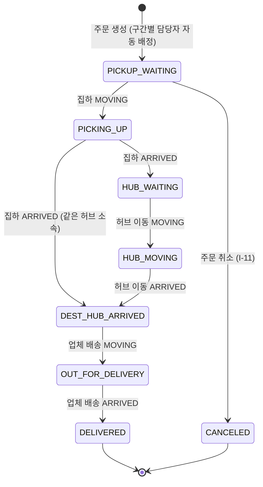
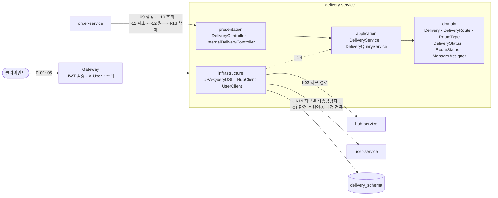
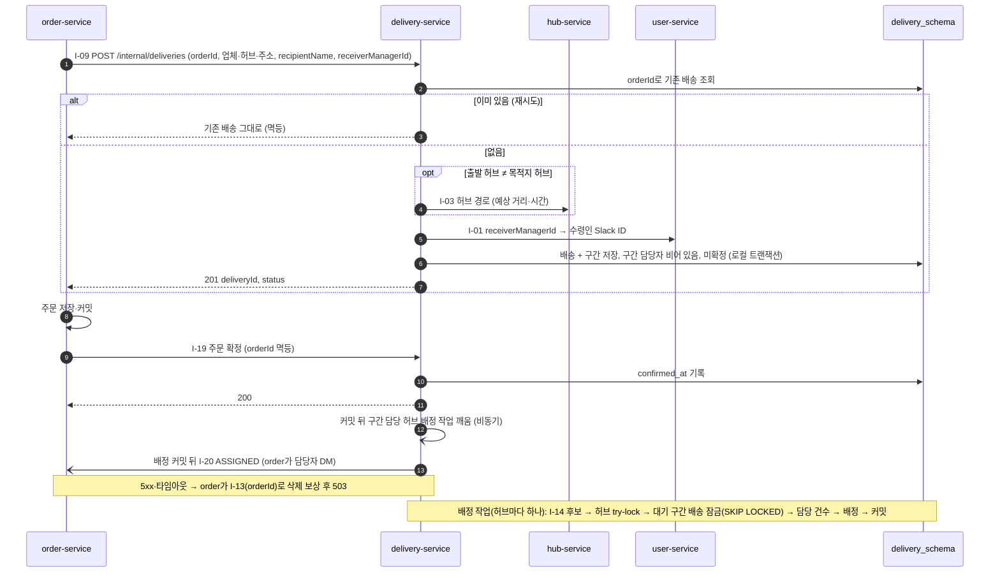
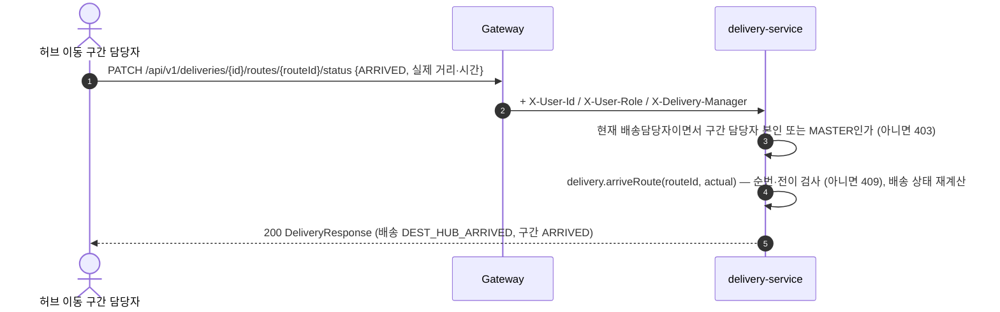
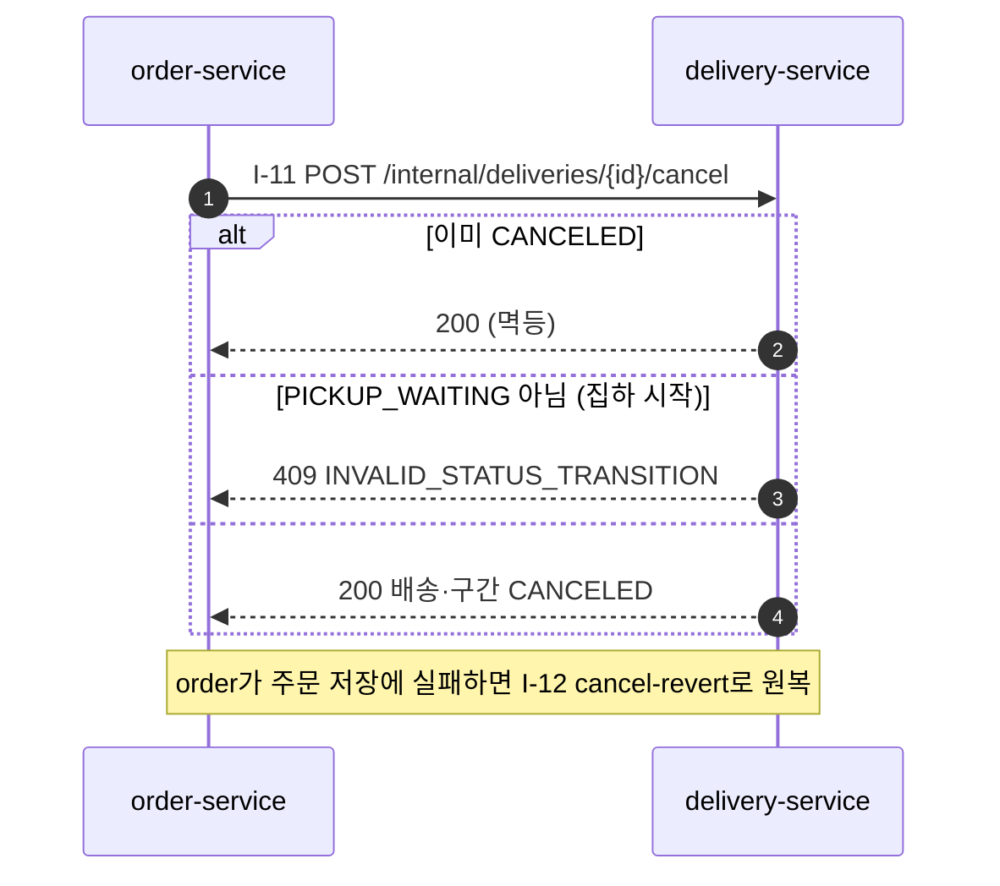
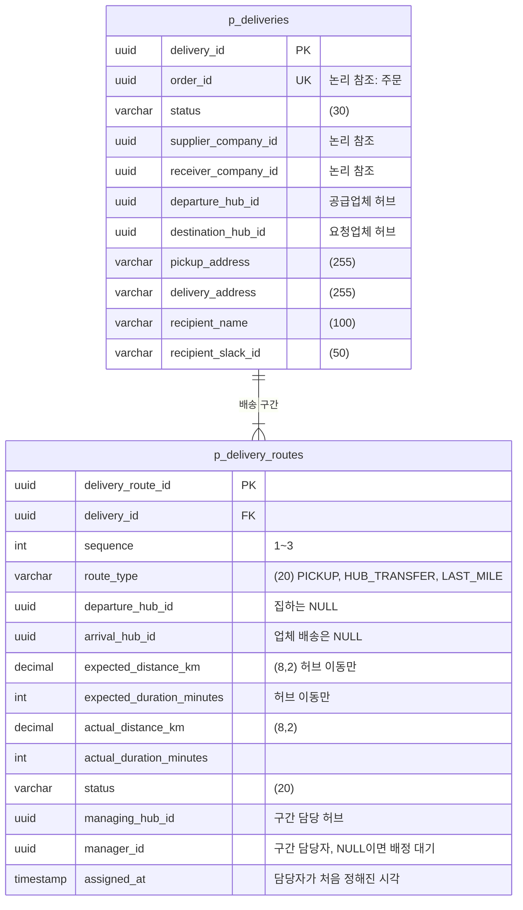

# 배송 도메인 설계 (delivery-service)

> 최종 수정: 2026-10-19 · 담당: 한얼 · 상태: **구현 (구현하며 정한 것은 결정 로그 16, 배정 분리는 27)**
> 기준: **Notion SA(스파르타물류_SA문서_Master) v2.0** (2026-10-13, 멘토 피드백 반영) — 1.5 #10·#13, 2.3, 2.5, 5.6, 6.2, 6.3, 6.8, 7.1~7.3, 8.4
> 표기 — [SA] SA 확정 · [제안] SA에 없음, 팀 합의 후 [SA] · [미정] 결정 필요
> 설계가 어떻게 정해졌는지는 [`delivery-decision-log.md`](delivery-decision-log.md)에 있다.
> 주의: Notion "스파르타 물류 MSA — 설계 문서"(03 ERD · 04 API · 05 서비스 흐름)는 SA v2.0 이전 내용이다. 배송은 **SA v2.0**(저장소 `docs/SA/sparta-logistics-sa.md`)을 따른다.

**목차**
1. [배송 도메인은 무엇을 하나](#1-배송-도메인은-무엇을-하나)
2. [배송 용어 (유비쿼터스 언어)](#2-배송-용어-유비쿼터스-언어)
3. [배송 상태와 흐름](#3-배송-상태와-흐름)
4. [구간 담당자 배정](#4-구간-담당자-배정)
5. [요청·응답 아키텍처](#5-요청응답-아키텍처)
6. [API 명세](#6-api-명세)
7. [ERD · 테이블 명세](#7-erd--테이블-명세)
8. [권한 정리](#8-권한-정리)
9. [에러 코드](#9-에러-코드)
10. [다른 서비스와 맞출 것 · 남은 결정](#10-다른-서비스와-맞출-것--남은-결정)
11. [구현 순서](#11-구현-순서)

---

## 1. 배송 도메인은 무엇을 하나

**주문 1건의 물건이 공급업체에서 요청업체까지 가는 과정(업체 to 업체)을 3구간으로 나눠 기록하고, 구간마다 담당자와 상태를 관리한다.**

```
 [공급업체] ──① 집하──▶ [공급업체 허브] ──② 허브 이동──▶ [요청업체 허브] ──③ 업체 배송──▶ [요청업체]
             PICKUP       = 출발 허브      HUB_TRANSFER     = 목적지 허브     LAST_MILE
             담당: 공급업체 허브 소속       담당: 공급업체 허브 소속             담당: 요청업체 허브 소속
```
두 업체가 같은 허브 소속이면 ② 허브 이동을 생략하고 ① 집하 → ③ 업체 배송 2구간만 만든다.

| 한다 | 하지 않는다 (다른 서비스 몫) |
|---|---|
| 주문 생성 시 배송 + 구간 생성, 구간별 담당자 **자동 배정** (I-09) | 주문 상태·금액 → order |
| 구간 상태 변경 → 배송 상태 자동 변경 (D-05) | 업체·주소·업체 관리자 → company (order가 조회해서 넘겨줌) |
| MASTER의 구간 담당자 재배정 (D-04) | 허브·허브 간 경로 → hub (I-03 조회만) |
| 배송지·수령인 수정 (D-03) | 사용자·배송담당자 여부·소속 허브 → user (I-01·I-14 조회만) |
| 주문 취소·취소 원복·삭제에 따른 배송 처리 (I-11·12·13) | Slack 알림 → order |
| 배송 조회·검색 (배송담당자는 본인 담당만) | 재고 → 고도화 (기본 범위에서 재고 무한) |

---

## 2. 배송 용어 (유비쿼터스 언어)

배송 서비스 안에서는 **이 표의 이름만** 쓴다. 다른 서비스의 이름(사용자, 소속 종류, 허브 경로 …)이 배송 코드에 그대로 들어오면 같은 말이 다른 뜻으로 섞인다.

### 2-1. 용어

| 용어 | 코드명 | 뜻 |
|---|---|---|
| 배송 | `Delivery` | 주문 1건 = 배송 1건. 공급업체 → 요청업체 전체 과정. 애그리거트 루트 |
| 배송 구간 | `DeliveryRoute` | 배송 안의 한 구간(1배송 2~3구간). 배송을 통해서만 생성·수정 |
| 구간 유형 | `RouteType` | `PICKUP`(집하) · `HUB_TRANSFER`(허브 이동) · `LAST_MILE`(업체 배송) |
| 집하 | `PICKUP` | 공급업체 → 공급업체 허브 |
| 허브 이동 | `HUB_TRANSFER` | 공급업체 허브 → 요청업체 허브. 같은 허브면 없음 |
| 업체 배송 | `LAST_MILE` | 요청업체 허브 → 요청업체 |
| 공급업체 / 요청업체 | `supplierCompanyId` / `receiverCompanyId` | 물건을 내보내는 업체 / 받는 업체 |
| 출발 허브 / 목적지 허브 | `departureHubId` / `destinationHubId` | 공급업체 허브 / 요청업체 허브 (배송 생성 시점 값) |
| 집하지 / 배송지 | `pickupAddress` / `deliveryAddress` | 공급업체 주소 / 요청업체 주소 (생성 시점 복사) |
| 수령인 | `recipientName`, `recipientSlackId` | 기본값 요청업체명, 요청업체 관리자의 Slack ID |
| 배송담당자 | `DeliveryManager` (값 객체) | user 중 `is_delivery_manager = true`이고 소속 허브(`hub_id`)가 있는 사람 |
| 소속 허브 | `managerHubId` | 배송담당자의 `hub_id` |
| 구간 담당 허브 | `RouteType.managingHub(route)` | 담당자를 고르는 기준. **구간 출발지를 관리하는 허브** — 집하는 도착 허브(공급업체 허브), 허브 이동·업체 배송은 출발 허브 |
| 구간 담당자 | `DeliveryRoute.managerId` | 구간을 맡은 배송담당자. 구간 담당 허브 소속 |
| 담당 건수 | `activeRouteCount` | 배송담당자가 맡은 구간 중 `WAITING`·`MOVING` 수 |
| 자동 배정 | `assign` | 배송 생성 시 구간마다 담당 건수가 가장 적은 배송담당자 지정 |
| 재배정 | `reassign` | MASTER가 구간 담당자를 바꾸는 것 (D-04) |
| 예상 / 실제 | `expected*` / `actual*` | 허브 경로 값(허브 이동만) / 도착 시 입력 값 (`RouteInfo` 값 객체) |
| 배송 취소 / 취소 원복 / 배송 삭제 | `cancel` / `revertCancel` / `delete` | 주문 취소(집하 전만) / 주문 취소 저장 실패 시 보상 / 주문 삭제·생성 보상 |

> 구간 담당자는 **사람의 종류가 아니라 배정된 자리**다. 같은 배송담당자가 한 배송에서 집하와 허브 이동을 모두 맡을 수도 있다 (둘 다 공급업체 허브 소속).

### 2-2. 다른 서비스 용어 → 배송 용어

Feign 응답 DTO(infrastructure)에서 배송 용어로 바꿔서 들여온다. domain·application에는 왼쪽 이름이 나오지 않는다.

| 서비스 | 그쪽 이름 | 배송에서 부르는 이름 | 비고 |
|---|---|---|---|
| user | 사용자 `User` | 배송담당자 `DeliveryManager` | 배송담당자가 아닌 사용자는 배송에 등장하지 않음 |
| user | `is_delivery_manager` | 배송담당자 여부 | role이 아니라 boolean (`DELIVERY_MANAGER` role 없음) |
| user | `hub_id` | 소속 허브 | 배송담당자면 NOT NULL (CHECK), 해제 시 NULL |
| user | `affiliation_type`·`affiliation_name` | **쓰지 않음** | 가입 시 입력한 소속 종류·이름일 뿐, 배정 기준이 아니다 |
| hub | 허브 경로 `HubRoute` | 예상 거리·시간 | 배송 구간(`DeliveryRoute`)과 다른 것 |
| company | 업체 관리 허브 | 출발 허브 / 목적지 허브 | 공급업체 → 출발, 요청업체 → 목적지 |
| company | 업체 주소 | 집하지 / 배송지 | 생성 시 복사 |
| company | 업체 관리자 `managerId` | 수령인 Slack ID를 찾는 데만 사용 (`receiverManagerId`) | 배송담당자와 다른 사람 |
| order | 주문 취소 / 주문 삭제 | 배송 취소 / 배송 삭제 | order가 I-11·I-13 호출 |

### 2-3. 쓰지 않는 말

| 쓰지 않는 말 | 이유 | 대신 |
|---|---|---|
| 허브 담당자 / 업체 담당자 (사람 유형) | user의 소속 종류(`affiliation_type`)와 섞인다 | 구간 담당자 (+ 구간 유형) |
| 업체 담당자 | company의 업체 관리자와 섞인다 | 업체 배송 구간 담당자 |
| 배송 경로 (기록) | hub의 허브 경로와 섞인다. SA v2.0 이름은 "배송 구간" | 배송 구간 |
| 담당 허브 (사람 쪽) | 구간 담당 허브와 섞인다 | 사람은 **소속 허브**, 구간은 **구간 담당 허브** |
| 담당자 명부 | 배송 서비스에 명부 테이블은 없다 | 배송담당자 (user I-14) |

**규칙** — 클래스·필드·에러 코드 이름은 2-1의 코드명만 쓴다. 새 용어는 이 표에 먼저 추가하고 코드에 쓴다.

---

## 3. 배송 상태와 흐름

### 3-1. 배송 상태 전이도 [SA] (SA 2.5)

**배송 상태는 직접 바꾸지 않는다.** 구간 상태를 바꾸면(D-05) 같은 트랜잭션에서 배송 상태가 따라 바뀐다.



### 3-2. 전이표 — 누가, 어떤 API로

| # | 배송 상태 | 누가 | API | 함께 바뀌는 것 |
|---|---|---|---|---|
| 0 | (생성) → `PICKUP_WAITING` | order (Saga) | I-09 | 구간 2~3개 `WAITING` 생성, 구간별 담당자 배정 |
| 1 | → `PICKING_UP` | 집하 구간 담당자 | D-05 집하 `MOVING` | |
| 2 | → `HUB_WAITING` (같은 허브면 `DEST_HUB_ARRIVED`) | 집하 구간 담당자 | D-05 집하 `ARRIVED` | 실제 값 선택 입력 |
| 3 | → `HUB_MOVING` | 허브 이동 구간 담당자 | D-05 허브 이동 `MOVING` | |
| 4 | → `DEST_HUB_ARRIVED` | 허브 이동 구간 담당자 | D-05 허브 이동 `ARRIVED` | **실제 거리·시간 필수** |
| 5 | → `OUT_FOR_DELIVERY` | 업체 배송 구간 담당자 | D-05 업체 배송 `MOVING` | |
| 6 | → `DELIVERED` | 업체 배송 구간 담당자 | D-05 업체 배송 `ARRIVED` | |
| C | `PICKUP_WAITING` → `CANCELED` | order (주문 취소) | I-11 | 구간 모두 `CANCELED` |
| R | `CANCELED` → `PICKUP_WAITING` | order (취소 보상) | I-12 | 구간 모두 `WAITING` |

MASTER는 1~6을 대신할 수 있다.

**규칙** [SA]
- 구간은 **순번대로만** 진행한다. 앞 구간이 `ARRIVED`여야 다음 구간을 `MOVING`으로 바꿀 수 있다 → 아니면 409 `INVALID_STATUS_TRANSITION`
- 구간 상태는 `WAITING → MOVING → ARRIVED` 한 단계씩. 건너뛰기·되돌리기, 도착·취소된 구간 변경은 409
- 취소는 **집하 시작 전(`PICKUP_WAITING`)에만**. 그 뒤는 409 `INVALID_STATUS_TRANSITION`
- [구현] 취소 원복(I-12)은 `PICKUP_WAITING`에서만 취소되므로 "`PICKUP_WAITING` + 구간 전부 `WAITING`"으로 되돌리면 된다 (이전 상태를 따로 저장할 필요 없음)

**코드에서 지킬 것** — 상태 규칙은 엔티티와 enum 안에 둔다
```
Delivery.startRoute(routeId) / arriveRoute(routeId, actual)   // D-05 진입점, 배송 상태 재계산
Delivery.cancel() / revertCancel()                            // I-11, I-12
DeliveryStatus.from(routes)                                   // 구간 상태 → 배송 상태 (3-1 표 그대로)
```
`setStatus()`는 없다. 3-2 전이표가 그대로 **단위 테스트 표**가 된다 (같은 허브 2구간 케이스 포함).

### 3-3. 한 건의 일생 (SA 예시)

부산수산도매(부산광역시 센터)가 일산건조식품(경기 북부 센터)의 마른오징어 가공품 50개를 주문
```
14:30  주문 생성 → 배송 PICKUP_WAITING
       구간1 집하       (일산건조식품 → 경기 북부 센터)  담당: 경기 북부 센터 소속 A
       구간2 허브 이동  (경기 북부 센터 → 부산광역시 센터, 예상 398.5km / 290분)  담당: 경기 북부 센터 소속 A
       구간3 업체 배송  (부산광역시 센터 → 부산수산도매)  담당: 부산광역시 센터 소속 B
       A: 구간1 MOVING → PICKING_UP,  ARRIVED (12.4km/35분) → HUB_WAITING
       A: 구간2 MOVING → HUB_MOVING,  ARRIVED (402.3km/305분 필수) → DEST_HUB_ARRIVED
       B: 구간3 MOVING → OUT_FOR_DELIVERY,  ARRIVED → DELIVERED
```

---

## 4. 구간 담당자 배정

### 4-1. 배정 대상 [SA] (SA 1.5 #13, 5.2)

```
배송담당자 = user 중  is_delivery_manager = true  AND  hub_id 있음 (CHECK로 보장)  AND  탈퇴 안 함
구간 후보  = 소속 허브(hub_id) = 구간 담당 허브 인 배송담당자
```

| 구간 | 구간 담당 허브 | 후보 |
|---|---|---|
| 집하 `PICKUP` | `arrival_hub_id` (공급업체 허브) | 공급업체 허브 소속 |
| 허브 이동 `HUB_TRANSFER` | `departure_hub_id` (공급업체 허브) | 공급업체 허브 소속 |
| 업체 배송 `LAST_MILE` | `departure_hub_id` (요청업체 허브) | 요청업체 허브 소속 |

### 4-2. 자동 배정 규칙 [SA] (SA 6.3)

```
언제   = 주문 확정(I-19)이 커밋된 뒤 허브별 배정 작업이 비동기로 (결정 로그 27·29). 생성(I-09) 때는 미확정이라 배정하지 않는다
후보   = I-14 GET /internal/users/delivery-managers?hubId={구간 담당 허브}  → [{userId, slackId}]
담당 건수 = delivery_db에서 manager_id = 후보 AND status IN (WAITING, MOVING) 인 구간 수
배정   = 담당 건수가 가장 적은 후보, 동점이면 userId 순. 대기 구간을 오래된 배송 순으로 모아 차례로 고른다
후보 0명 → 대기로 둔다. 30초 주기 작업이 다시 시도하고, MASTER가 D-04로 직접 배정할 수 있다. 주문은 실패하지 않는다
         확정 뒤 60초가 지나도 0명이면 배송을 수동 지정 필요로 바꾸고 자동 배정은 손을 뗀다. order가 MASTER에게 알린다
알림   = 배송의 대기 구간이 모두 채워지면(자동·D-04) order에 I-20 ASSIGNED. order가 담당자에게 DM을 보낸다
```
- [구현] 왜 확정 뒤인가: order는 I-09 응답을 받은 뒤 주문을 커밋한다. 배송 저장 직후 배정하면 배정 완료가 주문 커밋보다 먼저 끝나 알림을 판단할 수 없고, 생성이 실패할 주문에도 담당자가 붙어 담당 건수에 섞인다(결정 로그 29)
- [구현] "2번 더 시도"는 횟수 대신 확정 뒤 시간(60초, 주기 작업 30초면 2~3번째 시도)으로 센다. user 장애로 후보를 못 읽은 경우는 세지 않는다
- 배정 작업은 허브마다 한 번에 하나만 돈다. 허브 잠금을 기다리지 않고 시도(`pg_try_advisory_xact_lock`)해서 못 잡으면 바로 끝낸다. 커밋 직후 신호는 허브마다 하나로 합친다(실행 중 + "끝나면 한 번 더")
- I-14는 배정 작업 한 번에 그 허브로 한 번 부른다
- 한 배송 안에서 집하·허브 이동은 같은 허브라 같은 사람이 뽑힐 수 있다. [구현] 두 번째 구간을 고를 때 첫 번째 배정을 담당 건수에 더해서 센다 (SA 예시도 집하·허브 이동 담당자가 같음)
- [구현] 동시 주문: 동기 배정 때는 같은 허브 동시 50건이 2명에게 몰렸다(결정 로그 16의 가정이 틀림). 허브 잠금을 생성 경로에 넣으면 잠금을 기다리는 생성이 커넥션을 쥐어 같은 허브 생성 240/초(30만 건, D-01 인덱스 적용)에서 조회까지 멈췄다. 배정을 생성에서 떼어 허브별로 한 줄로 처리하고, 같은 조건에서 640/초를 통과했다(결정 로그 27, 28)
- 담당자가 없는 구간은 출발할 수 없다(D-05 409 `INVALID_STATUS_TRANSITION`)

### 4-3. 재배정 — D-04 (MASTER) [SA]

```
POST /api/v1/deliveries/{deliveryId}/routes/{routeId}/manager  { managerId }
1. I-01로 대상 조회 → 없거나(탈퇴) 배송담당자 아님 → 404 DELIVERY_MANAGER_NOT_FOUND
2. 대상 hubId ≠ 구간 담당 허브 → 400 MANAGER_HUB_MISMATCH
3. 구간이 ARRIVED·CANCELED → 409 INVALID_STATUS_TRANSITION
4. 구간 manager_id 변경
```
SA 예: 경기 북부 센터 → 부산광역시 센터 허브 이동 구간은 경기 북부 센터 소속만 가능.

---

## 5. 요청·응답 아키텍처

### 5-1. 배송 서비스 주변 [SA] (SA 2.3)



| 방향 | 상대 | API | 언제 | 실패 시 |
|---|---|---|---|---|
| 들어옴 | Client (Gateway) | D-01~05 | 조회, 배송지 수정, 재배정, 구간 상태 변경 | - |
| 들어옴 | order | I-09~13 | 주문 생성·취소·삭제·보상 | - |
| 나감 | hub | I-03 | 배송 생성 (허브 이동 구간 예상 값) | 503 → order가 I-13 보상 |
| 나감 | user | I-14 | 배송 생성 (구간 후보) | 503 → order가 I-13 보상 |
| 나감 | user | I-01 | 배송 생성 (수령인 Slack ID: `receiverManagerId`), 재배정 검증 | 〃 |

delivery는 company를 부르지 않는다. 업체 허브·주소·관리자는 order가 조회해서 I-09에 담아 보낸다 (SA 7.7).

### 5-2. 배송 생성 (order Saga 안에서) [SA] (SA 7.1)



### 5-3. 구간 상태 변경 (구간 담당자)



### 5-4. 주문 취소 [SA] (SA 7.2)



---

## 6. API 명세

**요청·응답 전체는 [`delivery-api.md`](delivery-api.md)** — 제공하는 API(D-01~05, I-09~13)와 사용하는 API(I-01, I-03, I-14)를 한 파일에 모았다.

| 구분 | ID | Method · URL | 누가 |
|---|---|---|---|
| 제공·외부 | D-01 | `GET /api/v1/deliveries` | 로그인 (배송담당자는 본인 담당만) |
| 제공·외부 | D-02 | `GET /api/v1/deliveries/{deliveryId}` | 〃 |
| 제공·외부 | D-03 | `PATCH /api/v1/deliveries/{deliveryId}` (배송지·수령인) | 현재 배송담당자인 업체 배송 구간 담당자, MASTER |
| 제공·외부 | D-04 | `POST /api/v1/deliveries/{deliveryId}/routes/{routeId}/manager` | MASTER |
| 제공·외부 | D-05 | `PATCH /api/v1/deliveries/{deliveryId}/routes/{routeId}/status` | 현재 배송담당자인 구간 담당자, MASTER |
| 제공·내부 | I-09 | `POST /internal/deliveries` | order |
| 제공·내부 | I-10 | `GET /internal/deliveries/{deliveryId}` | order |
| 제공·내부 | I-11 | `POST /internal/deliveries/{deliveryId}/cancel` | order |
| 제공·내부 | I-12 | `POST /internal/deliveries/{deliveryId}/cancel-revert` | order |
| 제공·내부 | I-13 | `DELETE /internal/deliveries/orders/{orderId}` | order |
| 사용 | I-01 | `GET /internal/users/{userId}` | → user |
| 사용 | I-03 | `GET /internal/hub-routes?departureHubId=&arrivalHubId=` | → hub |
| 사용 | I-14 | `GET /internal/users/delivery-managers?hubId=` | → user |

---

## 7. ERD · 테이블 명세 [SA] (SA 4.6, 5.6)


모든 테이블에 Audit 6컬럼(`created_at/by`, `updated_at/by`, `deleted_at/by`) — 표에서 생략.

### `p_deliveries` — 배송
| 컬럼 | 타입 | 제약 | 설명 |
|---|---|---|---|
| delivery_id | UUID | PK | |
| order_id | UUID | NOT NULL, UNIQUE | 주문 1 = 배송 1, **멱등 키** |
| status | VARCHAR(30) | NOT NULL, CHECK | §3-1 8개 상태 |
| supplier_company_id / receiver_company_id | UUID | NOT NULL | 공급업체 / 요청업체 |
| departure_hub_id / destination_hub_id | UUID | NOT NULL | 생성 시점 값 |
| pickup_address / delivery_address | VARCHAR(255) | NOT NULL | 집하지 / 배송지 |
| recipient_name | VARCHAR(100) | NOT NULL | 기본값 요청업체명 |
| recipient_slack_id | VARCHAR(50) | NULL | 요청업체 관리자 Slack ID (I-01) |
| confirmed_at | TIMESTAMP | NULL | 주문 확정 시각(I-19). NULL이면 배정하지 않는다 (V5, 결정 로그 29) |
| manual_assignment_requested_at | TIMESTAMP | NULL | 수동 지정 요청 시각. 값이 있으면 자동 배정이 건너뛴다 (V5) |

인덱스: `status`, `supplier_company_id`, `receiver_company_id`, `departure_hub_id`, `destination_hub_id`, D-01 허브별 최신순 목록용 `(departure_hub_id, created_at DESC) INCLUDE (delivery_id) WHERE deleted_at IS NULL`(V4 `idx_p_deliveries_departure_hub_id_created_at`, 결정 로그 28), 확정 유실 안전망용 `(created_at) WHERE confirmed_at IS NULL AND deleted_at IS NULL`(V5 `idx_p_deliveries_unconfirmed`)

### `p_delivery_routes` — 배송 구간 (배송 1건당 2~3건)
| 컬럼 | 타입 | 제약 | 설명 |
|---|---|---|---|
| delivery_route_id | UUID | PK | |
| delivery_id | UUID | NOT NULL, FK | |
| sequence | INT | NOT NULL | 1부터 진행 순서 |
| route_type | VARCHAR(20) | NOT NULL, CHECK | `PICKUP` / `HUB_TRANSFER` / `LAST_MILE` |
| departure_hub_id | UUID | NULL | 집하는 NULL |
| arrival_hub_id | UUID | NULL | 업체 배송은 NULL |
| expected_distance_km / expected_duration_minutes | DECIMAL(8,2) / INT | NULL | 허브 이동만 (I-03 값) |
| actual_distance_km / actual_duration_minutes | DECIMAL(8,2) / INT | NULL | 도착 시 입력 (허브 이동은 필수) |
| status | VARCHAR(20) | NOT NULL DEFAULT 'WAITING', CHECK | `WAITING` / `MOVING` / `ARRIVED` / `CANCELED` |
| managing_hub_id | UUID | NOT NULL | 구간 담당 허브. 집하는 도착 허브, 나머지는 출발 허브. 배정 후보는 이 허브 소속 (V3) |
| manager_id | UUID | NULL | 구간 담당자. NULL이면 배정 대기 (V3부터 NULL 허용, 결정 로그 27) |
| assigned_at | TIMESTAMP | NULL | 담당자가 처음 정해진 시각. 배정 지연을 잰다 (V3) |

`UNIQUE (delivery_id, sequence)` · 인덱스: `manager_id`, `status`, 배정 대기 부분 인덱스 `(managing_hub_id) WHERE manager_id IS NULL AND status = 'WAITING' AND deleted_at IS NULL` · 값 객체 `RouteInfo(distanceKm, durationMinutes)` × 2
[제안] 담당 건수 쿼리용 부분 인덱스 `(manager_id) WHERE status IN ('WAITING','MOVING') AND deleted_at IS NULL`

---

## 8. 권한 정리 [SA] (SA 8.4)

배송담당자 여부는 `X-Delivery-Manager` 헤더(`UserContext.deliveryManager()`), **어느 구간의 담당인지**는 `p_delivery_routes.manager_id`로 판단한다.

| 행위 | MASTER | 배송담당자 | 일반 USER | order (내부) |
|---|---|---|---|---|
| 검색·단건 (D-01·02) | 전체 | 담당 구간이 있는 배송만 | 전체 | - |
| 배송지·수령인 수정 (D-03) | 가능 | 업체 배송 구간 담당자 본인 | - | - |
| 재배정 (D-04) | 가능 (구간 담당 허브 소속만) | - | - | - |
| 구간 상태 변경 (D-05) | 가능 | 그 구간 담당자 본인 | - | - |
| 생성·조회·취소·원복·삭제 (I-09~13) | - | - | - | 가능 |

구현: MASTER 전용은 `@RequireRole`, D-03·D-05는 application에서 `user.isMaster() || (user.deliveryManager() && user.isSelf(managerId))`를 확인한다. D-03의 managerId는 마지막 구간, D-05는 요청한 구간이다.

지정 해제 후 배정 ID가 남아도 현재 자격이 false면 403이다. 현재 자격은 Gateway의 60초 캐시를 거치므로 해제 직후 즉시 차단을 보장하지 않는다. 남은 구간은 MASTER가 D-04로 현재 배송담당자에게 수동 인계한다. 상세 범위는 [DELIVERY-007](../../../docs/services/delivery/README.md#delivery-007-배송담당자-지정-해제-시-진행-중-구간-처리)을 따른다.

---

## 9. 에러 코드 [SA] (SA 6.1, 6.8)

| 코드 | HTTP | 언제 | 정의 위치 |
|---|---|---|---|
| `DELIVERY_NOT_FOUND` | 404 | 배송 없음 | `DeliveryErrorCode` |
| `DELIVERY_ROUTE_NOT_FOUND` | 404 | 구간 없음 / 다른 배송의 구간 | `DeliveryErrorCode` |
| `DELIVERY_MANAGER_NOT_FOUND` | 404 | 구간 담당 허브에 배송담당자 0명 (→ **주문 실패**), 재배정 대상이 없거나 배송담당자 아님 | `DeliveryErrorCode` (SA 6.1 공통 표) |
| `MANAGER_HUB_MISMATCH` | 400 | 재배정 대상 소속 허브 ≠ 구간 담당 허브 | `DeliveryErrorCode` (SA 6.1 공통 표) |
| `INVALID_STATUS_TRANSITION` | 409 | 앞 구간 도착 전 출발, 도착·취소된 구간 변경·재배정, 집하 시작 후 취소, 업체 배송 출발 후 배송지 수정 | `CommonErrorCode` |
| `VALIDATION_ERROR` | 400 | 허브 이동 도착 시 실제 값 누락 등 | 공통 |
| `FORBIDDEN` | 403 | 담당 구간이 아님 | 공통 |
| `SERVICE_UNAVAILABLE` | 503 | hub·user 호출 실패 | 공통 |

> SA가 공통 에러 코드로 둔 `DELIVERY_MANAGER_NOT_FOUND`·`MANAGER_HUB_MISMATCH`·`INVALID_STATUS_TRANSITION`중 앞의 둘은 `DeliveryErrorCode`, `INVALID_STATUS_TRANSITION`은 이미 `CommonErrorCode`에 있다(결정 로그 16). order는 `FeignErrorDecoder`로 같은 코드를 그대로 돌려준다

---

## 10. 다른 서비스와 맞출 것 · 남은 결정

| # | 항목 | 누구와 | 내용 |
|---|---|---|---|
| 1 | `p_users.hub_id` + CHECK, I-01 응답 `hubId`, I-14 구현 | **user 담당** | SA에 있음. 저장소 확인(10/15): `hub_id`+CHECK(`V1__create_p_users.sql`)와 I-01 `hubId`(`InternalUserResult`)는 있음, I-14는 아직 없음 |
| 2 | I-03 `GET /internal/hub-routes?departureHubId=&arrivalHubId=` | hub 담당 | SA에 있음 · 응답 `hubRouteId, distanceKm, durationMinutes` |
| 3 | I-09 요청 필드, 404 그대로 전달, I-11·12·13 보상 순서 | **order 담당** | SA 7.1·7.2 · 필드명만 확인 |
| 4 | 시연용 배송담당자 계정 | user 담당 | 시연에 쓰는 허브마다 `is_delivery_manager = true` + `hub_id` 계정이 없으면 주문이 404 |
| 5 | SA 공통 에러 코드 위치 | 팀 | 해결: §9, 결정 로그 16 |
| 6 | Notion 설계 문서 페이지 | 팀 | SA v2.0 이전 내용. 저장소 SA는 v2.0 |
| 7 | 같은 배송 안 연속 배정 반영, 허브 단위 잠금 | 나 | 해결: 반영함, 잠금 생략(결정 로그 16) |
| 8 | Feign 타임아웃 | 나 (인프라) | 해결(10/15 확인): `config-repo/application.yml`이 SA v2.0과 같은 connect 5초 / read 20초 |
| 9 | I-09에서 수령인 I-01이 404일 때, I-14 응답에 `name` 필요 여부, I-03 경로 없음 코드명 | user·hub 담당 | [`delivery-api.md`](delivery-api.md) §4의 [미정] |

---

## 11. 구현 순서

| 날짜 | 작업 | 산출물 |
|---|---|---|
| 10/15 | Flyway `delivery-service/src/main/resources/db/migration/V1__*.sql`, Entity·enum(`RouteType`, 상태 2종)·값 객체, **상태 전이 단위 테스트** (3구간·2구간) | §3-2 전이표 = 테스트 |
| 10/16 | 내부 API I-09~13 (멱등), I-03 Feign | order 담당에게 공유 |
| 10/17 | 자동 배정: I-14·I-01 Feign + 담당 건수 쿼리 + 404 | 배정 단위 테스트 |
| 10/18 | 외부 API D-01~05, 권한, 재배정 검증 | Swagger |
| 10/19 | order와 Saga 통합 (생성·담당자 없음·보상·취소·원복) | 시나리오 확인 |
| 10/20 | `docs/services/delivery/README.md` 계약·구현 현황 갱신, 버그 수정 | docs-check OK |
