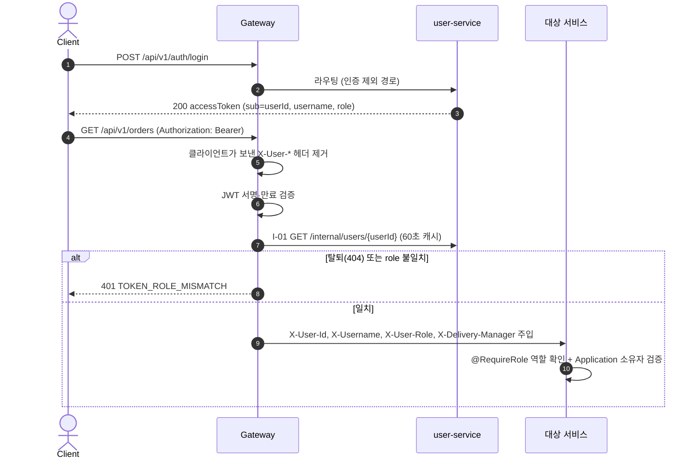

# 02. 아키텍처

> 최종 수정: 2026-10-12 · 기준: Notion SA 2장(시스템 구조도), 3장(인프라), 8장(보안)

## 1. 서비스 구성

| 서비스 | 포트 | 책임 | DB (컨테이너 :호스트 포트) | 상태 |
|---|---|---|---|---|
| eureka-server | 8761 | 서비스 등록·조회 | - | 완료 |
| config-server | 8888 | 루트 `config/` 설정을 각 서비스에 제공 (native), 파일 변경 시 해당 서비스 자동 refresh | - | 완료 |
| gateway-service | 8080 | 단일 진입점, JWT 검증, 권한 재확인, 라우팅, `/internal/**` 차단 | - | 완료 |
| user-service | 8081 | 회원가입, 로그인(JWT 발급), 사용자 관리 | `user_db` (user-db :5433) | 인증만 완료 |
| hub-service | 8082 | 허브·경로 조회, 허브별 재고 | `hub_db` (hub-db :5434) | 빈 모듈 |
| company-service | 8083 | 업체·상품 CRUD | `company_db` (company-db :5435) | 빈 모듈 |
| order-service | 8084 | 주문(Saga 오케스트레이터), Slack 알림 | `order_db` (order-db :5436) | 빈 모듈 |
| delivery-service | 8085 | 배송·배송 경로 기록 | `delivery_db` (delivery-db :5437) | 빈 모듈 |

### 설정 구조 (Spring Cloud Config, native) — 상세: `config/README.md`, 보안·무중단 변경: `doc/guide/12-config-ops.md`
- 서비스 `src/main/resources/application.yml`에는 이름·프로파일·Config 주소만 (`configserver:${CONFIG_SERVER_URL:http://localhost:8888}`)
- 프로파일: `local`(기본, IDE 실행) / `docker`(docker compose)
- 우선순위: `application.yml`(공통) < `application-{profile}.yml`(환경별) < `{service}.yml` < `{service}-{profile}.yml`

| 파일 | 내용 |
|---|---|
| `config/application.yml` | JPA(`ddl-auto: validate`, `open-in-view: false`), Feign 타임아웃 2s/5s, Eureka 인스턴스(`{서비스명}:{랜덤}`), actuator, Swagger 경로 |
| `config/application-local.yml` | DB `localhost:{db.local-port}`, Eureka `localhost:8761`, JWT 로컬 기본값, SQL 로그 |
| `config/application-docker.yml` | DB `{db.docker-host}:5432`, Eureka `eureka-server:8761`, `JWT_SECRET`·`DB_PASSWORD` 필수 |
| `config/{service}-service.yml` | 포트, `db.name`·`db.username`·`db.local-port`·`db.docker-host`, 서비스 고유 설정 (gateway 라우팅·인증, user JWT·MASTER, order Slack) |
- eureka-server·config-server는 config를 쓰지 않고 자기 `application.yml`만 사용
- **설정 자동 반영**: config-server가 `config/`를 2초마다 확인 → 바뀐 파일의 서비스 인스턴스를 Eureka에서 찾아 `POST /actuator/refresh` (재시작 없음, ADR-0006). 반영 가능한 키·한계: `doc/guide/12-config-ops.md` §3
- actuator 노출: `health`, `refresh`. 비즈니스 서비스는 포트 미공개라 내부망에서만 호출됨. **gateway는 현재 8080에 같이 열려 있음(로컬 전용) → 배포 전 관리 포트 분리 필요** (`doc/guide/12-config-ops.md` §3.3)
- `config/gateway-service.yml`의 Swagger 목록(`springdoc.swagger-ui.urls`)은 도메인 서비스 개발 전이라 user-service만 남기고 나머지는 주석 처리. 도메인 서비스가 뜨면 주석 해제 후 gateway 재시작 (springdoc은 refresh로 안 바뀜)

## 2. 프로젝트 구조 (SA 2.4)

```
sparta-logistics/
├── settings.gradle / build.gradle   # 멀티 모듈, 버전 고정 (Boot 3.3.5, Cloud 2023.0.3, QueryDSL 5.1.0, jjwt 0.12.6, springdoc 2.6.0, Java 17)
├── backend/
│   ├── common/                      # 공통 라이브러리 (java-library)
│   ├── eureka-server/
│   ├── config-server/               # 빌드 시 루트 config/를 jar에 포함 (classpath:/config/)
│   ├── gateway-service/             # WebFlux 기반 → common 미사용
│   └── user-service/ hub-service/ company-service/ order-service/ delivery-service/
│       └── src/main/java/com/sparta/logistics/{service}/
│           ├── presentation/        # controller, dto(request/response)
│           ├── application/         # service, dto(command/result)
│           ├── domain/              # model(entity, enum), repository(interface), exception(ErrorCode)
│           └── infrastructure/      # persistence(jpa, querydsl), client(feign), config
├── config/                          # Spring Cloud Config 설정 저장소
├── doc/sql/                         # 서비스별 DDL {NN}-{service}.sql
├── script/run.sh
└── docker-compose.yml
```

- `settings.gradle`이 `backend/*` 모듈을 `projectDir`로 연결 (프로젝트 이름은 `:user-service`처럼 짧게)
- common에도 QueryDSL APT가 있어 `QBaseEntity`를 만든다 (서비스의 `QUser` 등이 상속). 없으면 `cannot find symbol QBaseEntity`
- 비즈니스 서비스는 `implementation project(':common')` + PostgreSQL + QueryDSL APT, gateway·비즈니스 서비스는 `spring-cloud-starter-config`가 루트에서 자동 주입된다
- Application 클래스: `@SpringBootApplication(scanBasePackages = "com.sparta.logistics")` (common 빈 스캔), 도메인 서비스는 `@EnableFeignClients`
- `bootJar` 결과물은 `build/libs/app.jar` (Dockerfile 공통)

## 3. common 모듈 (`com.sparta.logistics.common`)

| 패키지 | 클래스 | 역할 |
|---|---|---|
| `domain` | `BaseEntity` | Audit 6컬럼(`created/updated/deleted` × `at/by`), `softDelete(username)` |
| `config` | `JpaAuditingConfig` | `AuditorAware<String>` = `X-Username` 헤더, 없으면 `SYSTEM` |
| | `QuerydslConfig` | `JPAQueryFactory` 빈 |
| | `WebMvcConfig` | `@CurrentUser` 리졸버, `@RequireRole` 인터셉터 등록 |
| `response` | `ApiResponse<T>` | `{status, message, data}` + `ok()` / `created()` 팩토리 |
| | `PageResponse<T>` | `{content, page, size, totalElements, totalPages, sort}` |
| `exception` | `ErrorCode` | 서비스별 enum이 구현. 응답 code = enum 상수 이름 |
| | `CommonErrorCode` | `VALIDATION_ERROR`, `INVALID_REQUEST`, `UNAUTHORIZED`, `TOKEN_ROLE_MISMATCH`, `FORBIDDEN`, `RESOURCE_NOT_FOUND`, `METHOD_NOT_ALLOWED`, `UNSUPPORTED_MEDIA_TYPE`, `SERVICE_UNAVAILABLE`, `INTERNAL_ERROR` |
| | `BusinessException` | 서비스가 던지는 유일한 예외. `hasCode()`로 원격 에러 비교 |
| | `ErrorResponse`, `GlobalExceptionHandler` | `{status, code, message, path, timestamp, errors?}` 변환 |
| | `RemoteErrorCode` | Feign으로 받은 상대 서비스 에러를 그대로 전달 |
| `security` | `UserHeaders` | `X-User-Id`, `X-Username`, `X-User-Role`, `X-Delivery-Manager` |
| | `UserRole` | `MASTER`, `USER` |
| | `UserContext`, `@CurrentUser` | 헤더 → `(userId, username, role, deliveryManager)` |
| | `@RequireRole`, `RoleCheckInterceptor` | 컨트롤러 역할 확인 (SA 8.3 #7) |
| `feign` | `FeignHeaderInterceptor` | X-User-* 헤더를 Feign 요청에 전달 |
| | `FeignErrorDecoder` | 4xx → 상대 code 유지, 5xx → 503 `SERVICE_UNAVAILABLE` |
| `web` | `PageRequests`, `QuerydslSorts` | size 10/30/50 보정·기본 정렬, 허용 필드만 정렬 |

## 4. 인증 / 인가 (SA 8)

### 4.1 흐름



### 4.2 Gateway 필터 순서 (`AuthenticationFilter`, order -1)

| # | 처리 | 실패 응답 |
|---|---|---|
| 1 | 클라이언트가 보낸 `X-User-Id`, `X-Username`, `X-User-Role`, `X-Delivery-Manager` 제거 | - |
| 2 | `/internal/**` 차단 | 404 `RESOURCE_NOT_FOUND` |
| 3 | 화이트리스트 통과: `/api/v1/auth/signup`, `/api/v1/auth/login`, Swagger 경로, `/actuator/health` (`gateway.auth.public-paths`) | - |
| 4 | `Authorization: Bearer` JWT 서명·만료 검증 | 401 `UNAUTHORIZED` |
| 5 | I-01로 role·탈퇴 여부 재확인 (FOUND·NOT_FOUND 60초 캐시, 장애는 캐시 안 함) | 401 `TOKEN_ROLE_MISMATCH` / 503 `SERVICE_UNAVAILABLE` |
| 6 | 저장된 값으로 X-User-* 주입 후 라우팅 | - |

- 캐시 TTL은 `gateway.auth.role-cache-ttl` (기본 60s). 권한 변경·탈퇴는 최대 60초 늦게 반영된다
- Gateway는 역할별 경로 제한을 하지 않는다. MASTER 전용 API는 각 서비스 컨트롤러의 `@RequireRole(UserRole.MASTER)`

### 4.3 JWT (SA 8.2)

| 항목 | 내용 |
|---|---|
| 알고리즘 | HS256. user-service 발급, Gateway 검증, `JWT_SECRET` 환경 변수 공유 (32바이트 이상) |
| 유효시간 | 60분 (`jwt.expiration-minutes`, `JwtProperties` — 발급마다 읽어 refresh로 재시작 없이 변경), Refresh Token 없음 |
| Claims | `sub`(userId), `username`, `role`, `iat`, `exp` |

### 4.4 라우팅 (SA 3.2)

| Path | 대상 |
|---|---|
| `/api/v1/auth/**`, `/api/v1/users/**` | `lb://user-service` |
| `/api/v1/hubs/**`, `/api/v1/hub-routes/**` | `lb://hub-service` |
| `/api/v1/companies/**`, `/api/v1/products/**` | `lb://company-service` |
| `/api/v1/orders/**` | `lb://order-service` |
| `/api/v1/deliveries/**` | `lb://delivery-service` |
| `/{service}/v3/api-docs` | 각 서비스 `/v3/api-docs` (Gateway Swagger UI에서 서비스 선택) |
| `/internal/**` | 라우팅 없음 (필터에서 404) |

## 5. 서비스 간 통신

- 동기 REST: OpenFeign + Spring Cloud LoadBalancer (`@FeignClient(name = "hub-service")` → Eureka 조회)
- 호출 대상은 `/internal/**` 내부 API만. 내부 API 응답은 `ApiResponse` 래퍼 없이 DTO 그대로
- 공통 처리(common): 사용자 헤더 전달, 에러 변환(4xx 유지 / 5xx·타임아웃 → 503), 타임아웃 2s/5s
- 서비스별 호출 관계(SA 2.3)와 보상 처리(SA 7)는 도메인 구현 시 이 절에 추가한다

| 호출자 → 제공자 | 내부 API | 상태 |
|---|---|---|
| gateway → user | I-01 `GET /internal/users/{userId}` (WebClient, Feign 아님) | 완료 |

## 6. 인프라·실행

### 6.1 컨테이너 (docker-compose.yml)

| 컨테이너 | 이미지 | 호스트 포트 | 기본 실행 | 비고 |
|---|---|---|---|---|
| user-db | postgres:16 | 5433 | O | `user_db` / `user_svc`, `doc/sql/01-user.sql` |
| hub-db · company-db · order-db · delivery-db | postgres:16 | 5434 ~ 5437 | `--profile domain` | `doc/sql/02~05` |
| eureka-server | 빌드 | 8761 | O | 대시보드 |
| config-server | 빌드 | 8888 | O | `./config`를 `/config`로 볼륨 마운트 (`CONFIG_LOCATION=file:/config/`) → 설정 수정 시 재빌드·재시작 불필요, 변경 감지 후 자동 refresh (`EUREKA_URL`로 인스턴스 조회) |
| gateway-service | 빌드 | 8080 | O | 유일한 외부 API 진입점 |
| user-service | 빌드 | 미공개 | O | |
| hub / company / order / delivery-service | 빌드 | 미공개 | `--profile domain` | 수평 확장 가능 (`--scale order-service=2`) |

- 네트워크 `logistics-net`(bridge)
- 서비스 기동 순서: config-server healthy + eureka started + 자기 DB healthy
- 서비스 환경 변수: `SPRING_PROFILES_ACTIVE=docker`, `CONFIG_SERVER_URL`, `DB_PASSWORD`(+ JWT·MASTER·Slack)
- Dockerfile 공통 템플릿: `eclipse-temurin:17-jre` + `build/libs/app.jar` (먼저 `./gradlew bootJar`)

### 6.2 DB 분리 — Database per Service
- 서비스마다 PostgreSQL 컨테이너 1개 (`{service}-db`), DB·계정은 compose 환경 변수(`POSTGRES_DB`, `POSTGRES_USER`)가 생성
- DDL 원본 `doc/sql/{NN}-{service}.sql`을 각 DB 컨테이너의 `/docker-entrypoint-initdb.d`에 하나씩 마운트 → 볼륨이 비어 있을 때만 실행
- 다른 서비스 DB에는 접속 정보 자체가 없다. 서비스 간 FK 없음 (UUID 논리 참조, Feign으로 검증)
- 비밀번호: `.env`의 `{SERVICE}_DB_PASSWORD` → DB 컨테이너와 서비스(`DB_PASSWORD`)에 같은 값

### 6.3 실행

```bash
cp .env.example .env
script/run.sh                    # 공통 인프라
script/run.sh --profile domain   # 전체
script/run.sh --reset            # DB 볼륨 삭제 후 재실행 (DDL 변경 시)

# IDE로 서비스 하나만 실행 (local 프로파일)
docker compose up -d user-db eureka-server config-server
```

비밀 정보(JWT secret, DB 비밀번호, Slack Webhook URL)는 `.env` → 환경 변수로만 주입하고 Git에서 제외한다 (`.gitignore`, 변수 목록은 `.env.example`).
재시작 없는 설정 반영(자동 refresh, 구현됨)과 config-server 접근 제한·롤링 재시작(설계)은 `doc/guide/12-config-ops.md`.
