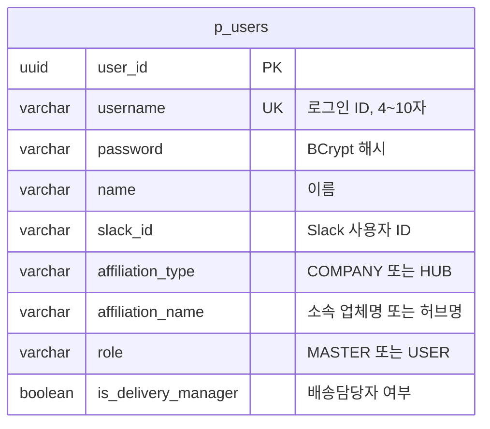

# 03. ERD

> 최종 수정: 2026-10-12 · 기준: Notion SA 4장(ERD), 5장(테이블 명세) · DDL 원본: `doc/sql/`

## 1. 공통 규칙 (SA 5.1)

- 테이블명 `p_` 접두사, 컬럼 snake_case
- 모든 PK는 UUID, 애플리케이션에서 생성 (`order_id`는 Saga를 위해 저장 전 선발급)
- 논리 삭제: DELETE API는 `deleted_at`, `deleted_by`만 채운다. Entity에 `@SQLRestriction("deleted_at IS NULL")`
- 유니크는 논리 삭제를 고려해 부분 인덱스 (`WHERE deleted_at IS NULL`) — 예외: `p_users.username`은 탈퇴 후 재사용 불가라 전체 UNIQUE
- Enum은 `VARCHAR` + `@Enumerated(EnumType.STRING)`
- Database per Service: 서비스마다 DB 컨테이너가 따로 있어 다른 서비스 테이블은 조회·조인할 수 없다. 서비스 간 참조 컬럼은 FK 없이 인덱스만

### 공통 Audit 컬럼 (`BaseEntity`)

| 컬럼 | 타입 | 제약 | 설명 |
|---|---|---|---|
| `created_at` | TIMESTAMP | NOT NULL | 생성 시각 |
| `created_by` | VARCHAR(100) | NOT NULL | 생성자 username (헤더 없으면 `SYSTEM`) |
| `updated_at` | TIMESTAMP | NOT NULL | 수정 시각 |
| `updated_by` | VARCHAR(100) | NOT NULL | 수정자 username |
| `deleted_at` | TIMESTAMP | NULL | 논리 삭제 시각 |
| `deleted_by` | VARCHAR(100) | NULL | 삭제자 username |

값은 JPA Auditing(`AuditorAware`)이 Gateway가 넣은 `X-Username` 헤더로 채운다.

## 2. user_db (`doc/sql/01-user.sql`)

### `p_users` — 사용자
- 목적: 회원가입·로그인, 권한(MASTER/USER), 배송담당자 여부
- 참조: 없음 (다른 서비스가 `user_id`를 논리 참조)
- 규칙: username은 탈퇴 후에도 재사용 불가, 삭제된 사용자는 로그인·기존 토큰 모두 차단

| 컬럼 | 타입 | 제약 | 설명 |
|---|---|---|---|
| `user_id` | UUID | PK | |
| `username` | VARCHAR(10) | NOT NULL, UNIQUE | 소문자·숫자 4~10자 |
| `password` | VARCHAR(255) | NOT NULL | BCrypt 해시 |
| `name` | VARCHAR(50) | NOT NULL | |
| `slack_id` | VARCHAR(50) | NOT NULL | |
| `affiliation_type` | VARCHAR(20) | NOT NULL, CHECK | `COMPANY`, `HUB` |
| `affiliation_name` | VARCHAR(100) | NOT NULL | |
| `role` | VARCHAR(20) | NOT NULL, DEFAULT `USER`, CHECK | `MASTER`, `USER` |
| `is_delivery_manager` | BOOLEAN | NOT NULL, DEFAULT FALSE | MASTER가 부여 |
| Audit 6개 | | | 공통 |

인덱스: `idx_users_role (role) WHERE deleted_at IS NULL`

## 3. hub_db · company_db · order_db · delivery_db

서비스 담당자가 Notion SA 5.3~5.6 기준으로 `doc/sql/{02~05}-{service}.sql`과 이 문서에 추가한다.
