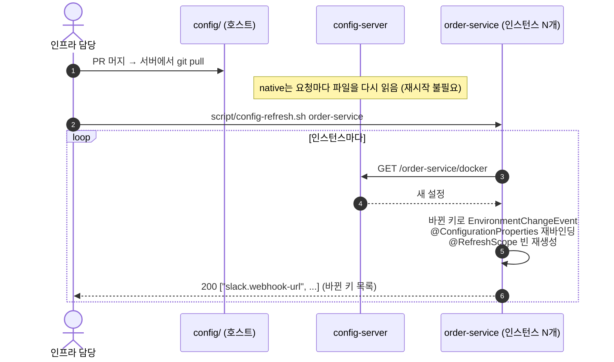

# 12. Config 운영 — 보안 관리 · 무중단 설정 변경

> 최종 수정: 2026-10-12 · 대상: **인프라 담당**, `config/`를 바꾸는 모든 사람
> 관련: [`config/README.md`](../../config/README.md), [02-architecture §1·§6](../design/02-architecture.md), ADR-0003, ADR-0006
>
> 상태 표기 — ✅ 구현됨(코드에 있음) · 📝 설계(아직 코드 없음). 📝 항목을 구현하면 이 문서의 표기를 ✅로 바꾸고 CHANGELOG에 남긴다.

## 0. 한눈에 보기

| 목표 | 방법 | 상태 |
|---|---|---|
| 비밀값이 Git에 들어가지 않게 | `config/`에는 `${ENV}` 자리표시자만, 값은 `.env` → compose 환경 변수 | ✅ |
| config-server 응답으로 비밀값이 새지 않게 | 자리표시자는 **클라이언트(서비스)에서** 풀린다 → config-server는 `${DB_PASSWORD}` 문자열만 내려줌 | ✅ |
| 컨테이너가 설정 파일을 바꾸지 못하게 | `./config:/config:ro` 읽기 전용 마운트 | ✅ |
| config-server 접근 제한 | Basic 인증 + 호스트 포트 바인딩 제한 | 📝 |
| 설정값 자체를 암호화해 커밋 | `{cipher}` + `ENCRYPT_KEY` (Git 백엔드 전환 시) | 📝 (현재 불필요) |
| 재시작 없이 설정 반영 | `POST /actuator/refresh` (인스턴스별) + `script/config-refresh.sh` | 📝 |
| 재시작이 필요한 설정도 무중단 | 롤링 재시작 (인스턴스 2개 이상 + Eureka 등록 해제 후 종료 + graceful shutdown) | 📝 |

---

## 1. 현재 구조 (✅)

```
config/ (Git) ──bind mount :ro──▶ config-server(:8888, native) ──HTTP──▶ 각 서비스 (기동 시 1회 조회)
                                     search-locations=${CONFIG_LOCATION}
```

- config-server는 `native` 프로파일로 `CONFIG_LOCATION`(compose: `file:/config/`, IDE: `classpath:/config/`)을 읽는다
- native 저장소는 **요청마다 파일을 다시 읽는다** → 호스트에서 `config/*.yml`을 고치면 config-server 재시작 없이 다음 조회부터 새 값이 나간다
- 서비스는 **기동할 때만** 설정을 받아온다 (`spring.config.import: configserver:...`) → 실행 중인 서비스에 새 값을 넣는 장치가 3장의 refresh
- IDE로 config-server를 띄우면 jar 안 복사본(`classpath:/config/`)을 읽으므로 `config/` 수정 후 재빌드가 필요하다. 설정 작업 중에는 config-server를 compose로 띄운다

---

## 2. 보안 관리

### 2.1 비밀값 목록과 주입 경로

| 값 | `config/`에 적는 형태 | 실제 값 | docker 프로파일에서 없으면 |
|---|---|---|---|
| DB 비밀번호 | `db.password: ${DB_PASSWORD}` (application-docker.yml) | `.env` `{SERVICE}_DB_PASSWORD` → compose `DB_PASSWORD` | 기동 실패 (자리표시자 해석 불가) |
| JWT 서명 키 | `jwt.secret: ${JWT_SECRET}` | `.env` `JWT_SECRET` (32바이트 이상) | compose가 `:?`로 실행 자체를 거부 |
| 최초 MASTER 비밀번호 | `${MASTER_PASSWORD:Master!234}` (user-service.yml) | `.env` `MASTER_PASSWORD` | ⚠ 기본값 `Master!234`로 생성됨 → 2.4 개선 항목 |
| Slack Webhook URL | `${SLACK_WEBHOOK_URL:}` (order-service.yml) | `.env` `SLACK_WEBHOOK_URL` | 빈 값 → 알림 생략 |

로컬 개발용 기본값(`db.local-password`, `application-local.yml`의 JWT 기본값)은 **local 프로파일에서만** 참조된다. docker 프로파일 파일(`application-docker.yml`)은 기본값 없는 `${ENV}`만 쓴다.

### 2.2 규칙

| # | 규칙 | 이유 |
|---|---|---|
| S1 | `config/`·`application*.yml`에 운영 비밀값을 평문으로 쓰지 않는다. `${ENV}` 또는 (Git 백엔드 전환 후) `{cipher}...`만 | Git 이력은 지워지지 않는다 |
| S2 | 로컬 기본값은 `application-local.yml` 또는 `{service}.yml`의 `local-*` 키에만. docker용 파일에는 기본값 없이 `${ENV}` | 기본값이 운영에 섞여 들어가는 것을 막는다 |
| S3 | `.env`는 커밋하지 않는다 (`.gitignore`). 새 변수는 `.env.example`에 **더미 값**으로 추가 | 팀원이 필요한 변수를 알 수 있게 |
| S4 | 서비스 actuator는 `health`(+ 3장 적용 후 `refresh`)만 노출. `env`, `configprops`, `heapdump`는 열지 않는다 | `/actuator/env`는 해석된 비밀값을 보여줄 수 있다 |
| S5 | Gateway 라우트·`public-paths`에 `/actuator/**`(다른 서비스 것)를 넣지 않는다. 서비스 포트는 호스트에 공개하지 않는다 | `refresh`는 `logistics-net` 내부에서만 호출 가능해야 한다 |
| S6 | `config/` 변경은 PR 리뷰를 거치고 CHANGELOG에 남긴다 (`[config]` 태그) | 누가 언제 무엇을 바꿨는지 추적 |
| S7 | 설정 파일·로그에 비밀값을 출력하지 않는다 (`log.info("secret={}")` 금지) | |

### 2.3 config-server 접근 제한 (📝)

현재 8888 포트가 호스트에 공개되어 있고 인증이 없다. 로컬 개발에서는 문제없지만, 공유 서버에 올릴 때는 아래를 적용한다.

**① 호스트 바인딩 제한** — `docker-compose.yml`
```yaml
config-server:
  ports:
    - "127.0.0.1:8888:8888"   # 같은 PC에서만 확인 가능. 서비스는 compose 네트워크로 접근
```

**② Basic 인증** — config-server
```groovy
// backend/config-server/build.gradle
implementation 'org.springframework.boot:spring-boot-starter-security'
```
```yaml
# backend/config-server/src/main/resources/application.yml
spring:
  security:
    user:
      name: ${CONFIG_USER}
      password: ${CONFIG_PASSWORD}
```
```java
// /actuator/health는 compose healthcheck용으로 열어둔다
@Bean
SecurityFilterChain configSecurity(HttpSecurity http) throws Exception {
    return http
            .csrf(AbstractHttpConfigurer::disable)
            .authorizeHttpRequests(auth -> auth
                    .requestMatchers("/actuator/health").permitAll()
                    .anyRequest().authenticated())
            .httpBasic(Customizer.withDefaults())
            .build();
}
```
클라이언트(각 서비스 `src/main/resources/application.yml`):
```yaml
spring:
  cloud:
    config:
      username: ${CONFIG_USER}
      password: ${CONFIG_PASSWORD}
```
`.env.example`에 `CONFIG_USER`, `CONFIG_PASSWORD` 추가, compose `x-service-env`와 config-server `environment`에 전달.

### 2.4 개선 항목 (📝)

| 항목 | 현재 | 변경안 |
|---|---|---|
| MASTER 비밀번호 기본값 | compose `${MASTER_PASSWORD:-Master!234}`, user-service.yml `${MASTER_PASSWORD:Master!234}` | docker에서는 `:?`로 필수화, 기본값은 local에만 |
| DB 비밀번호 기본값 | compose `${USER_DB_PASSWORD:-user_pw}` | 공유 서버 배포 시 `:?`로 필수화 |

### 2.5 `{cipher}` 암호화를 쓰지 않는 이유 (현재)

Spring Cloud Config는 `password: '{cipher}AQB...'` 형태로 암호문을 커밋하고, config-server가 `ENCRYPT_KEY`로 복호화해 내려주는 기능이 있다. 이 프로젝트는 쓰지 않는다.

- 비밀값은 이미 환경 변수로만 들어오므로 `config/`에 암호화할 대상이 없다
- `{cipher}`는 config-server가 **복호화한 평문을 응답에 담아** 내려준다 → 2.3 인증이 먼저 필요하다
- `ENCRYPT_KEY`라는 비밀값이 하나 더 생긴다

설정 저장소를 별도 Git 레포(native → git 백엔드)로 옮겨 비밀값까지 버전 관리해야 할 때 도입을 검토한다. 그때는 `/encrypt`, `/decrypt` 엔드포인트도 인증 뒤에 둔다.

### 2.6 JWT_SECRET 교체

`JwtTokenProvider`(user-service)와 `JwtVerifier`(gateway)는 생성자에서 키를 만든다 → refresh로 바뀌지 않는다.
교체 절차: `.env` 수정 → gateway·user-service를 **함께** 재시작 → 기존 토큰은 모두 401 (재로그인 필요, Refresh Token 없음).
무중단 교체가 필요해지면 검증 측이 이전 키·새 키를 둘 다 허용하는 2-키 방식(`jwt.secret`, `jwt.previous-secret`)을 검토한다.

---

## 3. 무중단 설정 변경 — refresh (📝)

### 3.1 동작 원리



`spring-cloud-starter-config`(이미 의존성에 있음)가 `refresh` 엔드포인트를 제공한다. 실행 중인 요청은 끊기지 않고, 다음 요청부터 새 값이 쓰인다.

### 3.2 무엇이 refresh로 바뀌나

| 설정 | refresh로 반영 | 비고 |
|---|---|---|
| `logging.level.*` | O | 장애 분석 시 일시적으로 debug 켜기 |
| `@ConfigurationProperties` — **JavaBean(setter) 방식** | O | 서비스 고유 설정은 이 방식으로 만든다 (`.claude/rules/config.md`) |
| `@ConfigurationProperties` — record·생성자 바인딩 | **X** | 불변 객체는 재바인딩되지 않는다. 현재 `GatewayAuthProperties`가 record → 3.3 ③ |
| `@Value` 필드 | `@RefreshScope` 빈일 때만 | 일반 빈의 `@Value`는 기동 시 값 고정 |
| 생성 시점에 값을 읽어 만든 객체 (캐시 TTL, 키 객체 등) | **X** | 속성이 바뀌어도 이미 만든 객체는 그대로 → 사용 시점에 properties를 읽거나 `@RefreshScope` 빈으로 분리 |
| Gateway 라우트 (`spring.cloud.gateway.routes`) | O | refresh 후 라우트가 다시 로드된다 |
| Feign 타임아웃 (`spring.cloud.openfeign.client.config.*`) | O (`refresh-enabled: true`일 때) | 3.3 ② |
| `server.port`, `spring.datasource.*`, `eureka.instance.*`, `jwt.secret` | **X** | 재시작 필요 → 3.5 롤링 재시작 |

### 3.3 구현 단계

**① refresh 엔드포인트 노출** — `config/application.yml` (모든 서비스 + gateway)
```yaml
management:
  endpoints:
    web:
      exposure:
        include: health,refresh   # refresh는 compose 내부망에서만 호출 가능 (서비스 포트 미공개, S5)
```
gateway는 8080이 호스트에 공개되어 있으므로 gateway만은 관리 포트를 분리한다 (`config/gateway-service.yml`):
```yaml
management:
  server:
    port: 9080        # 호스트에 공개하지 않음 → refresh는 내부망에서만
```

**② Feign 설정 refresh 허용** — `config/application.yml`
```yaml
spring:
  cloud:
    openfeign:
      client:
        refresh-enabled: true
```

**③ `GatewayAuthProperties`를 JavaBean으로** — `role-cache-ttl`, `public-paths`를 재시작 없이 바꾸려면
```java
@Getter @Setter
@ConfigurationProperties(prefix = "gateway.auth")
public class GatewayAuthProperties {
    private List<String> publicPaths = List.of();
    private Duration roleCacheTtl = Duration.ofSeconds(60);
    private Duration userLookupTimeout = Duration.ofSeconds(3);
}
```
캐시 TTL은 캐시를 만들 때 읽히므로, 값 변경을 반영하려면 캐시 빈에 `@RefreshScope`를 붙이거나 TTL을 항목마다 저장 시각과 비교하도록 바꾼다.

**④ `script/config-refresh.sh`** — 서비스의 모든 인스턴스에 refresh 호출
```bash
#!/usr/bin/env bash
# script/config-refresh.sh order-service   → order-service 모든 컨테이너에 POST /actuator/refresh
set -euo pipefail
cd "$(dirname "$0")/.."
SERVICE="$1"
PORT="$(grep -m1 -A1 '^server:' "config/${SERVICE}.yml" | sed -n 's/.*port: *//p')"
MGMT_PORT="${MGMT_PORT:-$PORT}"            # gateway는 MGMT_PORT=9080
NETWORK="sparta-logistics_logistics-net"
for name in $(docker compose ps --format '{{.Name}}' "$SERVICE"); do
  echo "▶ $name"
  docker run --rm --network "$NETWORK" curlimages/curl:8.10.1 \
    -sf -X POST "http://${name}:${MGMT_PORT}/actuator/refresh" && echo
done
```
- 컨테이너 이름으로 하나씩 호출하므로 `--scale`로 늘린 인스턴스도 모두 반영된다
- 응답(바뀐 키 목록)이 `[]`이면 config-server가 새 값을 못 읽은 것 → `curl localhost:8888/{service}/docker`로 확인

**⑤ (선택) 기동 시 config-server 대기** — 서비스 `application.yml`
```yaml
spring:
  cloud:
    config:
      fail-fast: true
      retry:
        max-attempts: 10
```
`spring-retry` 의존성이 필요하다. compose는 `depends_on: service_healthy`로 이미 순서를 보장하므로 IDE·재시작 상황 대비용.

### 3.4 운영 절차 (설정 변경 런북)

| 단계 | 작업 | 확인 |
|---|---|---|
| 1 | `config/*.yml` 수정 PR (CHANGELOG `[config]` 한 줄) → 리뷰 → 머지 | 비밀값 평문 없음 (S1) |
| 2 | 서버에서 `git pull` | `curl -s localhost:8888/order-service/docker \| jq` 에 새 값 |
| 3 | 3.2 표에서 **refresh로 바뀌는 키인지** 확인 | 아니면 3.5로 |
| 4 | `script/config-refresh.sh order-service` | 인스턴스마다 바뀐 키 목록 출력 |
| 5 | 동작 확인 (로그, API 호출) | |
| 롤백 | `git revert` → `git pull` → 4번 다시 | |

Spring Cloud Bus(Kafka/RabbitMQ)로 한 번에 전파하는 방법도 있지만, 메시지 브로커가 추가되어야 해서 도입하지 않는다 (ADR-0006).

### 3.5 재시작이 필요한 설정 — 롤링 재시작

전제: 대상 서비스 인스턴스가 2개 이상 (`--scale order-service=2`).

| 단계 | 작업 | 이유 |
|---|---|---|
| 1 | 새 설정으로 인스턴스 하나 추가: `docker compose up -d --no-recreate --scale order-service=3 order-service` | 새 컨테이너는 기동 시 새 설정을 받는다 |
| 2 | Eureka 대시보드(:8761)에서 새 인스턴스 `UP` 확인 | |
| 3 | 기존 인스턴스를 Eureka에서 내림: `PUT /eureka/apps/ORDER-SERVICE/{instanceId}/status?value=OUT_OF_SERVICE` | 호출자가 새 요청을 보내지 않게 |
| 4 | **약 60초 대기** | 호출자의 Eureka 레지스트리 캐시(30초) + LoadBalancer 캐시(35초)가 갱신될 때까지 |
| 5 | `docker stop {기존 컨테이너}` → `docker rm` | graceful shutdown으로 처리 중 요청은 마무리 |
| 6 | 기존 인스턴스 수만큼 1~5 반복 | |

graceful shutdown 설정 (📝, `config/application.yml`):
```yaml
server:
  shutdown: graceful
spring:
  lifecycle:
    timeout-per-shutdown-phase: 20s
```

한계:
- **gateway**는 호스트 8080을 하나만 쓰므로 compose에서 두 개를 동시에 띄울 수 없다 → gateway 재시작은 수 초 중단이 생긴다. 무중단이 필요하면 앞단에 로드밸런서(nginx 등)를 두고 gateway 2개를 둔다
- **config-server**를 재시작해도 실행 중인 서비스에는 영향이 없다 (기동·refresh 때만 조회). 단, 재시작 중에 새 인스턴스가 뜨거나 refresh하면 실패한다
- docker compose는 오케스트레이터가 아니므로 위 절차는 수동이다. 운영 환경(k8s 등)에서는 rolling update + readiness probe로 대체한다

---

## 4. 설정 변경 PR 체크리스트

- [ ] 비밀값 평문 없음, docker용 설정에 기본값 없음 (S1, S2)
- [ ] 새 환경 변수 → `.env.example`(더미 값) + `docker-compose.yml` `environment` 추가
- [ ] refresh로 반영되는 키인지 3.2 표로 확인, 아니면 PR에 "재시작 필요" 명시
- [ ] 서비스 고유 설정은 JavaBean `@ConfigurationProperties`로 받음
- [ ] `doc/design/02-architecture.md` §1 설정 표, `doc/etc/07-changelog.md` 갱신

## 5. 적용 상태

| 항목 | 상태 | 담당 |
|---|---|---|
| 비밀값 환경 변수 주입, `:ro` 마운트, actuator health만 노출 | ✅ | 공통 인프라 |
| 2.3 config-server 인증·바인딩 제한 | 📝 | 인프라 |
| 2.4 MASTER·DB 비밀번호 기본값 제거 (docker) | 📝 | 인프라 |
| 3.3 ①② refresh 노출, Feign refresh | 📝 | 인프라 |
| 3.3 ③ `GatewayAuthProperties` JavaBean 전환 | 📝 | 인프라 |
| 3.3 ④ `script/config-refresh.sh` | 📝 | 인프라 |
| 3.5 graceful shutdown | 📝 | 인프라 |
