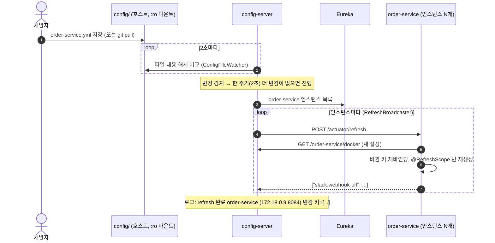

# 12. Config 운영 — 보안 관리 · 무중단 설정 변경

> 최종 수정: 2026-10-13 · 대상: **인프라 담당**, `config/`를 바꾸는 모든 사람
> 관련: [`config/README.md`](../../config/README.md), [02-architecture §1·§6](../design/02-architecture.md), ADR-0003, ADR-0006
>
> 상태 표기 — ✅ 구현됨(코드에 있음) · 📝 설계(아직 코드 없음). 📝 항목을 구현하면 이 문서의 표기를 ✅로 바꾸고 CHANGELOG에 남긴다.

## 0. 한눈에 보기

| 목표 | 방법 | 상태 |
|---|---|---|
| 비밀값이 Git에 들어가지 않게 | `config/`에는 `${ENV}` 자리표시자만, 값은 `.env` → compose 환경 변수 | ✅ |
| config-server 응답으로 비밀값이 새지 않게 | 자리표시자는 **클라이언트(서비스)에서** 풀린다 → config-server는 `${DB_PASSWORD}` 문자열만 내려줌 | ✅ |
| 컨테이너가 설정 파일을 바꾸지 못하게 | `./config:/config:ro` 읽기 전용 마운트 | ✅ |
| config-server 접근 제한 | Basic 인증 + 호스트 포트 바인딩 제한 | 📝 |
| 설정값 자체를 암호화해 커밋 | `{cipher}` + `ENCRYPT_KEY` (Git 백엔드 전환 시) | 📝 (현재 불필요) |
| 재시작 없이 설정 반영 | config-server가 `config/` 변경을 감지해 Eureka의 해당 서비스 인스턴스마다 `POST /actuator/refresh` (자동) | ✅ |
| 재시작이 필요한 설정도 무중단 | 롤링 재시작 (인스턴스 2개 이상 + Eureka 등록 해제 후 종료 + graceful shutdown) | 📝 |

---

## 1. 현재 구조 (✅)

```
config/ (Git) ──bind mount :ro──▶ config-server(:8888, native) ──HTTP──▶ 각 서비스 (기동 시 1회 조회)
                                     search-locations=${CONFIG_LOCATION}
```

- config-server는 `native` 프로파일로 `CONFIG_LOCATION`(compose: `file:/config/`, IDE: `classpath:/config/`)을 읽는다
- native 저장소는 **요청마다 파일을 다시 읽는다** → 호스트에서 `config/*.yml`을 고치면 config-server 재시작 없이 다음 조회부터 새 값이 나간다
- 서비스는 **기동할 때만** 설정을 받아온다 (`spring.config.import: configserver:...`) → 실행 중인 서비스에 새 값을 넣는 장치가 3장의 자동 refresh
- IDE로 config-server를 띄우면 jar 안 복사본(`classpath:/config/`)을 읽으므로 `config/` 수정 후 재빌드가 필요하다. 설정 작업 중에는 config-server를 compose로 띄운다

---

## 2. 보안 관리

### 2.1 비밀값 목록과 주입 경로

| 값 | `config/`에 적는 형태 | 실제 값 | docker 프로파일에서 없으면 |
|---|---|---|---|
| DB 비밀번호 | `db.password: ${DB_PASSWORD}` (application-docker.yml) | `.env` `{SERVICE}_DB_PASSWORD` → compose `DB_PASSWORD` | 기동 실패 (자리표시자 해석 불가) |
| JWT 서명 키 | `jwt.secret: ${JWT_SECRET}` | `.env` `JWT_SECRET` (32바이트 이상) | compose가 `:?`로 실행 자체를 거부 |
| 최초 MASTER 비밀번호 | `${MASTER_PASSWORD:Master!234}` (user-service.yml) | `.env` `MASTER_PASSWORD` | ⚠ 기본값 `Master!234`로 생성됨 → 2.4 개선 항목 |
| Slack Webhook URL | `${SLACK_WEBHOOK_URL:}` (order-service.yml) | `.env` `SLACK_WEBHOOK_URL` | 빈 값 → 알림 생략 |

로컬 개발용 기본값(`db.local-password`, `application-local.yml`의 JWT 기본값)은 **local 프로파일에서만** 참조된다. docker 프로파일 파일(`application-docker.yml`)은 기본값 없는 `${ENV}`만 쓴다.

### 2.2 규칙

| # | 규칙 | 이유 |
|---|---|---|
| S1 | `config/`·`application*.yml`에 운영 비밀값을 평문으로 쓰지 않는다. `${ENV}` 또는 (Git 백엔드 전환 후) `{cipher}...`만 | Git 이력은 지워지지 않는다 |
| S2 | 로컬 기본값은 `application-local.yml` 또는 `{service}.yml`의 `local-*` 키에만. docker용 파일에는 기본값 없이 `${ENV}` | 기본값이 운영에 섞여 들어가는 것을 막는다 |
| S3 | `.env`는 커밋하지 않는다 (`.gitignore`). 새 변수는 `.env.example`에 **더미 값**으로 추가 | 팀원이 필요한 변수를 알 수 있게 |
| S4 | 서비스 actuator는 `health`, `refresh`만 노출. `env`, `configprops`, `heapdump`는 열지 않는다 | `/actuator/env`는 해석된 비밀값을 보여줄 수 있다 |
| S5 | Gateway 라우트·`public-paths`에 `/actuator/**`(다른 서비스 것)를 넣지 않는다. 서비스 포트는 호스트에 공개하지 않는다 | `refresh`는 `logistics-net` 내부에서만 호출 가능해야 한다 |
| S6 | `config/` 변경은 PR 리뷰를 거치고 CHANGELOG에 남긴다 (`[config]` 태그) | 누가 언제 무엇을 바꿨는지 추적 |
| S7 | 설정 파일·로그에 비밀값을 출력하지 않는다 (`log.info("secret={}")` 금지) | |

### 2.3 config-server 접근 제한 (📝)

현재 8888 포트가 호스트에 공개되어 있고 인증이 없다. 로컬 개발에서는 문제없지만, 공유 서버에 올릴 때는 아래를 적용한다.

**① 호스트 바인딩 제한** — `docker-compose.yml`
```yaml
config-server:
  ports:
    - "127.0.0.1:8888:8888"   # 같은 PC에서만 확인 가능. 서비스는 compose 네트워크로 접근
```

**② Basic 인증** — config-server
```groovy
// backend/config-server/build.gradle
implementation 'org.springframework.boot:spring-boot-starter-security'
```
```yaml
# backend/config-server/src/main/resources/application.yml
spring:
  security:
    user:
      name: ${CONFIG_USER}
      password: ${CONFIG_PASSWORD}
```
```java
// /actuator/health는 compose healthcheck용으로 열어둔다
@Bean
SecurityFilterChain configSecurity(HttpSecurity http) throws Exception {
    return http
            .csrf(AbstractHttpConfigurer::disable)
            .authorizeHttpRequests(auth -> auth
                    .requestMatchers("/actuator/health").permitAll()
                    .anyRequest().authenticated())
            .httpBasic(Customizer.withDefaults())
            .build();
}
```
클라이언트(각 서비스 `src/main/resources/application.yml`):
```yaml
spring:
  cloud:
    config:
      username: ${CONFIG_USER}
      password: ${CONFIG_PASSWORD}
```
`.env.example`에 `CONFIG_USER`, `CONFIG_PASSWORD` 추가, compose `x-service-env`와 config-server `environment`에 전달.

### 2.4 개선 항목 (📝)

| 항목 | 현재 | 변경안 |
|---|---|---|
| MASTER 비밀번호 기본값 | compose `${MASTER_PASSWORD:-Master!234}`, user-service.yml `${MASTER_PASSWORD:Master!234}` | docker에서는 `:?`로 필수화, 기본값은 local에만 |
| DB 비밀번호 기본값 | compose `${USER_DB_PASSWORD:-user_pw}` | 공유 서버 배포 시 `:?`로 필수화 |

### 2.5 `{cipher}` 암호화를 쓰지 않는 이유 (현재)

Spring Cloud Config는 `password: '{cipher}AQB...'` 형태로 암호문을 커밋하고, config-server가 `ENCRYPT_KEY`로 복호화해 내려주는 기능이 있다. 이 프로젝트는 쓰지 않는다.

- 비밀값은 이미 환경 변수로만 들어오므로 `config/`에 암호화할 대상이 없다
- `{cipher}`는 config-server가 **복호화한 평문을 응답에 담아** 내려준다 → 2.3 인증이 먼저 필요하다
- `ENCRYPT_KEY`라는 비밀값이 하나 더 생긴다

설정 저장소를 별도 Git 레포(native → git 백엔드)로 옮겨 비밀값까지 버전 관리해야 할 때 도입을 검토한다. 그때는 `/encrypt`, `/decrypt` 엔드포인트도 인증 뒤에 둔다.

### 2.6 JWT_SECRET 교체

`JwtTokenProvider`(user-service)와 `JwtVerifier`(gateway)는 생성자에서 키를 만든다 → refresh로 바뀌지 않는다.
교체 절차: `.env` 수정 → gateway·user-service를 **함께** 재시작 → 기존 토큰은 모두 401 (재로그인 필요, Refresh Token 없음).
무중단 교체가 필요해지면 검증 측이 이전 키·새 키를 둘 다 허용하는 2-키 방식(`jwt.secret`, `jwt.previous-secret`)을 검토한다.

---

## 3. 무중단 설정 변경 — 자동 refresh (✅)

`config/*.yml`을 저장하면 **수 초 안에 해당 서비스가 재시작 없이 새 설정을 받는다.** 사람이 할 일은 파일 수정뿐이다.

### 3.1 동작 원리



| 바뀐 파일 | refresh 대상 |
|---|---|
| `application.yml`, `application-{profile}.yml` | Eureka에 등록된 모든 서비스 (config-server 제외) |
| `{service}.yml`, `{service}-{profile}.yml` | 그 서비스의 모든 인스턴스 (`--scale`로 늘린 것 포함) |
| 실행 중이 아닌 서비스의 파일 | 없음 (다음 기동 때 새 설정을 받는다) |

구현 위치 (`backend/config-server/.../refresh/`):

| 클래스 | 역할 |
|---|---|
| `ConfigFileWatcher` | `file:` search-location을 2초마다 폴링, SHA-256 내용 해시로 변경 파일 판별, 연속 저장은 한 번으로 묶음 |
| `RefreshTargets` | 파일 이름 → 대상 서비스 |
| `RefreshBroadcaster` | Eureka `DiscoveryClient`로 인스턴스 조회 → `POST http://{ip}:{포트}/actuator/refresh` (Eureka 메타데이터 `management.port`가 있으면 그 포트) |
| `ConfigWatchProperties` | `config.watch.enabled`, `connect-timeout`, `read-timeout` (주기는 `config.watch.interval-ms`) |

- WatchService(파일 이벤트) 대신 폴링: Docker Desktop 바인드 마운트는 호스트 변경 이벤트가 컨테이너로 전달되지 않을 수 있다
- config-server는 Eureka에 **등록하지 않고 조회만** 한다 (`register-with-eureka: false`)
- 끄기: config-server 환경 변수 `CONFIG_WATCH_ENABLED=false`

### 3.2 무엇을 동적으로 바꾸고, 무엇을 재시작으로 바꾸나

`config/`만 바꾸면 **재빌드·재배포는 절대 필요 없다** (config-server가 폴더를 마운트해서 읽음). 남는 선택은 **refresh(무중단)** 냐 **재시작**이냐다.

| 단계 | 의미 | `config/` 변경 시 |
|---|---|---|
| 재빌드·재배포 | jar·이미지를 새로 만들어 올림 | 필요 없음 |
| 재시작 | 같은 이미지로 컨테이너만 다시 띄움 (`docker compose restart {서비스}`) | C 그룹만 |
| refresh | 실행 중에 값만 교체 (자동) | A 그룹 |

#### 판단 기준 — 새 설정을 만들 때 이 3가지를 묻는다

1. **운영 중에 바꿀 일이 있나?** — 타임아웃·캐시 시간·로그 레벨·알림 URL·비즈니스 임계치는 있다. 포트·DB 이름은 거의 없다
2. **바뀌는 순간 안전한가?** — 서비스(인스턴스)마다 몇 초씩 다르게 바뀌어도 문제없어야 한다. 타임아웃은 괜찮고, JWT secret은 발급·검증이 어긋나 위험하다
3. **자원을 다시 만들어야 하나?** — 포트·DB 커넥션 풀·JPA 초기화처럼 기동 때 만든 자원은 실행 중에 바꾸면 위험하거나 의미가 없다

→ **1이 "예"이고 2·3에 걸리지 않으면 A(동적)**, 아니면 C(재시작).

#### 왜 어떤 값은 refresh로 안 바뀌나

refresh가 손대는 것은 ① Environment(설정값 원본), ② `@ConfigurationProperties` Bean 재바인딩(setter), ③ `@RefreshScope` Bean 재생성 **세 가지뿐**이다.
일반 Bean이 생성자·`@Value`로 값을 **복사**해 두었거나 그 값으로 **객체·자원을 만들어** 두었다면(키, 커넥션 풀, 캐시, 포트) 원본이 바뀌어도 복사본은 그대로다.
그래서 A 그룹 설정은 **JavaBean `@ConfigurationProperties`로 받고 쓸 때마다 getter로 읽는다** (`.claude/rules/config.md`).

#### A. 동적 (refresh로 반영) ✅

| 설정 | 파일 | 언제 바꾸나 | 구현 |
|---|---|---|---|
| Gateway 라우트 `spring.cloud.gateway.routes` | gateway-service.yml | 경로 추가·변경 | Spring Cloud Gateway 기본 |
| `gateway.auth.public-paths` | gateway-service.yml | 인증 없이 열 경로 조정 | `GatewayAuthProperties` (요청마다 읽음) |
| `gateway.auth.role-cache-ttl`, `user-lookup-timeout` | gateway-service.yml | 권한 반영 속도, 장애 대응 | 〃 |
| `jwt.expiration-minutes` | user-service.yml | 토큰 유효시간 조정 | `JwtProperties` (발급마다 읽음) |
| Feign 타임아웃 `spring.cloud.openfeign.client.config.*` | application.yml | 느린 서비스 대응 | `refresh-enabled: true` |
| `logging.level.*` | 어디든 | 장애 분석 시 debug | Spring Cloud 기본 |
| 앞으로 추가할 비즈니스 설정 (Slack URL, Saga 타임아웃 등) | {service}.yml | 운영 중 조정 | **처음부터** JavaBean `@ConfigurationProperties` + 쓸 때마다 읽기 |

#### C. 재시작 (동적으로 만들지 않는다) ⛔

| 설정 | 이유 (기준 2·3) |
|---|---|
| `jwt.secret` (`.env`) | 발급(user)과 검증(gateway)이 동시에 안 바뀌어 토큰이 깨진다. 환경 변수라 refresh 대상도 아님 → 2.6 |
| `server.port`, `management.server.port` | 이미 열린 포트 |
| `spring.datasource.*`, `db.*` | 커넥션 풀을 다시 만들어야 함 |
| `spring.jpa.*` | 기동 시 초기화 |
| `eureka.*` | 등록 정보가 꼬일 수 있음 |
| `springdoc.*` (Swagger 목록·경로) | 기동 시 만든 내부 객체. refresh하면 Swagger UI가 깨질 수 있음 (2026-10-13 확인) |
| `management.endpoints.web.exposure.*` | 기동 시 결정 |
| `app.master.*` | 최초 MASTER 계정은 기동 시 한 번만 생성 |
| `.env`의 모든 값 | 환경 변수는 컨테이너 생성 시 고정 → `docker compose up -d {서비스}` |
| eureka-server·config-server 자신의 `application.yml` | jar 안에 있음 → 빌드 + 이미지 재생성 (유일하게 재배포가 필요한 경우) |

C 그룹도 인스턴스가 2개 이상이면 하나씩 재시작해 무중단으로 바꿀 수 있다 → 3.5

### 3.3 구성 요소 (적용된 설정)

| 위치 | 내용 |
|---|---|
| `config/application.yml` | `management.endpoints.web.exposure.include: health,refresh`, `spring.cloud.openfeign.client.refresh-enabled: true` |
| `config/gateway-service.yml` | **현재: 분리 안 함 (로컬은 8080 그대로)** — 배포 전 관리 포트 분리 필요, 아래 ⚠ 참고 |
| `backend/config-server` | Eureka client(조회 전용), `@EnableScheduling`, `config.watch.*` |
| `docker-compose.yml` | config-server에 `EUREKA_URL`, `depends_on: eureka-server` |

보안: 비즈니스 서비스 포트는 호스트에 공개하지 않으므로 그 서비스들의 `/actuator/refresh`는 compose 내부망(config-server)에서만 호출된다. Gateway 라우트에도 `/actuator/**`가 없다 (S5).

> ⚠ **gateway는 예외 — 로컬은 8080, 배포 전 분리 필요**
> gateway는 외부 공개 포트 8080 하나만 쓰고, actuator도 같은 포트에 있다. Gateway의 인증 필터(`GlobalFilter`)는 라우팅되는 요청에만 걸리므로 **`POST :8080/actuator/refresh`는 인증 없이 호출된다.**
> - 로컬: 8080이 내 PC에서만 열려 있어 문제없음 → 현재 분리하지 않는다
> - 배포 전: 관리 포트를 분리한다. compose(배포)에서만 적용되도록 `config/gateway-service-docker.yml`에 추가하고, compose에서 9080은 공개하지 않는다
>   ```yaml
>   management:
>     server:
>       port: 9080
>   eureka:
>     instance:
>       metadata-map:
>         "[management.port]": 9080   # config-server가 refresh를 보낼 포트
>   ```
>   관리 포트 변경은 refresh로 안 바뀌므로 적용 후 gateway 재시작. 앞단에 nginx·로드밸런서가 있다면 거기서 `/actuator/**`를 막는 방법도 있다

### 3.4 운영 절차

| 단계 | 작업 | 확인 |
|---|---|---|
| 1 | `config/*.yml` 수정 PR → 리뷰 → 머지 → 서버에서 `git pull` (로컬은 저장만) | 비밀값 평문 없음 (S1) |
| 2 | 자동 refresh (2~4초) | `docker compose logs -f config-server` 에 `refresh 완료 ... 변경 키=[...]` |
| 3 | 3.2 표에서 refresh가 안 되는 키면 해당 서비스 재시작 (3.5) | |
| 롤백 | `git revert` → `git pull` → 자동 refresh | |

수동으로 한 인스턴스만 refresh: `docker compose exec order-service sh -c 'wget -qO- --post-data= localhost:8084/actuator/refresh'` 처럼 컨테이너 안에서 호출 (이미지에 wget/curl이 없으면 `docker run --rm --network sparta-logistics_logistics-net curlimages/curl -X POST http://{컨테이너명}:{포트}/actuator/refresh`).

**자동 refresh가 안 되는 경우**

| 상황 | 이유 | 대응 |
|---|---|---|
| config-server를 IDE로 실행 | `classpath:/config/`(jar 안 복사본)를 읽음 → 파일이 안 바뀜 | config-server는 compose로, 또는 IDE 환경 변수 `CONFIG_LOCATION=file:/절대경로/config/` |
| 서비스는 IDE, config-server는 compose | 서비스가 호스트 IP로 Eureka에 등록 → 컨테이너에서 접근이 안 될 수 있음 | 로그에 `refresh 실패` → 서비스 재시작 |
| refresh 호출 실패 | 인스턴스 기동 중·타임아웃 | 해당 인스턴스 재시작 (로그에 대상이 찍힘) |

Spring Cloud Bus(Kafka/RabbitMQ)를 쓰면 브로커가 전파하지만, 브로커 컨테이너가 추가되어 config-server가 Eureka로 직접 호출하는 방식을 택했다 (ADR-0006).

### 3.5 재시작이 필요한 설정 — 롤링 재시작

전제: 대상 서비스 인스턴스가 2개 이상 (`--scale order-service=2`).

| 단계 | 작업 | 이유 |
|---|---|---|
| 1 | 새 설정으로 인스턴스 하나 추가: `docker compose up -d --no-recreate --scale order-service=3 order-service` | 새 컨테이너는 기동 시 새 설정을 받는다 |
| 2 | Eureka 대시보드(:8761)에서 새 인스턴스 `UP` 확인 | |
| 3 | 기존 인스턴스를 Eureka에서 내림: `PUT /eureka/apps/ORDER-SERVICE/{instanceId}/status?value=OUT_OF_SERVICE` | 호출자가 새 요청을 보내지 않게 |
| 4 | **약 60초 대기** | 호출자의 Eureka 레지스트리 캐시(30초) + LoadBalancer 캐시(35초)가 갱신될 때까지 |
| 5 | `docker stop {기존 컨테이너}` → `docker rm` | graceful shutdown으로 처리 중 요청은 마무리 |
| 6 | 기존 인스턴스 수만큼 1~5 반복 | |

graceful shutdown 설정 (📝, `config/application.yml`):
```yaml
server:
  shutdown: graceful
spring:
  lifecycle:
    timeout-per-shutdown-phase: 20s
```

한계:
- **gateway**는 호스트 8080을 하나만 쓰므로 compose에서 두 개를 동시에 띄울 수 없다 → gateway 재시작은 수 초 중단이 생긴다. 무중단이 필요하면 앞단에 로드밸런서(nginx 등)를 두고 gateway 2개를 둔다
- **config-server**를 재시작해도 실행 중인 서비스에는 영향이 없다 (기동·refresh 때만 조회). 단, 재시작 중에 새 인스턴스가 뜨거나 refresh하면 실패한다
- docker compose는 오케스트레이터가 아니므로 위 절차는 수동이다. 운영 환경(k8s 등)에서는 rolling update + readiness probe로 대체한다

---

## 4. 설정 변경 PR 체크리스트

- [ ] 비밀값 평문 없음, docker용 설정에 기본값 없음 (S1, S2)
- [ ] 새 환경 변수 → `.env.example`(더미 값) + `docker-compose.yml` `environment` 추가
- [ ] 새 설정이면 3.2 판단 기준으로 A(동적)/C(재시작) 중 어디인지 정하고 표에 추가
- [ ] refresh로 반영되는 키인지 3.2 표로 확인, 아니면 PR에 "재시작 필요" 명시 (머지 후 config-server 로그로 refresh 확인)
- [ ] 서비스 고유 설정은 JavaBean `@ConfigurationProperties`로 받음
- [ ] `doc/design/02-architecture.md` §1 설정 표, `doc/etc/07-changelog.md` 갱신

## 5. 적용 상태

| 항목 | 상태 | 담당 |
|---|---|---|
| 비밀값 환경 변수 주입, `:ro` 마운트, actuator health만 노출 | ✅ | 공통 인프라 |
| 2.3 config-server 인증·바인딩 제한 | 📝 | 인프라 |
| 2.4 MASTER·DB 비밀번호 기본값 제거 (docker) | 📝 | 인프라 |
| 3장 자동 refresh (config-server 감시 + Eureka 전파, refresh 노출, Feign refresh, `GatewayAuthProperties` JavaBean) | ✅ | 인프라 |
| 3.3 gateway 관리 포트 분리 (`gateway-service-docker.yml`, 9080) | 📝 배포 전 필수 | 인프라 |
| 3.5 graceful shutdown | 📝 | 인프라 |
