# 스파르타물류_SA문서_Master

최신본: 최신

# 스파르타 물류 SA 문서

> MSA 기반 국내 B2B 물류 관리 및 배송 시스템 — System Architecture
작성일: 2026-10-12 · 최종 수정: 2026-10-16 · 버전: v2.0 (멘토 피드백 반영) · 작성: 3조 (안준현, 권민혁, 지한얼, 김은지, 최승근, 김진우)
>

**변경 이력**

| 버전 | 날짜 | 내용 |
| --- | --- | --- |
| v1.0 | 2026-10-12 | 초안 |
| v1.1 | 2026-10-12 | [SA 제작 미팅](https://app.notion.com/p/SA-3f77bd823b7580eaaab5f0f9e1248abf?pvs=21) 결정 반영: 출고 허브 결정 방식(요청업체 허브 우선, 부족분은 가까운 허브 순으로 모아서 출고), 주문 권한(요청업체 관리자 본인), Gateway 권한 캐시 60초, PK는 UUID로 확정, Kafka는 고도화 단계로 이동, docker-compose 형식 복구 |
| v1.2 | 2026-10-13 | 추가 요구사항 반영: 배송담당자 소속 허브(`p_users.hub_id`)와 출발지 허브 기준 배정 검증, 배송담당자 없음(`DELIVERY_MANAGER_NOT_FOUND`)·소속 허브 불일치(`MANAGER_HUB_MISMATCH`) 에러 추가, user → hub 호출 추가, I-12 응답·재시도 표현 정리 |
| v2.0 | 2026-10-13 | 멘토 피드백 반영: 재고 관리 전체를 고도화로 이동(공급업체가 항상 출고), 배송을 집하·허브 이동·업체 배송 3구간으로 재설계, 배송담당자 자동 배정(없으면 주문 실패), 담당자·상태 변경 API를 구간 단위로 통합(D-04 POST 재배정, D-05 구간 상태 변경), 주문 `total_price` 저장, 배송에 업체 간 배송 컬럼 추가, 시스템 구조도 유즈케이스별 분리, 인프라도에 기술 스택 표시, Feign 타임아웃 connect 5초·read 20초, Saga 방식 비교와 팀 논의 정리 |
| v2.0 주문 보강 | 2026-10-15 | 주문 담당자 승인으로 취소 진행 기록·중복 실행 보호·미확정 결과 수동 복구를 추가했다. 공개 주문 상태는 유지한다([order ADR 0006](../services/order/decisions/0006-order-cancellation-progress.md)). |
| v2.0 생성 보강 | 2026-10-15 | 주문 담당자의 O-01 보강 요청으로 생성 진행 기록·커밋 재확인·미확정 결과 보존을 추가했다([order ADR 0007](../services/order/decisions/0007-order-creation-progress.md)). |
| v2.0 생성 멱등성 | 2026-10-15 | 주문 담당자의 요청으로 O-01 필수 Idempotency-Key·사용자별 키 UNIQUE·요청 지문·최초 응답 재사용을 추가했다([order ADR 0008](../services/order/decisions/0008-order-idempotency-key.md)). |
| v2.0 삭제 보강 | 2026-10-15 | 주문 담당자 승인으로 O-06 삭제 조건·진행 기록을 보존한다. 배송 삭제 후 로컬 롤백에도 같은 DELETE로 진행한다([order ADR 0009](../services/order/decisions/0009-order-deletion-progress.md)). |
| v2.0 DM 로컬 확장 | 2026-10-16 | 사용자 요청으로 slackEmail·I-15·I-16·커밋 후 DM을 구현했다. 아래 해당 항목은 [ADR 0016](../decisions/0016-delivery-manager-slack-dm.md)의 로컬 확장 표시이며 팀 합의 완료를 뜻하지 않는다. USER-002·DELIVERY-003 리뷰 대기다. |

---

## 1. 프로젝트 개요

### 1.1 목표

- 스파르타 물류는 전국 17개 허브를 운영하며, 모든 업체는 가까운 허브 한 곳에 소속된다.
- 요청(수령)업체가 공급업체의 특정 상품을 주문하면, 물건은 **공급업체 → 공급업체 허브 → 요청업체 허브 → 요청업체** 순서로 옮겨진다.
- **특정 업체의 특정 상품 재고는 무한하다고 가정한다.** 그래서 주문 시 재고를 확인하거나 차감하지 않고, 공급업체는 주문 수량을 언제나 출고한다. 재고 관리는 고도화 기능으로 둔다.
- 이번 프로젝트의 핵심은 **서비스 경계 설계, FeignClient 기반 서비스 간 통신, 서비스별 스키마 분리, 실패 시 보상(롤백) 처리, Docker Compose 오케스트레이션**이다.

### 1.2 핵심 업무 흐름 (멘토 피드백 반영)

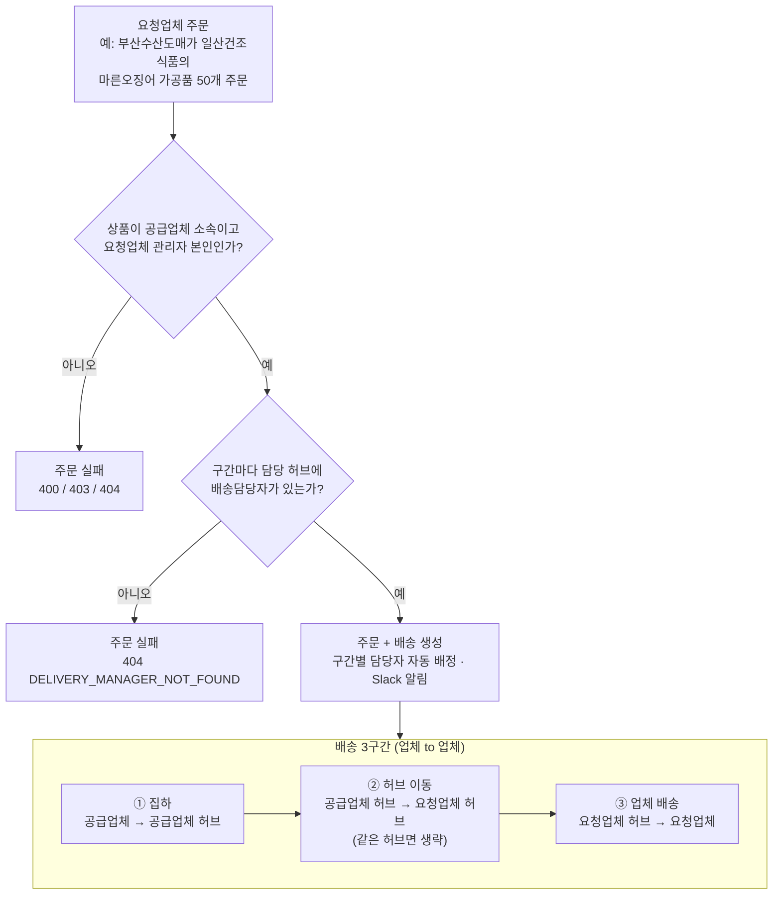

예: 부산수산도매(부산광역시 센터 소속)가 일산건조식품(경기 북부 센터 소속)의 마른오징어 가공품 50개를 주문하면 일산건조식품 → 경기 북부 센터(집하) → 부산광역시 센터(허브 이동) → 부산수산도매(업체 배송) 순서로 배송된다. 두 업체가 같은 허브 소속이면 허브 이동 없이 집하 후 바로 업체 배송으로 넘어간다.

### 1.3 개발 범위

| 구분 | 내용 |
| --- | --- |
| 포함 (필수) | 허브·허브 간 경로 조회(초기 데이터 적재), 업체·상품 CRUD + 검색, 주문 생성·취소·삭제, 배송·배송 구간(집하·허브 이동·업체 배송) 자동 생성 및 상태 관리, 배송담당자 자동 배정(MASTER 재배정 병행), 회원가입·로그인(JWT), 주문 생성 시 Slack 알림, Eureka·Gateway·Feign, Docker Compose |
| 제외 | 허브·경로 생성/수정/삭제, 배차 경로 최적화, AI 연동, 서버 배포 |
| 고도화 (기본 기능 완성 후) | 재고 관리(허브 재고·입고·재고 부족 처리·재고 이력, 여러 허브 재고를 모아 출고), 허브 재고 검색, Kafka 메시징(코레오그래피 Saga 검토), Redis 캐싱, Zipkin 분산 추적, Resilience4j 서킷브레이커, 테스트 자동화 |

### 1.4 기술 스택

| 구분 | 기술 | 용도 |
| --- | --- | --- |
| Language | Java 17 | - |
| Framework | Spring Boot 3.x | 각 마이크로서비스 (Spring Cloud는 Boot 버전과 호환되는 릴리스 트레인 사용) |
| API Gateway | Spring Cloud Gateway | 단일 진입점, JWT 인증·인가, 라우팅 |
| Service Discovery | Spring Cloud Netflix Eureka | 서비스 등록·조회 |
| 서비스 간 통신 | Spring Cloud OpenFeign + LoadBalancer | 동기 REST 호출, 인스턴스 간 부하 분산 |
| Data Access | Spring Data JPA, QueryDSL | ORM, 동적 검색 쿼리 |
| Database | PostgreSQL 16 | 서비스별 스키마 분리 |
| Security | Spring Security, JJWT, BCrypt | 인증, 토큰 발급·검증, 비밀번호 해시 |
| Validation | Spring Validation (Bean Validation) | 서버 측 요청 값 검증 |
| API 문서 | springdoc-openapi (Swagger UI) | API 문서 자동화 |
| Infra | Docker, Docker Compose | 로컬 컨테이너 오케스트레이션 |
| Build / VCS | Gradle (멀티 모듈), Git / GitHub | 빌드, 버전 관리 |
| 외부 연동 | Slack Incoming Webhook | 주문 생성 알림 |
| 선택 | Resilience4j, Micrometer Tracing + Zipkin, Redis, Kafka | 장애 격리, 분산 추적, 캐싱, 서비스 간 비동기 메시징 (Kafka는 고도화 단계) |

### 1.5 주요 설계 결정

| # | 결정 | 이유 |
| --- | --- | --- |
| 1 | 비즈니스 서비스 5개(user, hub, company, order, delivery) + 인프라 서비스 2개(eureka, gateway)로 분리. 상품은 company-service가 소유하고, hub-service는 허브·허브 간 경로를 담당 (재고는 고도화 단계에서 hub-service에 추가) | 발제 가이드(상품은 업체 하위 리소스)와 데이터 소유권 기준으로 경계 설정 |
| 2 | 인증·인가는 Gateway에서 일괄 처리하고, 하위 서비스는 Gateway가 주입한 `X-User-*` 헤더를 신뢰 | 인증 로직 중복 제거, 각 서비스는 소유자 검증 같은 비즈니스 인가에 집중 |
| 3 | 권한은 `MASTER` / `USER` 2단계, 배송담당자는 USER에게 부여하는 `is_delivery_manager` 속성 | “권한 2단계” 진행 안내와 “배송담당자는 권한으로 부여” 요구를 함께 충족 |
| 4 | 서비스 간 참조는 FK 없이 UUID 논리 참조, 존재 여부는 Feign 호출로 검증 | 스키마 분리 원칙 준수, 서비스 독립 배포 |
| 5 | 주문 생성은 order-service가 오케스트레이터인 Saga + 보상 트랜잭션으로 처리 | 분산 환경에서는 단일 DB 트랜잭션이 불가능하므로 실패 지점별 보상으로 일관성 확보 |
| 6 | `orderId`를 주문 저장 전에 선발급하고, 배송 생성·취소·삭제 API를 orderId 기준으로 멱등하게 설계 | 타임아웃처럼 결과를 알 수 없는 상황에서도 재시도·보상을 안전하게 수행 |
| 7 | 배송은 주문의 생명주기를 따르므로 배송 생성·삭제는 내부 API로만 제공 | 주문 없는 배송, 배송 없는 주문 방지 |
| 8 | PostgreSQL 컨테이너 1개 + 서비스별 스키마·전용 계정 분리 | 로컬 리소스 절약과 논리적 DB 독립성 동시 확보 |
| 9 | 특정 업체의 특정 상품 재고는 무한하다고 가정한다. 재고를 확인·차감하지 않고 공급업체가 주문 수량을 항상 출고한다. 재고 관리(입고·차감·부족 처리·이력)는 고도화 기능 | 멘토 피드백. 상품은 한 업체가 소유하고 업체는 한 허브에 소속되므로, 기본 범위에서는 허브 재고 조회와 여러 허브 출고의 의미가 작음 |
| 10 | 배송은 집하(공급업체 → 공급업체 허브), 허브 이동(공급업체 허브 → 요청업체 허브), 업체 배송(요청업체 허브 → 요청업체) 3구간으로 기록한다. 두 업체가 같은 허브 소속이면 허브 이동 구간을 생략. 주문 1건 = 배송 1건 | 멘토 피드백(허브 간 이동은 배송 경로의 한 구간) + 업체 to 업체 배송. 구간마다 담당자·상태를 따로 관리 |
| 11 | 주문은 한 번에 한 품목만, 요청업체 관리자 본인(또는 MASTER)만 그 업체 명의로 주문 | SA 제작 미팅 결정. 다른 업체 명의로 주문하는 것을 막음 |
| 12 | 모든 주요 엔티티의 PK는 UUID | SA 제작 미팅 결정 + 발제 요구사항. 서비스마다 따로 생성해도 충돌하지 않고, 외부에 노출돼도 순번을 추측할 수 없음 |
| 13 | 배송담당자는 소속 허브(`hub_id`)를 갖고, 구간의 출발지를 관리하는 허브 소속만 담당한다(집하·허브 이동: 공급업체 허브, 업체 배송: 요청업체 허브). 배송을 만들 때 구간마다 담당 건수가 가장 적은 담당자를 자동 배정하고, 배정할 사람이 없으면 주문을 404 `DELIVERY_MANAGER_NOT_FOUND`로 실패 처리. MASTER는 재배정 가능 | 추가 요구사항(소속 허브는 출발지 기준) + 멘토 피드백(담당자 배정은 자동, 수동 API는 병행) |
| 14 | Saga는 order-service가 지휘하는 오케스트레이션. 보상은 단계별로 수행하고, 클라이언트에는 실패한 단계에 맞는 에러 코드 하나를 반환 | 멘토 피드백(방식 비교 후 결정). Feign 동기 호출 구조와 맞고 흐름을 한 곳에서 추적 가능. 코레오그래피는 메시지 브로커가 필요해 Kafka 고도화 단계에서 검토 (7.6 참고) |

---

## 2. 시스템 구조도

### 2.1 서비스 구성

| 서비스 | 포트 | 책임 | DB 스키마 | 담당자 |
| --- | --- | --- | --- | --- |
| eureka-server | 8761 | 서비스 등록·조회 | - |  |
| gateway-service | 8080 | 외부 요청 단일 진입점, JWT 검증, 권한 재확인, 라우팅, `/internal/**` 외부 차단 | - |  |
| user-service | 8081 | 회원가입, 로그인(JWT 발급), 사용자 관리, 배송담당자 지정(소속 허브 포함) | `user_schema` |  |
| hub-service | 8082 | 허브·허브 간 경로 조회 (재고는 고도화 단계에서 추가) | `hub_schema` |  |
| company-service | 8083 | 업체 CRUD, 상품(업체 하위 리소스) CRUD | `company_schema` |  |
| order-service | 8084 | 주문 생성(Saga 오케스트레이션)·취소·삭제, Slack 알림 | `order_schema` |  |
| delivery-service | 8085 | 배송·배송 구간(집하·허브 이동·업체 배송) 생성, 담당자 자동 배정·재배정, 상태 관리 | `delivery_schema` |  |

### 2.2 시스템 구조도

실선은 Gateway를 통한 외부 요청 라우팅, 점선은 서비스 간 내부 Feign 호출이다. 모든 서비스는 Eureka에 등록되며, Gateway와 Feign은 `lb://{서비스명}`으로 대상 인스턴스를 찾는다.

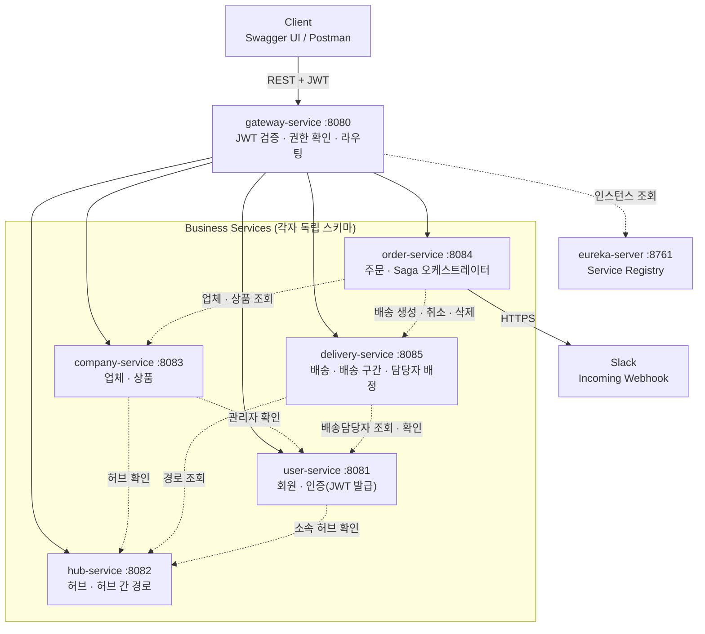

인증/인가 - gateway

나중에 서비스별로 역할 분배

**유즈케이스별 구조도** (멘토 피드백: 한 장에 모든 호출을 그리지 않고 사용 흐름별로 나눔)

① 회원가입·로그인과 인증

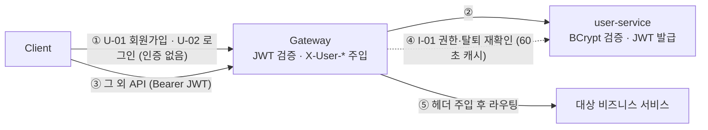

② 업체·상품 등록

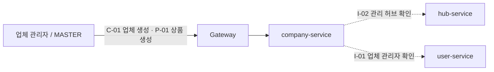

③ 배송담당자 지정

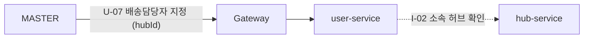

④ 주문 생성 (상세 순서는 7.1)

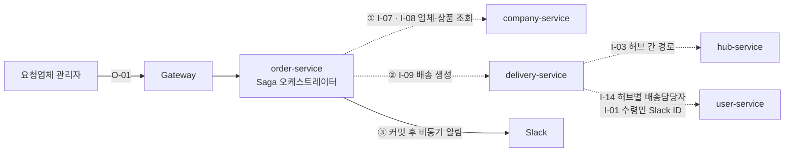

⑤ 배송 처리

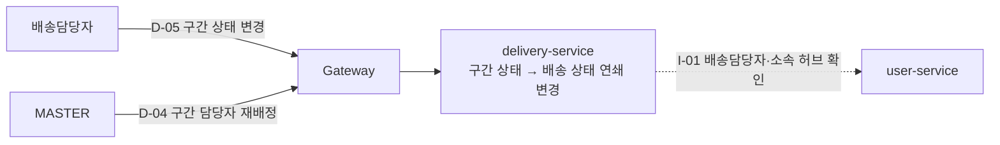

⑥ 주문 취소·삭제 (상세 순서는 7.2)

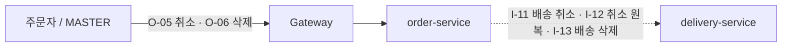

### 2.3 서비스 간 호출 관계 (Feign)

| 호출자 → 제공자 | 호출 시점 | 목적 |
| --- | --- | --- |
| gateway → user | 인증이 필요한 모든 요청 | 토큰의 role과 저장된 role 일치 여부, 탈퇴 여부 확인 (60초 캐시) |
| company → hub | 업체 생성·수정 | 관리 허브 존재 확인 |
| company → user | 업체 생성·수정 (관리자 지정 시) | 업체 관리자 사용자 존재 확인 |
| order → company | 주문 생성 | 공급·수령업체와 상품 정보 조회, 소속 검증 |
| order → delivery | 주문 생성 / 취소 / 삭제·보상 | 배송 생성 / 취소·취소 원복 / 논리 삭제 |
| delivery → hub | 배송 생성 | 공급업체 허브 → 요청업체 허브 경로(예상 거리·소요시간) 조회 (I-03) |
| delivery → user | 배송 생성 / 구간 담당자 재배정 | 구간별 담당 허브의 배송담당자 목록 조회(I-14), 수령인 Slack ID 조회와 재배정 대상 검증(I-01) |
| user → hub | 배송담당자 지정 (U-07) | 소속 허브 존재 확인, 허브명 조회 |

> hub-service는 다른 서비스를 호출하지 않는 최하위 서비스다(재고 기능이 고도화로 빠지면서 hub → company 호출도 없어졌다). user-service는 hub-service만, company·delivery-service는 user·hub-service만 호출하므로 **순환 호출은 없다.**
>

### 2.4 서비스 내부 구조 (Layered Architecture)

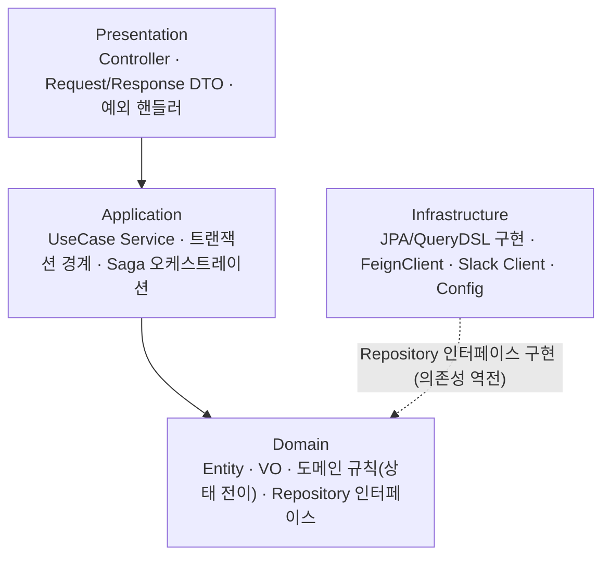

- 의존은 Presentation → Application → Domain 방향으로 흐른다. Infrastructure는 Domain이 정의한 Repository 인터페이스를 구현하므로 Domain 쪽으로 의존한다(의존성 역전). 그래서 Domain은 DB 접근·외부 호출을 어떻게 구현하는지 몰라도 된다.
- Entity는 Controller 밖으로 노출하지 않고, 계층마다 DTO를 분리한다.
- 상태 전이 규칙(예: 집하 시작 전에만 취소 가능)은 Entity 메서드에 둬서 도메인 계층에서 검증한다.
- 4 layered architecture 계층별 구현은 참조만 하되, 구현시 타협하고 합의하고 해서 진행

**프로젝트 구조 (Gradle 멀티 모듈)**

```
sparta-logistics/
├── common/                         # 공통 라이브러리 모듈
│   ├── BaseEntity                  # Audit + Soft Delete 필드
│   ├── ApiResponse, PageResponse   # 공통 응답 포맷
│   ├── GlobalExceptionHandler, ErrorCode
│   ├── UserContext, @CurrentUser   # X-User-* 헤더 → 사용자 정보 주입
│   └── FeignHeaderInterceptor      # 내부 호출 시 사용자 헤더 전파
├── eureka-server/
├── gateway-service/
├── user-service/
├── hub-service/
├── company-service/
├── order-service/
├── delivery-service/
│   └── src/main/java/com/sparta/logistics/delivery/
│       ├── presentation/           # controller, dto(request/response)
│       ├── application/            # service, dto(command/result)
│       ├── domain/                 # entity, enum, repository(interface)
│       └── infrastructure/         # jpa, querydsl, client(feign), config
├── infra/postgres/init.sql
└── docker-compose.yml
script/run.sh
```

### 2.5 배송 상태 전이 (업체 to 업체)

배송 상태는 구간 상태가 바뀔 때 자동으로 따라 바뀐다. 구간은 순번대로만 진행되며, 앞 구간이 `ARRIVED`여야 다음 구간을 `MOVING`으로 바꿀 수 있다.

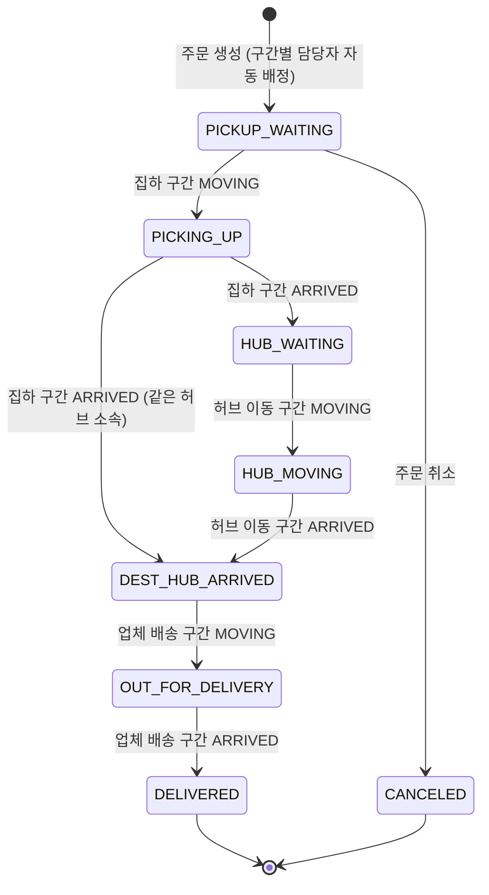

| 배송 상태 | 의미 | 바뀌는 시점 |
| --- | --- | --- |
| `PICKUP_WAITING` | 집하 대기 | 주문 생성 시 자동 |
| `PICKING_UP` | 공급업체 → 공급업체 허브 이동 중 | 집하 구간을 `MOVING`으로 변경 (D-05) |
| `HUB_WAITING` | 공급업체 허브 도착, 허브 이동 대기 | 집하 구간을 `ARRIVED`로 변경 (D-05) |
| `HUB_MOVING` | 허브 간 이동 중 | 허브 이동 구간을 `MOVING`으로 변경 (D-05) |
| `DEST_HUB_ARRIVED` | 요청업체 허브 도착 | 허브 이동 구간을 `ARRIVED`로 변경 (D-05). 같은 허브 소속이면 집하 구간 `ARRIVED` 때 바로 이 상태 |
| `OUT_FOR_DELIVERY` | 요청업체로 배송 중 | 업체 배송 구간을 `MOVING`으로 변경 (D-05) |
| `DELIVERED` | 배송 완료 | 업체 배송 구간을 `ARRIVED`로 변경 (D-05) |
| `CANCELED` | 주문 취소 | 주문 취소 시 내부 API(I-11)로 변경. 집하 시작 전(`PICKUP_WAITING`)에만 가능 |

배송 구간 상태: `WAITING` → `MOVING` → `ARRIVED` (주문 취소 시 `CANCELED`). 구간 유형은 `PICKUP`(집하), `HUB_TRANSFER`(허브 이동), `LAST_MILE`(업체 배송)이다.

---

## 3. 인프라 설계도

### 3.1 인프라 구성도

이번 과제는 서버 배포 없이 로컬에서 **모든 애플리케이션을 Docker 컨테이너로 실행**한다. 외부에는 Gateway(8080)와 Eureka 대시보드(8761)만 공개한다.

노드마다 사용하는 기술 스택을 표시했다 (멘토 피드백: 처음 보는 사람도 스택을 알 수 있게). 로고가 들어간 아키텍처 그림은 별도 이미지로 제작할 예정이다.

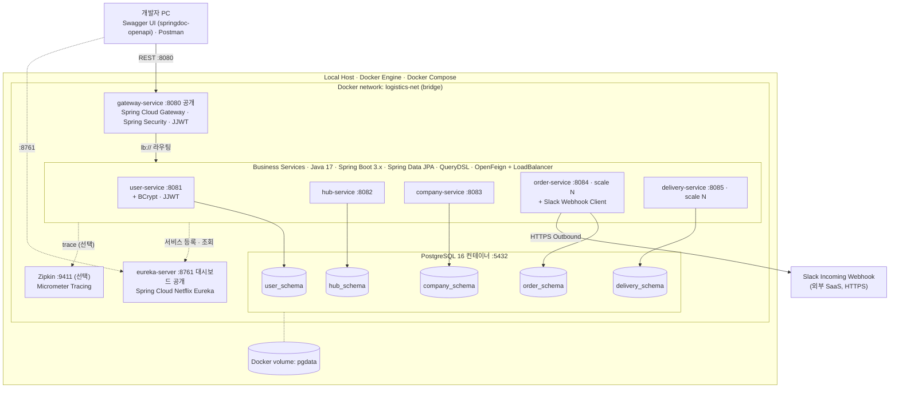

### 3.2 컨테이너 구성

| 컨테이너 | 이미지 | 내부 포트 | 호스트 공개 | depends_on | 비고 |
| --- | --- | --- | --- | --- | --- |
| postgres | postgres:16 | 5432 | 5432 (개발용, 선택) | - | `init.sql`로 스키마·계정 생성, `pgdata` 볼륨으로 데이터 유지 |
| eureka-server | 빌드 (eclipse-temurin:17-jre) | 8761 | 8761 | - | 등록 현황 대시보드 |
| gateway-service | 빌드 | 8080 | **8080** | eureka | 유일한 외부 API 진입점 |
| user-service | 빌드 | 8081 | 미공개 | postgres, eureka | JWT 발급 |
| hub-service | 빌드 | 8082 | 미공개 | postgres, eureka | 기동 시 허브 17개·경로 272개 시드 적재 |
| company-service | 빌드 | 8083 | 미공개 | postgres, eureka | - |
| order-service | 빌드 | 8084 | 미공개 | postgres, eureka | `SLACK_WEBHOOK_URL` 환경 변수 |
| delivery-service | 빌드 | 8085 | 미공개 | postgres, eureka | - |
| zipkin (선택) | openzipkin/zipkin | 9411 | 9411 | - | 분산 추적 |

**Gateway 라우팅 규칙**

| Path | 대상 |
| --- | --- |
| `/api/v1/auth/**`, `/api/v1/users/**` | `lb://user-service` |
| `/api/v1/hubs/**`, `/api/v1/hub-routes/**` | `lb://hub-service` |
| `/api/v1/companies/**`, `/api/v1/products/**` | `lb://company-service` |
| `/api/v1/orders/**` | `lb://order-service` |
| `/api/v1/deliveries/**` | `lb://delivery-service` |
| `/internal/**` | 라우팅하지 않음 (외부 접근 차단, 서비스 간 Feign 전용) |

### 3.3 서비스 디스커버리와 수평 확장

- 모든 서비스는 기동 시 `spring.application.name`으로 Eureka에 등록한다. `instance-id`에 랜덤 값을 붙여 같은 서비스의 여러 인스턴스를 구분한다.
- Gateway 라우팅(`lb://`)과 Feign(`@FeignClient(name = "hub-service")`)은 Spring Cloud LoadBalancer가 Eureka 목록을 기반으로 라운드로빈 분산한다.
- 비즈니스 서비스는 호스트 포트를 고정 공개하지 않으므로 `docker compose up --scale order-service=2`처럼 수평 확장할 수 있다.
- 서비스는 상태를 갖지 않는다(Stateless). 인증 정보는 JWT, 데이터는 DB에만 둔다.

### 3.4 DB 분리 전략

- PostgreSQL 인스턴스 1개에 **서비스별 스키마 + 전용 계정**을 만들고, 각 계정은 자기 스키마에만 권한을 갖는다. 다른 서비스 테이블을 직접 조회하거나 조인할 수 없다.
- 서비스 간에는 FK를 두지 않는다(UUID 논리 참조). 정합성은 Feign 검증과 Saga 보상으로 보장한다.
- 각 서비스는 JDBC URL의 `currentSchema` 또는 `hibernate.default_schema`로 자기 스키마를 지정한다.
- 운영 환경으로 확장할 때는 스키마를 서비스별 DB 인스턴스로 옮기고 읽기 복제본을 추가한다. 코드 변경 없이 DataSource 설정만 바꾸면 된다.

```sql
-- infra/postgres/init.sql (로컬 전용 비밀번호)
CREATE SCHEMA IF NOT EXISTS user_schema;
CREATE SCHEMA IF NOT EXISTS hub_schema;
CREATE SCHEMA IF NOT EXISTS company_schema;
CREATE SCHEMA IF NOT EXISTS order_schema;
CREATE SCHEMA IF NOT EXISTS delivery_schema;

-- 서비스별 계정 (hub 예시, 나머지 서비스도 같은 패턴)
CREATE USER hub_app WITH PASSWORD 'hub_local_pw';
GRANT USAGE, CREATE ON SCHEMA hub_schema TO hub_app;
ALTER ROLE hub_app SET search_path = hub_schema;
```

### 3.5 장애 대응과 운영 설정

| 항목 | 설계 |
| --- | --- |
| Feign 타임아웃 | connect 5초 / read 20초. 외부·하위 서비스 연결 시간이 길어질 수 있어 보수적으로 설정한다(멘토 피드백). Slack Webhook 호출도 같은 값을 쓴다. Gateway `response-timeout`은 60초로 둬서 주문 생성처럼 내부 호출이 이어지는 요청이 먼저 끊기지 않게 한다. 하위 서비스 실패는 `ErrorDecoder`에서 도메인 예외 또는 503 `SERVICE_UNAVAILABLE`로 변환 |
| 재시도 | GET 요청과 orderId 기반 멱등 API(배송 생성·취소 원복·삭제)만 최대 3회 재시도 |
| 서킷브레이커 (선택) | Resilience4j로 하위 서비스 장애 시 빠르게 실패 처리 |
| Health check | Spring Boot Actuator `/actuator/health`. postgres는 compose healthcheck 후 서비스 기동 |
| 분산 추적 (선택) | Micrometer Tracing + Zipkin, 로그에 traceId 포함 |
| 설정·비밀 정보 | JWT secret, DB 비밀번호, Slack Webhook URL은 `.env` → 환경 변수로 주입하고 Git에서 제외 |
| API 문서 | 각 서비스 springdoc 문서를 Gateway Swagger UI에서 서비스별로 선택해 조회 |

---

## 4. ERD

**표기 규칙**

- 실선: 같은 스키마 안의 물리 FK
- 점선: 서비스(스키마) 간 UUID 논리 참조. FK 없이 Feign 호출로 검증
- 모든 테이블은 Audit 컬럼 6개(`created_at`, `created_by`, `updated_at`, `updated_by`, `deleted_at`, `deleted_by`)를 포함한다. 다이어그램에서는 생략했으며 5장 테이블 명세와 부록 DBML에 전체 컬럼이 있다.
- dbdiagram.io 제출용 ERD는 부록 10.2의 DBML 코드를 붙여넣으면 바로 생성된다.
- 서비스별 ERD의 컬럼 설명 앞 괄호는 길이·정밀도다. 예: `(10)` = VARCHAR(10), `(8,2)` = DECIMAL(8,2) (멘토 피드백: 길이까지 함께 표기)
- 재고 테이블(`p_hub_stocks`, `p_hub_stock_histories`)은 고도화 단계에서 추가하므로 ERD에서 뺐다 (5.3 참고)

### 4.1 전체 ERD (서비스 간 관계)

→ Audit 컬럼(`created_at`, `created_by`, `updated_at`, `updated_by`, `deleted_at`, `deleted_by`)은 `BaseEntity`로 공통 관리하므로 ERD에는 표기하지 않는다. 발제 요구사항: 모든 테이블에 Audit 필드를 추가하고, update가 없는 기록형 데이터는 일부 생략 가능

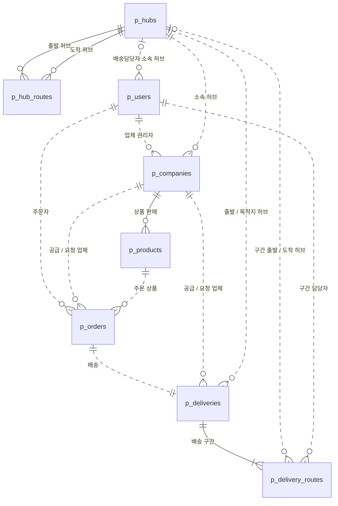

### 4.2 user-service (`user_schema`)

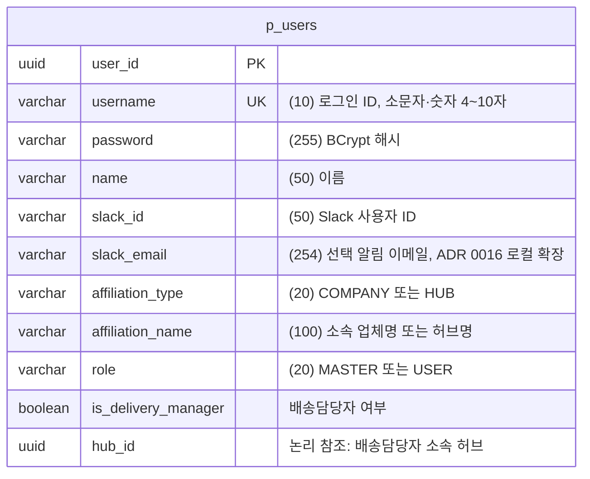

### 4.3 hub-service (`hub_schema`)

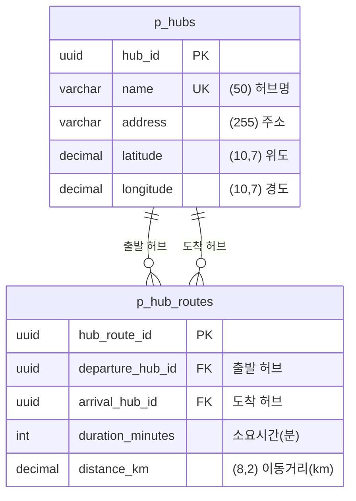

### 4.4 company-service (`company_schema`)

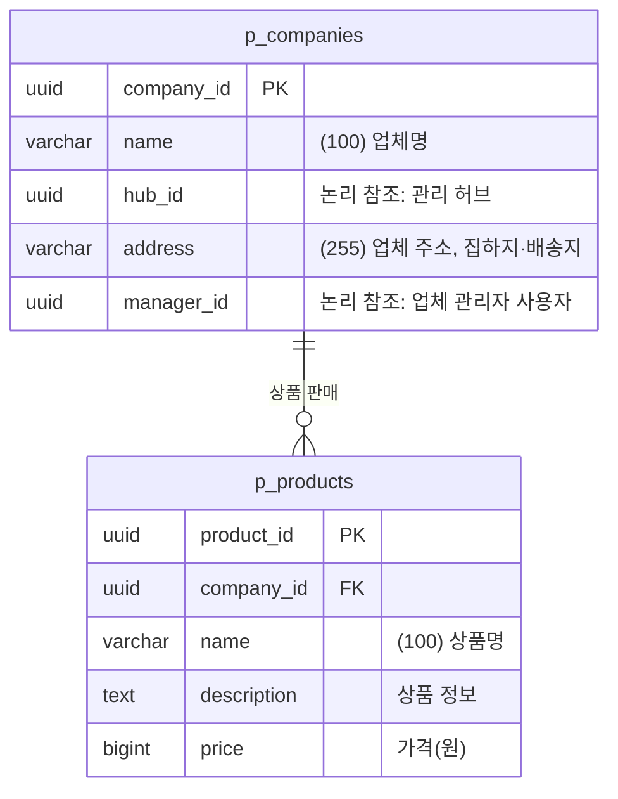

### 4.5 order-service (`order_schema`)

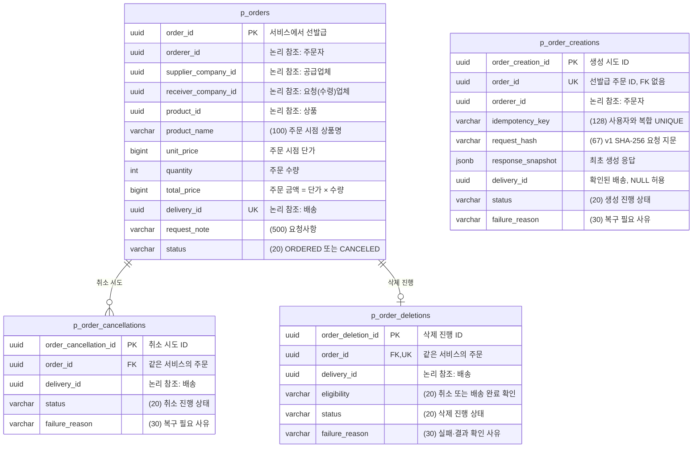

### 4.6 delivery-service (`delivery_schema`)

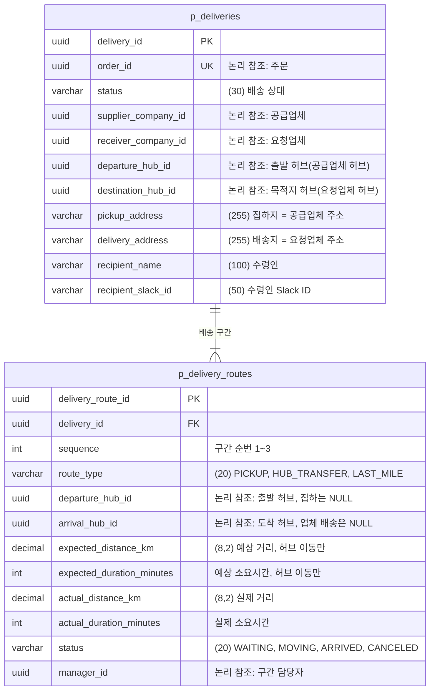

---

## 5. 테이블 명세서

### 5.1 공통 규칙

- 테이블명은 `p_` 접두사, 컬럼은 snake_case를 사용한다.
- 모든 PK는 UUID다. 애플리케이션에서 생성하며, `order_id`는 Saga 처리를 위해 주문 저장 전에 서비스 코드에서 선발급한다.
- 논리 삭제: DELETE API는 `deleted_at`, `deleted_by`만 채운다. Entity에 `@SQLRestriction("deleted_at IS NULL")`을 적용해 조회·검색에서 삭제 데이터를 제외한다.
- 유니크 제약은 논리 삭제를 고려해 부분 인덱스로 만든다. 예: `CREATE UNIQUE INDEX ... WHERE deleted_at IS NULL`
- Enum 값은 `VARCHAR` + `@Enumerated(EnumType.STRING)`으로 저장한다.
- 서비스 간 참조 컬럼(표의 “논리 참조”)에는 FK가 없다. 대신 조회 성능을 위해 인덱스를 둔다.

**공통 Audit 컬럼** (모든 테이블 포함, `BaseEntity` 상속)

| 컬럼 | 타입 | 제약 | 설명 |
| --- | --- | --- | --- |
| `created_at` | TIMESTAMP | NOT NULL | 레코드 생성 시각 |
| `created_by` | VARCHAR(100) | NOT NULL | 생성자 username (시스템 생성은 `SYSTEM`) |
| `updated_at` | TIMESTAMP | NOT NULL | 레코드 수정 시각 |
| `updated_by` | VARCHAR(100) | NOT NULL | 수정자 username |
| `deleted_at` | TIMESTAMP | NULL | 논리 삭제 시각, NULL이면 활성 데이터 |
| `deleted_by` | VARCHAR(100) | NULL | 삭제자 username |

> Audit 값은 JPA Auditing(`AuditorAware`)이 Gateway가 전달한 `X-Username` 헤더로 채운다. 헤더가 없는 내부 시스템 작업은 `SYSTEM`으로 기록한다.
>

### 5.2 user_schema

**`p_users` — 사용자**

| 컬럼 | 타입 | 제약 | 설명 |
| --- | --- | --- | --- |
| `user_id` | UUID | PK | 사용자 식별자 |
| `username` | VARCHAR(10) | NOT NULL, UNIQUE | 로그인 ID. 소문자·숫자 4~10자. 탈퇴 후에도 재사용 불가 |
| `password` | VARCHAR(255) | NOT NULL | BCrypt 해시 |
| `name` | VARCHAR(50) | NOT NULL | 이름 |
| `slack_id` | VARCHAR(50) | NULL 허용 | 기존 Slack 사용자 ID 보존. 이메일로 가입한 신규 사용자는 null(V3·ADR 0016 로컬 확장) |
| `slack_email` | VARCHAR(254) | NULL 허용, 비어 있지 않고 양끝 공백 없음 CHECK | 선택 Slack 알림 이메일. V2·ADR 0016 로컬 확장, 팀 리뷰 대기 |
| `affiliation_type` | VARCHAR(20) | NOT NULL | 소속 구분: `COMPANY`, `HUB` |
| `affiliation_name` | VARCHAR(100) | NOT NULL | 소속 업체명 또는 허브명 |
| `role` | VARCHAR(20) | NOT NULL, DEFAULT `'USER'` | 권한: `MASTER`, `USER` |
| `is_delivery_manager` | BOOLEAN | NOT NULL, DEFAULT `FALSE` | 배송담당자 여부 (MASTER가 부여) |
| `hub_id` | UUID | NULL 허용, 배송담당자면 NOT NULL (CHECK) | 배송담당자 소속 허브 (논리 참조: `hub_schema.p_hubs`). 배송담당자 지정 시 필수, 해제 시 NULL |
| Audit 컬럼 6개 |  |  | 공통 |

### 5.3 hub_schema

**`p_hubs` — 허브** (17개 고정, 초기 데이터 적재 후 조회 전용)

| 컬럼 | 타입 | 제약 | 설명 |
| --- | --- | --- | --- |
| `hub_id` | UUID | PK | 허브 식별자 |
| `name` | VARCHAR(50) | NOT NULL, UNIQUE | 허브명 (예: 서울특별시 센터) |
| `address` | VARCHAR(255) | NOT NULL | 허브 주소 |
| `latitude` | DECIMAL(10,7) | NOT NULL | 위도 (경로 거리 산출용) |
| `longitude` | DECIMAL(10,7) | NOT NULL | 경도 |
| Audit 컬럼 6개 |  |  | 공통 |

**`p_hub_routes` — 허브 간 이동 경로** (P2P, 17 × 16 = 272건, 조회 전용)

| 컬럼 | 타입 | 제약 | 설명 |
| --- | --- | --- | --- |
| `hub_route_id` | UUID | PK | 경로 식별자 |
| `departure_hub_id` | UUID | NOT NULL, FK → `p_hubs` | 출발 허브 |
| `arrival_hub_id` | UUID | NOT NULL, FK → `p_hubs` | 도착 허브 |
| `duration_minutes` | INT | NOT NULL, CHECK `> 0` | 소요시간(분) |
| `distance_km` | DECIMAL(8,2) | NOT NULL, CHECK `> 0` | 이동거리(km) |
| Audit 컬럼 6개 |  |  | 공통 |
- `UNIQUE (departure_hub_id, arrival_hub_id) WHERE deleted_at IS NULL`
- `CHECK (departure_hub_id <> arrival_hub_id)`

> 아래 두 테이블(`p_hub_stocks`, `p_hub_stock_histories`)은 **재고 관리 고도화 단계**에서 추가한다. 기본 범위에서는 만들지 않으며, 아래는 v1.2 기준 설계 초안이다.
>

**`p_hub_stocks` — 허브별 상품 재고 (고도화)**

| 컬럼 | 타입 | 제약 | 설명 |
| --- | --- | --- | --- |
| `hub_stock_id` | UUID | PK | 재고 식별자 |
| `hub_id` | UUID | NOT NULL, FK → `p_hubs` | 보관 허브 |
| `product_id` | UUID | NOT NULL, 논리 참조 | company-service 상품 ID |
| `quantity` | INT | NOT NULL, DEFAULT 0, CHECK `>= 0` | 재고 수량 |
| Audit 컬럼 6개 |  |  | 공통 |
- `UNIQUE (hub_id, product_id) WHERE deleted_at IS NULL`
- 상품 생성 시 company-service가 내부 API로 기본 허브(업체 관리 허브)에 수량 0인 재고 레코드를 만든다. 다른 허브의 재고 레코드는 그 허브에 처음 입고(H-06)할 때 만든다.
- 같은 상품이 여러 허브에 재고로 있을 수 있다 (허브 × 상품당 1행).

**`p_hub_stock_histories` — 재고 변경 이력 (고도화)** (기록형 데이터, update·delete가 없으므로 `updated_*`, `deleted_*` 생략)

| 컬럼 | 타입 | 제약 | 설명 |
| --- | --- | --- | --- |
| `hub_stock_history_id` | UUID | PK | 이력 식별자 |
| `hub_stock_id` | UUID | NOT NULL, FK → `p_hub_stocks` | 대상 재고 |
| `order_id` | UUID | NULL, 논리 참조 | 주문 ID (입고는 NULL) |
| `change_type` | VARCHAR(20) | NOT NULL | `INBOUND`(입고), `DECREASE`(주문 차감), `RESTORE`(취소·보상 복원) |
| `quantity` | INT | NOT NULL, CHECK `> 0` | 변경 수량 |
| `quantity_after` | INT | NOT NULL | 변경 후 재고 수량 |
| `created_at` | TIMESTAMP | NOT NULL | 생성 시각 |
| `created_by` | VARCHAR(100) | NOT NULL | 생성자 |
- `UNIQUE (hub_stock_id, order_id, change_type) WHERE order_id IS NOT NULL` → 같은 주문이 같은 허브 재고를 두 번 차감·복원하지 않도록 막는 **멱등성 키**. 한 주문이 여러 허브에서 차감될 수 있으므로 허브 재고 단위로 건다.

### 5.4 company_schema

**`p_companies` — 업체** (모든 업체는 구분 없이 생산업체·수령업체가 될 수 있음)

| 컬럼 | 타입 | 제약 | 설명 |
| --- | --- | --- | --- |
| `company_id` | UUID | PK | 업체 식별자 |
| `name` | VARCHAR(100) | NOT NULL | 업체명 |
| `hub_id` | UUID | NOT NULL, 논리 참조 | 업체 관리 허브 ID (생성·수정 시 hub-service로 존재 확인) |
| `address` | VARCHAR(255) | NOT NULL | 업체 주소 (공급업체면 집하지, 요청업체면 배송지) |
| `manager_id` | UUID | NOT NULL, 논리 참조 | 업체 관리자 사용자 ID |
| Audit 컬럼 6개 |  |  | 공통 |
- 인덱스: `hub_id`, `manager_id`

**`p_products` — 상품** (업체의 하위 리소스)

| 컬럼 | 타입 | 제약 | 설명 |
| --- | --- | --- | --- |
| `product_id` | UUID | PK | 상품 식별자 |
| `company_id` | UUID | NOT NULL, FK → `p_companies` | 소속 업체 |
| `name` | VARCHAR(100) | NOT NULL | 상품명 |
| `description` | TEXT | NULL | 상품 정보 |
| `price` | BIGINT | NOT NULL, CHECK `>= 0` | 가격(원) |
| Audit 컬럼 6개 |  |  | 공통 |
- 인덱스: `company_id`
- 상품의 허브는 따로 저장하지 않고 소속 업체의 관리 허브를 따른다. 재고가 없으므로 업체 관리 허브를 바꿔도 되고, 이미 만들어진 배송은 생성 시점의 허브를 그대로 쓴다.

### 5.5 order_schema

**`p_orders` — 주문**

| 컬럼 | 타입 | 제약 | 설명 |
| --- | --- | --- | --- |
| `order_id` | UUID | PK | 주문 식별자 (저장 전 선발급, Saga 멱등키) |
| `orderer_id` | UUID | NOT NULL, 논리 참조 | 주문한 사용자 ID |
| `supplier_company_id` | UUID | NOT NULL, 논리 참조 | 공급업체 ID (상품 보유 업체) |
| `receiver_company_id` | UUID | NOT NULL, 논리 참조 | 요청업체 ID (수령·주문 업체) |
| `product_id` | UUID | NOT NULL, 논리 참조 | 상품 ID |
| `product_name` | VARCHAR(100) | NOT NULL | 주문 시점 상품명 스냅샷 |
| `unit_price` | BIGINT | NOT NULL | 주문 시점 단가 스냅샷 |
| `quantity` | INT | NOT NULL, CHECK `> 0` | 주문 수량 |
| `total_price` | BIGINT | NOT NULL, CHECK `>= 0` | 주문 금액 = `unit_price` × `quantity`. 주문 시점에 계산해 저장 (멘토 피드백) |
| `delivery_id` | UUID | NOT NULL, UNIQUE, 논리 참조 | 배송 ID |
| `request_note` | VARCHAR(500) | NULL | 요청사항 |
| `status` | VARCHAR(20) | NOT NULL | `ORDERED`, `CANCELED` |
| Audit 컬럼 6개 |  |  | 공통 |
- 인덱스: `orderer_id`, `supplier_company_id`, `receiver_company_id`, `created_at`
- 배송 진행 상태는 delivery-service가 관리하므로 주문에는 중복 저장하지 않는다.

**`p_order_cancellations` — 취소 진행 기록** (2026-10-15 주문 담당자 승인, order ADR 0006)

| 컬럼 | 타입 | 제약 | 설명 |
| --- | --- | --- | --- |
| `order_cancellation_id` | UUID | PK | 취소 시도 식별자, 원격 호출 전에 선발급 |
| `status` | VARCHAR(20) | NOT NULL, CHECK | `PROCESSING`, `COMPLETED`, `ABORTED`, `RECOVERY_REQUIRED` |
| `failure_reason` | VARCHAR(30) | NULL, CHECK | `DELIVERY_RESULT_UNKNOWN`, `ORDER_COMMIT_UNKNOWN`, `REVERT_FAILED`. RECOVERY_REQUIRED일 때만 필수 |
| `order_id` | UUID | NOT NULL, FK | 같은 order_schema의 p_orders 참조 |
| `delivery_id` | UUID | NOT NULL, 논리 참조 | 취소 대상 배송 |
| Audit 컬럼 6개 | | | 공통 |

- 미해결 시도 부분 유니크: `order_id WHERE deleted_at IS NULL AND status IN ('PROCESSING', 'RECOVERY_REQUIRED')`.
- 조회 인덱스: `order_id`, `delivery_id` (활성 행). 공개 주문 상태와 분리하며 기록을 자동 만료시키지 않는다.
- 완료·중단 기록도 이력으로 남긴다. delivery 테이블에는 물리 FK를 만들지 않는다.

**`p_order_creations` — 생성 진행 기록** (2026-10-15 주문 담당자 요청, order ADR 0007·0008)

| 컬럼 | 타입 | 제약 | 설명 |
| --- | --- | --- | --- |
| `order_creation_id` | UUID | PK | 생성 시도 식별자 |
| `status` | VARCHAR(20) | NOT NULL, CHECK | `PROCESSING`, `COMPLETED`, `ABORTED`, `RECOVERY_REQUIRED` |
| `failure_reason` | VARCHAR(30) | NULL, CHECK | `DELIVERY_RESULT_UNKNOWN`, `ORDER_COMMIT_UNKNOWN`, `DELIVERY_DELETE_FAILED`. RECOVERY_REQUIRED일 때만 필수 |
| `order_id` | UUID | NOT NULL, UNIQUE, FK 없음 | 선발급 주문 ID. 주문 행보다 먼저 저장 |
| `orderer_id` | UUID | NOT NULL, 논리 참조 | 생성 요청자 |
| `idempotency_key` | VARCHAR(128), COLLATE "C" | NULL 허용, CHECK | O-01 필수 헤더. 이전 키 없는 기록만 NULL, 대소문자 구분 |
| `request_hash` | VARCHAR(67) | NULL 허용, CHECK | `v1:` + SHA-256 64자리. 키와 함께 NULL 또는 함께 값 보유 |
| `response_snapshot` | JSONB | NULL 허용, CHECK | 최초 생성 응답 객체. 키 있는 COMPLETED이면 필수 |
| `delivery_id` | UUID | NULL, 논리 참조 | 확인된 배송 ID. COMPLETED일 때 필수 |
| Audit 컬럼 6개 | | | 공통 |

- 조회 인덱스: 활성 행의 `orderer_id`, `delivery_id`; 미해결 활성 행의 `created_at`.
- 생성 전 기록이므로 p_orders에도 물리 FK를 두지 않는다. 기존 주문의 생성 이력을 역으로 채우지 않으며 새 생성 요청부터 기록한다.
- `(orderer_id, idempotency_key)` UNIQUE는 논리 삭제 이력도 포함한다. 키를 자동 만료하지 않으며 기존 키 없는 행은 유지한다(V4).
- 전체 실패 요청 본문 저장·자동 재실행은 별도 범위다. 성공 응답만 주문·COMPLETED와 같은 트랜잭션으로 보관한다.

**`p_order_deletions` — 삭제 진행 기록** (2026-10-15 주문 담당자 승인, order ADR 0009)

| 컬럼 | 타입 | 제약 | 설명 |
| --- | --- | --- | --- |
| `order_deletion_id` | UUID | PK | 삭제 진행 식별자 |
| `status` | VARCHAR(20) | NOT NULL, CHECK | `PROCESSING`, `COMPLETED`, `RECOVERY_REQUIRED` |
| `eligibility` | VARCHAR(20) | NOT NULL, CHECK | `ORDER_CANCELED`, `DELIVERY_DELIVERED`. 삭제 전에 확인한 허가 근거 |
| `failure_reason` | VARCHAR(30) | NULL, CHECK | `DELIVERY_DELETE_FAILED`, `ORDER_WRITE_FAILED`, `ORDER_COMMIT_UNKNOWN`. RECOVERY_REQUIRED에서만 필수 |
| `order_id` | UUID | NOT NULL, UNIQUE, FK | 같은 order_schema의 p_orders 참조. 삭제 이력 포함 UNIQUE |
| `delivery_id` | UUID | NOT NULL, 논리 참조 | 삭제할 배송 ID |
| Audit 컬럼 6개 | | | 공통 |

- 조회 인덱스: 활성 행의 `delivery_id`, 미해결 활성 행의 `created_at`. 자동 만료하지 않는다(V5).
- 기록이 있으면 같은 삭제 재요청은 최초 허가 근거로 진행한다. 새 취소를 차단하며 생성 멱등키·최초 응답은 유지한다.

### 5.6 delivery_schema

**`p_deliveries` — 배송**

| 컬럼 | 타입 | 제약 | 설명 |
| --- | --- | --- | --- |
| `delivery_id` | UUID | PK | 배송 식별자 |
| `order_id` | UUID | NOT NULL, UNIQUE, 논리 참조 | 주문 ID (주문 1건 = 배송 1건, 멱등키) |
| `status` | VARCHAR(30) | NOT NULL | `PICKUP_WAITING`, `PICKING_UP`, `HUB_WAITING`, `HUB_MOVING`, `DEST_HUB_ARRIVED`, `OUT_FOR_DELIVERY`, `DELIVERED`, `CANCELED` (2.5 참고) |
| `supplier_company_id` | UUID | NOT NULL, 논리 참조 | 공급업체 ID (물건을 내보내는 업체) |
| `receiver_company_id` | UUID | NOT NULL, 논리 참조 | 요청업체 ID (물건을 받는 업체) |
| `departure_hub_id` | UUID | NOT NULL, 논리 참조 | 출발 허브 = 공급업체 관리 허브 (배송 생성 시점 값) |
| `destination_hub_id` | UUID | NOT NULL, 논리 참조 | 목적지 허브 = 요청업체 관리 허브 (배송 생성 시점 값) |
| `pickup_address` | VARCHAR(255) | NOT NULL | 집하지 주소 (공급업체 주소) |
| `delivery_address` | VARCHAR(255) | NOT NULL | 배송지 주소 (요청업체 주소) |
| `recipient_name` | VARCHAR(100) | NOT NULL | 수령인 (기본값: 요청업체명) |
| `recipient_slack_id` | VARCHAR(50) | NULL | 수령인 Slack ID (요청업체 관리자의 Slack ID, 배송 생성 시 I-01로 조회) |
| Audit 컬럼 6개 |  |  | 공통 |
- 인덱스: `status`, `supplier_company_id`, `receiver_company_id`, `departure_hub_id`, `destination_hub_id`

**`p_delivery_routes` — 배송 구간** (배송 1건당 2~3건)

| 컬럼 | 타입 | 제약 | 설명 |
| --- | --- | --- | --- |
| `delivery_route_id` | UUID | PK | 구간 식별자 |
| `delivery_id` | UUID | NOT NULL, FK → `p_deliveries` | 배송 ID |
| `sequence` | INT | NOT NULL | 구간 순번 (1부터, 진행 순서) |
| `route_type` | VARCHAR(20) | NOT NULL | `PICKUP`(집하: 공급업체 → 공급업체 허브), `HUB_TRANSFER`(허브 이동), `LAST_MILE`(업체 배송: 요청업체 허브 → 요청업체) |
| `departure_hub_id` | UUID | NULL, 논리 참조 | 출발 허브. `PICKUP`은 업체에서 출발하므로 NULL |
| `arrival_hub_id` | UUID | NULL, 논리 참조 | 도착 허브. `LAST_MILE`은 업체로 도착하므로 NULL |
| `expected_distance_km` | DECIMAL(8,2) | NULL | 예상 거리. `HUB_TRANSFER`만 `p_hub_routes` 값으로 채움 |
| `expected_duration_minutes` | INT | NULL | 예상 소요시간. `HUB_TRANSFER`만 채움 |
| `actual_distance_km` | DECIMAL(8,2) | NULL | 실제 거리 (도착 처리 시 입력) |
| `actual_duration_minutes` | INT | NULL | 실제 소요시간 |
| `status` | VARCHAR(20) | NOT NULL, DEFAULT `'WAITING'` | `WAITING`, `MOVING`, `ARRIVED`, `CANCELED` |
| `manager_id` | UUID | NOT NULL, 논리 참조 | 구간 담당 배송담당자 (배송 생성 시 자동 배정, MASTER 재배정 가능) |
| Audit 컬럼 6개 |  |  | 공통 |
- `UNIQUE (delivery_id, sequence)`, 인덱스: `manager_id`, `status`
- 구간 담당 허브(담당자를 고르는 기준)는 구간의 출발지를 관리하는 허브다. `PICKUP`은 `arrival_hub_id`(공급업체 허브), `HUB_TRANSFER`·`LAST_MILE`은 `departure_hub_id`.
- 공급업체와 요청업체가 같은 허브 소속이면 `HUB_TRANSFER` 없이 `PICKUP`(1), `LAST_MILE`(2) 두 구간만 만든다.

---

## 6. API 명세서

### 6.1 공통 규약

**Base URL**: `http://localhost:8080` — 모든 외부 요청은 Gateway를 통해서만 접근한다. 서비스별 Swagger 문서는 Gateway Swagger UI에서 확인한다.

**공통 Request Header**

| 헤더 | 필수 여부 | 설명 |
| --- | --- | --- |
| `Authorization` | 필수 (Public API 제외) | `Bearer {accessToken}` |
| `Content-Type` | Body가 있는 요청은 필수 | `application/json` |

**Gateway → 각 서비스 전달 헤더** (클라이언트가 직접 보낸 같은 이름의 헤더는 Gateway가 제거한 뒤 다시 주입) - 만들다가 필요한 내용 추가

| 헤더 | 예시 | 설명 |
| --- | --- | --- |
| `X-User-Id` | `3fa85f64-5717-4562-b3fc-2c963f66afa6` | 사용자 UUID |
| `X-Username` | `hong01` | 로그인 ID (Audit 컬럼 기록용) |
| `X-User-Role` | `MASTER`, `USER` | 권한 |
| `X-Delivery-Manager` | `true`, `false` | 배송담당자 여부 |

**성공 응답**

```json
{
  "status": 200,
  "message": "SUCCESS",
  "data": { }
}
```

**목록(검색) 응답**

```json
{
  "status": 200,
  "message": "SUCCESS",
  "data": {
    "content": [ ],
    "page": 0,
    "size": 10,
    "totalElements": 42,
    "totalPages": 5,
    "sort": "createdAt,DESC"
  }
}
```

**에러 응답**

```json
{
  "status": 400,
  "code": "VALIDATION_ERROR",
  "message": "요청 값이 올바르지 않습니다.",
  "path": "/api/v1/auth/signup",
  "timestamp": "2026-10-13T10:15:30",
  "errors": [
    { "field": "username", "reason": "4~10자의 소문자와 숫자만 사용할 수 있습니다." }
  ]
}
```

`errors`는 `VALIDATION_ERROR`일 때만 포함한다.

**검색 공통 Query Parameter** (모든 목록 API 공통)

| 파라미터 | 타입 | 기본값 | 설명 |
| --- | --- | --- | --- |
| `page` | Integer | 0 | 페이지 번호 (0부터 시작) |
| `size` | Integer | 10 | 10, 30, 50 중 하나. 그 외 값은 10으로 보정 |
| `sort` | String | `createdAt,DESC` | `필드명,ASC` 또는 `필드명,DESC`. 허용 필드는 API별로 명시 |

**공통 에러 코드**

| HTTP | code | 설명 |
| --- | --- | --- |
| 400 | `VALIDATION_ERROR` | 요청 값 검증 실패 |
| 400 | `INVALID_REQUEST` | 비즈니스 규칙 위반 (예: 상품이 공급업체 소속이 아님) |
| 400 | `MANAGER_HUB_MISMATCH` | 재배정할 배송담당자의 소속 허브가 구간 담당 허브(구간 출발지를 관리하는 허브)와 다름 |
| 401 | `UNAUTHORIZED` | 토큰 누락, 위조, 만료 |
| 401 | `TOKEN_ROLE_MISMATCH` | 토큰의 권한과 저장된 권한이 다름 (재로그인 필요) |
| 401 | `LOGIN_FAILED` | 아이디 또는 비밀번호 불일치 |
| 403 | `FORBIDDEN` | 권한 없음 (MASTER 전용 API, 소유자 아님) |
| 404 | `USER_NOT_FOUND` 등 `{리소스}_NOT_FOUND` | 리소스가 없거나 논리 삭제됨 |
| 404 | `DELIVERY_MANAGER_NOT_FOUND` | 배정할 배송담당자가 없음. 주문 생성 시 구간 담당 허브에 배송담당자가 한 명도 없거나, 재배정 대상 사용자가 없거나(탈퇴 포함) 배송담당자가 아님 |
| 409 | `DUPLICATE_USERNAME` | username 중복 |
| 409 | `INVALID_STATUS_TRANSITION` | 허용되지 않는 상태 변경 (예: 집하가 시작된 배송의 주문 취소, 앞 구간 도착 전 다음 구간 출발) |
| 409 | `ORDER_NOT_DELETABLE` | 취소 또는 배송 완료 전 주문 삭제 |
| 503 | `SERVICE_UNAVAILABLE` | 하위 서비스 호출 실패 또는 타임아웃 |

### 6.2 외부 API 목록

| ID | 서비스 | Method | URL | 설명 | 권한 |
| --- | --- | --- | --- | --- | --- |
| U-01 | user | POST | `/api/v1/auth/signup` | 회원가입 | Public |
| U-02 | user | POST | `/api/v1/auth/login` | 로그인 (JWT 발급) | Public |
| U-03 | user | GET | `/api/v1/users/me` | 내 정보 조회 | 로그인 |
| U-04 | user | GET | `/api/v1/users/{userId}` | 사용자 단건 조회 | 본인, MASTER |
| U-05 | user | GET | `/api/v1/users` | 사용자 검색 | MASTER |
| U-06 | user | PATCH | `/api/v1/users/{userId}` | 사용자 정보 수정 | MASTER |
| U-07 | user | PATCH | `/api/v1/users/{userId}/role` | 권한·배송담당자 지정 | MASTER |
| U-08 | user | DELETE | `/api/v1/users/{userId}` | 사용자 비활성화 (논리 삭제) | MASTER |
| H-01 | hub | GET | `/api/v1/hubs` | 허브 검색 | 로그인 |
| H-02 | hub | GET | `/api/v1/hubs/{hubId}` | 허브 단건 조회 | 로그인 |
| H-03 | hub | GET | `/api/v1/hub-routes` | 허브 간 경로 검색 | 로그인 |
| H-04 | hub | GET | `/api/v1/hub-routes/{hubRouteId}` | 허브 간 경로 단건 조회 | 로그인 |
| H-05 | hub | GET | `/api/v1/hubs/{hubId}/stocks` | 허브 재고 검색 (고도화) | 로그인 |
| H-06 | hub | POST | `/api/v1/hubs/{hubId}/stocks/inbound` | 재고 입고 (고도화) | MASTER |
| C-01 | company | POST | `/api/v1/companies` | 업체 생성 | 로그인 (USER는 본인이 관리자) |
| C-02 | company | GET | `/api/v1/companies` | 업체 검색 | 로그인 |
| C-03 | company | GET | `/api/v1/companies/{companyId}` | 업체 단건 조회 | 로그인 |
| C-04 | company | PATCH | `/api/v1/companies/{companyId}` | 업체 수정 | 업체 관리자, MASTER |
| C-05 | company | DELETE | `/api/v1/companies/{companyId}` | 업체 삭제 (상품 포함 논리 삭제) | 업체 관리자, MASTER |
| P-01 | company | POST | `/api/v1/companies/{companyId}/products` | 상품 생성 | 업체 관리자, MASTER |
| P-02 | company | GET | `/api/v1/products` | 상품 검색 | 로그인 |
| P-03 | company | GET | `/api/v1/companies/{companyId}/products/{productId}` | 상품 단건 조회 | 로그인 |
| P-04 | company | PATCH | `/api/v1/companies/{companyId}/products/{productId}` | 상품 수정 | 업체 관리자, MASTER |
| P-05 | company | DELETE | `/api/v1/companies/{companyId}/products/{productId}` | 상품 삭제 | 업체 관리자, MASTER |
| O-01 | order | POST | `/api/v1/orders` | 주문 생성 (배송 생성 + 담당자 자동 배정 + Slack 알림) | 요청업체 관리자, MASTER |
| O-02 | order | GET | `/api/v1/orders` | 주문 검색 | 로그인 (USER는 본인 주문만) |
| O-03 | order | GET | `/api/v1/orders/{orderId}` | 주문 단건 조회 | 주문자, MASTER |
| O-04 | order | PATCH | `/api/v1/orders/{orderId}` | 요청사항 수정 | 주문자, MASTER |
| O-05 | order | POST | `/api/v1/orders/{orderId}/cancel` | 주문 취소 (집하 시작 전) | 주문자, MASTER |
| O-06 | order | DELETE | `/api/v1/orders/{orderId}` | 주문 삭제 (배송 포함 논리 삭제) | MASTER |
| D-01 | delivery | GET | `/api/v1/deliveries` | 배송 검색 | 로그인 (배송담당자는 본인 담당만) |
| D-02 | delivery | GET | `/api/v1/deliveries/{deliveryId}` | 배송 단건 조회 (구간 포함) | 로그인 (배송담당자는 본인 담당만) |
| D-03 | delivery | PATCH | `/api/v1/deliveries/{deliveryId}` | 배송지·수령인 수정 | 업체 배송 구간 담당자, MASTER |
| D-04 | delivery | POST | `/api/v1/deliveries/{deliveryId}/routes/{routeId}/manager` | 구간 담당자 재배정 | MASTER |
| D-05 | delivery | PATCH | `/api/v1/deliveries/{deliveryId}/routes/{routeId}/status` | 구간 상태 변경 (집하·허브 이동·업체 배송) | 구간 담당자, MASTER |

> 배송 생성·삭제는 주문 생성·삭제에 종속되므로 외부 API로 제공하지 않고 내부 API(I-09, I-13)로만 처리한다. 구간 담당자는 배송 생성 때 자동 배정되고(I-09), D-04는 MASTER가 담당자를 바꿀 때만 쓴다.
>

### 6.3 내부 API 목록 (서비스 간 Feign 전용)

`/internal/**` 경로는 Gateway에 라우팅을 정의하지 않아 외부에서 호출할 수 없다. 호출 시 `FeignHeaderInterceptor`가 `X-User-*` 헤더를 그대로 전달한다.

| ID | 제공 | Method | URL | Request | Response | 호출자 |
| --- | --- | --- | --- | --- | --- | --- |
| I-01 | user | GET | `/internal/users/{userId}` | - | userId, username, role, isDeliveryManager, hubId, slackId(nullable, 탈퇴 시 404) | gateway, company, delivery |
| I-02 | hub | GET | `/internal/hubs/{hubId}` | - | hubId, name, address | company, user |
| I-03 | hub | GET | `/internal/hub-routes?departureHubId=&arrivalHubId=` | - | hubRouteId, distanceKm, durationMinutes (공급업체 허브 → 요청업체 허브 1건) | delivery |
| I-04 (고도화) | hub | POST | `/internal/stocks` | hubId, productId | hubStockId, quantity(0). 이미 있으면 기존 값 반환 | company |
| I-05 (고도화) | hub | POST | `/internal/stocks/allocate` | orderId, productId, quantity, destinationHubId(요청업체 허브) | allocations: 출고 허브별 hubId, quantity (가까운 순). 요청업체 허브 → 가까운 허브 순으로 모아 차감하고, 전체 합계가 부족하면 409. 같은 orderId 재요청 시 기존 할당 반환 | order |
| I-06 (고도화) | hub | POST | `/internal/stocks/restore` | orderId | restoredQuantity. 출고 허브별 차감분을 모두 복원. 차감 이력이 없거나 이미 복원했으면 0 | order |
| I-07 | company | GET | `/internal/companies/{companyId}` | - | companyId, name, hubId, address, managerId | order |
| I-08 | company | GET | `/internal/products/{productId}` | - | productId, companyId, name, price | order |
| I-09 | delivery | POST | `/internal/deliveries` | orderId, supplierCompanyId, receiverCompanyId, departureHubId(공급업체 허브), destinationHubId(요청업체 허브), pickupAddress, deliveryAddress, recipientName, receiverManagerId | deliveryId, status. 구간을 만들고 구간별 담당자를 자동 배정. 담당 허브에 배송담당자가 없으면 404 `DELIVERY_MANAGER_NOT_FOUND`. 같은 orderId 배송이 있으면 기존 값 반환 | order |
| I-10 | delivery | GET | `/internal/deliveries/{deliveryId}` | - | deliveryId, orderId, status | order |
| I-11 | delivery | POST | `/internal/deliveries/{deliveryId}/cancel` | - | status=`CANCELED`. 집하가 시작됐으면(`PICKUP_WAITING`이 아니면) 409 | order |
| I-12 | delivery | POST | `/internal/deliveries/{deliveryId}/cancel-revert` | - | 취소 전 상태로 원복 (취소 보상) | order |
| I-13 | delivery | DELETE | `/internal/deliveries/orders/{orderId}` | - | 204. 배송·구간 논리 삭제, 대상이 없어도 204 | order |
| I-14 | user | GET | `/internal/users/delivery-managers?hubId=` | - | 해당 허브 소속 배송담당자 목록(userId, slackId nullable). 탈퇴자 제외, 없으면 빈 목록 | delivery |
| I-15 (로컬 확장) | delivery | GET | `/internal/deliveries/{deliveryId}/notification-recipients` | - | deliveryId, orderId, status, managerIds. WAITING·MOVING 담당자 중복 제거, 완료·취소는 빈 배열, 없음·삭제 404 | order |
| I-16 (로컬 확장) | user | GET | `/internal/users/{userId}/notification-contact` | - | userId, isDeliveryManager, slackEmail(nullable). 없음·탈퇴 404 | order |

> I-15·I-16과 slackEmail은 [ADR 0016](../decisions/0016-delivery-manager-slack-dm.md)의 로컬 확장이다. 기존 내부 응답은 유지하며 Gateway로 공개하지 않는다. 팀 리뷰가 남아 있다.

> I-04~I-06(재고)은 고도화 단계 API라 번호만 남겨 두었다. 배송담당자 자동 배정은 delivery-service가 I-14로 후보를 받아 자기 DB에서 담당 중인 구간(`WAITING`, `MOVING`) 수가 가장 적은 사람을 고른다. 동점이면 userId 순.
>

### 6.4 API 상세 — 사용자 (user-service)

**UserResponse 객체** (U-03 ~ U-07 응답 공통)

| 필드 | 타입 | 설명 |
| --- | --- | --- |
| `userId` | UUID | 사용자 ID |
| `username` | String | 로그인 ID |
| `name` | String | 이름 |
| `slackId` | String | 기존 Slack 사용자 ID. 이메일로 가입한 신규 사용자는 null |
| `slackEmail` | String | 선택 Slack 알림 이메일. 없으면 필드 생략. ADR 0016 로컬 확장 |
| `affiliationType` | String | `COMPANY`, `HUB` |
| `affiliationName` | String | 소속 업체명 또는 허브명 |
| `role` | String | `MASTER`, `USER` |
| `isDeliveryManager` | Boolean | 배송담당자 여부 |
| `hubId` | UUID | 배송담당자 소속 허브 ID (배송담당자가 아니면 `null`) |
| `createdAt` | DateTime | 가입 일시 |
| `updatedAt` | DateTime | 수정 일시 |

#### U-01. 회원가입

| Method | URL | 권한 |
| --- | --- | --- |
| POST | `/api/v1/auth/signup` | Public (가입 즉시 활성화, 승인 절차 없음) |

**Request Body**

| 파라미터 | 타입 | 필수 | 설명 |
| --- | --- | --- | --- |
| `username` | String | O | 4~10자, 알파벳 소문자·숫자 |
| `password` | String | O | 8~15자, 대문자·소문자·숫자·특수문자 각 1자 이상 |
| `name` | String | O | 이름 (최대 50자) |
| `slackEmail` | String | O | Slack 가입 이메일, 이메일 형식·최대 254자. 멤버 ID 대신 받는다(ADR 0016 로컬 확장) |
| `affiliationType` | String | O | `COMPANY`, `HUB` |
| `affiliationName` | String | O | 소속 업체명 또는 허브명 (최대 100자) |

```json
POST /api/v1/auth/signup
Content-Type: application/json

{
  "username": "hong01",
  "password": "Sparta!2026",
  "name": "홍길동",
  "slackEmail": "hong@example.com",
  "affiliationType": "COMPANY",
  "affiliationName": "부산수산도매"
}
```

**Response `201 Created`**

```json
{
  "status": 201,
  "message": "회원가입이 완료되었습니다.",
  "data": {
    "userId": "3fa85f64-5717-4562-b3fc-2c963f66afa6",
    "username": "hong01",
    "role": "USER",
    "isDeliveryManager": false
  }
}
```

**Error**: 400 `VALIDATION_ERROR` · 409 `DUPLICATE_USERNAME`

#### U-02. 로그인

| Method | URL | 권한 |
| --- | --- | --- |
| POST | `/api/v1/auth/login` | Public |

**Request Body**

| 파라미터 | 타입 | 필수 | 설명 |
| --- | --- | --- | --- |
| `username` | String | O | 로그인 ID |
| `password` | String | O | 비밀번호 |

```json
POST /api/v1/auth/login
Content-Type: application/json

{
  "username": "hong01",
  "password": "Sparta!2026"
}
```

**Response `200 OK`**

| 필드 | 타입 | 설명 |
| --- | --- | --- |
| `accessToken` | String | JWT (HS256, 유효시간 60분) |
| `tokenType` | String | `Bearer` |
| `expiresIn` | Long | 만료까지 남은 시간(초) |

```json
{
  "status": 200,
  "message": "로그인에 성공했습니다.",
  "data": {
    "accessToken": "eyJhbGciOiJIUzI1NiJ9.eyJzdWIiOiIzZmE4NWY2NC...",
    "tokenType": "Bearer",
    "expiresIn": 3600
  }
}
```

**Error**: 400 `VALIDATION_ERROR` · 401 `LOGIN_FAILED` (탈퇴 사용자 포함)

#### U-03. 내 정보 조회

| Method | URL | 권한 |
| --- | --- | --- |
| GET | `/api/v1/users/me` | 로그인 |

```json
GET /api/v1/users/me
Authorization: Bearer {accessToken}
```

**Response `200 OK`**

```json
{
  "status": 200,
  "message": "SUCCESS",
  "data": {
    "userId": "3fa85f64-5717-4562-b3fc-2c963f66afa6",
    "username": "hong01",
    "name": "홍길동",
    "slackId": "U01ABCDE2FG",
    "affiliationType": "COMPANY",
    "affiliationName": "부산수산도매",
    "role": "USER",
    "isDeliveryManager": false,
    "hubId": null,
    "createdAt": "2026-10-13T09:00:00",
    "updatedAt": "2026-10-13T09:00:00"
  }
}
```

#### U-04. 사용자 단건 조회

| Method | URL | 권한 |
| --- | --- | --- |
| GET | `/api/v1/users/{userId}` | 본인, MASTER |

| Path Variable | 타입 | 설명 |
| --- | --- | --- |
| `userId` | UUID | 조회할 사용자 ID |

**Response `200 OK`**: `UserResponse` (U-03과 동일한 형태)

**Error**: 403 `FORBIDDEN` (USER가 다른 사용자 조회) · 404 `USER_NOT_FOUND`

#### U-05. 사용자 검색

| Method | URL | 권한 |
| --- | --- | --- |
| GET | `/api/v1/users` | MASTER |

**Query Parameter** (+ 공통 `page`, `size`, `sort`)

| 파라미터 | 타입 | 필수 | 설명 |
| --- | --- | --- | --- |
| `username` | String | X | 로그인 ID 부분 일치 |
| `name` | String | X | 이름 부분 일치 |
| `role` | String | X | `MASTER`, `USER` |
| `isDeliveryManager` | Boolean | X | 배송담당자 여부 |
| `hubId` | UUID | X | 배송담당자 소속 허브 (담당자 배정 전 후보 조회용) |

정렬 허용 필드: `createdAt`, `username`

```json
GET /api/v1/users?isDeliveryManager=true&hubId=0c6f1a52-8d3e-4a7b-9f21-5e8d7c6b4a31&page=0&size=10&sort=createdAt,DESC
Authorization: Bearer {accessToken}
```

**Response `200 OK`**: `data.content`는 `UserResponse` 배열 (6.1 목록 응답 형식)

#### U-06. 사용자 정보 수정

| Method | URL | 권한 |
| --- | --- | --- |
| PATCH | `/api/v1/users/{userId}` | MASTER |

**Request Body** (보낸 필드만 수정)

| 파라미터 | 타입 | 필수 | 설명 |
| --- | --- | --- | --- |
| `name` | String | X | 이름 |
| `slackId` | String | X | Slack 사용자 ID |
| `slackEmail` | String | X | 이메일 형식·최대 254자. 생략·null은 유지, 빈 문자열은 해제. ADR 0016 로컬 확장 |
| `affiliationType` | String | X | `COMPANY`, `HUB` |
| `affiliationName` | String | X | 소속 업체명 또는 허브명 |

```json
PATCH /api/v1/users/3fa85f64-5717-4562-b3fc-2c963f66afa6
Authorization: Bearer {accessToken}
Content-Type: application/json

{
  "slackId": "U09ZYXWV8UT"
}
```

**Response `200 OK`**: 수정된 `UserResponse`

**Error**: 400 `VALIDATION_ERROR` · 403 `FORBIDDEN` · 404 `USER_NOT_FOUND`

#### U-07. 권한·배송담당자 지정

| Method | URL | 권한 |
| --- | --- | --- |
| PATCH | `/api/v1/users/{userId}/role` | MASTER |

**Request Body** (보낸 필드만 수정)

| 파라미터 | 타입 | 필수 | 설명 |
| --- | --- | --- | --- |
| `role` | String | X | `MASTER`, `USER` |
| `isDeliveryManager` | Boolean | X | 배송담당자 지정(`true`) 또는 해제(`false`) |
| `hubId` | UUID | 조건부 | 배송담당자 소속 허브. `isDeliveryManager`를 `true`로 지정할 때 필수. 이미 배송담당자면 `hubId`만 보내 소속 허브를 바꿀 수 있음 |

```json
PATCH /api/v1/users/4ab96a75-6828-4673-a4fd-3da74f77bfb7/role
Authorization: Bearer {accessToken}
Content-Type: application/json

{
  "isDeliveryManager": true,
  "hubId": "0c6f1a52-8d3e-4a7b-9f21-5e8d7c6b4a31"
}
```

**Response `200 OK`**: 수정된 `UserResponse`

> 권한이 바뀐 사용자의 기존 토큰은 Gateway의 권한 재확인 단계에서 401 `TOKEN_ROLE_MISMATCH`가 되므로 다시 로그인해야 한다.
>
- 배송담당자로 지정할 때 `hubId`로 허브가 있는지 확인하고(I-02), `affiliation_type`을 `HUB`, `affiliation_name`을 해당 허브명으로 함께 바꾼다.
- 배송담당자를 해제하면 `hub_id`를 NULL로 바꾼다. 이미 배정된 배송·경로의 담당자는 바뀌지 않는다.

**Error**: 400 `VALIDATION_ERROR` (배송담당자 지정 시 `hubId` 누락) · 403 `FORBIDDEN` · 404 `USER_NOT_FOUND`, `HUB_NOT_FOUND` · 503 `SERVICE_UNAVAILABLE`

#### U-08. 사용자 비활성화 (논리 삭제)

| Method | URL | 권한 |
| --- | --- | --- |
| DELETE | `/api/v1/users/{userId}` | MASTER |

```json
DELETE /api/v1/users/4ab96a75-6828-4673-a4fd-3da74f77bfb7
Authorization: Bearer {accessToken}
```

**Response `200 OK`**

```json
{
  "status": 200,
  "message": "사용자가 삭제되었습니다.",
  "data": null
}
```

- `deleted_at`, `deleted_by`만 기록한다. 삭제된 사용자는 로그인과 기존 토큰 사용이 모두 차단된다.
- 자기 자신은 삭제할 수 없다 (마지막 MASTER 계정 보호).

**Error**: 400 `INVALID_REQUEST` (자기 자신 삭제) · 403 `FORBIDDEN` · 404 `USER_NOT_FOUND`

### 6.5 API 상세 — 허브 (hub-service)

> H-05, H-06은 재고 관리 고도화 단계의 API다. 기본 범위에서는 구현하지 않는다.
>

**HubResponse 객체**

| 필드 | 타입 | 설명 |
| --- | --- | --- |
| `hubId` | UUID | 허브 ID |
| `name` | String | 허브명 |
| `address` | String | 주소 |
| `latitude` | Decimal | 위도 |
| `longitude` | Decimal | 경도 |

#### H-01. 허브 검색

| Method | URL | 권한 |
| --- | --- | --- |
| GET | `/api/v1/hubs` | 로그인 |

**Query Parameter** (+ 공통 `page`, `size`, `sort`)

| 파라미터 | 타입 | 필수 | 설명 |
| --- | --- | --- | --- |
| `keyword` | String | X | 허브명 또는 주소 부분 일치 |

정렬 허용 필드: `createdAt`, `name`

```json
GET /api/v1/hubs?keyword=경기&page=0&size=10
Authorization: Bearer {accessToken}
```

**Response `200 OK`**

```json
{
  "status": 200,
  "message": "SUCCESS",
  "data": {
    "content": [
      {
        "hubId": "0c6f1a52-8d3e-4a7b-9f21-5e8d7c6b4a31",
        "name": "경기 북부 센터",
        "address": "경기도 고양시 덕양구 권율대로 570",
        "latitude": 37.6532000,
        "longitude": 126.8434000
      },
      {
        "hubId": "5a4b3c2d-1e0f-4a9b-8c7d-6e5f4a3b2c1d",
        "name": "경기 남부 센터",
        "address": "경기도 이천시 덕평로 257-21",
        "latitude": 37.2401000,
        "longitude": 127.3925000
      }
    ],
    "page": 0,
    "size": 10,
    "totalElements": 2,
    "totalPages": 1,
    "sort": "createdAt,DESC"
  }
}
```

> 위·경도 값은 예시다. 실제 값은 시드 적재 시 주소를 지오코딩해 채운다 (부록 10.1).
>

#### H-02. 허브 단건 조회

| Method | URL | 권한 |
| --- | --- | --- |
| GET | `/api/v1/hubs/{hubId}` | 로그인 |

**Response `200 OK`**: `HubResponse`

**Error**: 404 `HUB_NOT_FOUND`

#### H-03. 허브 간 경로 검색

| Method | URL | 권한 |
| --- | --- | --- |
| GET | `/api/v1/hub-routes` | 로그인 |

**Query Parameter** (+ 공통 `page`, `size`, `sort`)

| 파라미터 | 타입 | 필수 | 설명 |
| --- | --- | --- | --- |
| `departureHubId` | UUID | X | 출발 허브 |
| `arrivalHubId` | UUID | X | 도착 허브 |

정렬 허용 필드: `createdAt`, `distanceKm`, `durationMinutes`

```json
GET /api/v1/hub-routes?departureHubId=0c6f1a52-8d3e-4a7b-9f21-5e8d7c6b4a31&arrivalHubId=7d2e9b14-6a5c-4f3e-8b1d-2c9a0e7f6d52
Authorization: Bearer {accessToken}
```

**Response `200 OK`** (`data.content` 항목 = HubRouteResponse)

```json
{
  "status": 200,
  "message": "SUCCESS",
  "data": {
    "content": [
      {
        "hubRouteId": "1b0e9d8c-7a6f-4e5d-9d2c-2b1a0f9e8d76",
        "departureHub": { "hubId": "0c6f1a52-8d3e-4a7b-9f21-5e8d7c6b4a31", "name": "경기 북부 센터" },
        "arrivalHub": { "hubId": "7d2e9b14-6a5c-4f3e-8b1d-2c9a0e7f6d52", "name": "부산광역시 센터" },
        "distanceKm": 398.50,
        "durationMinutes": 290
      }
    ],
    "page": 0,
    "size": 10,
    "totalElements": 1,
    "totalPages": 1,
    "sort": "createdAt,DESC"
  }
}
```

#### H-04. 허브 간 경로 단건 조회

| Method | URL | 권한 |
| --- | --- | --- |
| GET | `/api/v1/hub-routes/{hubRouteId}` | 로그인 |

**Response `200 OK`**: HubRouteResponse (H-03 항목과 동일)

**Error**: 404 `HUB_ROUTE_NOT_FOUND`

#### H-05. 허브 재고 검색 (고도화)

| Method | URL | 권한 |
| --- | --- | --- |
| GET | `/api/v1/hubs/{hubId}/stocks` | 로그인 |

**Query Parameter** (+ 공통 `page`, `size`, `sort`)

| 파라미터 | 타입 | 필수 | 설명 |
| --- | --- | --- | --- |
| `productId` | UUID | X | 상품 ID |

정렬 허용 필드: `createdAt`, `quantity`

**Response `200 OK`** (`data.content` 항목 = HubStockResponse)

```json
{
  "status": 200,
  "message": "SUCCESS",
  "data": {
    "content": [
      {
        "hubStockId": "2c1f0e9d-8b7a-4f6e-8e3d-3c2b1a0f9e87",
        "hubId": "0c6f1a52-8d3e-4a7b-9f21-5e8d7c6b4a31",
        "productId": "d7a6e5f4-3c2b-4a19-9f8e-8d7c6b5a4f32",
        "quantity": 450,
        "updatedAt": "2026-10-14T11:20:00"
      }
    ],
    "page": 0,
    "size": 10,
    "totalElements": 1,
    "totalPages": 1,
    "sort": "createdAt,DESC"
  }
}
```

> 상품명은 company-service 소유 데이터라 포함하지 않는다. 화면에서는 P-02 응답과 `productId`로 조합한다.
>

**Error**: 404 `HUB_NOT_FOUND`

#### H-06. 재고 입고 (고도화)

| Method | URL | 권한 |
| --- | --- | --- |
| POST | `/api/v1/hubs/{hubId}/stocks/inbound` | MASTER |

공급업체 → 허브 입고 프로세스는 개발 범위 밖이므로 이 API로 재고를 추가한다.

**Request Body**

| 파라미터 | 타입 | 필수 | 설명 |
| --- | --- | --- | --- |
| `productId` | UUID | O | 상품 ID (해당 허브에 재고 레코드가 없으면 새로 생성) |
| `quantity` | Integer | O | 입고 수량 (1 이상) |

```json
POST /api/v1/hubs/0c6f1a52-8d3e-4a7b-9f21-5e8d7c6b4a31/stocks/inbound
Authorization: Bearer {accessToken}
Content-Type: application/json

{
  "productId": "d7a6e5f4-3c2b-4a19-9f8e-8d7c6b5a4f32",
  "quantity": 500
}
```

**Response `200 OK`**

```json
{
  "status": 200,
  "message": "재고가 입고되었습니다.",
  "data": {
    "hubStockId": "2c1f0e9d-8b7a-4f6e-8e3d-3c2b1a0f9e87",
    "hubId": "0c6f1a52-8d3e-4a7b-9f21-5e8d7c6b4a31",
    "productId": "d7a6e5f4-3c2b-4a19-9f8e-8d7c6b5a4f32",
    "quantity": 500
  }
}
```

- 재고 수량 증가와 `INBOUND` 이력 저장을 하나의 로컬 트랜잭션으로 처리한다.
- 상품의 기본 허브가 아닌 허브에도 입고할 수 있다. 재고 레코드가 없으면 company-service에서 상품 존재를 확인(I-08)한 뒤 새로 만든다.

**Error**: 400 `VALIDATION_ERROR` · 403 `FORBIDDEN` · 404 `HUB_NOT_FOUND`, `PRODUCT_NOT_FOUND` · 503 `SERVICE_UNAVAILABLE`

### 6.6 API 상세 — 업체·상품 (company-service)

**CompanyResponse 객체**

| 필드 | 타입 | 설명 |
| --- | --- | --- |
| `companyId` | UUID | 업체 ID |
| `name` | String | 업체명 |
| `hubId` | UUID | 업체 관리 허브 ID |
| `address` | String | 업체 주소 |
| `managerId` | UUID | 업체 관리자 사용자 ID |
| `createdAt` | DateTime | 생성 일시 |
| `updatedAt` | DateTime | 수정 일시 |

#### C-01. 업체 생성

| Method | URL | 권한 |
| --- | --- | --- |
| POST | `/api/v1/companies` | 로그인 (USER는 본인을 관리자로만 생성, MASTER는 관리자 지정) |

**Request Body**

| 파라미터 | 타입 | 필수 | 설명 |
| --- | --- | --- | --- |
| `name` | String | O | 업체명 (최대 100자) |
| `hubId` | UUID | O | 업체 관리 허브 ID |
| `address` | String | O | 업체 주소 (최대 255자) |
| `managerId` | UUID | △ | 업체 관리자 ID. MASTER는 필수, USER는 생략하거나 본인 ID만 가능 |

```json
POST /api/v1/companies
Authorization: Bearer {accessToken}
Content-Type: application/json

{
  "name": "일산건조식품",
  "hubId": "0c6f1a52-8d3e-4a7b-9f21-5e8d7c6b4a31",
  "address": "경기도 고양시 일산동구 중앙로 1234"
}
```

**처리 흐름**: 허브 존재 확인 (I-02) → MASTER가 관리자를 지정했으면 사용자 존재 확인 (I-01) → 저장

**Response `201 Created`**

```json
{
  "status": 201,
  "message": "업체가 생성되었습니다.",
  "data": {
    "companyId": "b5e4c3d2-1a09-4f8e-9d7c-6b5a4f3e2d10",
    "name": "일산건조식품",
    "hubId": "0c6f1a52-8d3e-4a7b-9f21-5e8d7c6b4a31",
    "address": "경기도 고양시 일산동구 중앙로 1234",
    "managerId": "3fa85f64-5717-4562-b3fc-2c963f66afa6",
    "createdAt": "2026-10-13T10:00:00",
    "updatedAt": "2026-10-13T10:00:00"
  }
}
```

**Error**: 400 `VALIDATION_ERROR` · 403 `FORBIDDEN` (USER가 다른 사용자를 관리자로 지정) · 404 `HUB_NOT_FOUND`, `USER_NOT_FOUND` · 503 `SERVICE_UNAVAILABLE`

#### C-02. 업체 검색

| Method | URL | 권한 |
| --- | --- | --- |
| GET | `/api/v1/companies` | 로그인 |

**Query Parameter** (+ 공통 `page`, `size`, `sort`)

| 파라미터 | 타입 | 필수 | 설명 |
| --- | --- | --- | --- |
| `name` | String | X | 업체명 부분 일치 |
| `hubId` | UUID | X | 관리 허브 |
| `managerId` | UUID | X | 업체 관리자 |

정렬 허용 필드: `createdAt`, `name`

**Response `200 OK`**: `data.content`는 `CompanyResponse` 배열

#### C-03. 업체 단건 조회

| Method | URL | 권한 |
| --- | --- | --- |
| GET | `/api/v1/companies/{companyId}` | 로그인 |

**Response `200 OK`**: `CompanyResponse`

**Error**: 404 `COMPANY_NOT_FOUND`

#### C-04. 업체 수정

| Method | URL | 권한 |
| --- | --- | --- |
| PATCH | `/api/v1/companies/{companyId}` | 업체 관리자 본인, MASTER |

**Request Body** (보낸 필드만 수정)

| 파라미터 | 타입 | 필수 | 설명 |
| --- | --- | --- | --- |
| `name` | String | X | 업체명 |
| `hubId` | UUID | X | 관리 허브 ID (존재 확인). 진행 중인 배송은 생성 시점의 허브를 그대로 쓴다 |
| `address` | String | X | 업체 주소 |
| `managerId` | UUID | X | 업체 관리자 변경 (MASTER만 가능) |

```json
PATCH /api/v1/companies/b5e4c3d2-1a09-4f8e-9d7c-6b5a4f3e2d10
Authorization: Bearer {accessToken}
Content-Type: application/json

{
  "address": "경기도 고양시 일산동구 중앙로 1300"
}
```

**Response `200 OK`**: 수정된 `CompanyResponse`

**Error**: 403 `FORBIDDEN` · 404 `COMPANY_NOT_FOUND`, `HUB_NOT_FOUND` · 503 `SERVICE_UNAVAILABLE`

#### C-05. 업체 삭제

| Method | URL | 권한 |
| --- | --- | --- |
| DELETE | `/api/v1/companies/{companyId}` | 업체 관리자 본인, MASTER |

**Response `200 OK`**

```json
{
  "status": 200,
  "message": "업체가 삭제되었습니다.",
  "data": null
}
```

- 업체와 소속 상품을 **하나의 로컬 트랜잭션**으로 논리 삭제한다. 하나라도 실패하면 전체 롤백한다.

**Error**: 403 `FORBIDDEN` · 404 `COMPANY_NOT_FOUND`

**ProductResponse 객체**

| 필드 | 타입 | 설명 |
| --- | --- | --- |
| `productId` | UUID | 상품 ID |
| `companyId` | UUID | 소속 업체 ID |
| `hubId` | UUID | 소속 업체의 관리 허브 ID (상품에 저장하지 않고 업체에서 가져옴) |
| `name` | String | 상품명 |
| `description` | String | 상품 정보 |
| `price` | Long | 가격(원) |
| `createdAt` | DateTime | 생성 일시 |
| `updatedAt` | DateTime | 수정 일시 |

#### P-01. 상품 생성

| Method | URL | 권한 |
| --- | --- | --- |
| POST | `/api/v1/companies/{companyId}/products` | 업체 관리자 본인, MASTER |

**Request Body**

| 파라미터 | 타입 | 필수 | 설명 |
| --- | --- | --- | --- |
| `name` | String | O | 상품명 (최대 100자) |
| `description` | String | X | 상품 정보 |
| `price` | Long | O | 가격 (0 이상) |

```json
POST /api/v1/companies/b5e4c3d2-1a09-4f8e-9d7c-6b5a4f3e2d10/products
Authorization: Bearer {accessToken}
Content-Type: application/json

{
  "name": "마른오징어 가공품",
  "description": "국내산 마른오징어 슬라이스 500g",
  "price": 12000
}
```

**처리 흐름**: 업체 존재와 업체 관리자 본인 확인 → 상품 저장. 재고를 관리하지 않으므로 다른 서비스는 호출하지 않는다.

**Response `201 Created`**

```json
{
  "status": 201,
  "message": "상품이 생성되었습니다.",
  "data": {
    "productId": "d7a6e5f4-3c2b-4a19-9f8e-8d7c6b5a4f32",
    "companyId": "b5e4c3d2-1a09-4f8e-9d7c-6b5a4f3e2d10",
    "hubId": "0c6f1a52-8d3e-4a7b-9f21-5e8d7c6b4a31",
    "name": "마른오징어 가공품",
    "description": "국내산 마른오징어 슬라이스 500g",
    "price": 12000,
    "createdAt": "2026-10-13T10:05:00",
    "updatedAt": "2026-10-13T10:05:00"
  }
}
```

**Error**: 400 `VALIDATION_ERROR` · 403 `FORBIDDEN` · 404 `COMPANY_NOT_FOUND`

#### P-02. 상품 검색

| Method | URL | 권한 |
| --- | --- | --- |
| GET | `/api/v1/products` | 로그인 |

**Query Parameter** (+ 공통 `page`, `size`, `sort`)

| 파라미터 | 타입 | 필수 | 설명 |
| --- | --- | --- | --- |
| `name` | String | X | 상품명 부분 일치 |
| `companyId` | UUID | X | 소속 업체 |
| `hubId` | UUID | X | 업체 관리 허브 |

정렬 허용 필드: `createdAt`, `name`, `price`

**Response `200 OK`**: `data.content`는 `ProductResponse` 배열

#### P-03. 상품 단건 조회

| Method | URL | 권한 |
| --- | --- | --- |
| GET | `/api/v1/companies/{companyId}/products/{productId}` | 로그인 |

**Response `200 OK`**: `ProductResponse`

**Error**: 404 `PRODUCT_NOT_FOUND` (업체 소속이 아닌 상품 포함)

#### P-04. 상품 수정

| Method | URL | 권한 |
| --- | --- | --- |
| PATCH | `/api/v1/companies/{companyId}/products/{productId}` | 업체 관리자 본인, MASTER |

**Request Body** (보낸 필드만 수정)

| 파라미터 | 타입 | 필수 | 설명 |
| --- | --- | --- | --- |
| `name` | String | X | 상품명 |
| `description` | String | X | 상품 정보 |
| `price` | Long | X | 가격 (0 이상) |

**Response `200 OK`**: 수정된 `ProductResponse`

> 가격을 바꿔도 기존 주문 금액은 변하지 않는다. 주문에 상품명·단가 스냅샷을 저장하기 때문이다.
>

**Error**: 403 `FORBIDDEN` · 404 `PRODUCT_NOT_FOUND`

#### P-05. 상품 삭제

| Method | URL | 권한 |
| --- | --- | --- |
| DELETE | `/api/v1/companies/{companyId}/products/{productId}` | 업체 관리자 본인, MASTER |

**Response `200 OK`**: `data: null`. 삭제된 상품은 주문할 수 없다 (I-08이 404 반환).

**Error**: 403 `FORBIDDEN` · 404 `PRODUCT_NOT_FOUND`

### 6.7 API 상세 — 주문 (order-service)

**OrderResponse 객체**

| 필드 | 타입 | 설명 |
| --- | --- | --- |
| `orderId` | UUID | 주문 ID |
| `ordererId` | UUID | 주문자 ID |
| `supplierCompanyId` | UUID | 공급업체 ID |
| `receiverCompanyId` | UUID | 요청(수령)업체 ID |
| `productId` | UUID | 상품 ID |
| `productName` | String | 주문 시점 상품명 |
| `unitPrice` | Long | 주문 시점 단가 |
| `quantity` | Integer | 수량 |
| `totalPrice` | Long | 주문 금액 = 단가 × 수량 (주문 시점에 저장) |
| `requestNote` | String | 요청사항 |
| `status` | String | `ORDERED`, `CANCELED` |
| `deliveryId` | UUID | 배송 ID (배송 진행 상태는 D-02로 조회) |
| `createdAt` | DateTime | 주문 일시 |
| `updatedAt` | DateTime | 수정 일시 |

#### O-01. 주문 생성

| Method | URL | 권한 |
| --- | --- | --- |
| POST | `/api/v1/orders` | 요청업체 관리자 본인, MASTER |

**Request Header**

| 헤더 | 필수 | 설명 |
| --- | --- | --- |
| `Idempotency-Key` | O | 새 주문마다 새 키, 재요청에는 같은 키·본문. 1~128자 `[A-Za-z0-9._:-]+`, UUID 권장 |

키는 인증 사용자 ID별로 구분하고 대소문자를 구별한다. 이미 완료된 같은 요청은 최초 생성 응답으로 201을 반환한다.
주문이 나중에 수정·취소·논리 삭제돼도 생성 응답은 바뀌지 않으며, 현재 주문 상태는 O-03에서 확인한다.

**Request Body**

| 파라미터 | 타입 | 필수 | 설명 |
| --- | --- | --- | --- |
| `supplierCompanyId` | UUID | O | 공급업체 ID (상품 보유 업체) |
| `receiverCompanyId` | UUID | O | 요청(수령)업체 ID. 공급업체와 달라야 함 |
| `productId` | UUID | O | 상품 ID (공급업체 소속이어야 함) |
| `quantity` | Integer | O | 주문 수량 (1 이상) |
| `requestNote` | String | X | 요청사항 (최대 500자) |

```json
POST /api/v1/orders
Authorization: Bearer {accessToken}
Idempotency-Key: 8f2d6f94-a287-4b6d-82c9-4828a2a72ef3
Content-Type: application/json

{
  "supplierCompanyId": "b5e4c3d2-1a09-4f8e-9d7c-6b5a4f3e2d10",
  "receiverCompanyId": "c6f5d4e3-2b1a-4098-8e7d-7c6b5a4f3e21",
  "productId": "d7a6e5f4-3c2b-4a19-9f8e-8d7c6b5a4f32",
  "quantity": 50,
  "requestNote": "10월 20일 오전 중 도착 희망"
}
```

**처리 흐름** (상세 시퀀스와 보상 처리는 7.1 참고)

1. 헤더·본문 검증 후 파싱한 UUID·수량·요청사항의 지문을 계산한다. 사용자·키로 조회해 완료된 같은 요청은 원래 201, 본문 충돌·미완료·실패는 전용 409로 종료한다.
2. 새 키이면 `orderId`를 선발급하고 공급·수령업체, 상품 조회 및 검증(I-07, I-08)을 한다. 상품이 공급업체 소속인지, 요청자가 요청업체 관리자 본인인지 확인한다(MASTER는 관리자 확인 생략).
3. 키·요청 지문을 포함한 PROCESSING 기록을 별도 커밋한다. 같은 사용자·키의 INSERT 경쟁에서 진 요청은 롤백 후 기존 기록을 다시 읽고 종료한다.
4. 배송 생성(I-09): 출발·목적지 허브와 집하지·배송지는 각각 공급·요청업체 정보다. delivery-service가 구간과 담당자를 배정하며 담당 허브에 배송담당자가 없으면 404로 실패한다.
5. 주문·COMPLETED·최초 응답 스냅샷을 같은 로컬 트랜잭션으로 저장한다(`total_price` = 단가 × 수량).
6. 커밋 후 Slack Incoming Webhook을 비동기로 발송한다. 실패해도 주문을 유지하며 완료 요청의 재응답에서는 발송하지 않는다.

ADR 0016 로컬 확장: 설정이 활성화돼 있으면 별도 커밋 후 비동기 리스너가 I-15·I-16으로 담당자·이메일을 조회하고 Slack DM을 보낸다. 같은 이벤트의 수신자는 중복 제거하고 알림 실패는 주문 결과를 바꾸지 않는다. [실행·실패 계약](../guides/slack-dm.md).

주문 1건에는 한 품목만 담는다. 여러 품목은 품목별로 따로 주문한다. 재고는 무한하다고 가정하므로 공급업체는 주문 수량을 항상 출고한다.

**Response `201 Created`**

```json
{
  "status": 201,
  "message": "주문이 생성되었습니다.",
  "data": {
    "orderId": "e8b7f6a5-4d3c-4b2a-8a9f-9e8d7c6b5a43",
    "ordererId": "3fa85f64-5717-4562-b3fc-2c963f66afa6",
    "supplierCompanyId": "b5e4c3d2-1a09-4f8e-9d7c-6b5a4f3e2d10",
    "receiverCompanyId": "c6f5d4e3-2b1a-4098-8e7d-7c6b5a4f3e21",
    "productId": "d7a6e5f4-3c2b-4a19-9f8e-8d7c6b5a4f32",
    "productName": "마른오징어 가공품",
    "unitPrice": 12000,
    "quantity": 50,
    "totalPrice": 600000,
    "requestNote": "10월 20일 오전 중 도착 희망",
    "status": "ORDERED",
    "deliveryId": "f9c8a7b6-5e4d-4c3b-9b0a-0f9e8d7c6b54",
    "createdAt": "2026-10-14T14:30:00",
    "updatedAt": "2026-10-14T14:30:00"
  }
}
```

**Slack 발송 예시** (order-service → Incoming Webhook)

```json
POST {SLACK_WEBHOOK_URL}
Content-Type: application/json

{
  "text": "[신규 주문] e8b7f6a5-4d3c-4b2a-8a9f-9e8d7c6b5a43\n공급업체: 일산건조식품 → 수령업체: 부산수산도매\n상품: 마른오징어 가공품 x 50\n요청사항: 10월 20일 오전 중 도착 희망"
}
```

**Error**: 400 `VALIDATION_ERROR`, `INVALID_REQUEST` (상품이 공급업체 소속이 아님, 공급업체 = 수령업체) · 403 `FORBIDDEN` (요청업체 관리자가 아님) · 404 `COMPANY_NOT_FOUND`, `PRODUCT_NOT_FOUND`, `DELIVERY_MANAGER_NOT_FOUND` (구간 담당 허브에 배송담당자 없음) · 503 `SERVICE_UNAVAILABLE`

| 멱등키 관련 409 | 의미·재요청 규칙 |
| --- | --- |
| `ORDER_IDEMPOTENCY_KEY_CONFLICT` | 같은 사용자·키에 다른 유효한 본문. 기존 요청 유지 |
| `ORDER_CREATION_IN_PROGRESS` | 처리 중. 간격을 두고 같은 키·본문으로 결과 확인 |
| `ORDER_CREATION_ABORTED` | 실패 종료. 같은 키 재실행 없음. 원인 해결 후 별도 새 주문에는 새 키 사용 |
| `ORDER_CREATION_RECOVERY_REQUIRED` | 복구 대기 또는 생성 기록 삭제. 담당자가 결과를 확인하기 전 새 키로 우회하지 않음 |

헤더 누락·형식 위반도 400 VALIDATION_ERROR다. 최초 업체·상품·권한 검증 실패는 키를 소비하지 않는다. 키는 자동 만료하지 않으며 생성 진행 조회·자동 복구 API는 아직 없다.

#### O-02. 주문 검색

| Method | URL | 권한 |
| --- | --- | --- |
| GET | `/api/v1/orders` | 로그인 (USER는 `ordererId = 본인` 조건이 자동 적용, MASTER는 전체) |

**Query Parameter** (+ 공통 `page`, `size`, `sort`)

| 파라미터 | 타입 | 필수 | 설명 |
| --- | --- | --- | --- |
| `status` | String | X | `ORDERED`, `CANCELED` |
| `supplierCompanyId` | UUID | X | 공급업체 |
| `receiverCompanyId` | UUID | X | 요청(수령)업체 |
| `productId` | UUID | X | 상품 |
| `startDate` | Date | X | 주문일 시작 (`yyyy-MM-dd`) |
| `endDate` | Date | X | 주문일 종료 (`yyyy-MM-dd`) |

정렬 허용 필드: `createdAt`, `quantity`

```json
GET /api/v1/orders?status=ORDERED&startDate=2026-10-01&endDate=2026-10-31&page=0&size=10
Authorization: Bearer {accessToken}
```

**Response `200 OK`**: `data.content`는 `OrderResponse` 배열

#### O-03. 주문 단건 조회

| Method | URL | 권한 |
| --- | --- | --- |
| GET | `/api/v1/orders/{orderId}` | 주문자 본인, MASTER |

**Response `200 OK`**: `OrderResponse`

**Error**: 403 `FORBIDDEN` · 404 `ORDER_NOT_FOUND`

#### O-04. 요청사항 수정

| Method | URL | 권한 |
| --- | --- | --- |
| PATCH | `/api/v1/orders/{orderId}` | 주문자 본인, MASTER |

수량·상품 변경은 금액과 배송을 다시 만들어야 하므로 지원하지 않는다. 변경이 필요하면 취소 후 다시 주문한다.

**Request Body**

| 파라미터 | 타입 | 필수 | 설명 |
| --- | --- | --- | --- |
| `requestNote` | String | O | 요청사항 (최대 500자) |

**Response `200 OK`**: 수정된 `OrderResponse`

**Error**: 403 `FORBIDDEN` · 404 `ORDER_NOT_FOUND` · 409 `INVALID_STATUS_TRANSITION` (취소된 주문)

#### O-05. 주문 취소

| Method | URL | 권한 |
| --- | --- | --- |
| POST | `/api/v1/orders/{orderId}/cancel` | 주문자 본인, MASTER |

집하가 시작되기 전(배송 상태 `PICKUP_WAITING`)에만 취소할 수 있다. 취소하면 배송과 모든 구간이 `CANCELED`가 된다. 상세 흐름은 7.2 참고.

```json
POST /api/v1/orders/e8b7f6a5-4d3c-4b2a-8a9f-9e8d7c6b5a43/cancel
Authorization: Bearer {accessToken}
```

**Response `200 OK`**

```json
{
  "status": 200,
  "message": "주문이 취소되었습니다.",
  "data": {
    "orderId": "e8b7f6a5-4d3c-4b2a-8a9f-9e8d7c6b5a43",
    "status": "CANCELED"
  }
}
```

**Error**: 403 `FORBIDDEN` · 404 `ORDER_NOT_FOUND` · 409 `INVALID_STATUS_TRANSITION` (이미 취소됨, 집하가 시작됨, 취소 진행 중·결과 확인 필요) · 500 `INTERNAL_SERVER_ERROR` (주문 저장·복구 실패) · 503 `SERVICE_UNAVAILABLE`

#### O-06. 주문 삭제

| Method | URL | 권한 |
| --- | --- | --- |
| DELETE | `/api/v1/orders/{orderId}` | MASTER |

`CANCELED` 상태이거나 배송이 `DELIVERED`인 주문만 삭제할 수 있다. 진행 중인 주문을 삭제하면 배송 정합성이 깨지기 때문이다.

**Response `200 OK`**: `data: null`

- 주문 논리 삭제와 배송·구간 논리 삭제(I-13)를 함께 수행한다. I-13 호출이 실패하면 주문 삭제도 롤백한다.
- 최초 ORDERED 삭제는 I-10의 deliveryId·orderId 일치와 DELIVERED를 확인한다. CANCELED 주문과 이미 삭제를 시작한 주문은 I-10을 재조회하지 않는다.
- 삭제 가능 근거를 p_order_deletions에 먼저 커밋한다. 이후 같은 주문 잠금 아래 논리 삭제·I-13·완료 기록을 처리한다. 미해결 취소가 있으면 삭제를 거부하고 삭제 시작 후 새 취소도 막는다.
- I-13 성공 뒤 주문 DB가 롤백되면 삭제 기록으로 재요청을 이어간다. 새 I-10의 404로 이전 삭제 허가를 잃지 않는다. I-13은 요청당 1회이며 같은 orderId의 반복 삭제는 제공 계약대로 안전해야 한다.
- 커밋 예외 뒤 주문 삭제·COMPLETED가 확인되면 200을 유지한다. 이미 삭제된 주문의 별도 새 요청은 404다. 삭제는 Slack을 발행하지 않고 생성의 최초 응답도 지우지 않는다.

**Error**: 403 `FORBIDDEN` · 404 `ORDER_NOT_FOUND`·하위 조회 4xx · 409 `ORDER_NOT_DELETABLE` (조건 미충족·미해결 취소·기록 불일치) · 500 `INTERNAL_SERVER_ERROR` (진행 기록·로컬 저장 실패) · 503 `SERVICE_UNAVAILABLE`

### 6.8 API 상세 — 배송 (delivery-service)

**DeliveryResponse 객체**

| 필드 | 타입 | 설명 |
| --- | --- | --- |
| `deliveryId` | UUID | 배송 ID |
| `orderId` | UUID | 주문 ID |
| `status` | String | 배송 상태 (2.5 참고) |
| `supplierCompanyId` | UUID | 공급업체 ID |
| `receiverCompanyId` | UUID | 요청업체 ID |
| `departureHubId` | UUID | 출발 허브 ID (공급업체 허브) |
| `destinationHubId` | UUID | 목적지 허브 ID (요청업체 허브) |
| `pickupAddress` | String | 집하지 주소 (공급업체) |
| `deliveryAddress` | String | 배송지 주소 (요청업체) |
| `recipientName` | String | 수령인 |
| `recipientSlackId` | String | 수령인 Slack ID |
| `routes` | Array | 배송 구간 목록 (단건 조회에만 포함) |
| `routes[].deliveryRouteId` | UUID | 구간 ID |
| `routes[].sequence` | Integer | 구간 순번 |
| `routes[].routeType` | String | `PICKUP`, `HUB_TRANSFER`, `LAST_MILE` |
| `routes[].departureHubId` | UUID | 출발 허브 (`PICKUP`은 `null`) |
| `routes[].arrivalHubId` | UUID | 도착 허브 (`LAST_MILE`은 `null`) |
| `routes[].expectedDistanceKm` | Decimal | 예상 거리 (허브 이동만) |
| `routes[].expectedDurationMinutes` | Integer | 예상 소요시간 (허브 이동만) |
| `routes[].actualDistanceKm` | Decimal | 실제 거리 |
| `routes[].actualDurationMinutes` | Integer | 실제 소요시간 |
| `routes[].status` | String | `WAITING`, `MOVING`, `ARRIVED`, `CANCELED` |
| `routes[].managerId` | UUID | 구간 담당자 ID |
| `createdAt` | DateTime | 생성 일시 |
| `updatedAt` | DateTime | 수정 일시 |

#### D-01. 배송 검색

| Method | URL | 권한 |
| --- | --- | --- |
| GET | `/api/v1/deliveries` | 로그인 |

조회 범위: MASTER는 전체. 배송담당자(`X-Delivery-Manager=true`)는 본인이 담당한 구간이 하나라도 있는 배송만. 일반 USER는 발제 기준에 따라 전체 조회.

**Query Parameter** (+ 공통 `page`, `size`, `sort`)

| 파라미터 | 타입 | 필수 | 설명 |
| --- | --- | --- | --- |
| `status` | String | X | 배송 상태 |
| `departureHubId` | UUID | X | 출발 허브 |
| `destinationHubId` | UUID | X | 목적지 허브 |
| `managerId` | UUID | X | 구간 담당자 (담당 구간이 있는 배송) |
| `orderId` | UUID | X | 주문 ID |
| `supplierCompanyId` | UUID | X | 공급업체 |
| `receiverCompanyId` | UUID | X | 요청업체 |

정렬 허용 필드: `createdAt`, `status`

**Response `200 OK`**: `data.content`는 `routes`를 제외한 `DeliveryResponse` 배열

#### D-02. 배송 단건 조회

| Method | URL | 권한 |
| --- | --- | --- |
| GET | `/api/v1/deliveries/{deliveryId}` | 로그인 (배송담당자는 본인 담당 건만) |

```json
GET /api/v1/deliveries/f9c8a7b6-5e4d-4c3b-9b0a-0f9e8d7c6b54
Authorization: Bearer {accessToken}
```

**Response `200 OK`**

```json
{
  "status": 200,
  "message": "SUCCESS",
  "data": {
    "deliveryId": "f9c8a7b6-5e4d-4c3b-9b0a-0f9e8d7c6b54",
    "orderId": "e8b7f6a5-4d3c-4b2a-8a9f-9e8d7c6b5a43",
    "status": "HUB_MOVING",
    "supplierCompanyId": "b5e4c3d2-1a09-4f8e-9d7c-6b5a4f3e2d10",
    "receiverCompanyId": "c6f5d4e3-2b1a-4098-8e7d-7c6b5a4f3e21",
    "departureHubId": "0c6f1a52-8d3e-4a7b-9f21-5e8d7c6b4a31",
    "destinationHubId": "7d2e9b14-6a5c-4f3e-8b1d-2c9a0e7f6d52",
    "pickupAddress": "경기도 고양시 일산동구 중앙로 1234",
    "deliveryAddress": "부산광역시 중구 자갈치해안로 52",
    "recipientName": "부산수산도매",
    "recipientSlackId": "U02BCDEF3GH",
    "routes": [
      {
        "deliveryRouteId": "1b0a9c8d-7e6f-4a5b-9c4d-2b1a0f9e8d76",
        "sequence": 1,
        "routeType": "PICKUP",
        "departureHubId": null,
        "arrivalHubId": "0c6f1a52-8d3e-4a7b-9f21-5e8d7c6b4a31",
        "expectedDistanceKm": null,
        "expectedDurationMinutes": null,
        "actualDistanceKm": 12.40,
        "actualDurationMinutes": 35,
        "status": "ARRIVED",
        "managerId": "4ab96a75-6828-4673-a4fd-3da74f77bfb7"
      },
      {
        "deliveryRouteId": "0a9d8c7b-6f5e-4d4c-8c1b-1a0f9e8d7c65",
        "sequence": 2,
        "routeType": "HUB_TRANSFER",
        "departureHubId": "0c6f1a52-8d3e-4a7b-9f21-5e8d7c6b4a31",
        "arrivalHubId": "7d2e9b14-6a5c-4f3e-8b1d-2c9a0e7f6d52",
        "expectedDistanceKm": 398.50,
        "expectedDurationMinutes": 290,
        "actualDistanceKm": null,
        "actualDurationMinutes": null,
        "status": "MOVING",
        "managerId": "4ab96a75-6828-4673-a4fd-3da74f77bfb7"
      },
      {
        "deliveryRouteId": "3d2c1b0a-9e8f-4c7d-8e6f-4d3c2b1a0f98",
        "sequence": 3,
        "routeType": "LAST_MILE",
        "departureHubId": "7d2e9b14-6a5c-4f3e-8b1d-2c9a0e7f6d52",
        "arrivalHubId": null,
        "expectedDistanceKm": null,
        "expectedDurationMinutes": null,
        "actualDistanceKm": null,
        "actualDurationMinutes": null,
        "status": "WAITING",
        "managerId": "9b8a7c6d-5e4f-4a3b-8c2d-1e0f9a8b7c6d"
      }
    ],
    "createdAt": "2026-10-14T14:30:00",
    "updatedAt": "2026-10-15T09:00:00"
  }
}
```

**Error**: 403 `FORBIDDEN` (배송담당자가 담당하지 않은 배송) · 404 `DELIVERY_NOT_FOUND`

#### D-03. 배송지·수령인 수정

| Method | URL | 권한 |
| --- | --- | --- |
| PATCH | `/api/v1/deliveries/{deliveryId}` | 업체 배송 구간 담당자 본인, MASTER |

업체 배송 출발(`OUT_FOR_DELIVERY`) 전까지만 수정할 수 있다.

**Request Body** (보낸 필드만 수정)

| 파라미터 | 타입 | 필수 | 설명 |
| --- | --- | --- | --- |
| `deliveryAddress` | String | X | 배송지 주소 |
| `recipientName` | String | X | 수령인 |

**Response `200 OK`**: 수정된 `DeliveryResponse`

**Error**: 403 `FORBIDDEN` · 404 `DELIVERY_NOT_FOUND` · 409 `INVALID_STATUS_TRANSITION`

#### D-04. 구간 담당자 재배정

배송을 만들 때 구간별 담당자는 자동 배정된다(I-09). 이 API는 MASTER가 담당자를 바꿀 때만 쓴다 (멘토 피드백: 자동 배정과 수동 API 병행, 값을 추가하는 개념이라 POST).

| Method | URL | 권한 |
| --- | --- | --- |
| POST | `/api/v1/deliveries/{deliveryId}/routes/{routeId}/manager` | MASTER |

**Request Body**

| 파라미터 | 타입 | 필수 | 설명 |
| --- | --- | --- | --- |
| `managerId` | UUID | O | 새 담당자 사용자 ID. I-01로 배송담당자인지, 소속 허브가 구간 담당 허브와 같은지 확인 (예: 경기 북부 센터 → 부산광역시 센터 허브 이동 구간은 경기 북부 센터 소속만 가능) |

```json
POST /api/v1/deliveries/f9c8a7b6-5e4d-4c3b-9b0a-0f9e8d7c6b54/routes/0a9d8c7b-6f5e-4d4c-8c1b-1a0f9e8d7c65/manager
Authorization: Bearer {accessToken}
Content-Type: application/json

{
  "managerId": "5c4d3e2f-1a0b-4c9d-8e7f-6a5b4c3d2e1f"
}
```

- `ARRIVED`·`CANCELED` 구간은 담당자를 바꿀 수 없다.

**Response `200 OK`**: 수정된 `DeliveryResponse` (구간 포함)

**Error**: 400 `MANAGER_HUB_MISMATCH` (구간 담당 허브 소속이 아님) · 403 `FORBIDDEN` · 404 `DELIVERY_NOT_FOUND`, `DELIVERY_ROUTE_NOT_FOUND`, `DELIVERY_MANAGER_NOT_FOUND` (사용자가 없거나 배송담당자가 아님) · 409 `INVALID_STATUS_TRANSITION` (도착·취소된 구간)

#### D-05. 구간 상태 변경

| Method | URL | 권한 |
| --- | --- | --- |
| PATCH | `/api/v1/deliveries/{deliveryId}/routes/{routeId}/status` | 구간 담당자 본인, MASTER |

**Request Body**

| 파라미터 | 타입 | 필수 | 설명 |
| --- | --- | --- | --- |
| `status` | String | O | `MOVING`, `ARRIVED`. 앞 구간이 `ARRIVED`여야 `MOVING`으로 바꿀 수 있음 |
| `actualDistanceKm` | Decimal | △ | 실제 이동거리. 허브 이동 구간을 `ARRIVED`로 바꿀 때 필수 (다른 구간은 선택) |
| `actualDurationMinutes` | Integer | △ | 실제 소요시간. 허브 이동 구간을 `ARRIVED`로 바꿀 때 필수 (다른 구간은 선택) |

```json
PATCH /api/v1/deliveries/f9c8a7b6-5e4d-4c3b-9b0a-0f9e8d7c6b54/routes/0a9d8c7b-6f5e-4d4c-8c1b-1a0f9e8d7c65/status
Authorization: Bearer {accessToken}
Content-Type: application/json

{
  "status": "ARRIVED",
  "actualDistanceKm": 402.30,
  "actualDurationMinutes": 305
}
```

**연쇄 처리** (같은 로컬 트랜잭션, 2.5 참고)

| 구간 | 변경 | 배송 상태 |
| --- | --- | --- |
| `PICKUP` | `MOVING` / `ARRIVED` | `PICKING_UP` / `HUB_WAITING` (같은 허브 소속이면 `DEST_HUB_ARRIVED`) |
| `HUB_TRANSFER` | `MOVING` / `ARRIVED` | `HUB_MOVING` / `DEST_HUB_ARRIVED` |
| `LAST_MILE` | `MOVING` / `ARRIVED` | `OUT_FOR_DELIVERY` / `DELIVERED` |

**Response `200 OK`**: 수정된 `DeliveryResponse` (구간 포함)

**Error**: 400 `VALIDATION_ERROR` (허브 이동 도착 시 실제 값 누락) · 403 `FORBIDDEN` (구간 담당자가 아님) · 404 `DELIVERY_ROUTE_NOT_FOUND` · 409 `INVALID_STATUS_TRANSITION` (앞 구간 도착 전, 이미 도착·취소된 구간)

---

## 7. 트랜잭션·데이터 정합성 설계

서비스마다 DB 스키마가 분리돼 있어 여러 서비스에 걸친 작업을 하나의 DB 트랜잭션으로 묶을 수 없다. 그래서 **서비스 내부는 로컬 트랜잭션(`@Transactional`)**, **서비스 간은 order-service가 순서를 지휘하는 Saga(Orchestration) + 보상 트랜잭션**으로 일관성을 맞춘다.

### 7.1 주문 생성 Saga (필수 롤백 시나리오)

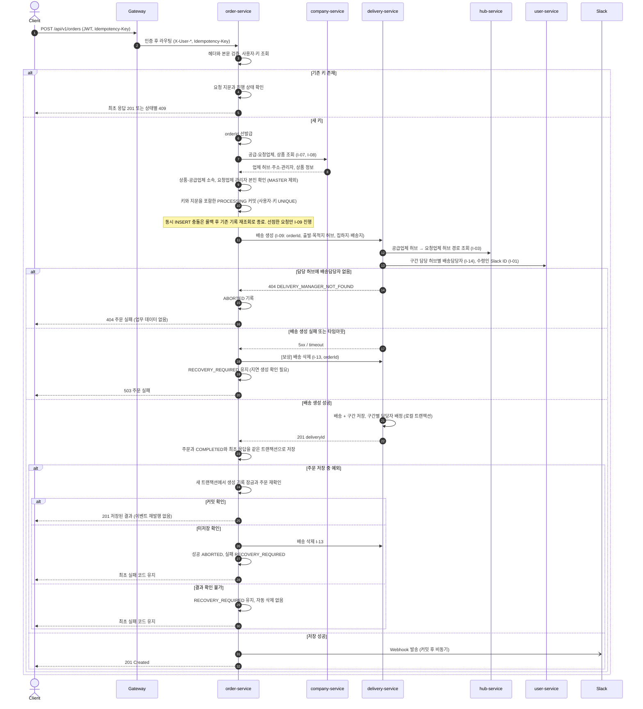

**실패 지점별 처리**

| 단계 | 실패 상황 | 처리 | 응답 |
| --- | --- | --- | --- |
| 멱등키 재확인 | 본문 충돌 / 처리 중 / 실패 / 복구 대기 | 새 실행 없이 전용 오류 | 409 |
| ① 업체·상품 조회 | 없음 / 타임아웃 | 아무것도 변경하지 않았으므로 즉시 실패 | 404 / 503 |
| ② 배송 생성 | 구간 담당 허브에 배송담당자 없음 | 업무 데이터 없음, 생성 시도 ABORTED 기록 | 404 |
| ② 배송 생성 | 실패 / 타임아웃 (생성 여부 모름) | I-13 보상 시도. 204 뒤 지연 생성 가능성이 있어 RECOVERY_REQUIRED 유지 | 503 |
| ③ 주문 저장 | DB 오류 | 새 트랜잭션으로 재확인. 커밋이면 201, 미저장 확인이면 I-13, 결과 불명확이면 삭제하지 않고 복구 대기 | 201 / 최초 실패 |
| ④ Slack 발송 | 실패 | 주문은 유지, 에러 로그만 기록 (`@TransactionalEventListener(phase = AFTER_COMMIT)`  • `@Async`) | 201 |
| 보상 자체 실패 | 보상 API 호출 실패 | 최대 3회 시도 후 orderId·attemptId·사유를 로그와 진행 기록에 남긴다. 자동 복구 작업은 미구현 | 최초 실패 유지 |

생성 기록의 상세 기준은 [order ADR 0007](../services/order/decisions/0007-order-creation-progress.md), 제공 서비스의 기대 계약과 미확정 사항은 [연동 계약](../services/order/integration-contract.md)에 있다.

### 7.2 주문 취소 흐름

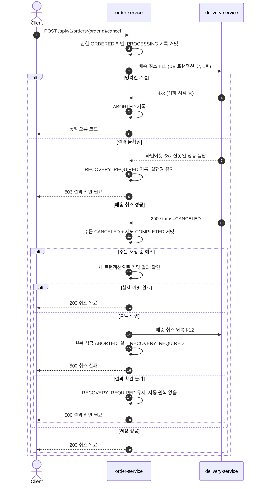

같은 주문에 미해결 시도가 있으면 새 취소를 409로 거부한다. 상태 확인·진행 기록과 주문 변경은 짧은 로컬 트랜잭션으로 나누고 원격 호출 중에는 DB 트랜잭션을 유지하지 않는다.
I-11은 1회 호출하고 I-12는 응답 없는 통신 실패에만 최대 3회 시도한다. 타임아웃 뒤 지연 완료와 새 시도가 겹칠 수 있으므로 진행 기록을 시간만으로 해제하지 않는다.
상세 실패 분류와 수동 복구 기준은 [주문 예외 처리 설계](../services/order/failure-handling.md)에 있다.

### 7.3 멱등성 설계

결과를 알 수 없는 실패(타임아웃)에서 재시도와 보상을 안전하게 하려면, 같은 요청을 여러 번 보내도 결과가 한 번 실행한 것과 같아야 한다.

| API | 멱등키 | 구현 |
| --- | --- | --- |
| O-01 주문 생성 | 인증 사용자 ID + `Idempotency-Key` | `p_order_creations`의 `(orderer_id, idempotency_key) UNIQUE`. 요청 지문 비교, 완료는 최초 응답 201, 충돌·처리 중·실패·복구 대기는 409. 자동 만료 없음 |
| I-05 재고 할당 (고도화) | `orderId`와 `DECREASE` 조합 | `p_hub_stock_histories`의 `UNIQUE (hub_stock_id, order_id, change_type)`. 해당 주문의 `DECREASE` 이력이 있으면 차감하지 않고 기존 할당 결과 반환 |
| I-06 재고 복원 (고도화) | `orderId`와 `RESTORE` 조합 | `DECREASE` 이력이 없거나 `RESTORE` 이력이 이미 있으면 no-op. 출고 허브별 `DECREASE` 이력을 그대로 되돌림 |
| I-09 배송 생성 | `orderId` | `p_deliveries.order_id UNIQUE`. 이미 있으면 기존 배송 반환 |
| I-13 배송 삭제 | `orderId` | 이미 삭제됐거나 없으면 204 |
| I-11 배송 취소 | `deliveryId` | 이미 `CANCELED`면 다시 바꾸지 않고 200 반환 |
| I-12 취소 원복 | `deliveryId` | 취소 전 상태로 돌린 뒤에는 같은 요청을 no-op으로 처리 |
| I-04 재고 초기화 (고도화) | `hubId`  • `productId` | `UNIQUE (hub_id, product_id)`. 이미 있으면 기존 레코드 반환 |

### 7.4 재고 동시성 제어 (고도화)

> 재고 관리는 고도화 기능이다. 아래는 고도화 단계에서 여러 허브 재고를 모아 출고할 때 적용할 v1.2 기준 설계 초안이다. 기본 범위에서는 재고를 다루지 않으므로 이 절을 구현하지 않는다. 배송담당자 자동 배정은 동시에 같은 담당자가 뽑혀도 정합성 문제가 없어 별도 락을 두지 않는다.
>

재고 할당은 여러 허브의 재고를 함께 보고 나눠서 차감해야 한다. 그래서 **해당 상품의 재고 행을 비관적 락으로 먼저 잠근 뒤** hub-service의 한 로컬 트랜잭션에서 차감한다. 상품 하나의 재고 행은 허브 수만큼(최대 17행)이라 잠금 범위가 작다.

```sql
-- ① 해당 상품의 재고 행 잠금 (교착 상태 방지를 위해 항상 hub_id 순으로 잠금)
SELECT hub_stock_id, hub_id, quantity
  FROM hub_schema.p_hub_stocks
 WHERE product_id = :productId
   AND quantity > 0
   AND deleted_at IS NULL
 ORDER BY hub_id
   FOR UPDATE;

-- ② 합계 < 주문 수량이면 STOCK_INSUFFICIENT (409), 롤백으로 잠금 해제
-- ③ 요청업체 허브(거리 0) → p_hub_routes.distance_km 오름차순으로 필요한 만큼 차감
UPDATE hub_schema.p_hub_stocks
   SET quantity   = quantity - :take,
       updated_at = now(),
       updated_by = :username
 WHERE hub_stock_id = :hubStockId;

-- ④ 차감한 허브마다 DECREASE 이력 INSERT (order_id 포함)
```

- 허브 간 거리는 hub-service가 가진 `p_hub_routes`(출고 허브 → 요청업체 허브)에서 바로 조회하므로 다른 서비스를 호출하지 않는다.
- 비교안: 허브마다 조건부 UPDATE(`quantity >= :qty`)를 반복하는 방식도 가능하지만, 주문마다 가까운 허브 순서가 달라 행을 잠그는 순서가 달라지고 교착 상태가 생길 수 있다. 처음에 hub_id 순으로 한 번에 잠그면 순서가 항상 같아 이를 피할 수 있다. 낙관적 락(`@Version`)은 충돌 시 재시도 로직이 필요하다.

### 7.5 논리 삭제와 트랜잭션

| 작업 | 처리 | 실패 시 |
| --- | --- | --- |
| 업체 삭제 (C-05) | 업체 + 소속 상품 논리 삭제를 한 로컬 트랜잭션으로 처리 | 전체 롤백 |
| 주문 삭제 (O-06) | 삭제 허가 근거 별도 커밋 → 주문 잠금 안에서 논리 삭제·I-13·완료 기록 처리 | 실패 시 로컬 롤백·기록 보존. 같은 DELETE는 저장된 허가로 I-13 반복·로컬 삭제를 완료. 커밋 확인 시 200 유지 |
| 배송 생성 (I-09) | 배송, 구간 기록, 구간별 담당자 배정을 한 로컬 트랜잭션으로 저장 | 전체 롤백 → order-service가 보상 수행 |
| 조회 | `@SQLRestriction("deleted_at IS NULL")`로 삭제 데이터 자동 제외 | - |

O-06은 기존 SA 경계를 유지하므로 I-13 동안 주문 잠금·DB 연결을 사용한다. 최초 I-10 조회는 트랜잭션 밖이다. 잠금 안에서 재시도를 중첩하지 않고 I-13을 요청당 1회 호출한다.
생성·취소의 미확정 작업을 새 시도로 다시 실행하는 것과, 삭제의 같은 종료 동작을 계속하는 것을 구분한다. 운영 복구·자동 스케줄러는 별도 범위다.

### 7.6 Saga 방식 결정 (멘토 피드백)

멘토 피드백: 단계별로 실패를 차근차근 처리할지 total error를 쓸지, Saga 중 코레오그래피와 오케스트레이션 중 무엇을 쓸지 고민해서 결정할 것.

| 구분 | 오케스트레이션 (채택) | 코레오그래피 |
| --- | --- | --- |
| 흐름 제어 | order-service가 순서를 지휘하고 보상도 직접 호출 | 각 서비스가 이벤트를 발행·구독하며 다음 단계를 이어감 |
| 통신 | Feign 동기 호출 (현재 스택 그대로) | 메시지 브로커(Kafka) 필요 |
| 흐름 추적 | 한 곳에서 전체 순서와 보상을 볼 수 있음 | 흐름이 여러 서비스에 흩어져 추적이 어려움 |
| 결합도 | order-service가 다른 서비스 API를 알아야 함 | 서비스 간 결합이 낮음 |
| 적합한 시점 | 기본 기능 구현 (지금) | Kafka를 도입하는 고도화 단계 |
- **실패 처리 방식:** 보상은 실패한 단계 앞까지 거꾸로 하나씩 수행한다(단계별 처리). 클라이언트에는 실패한 단계에 맞는 에러 코드 하나만 돌려준다(예: 담당자 없음 404, 하위 서비스 장애 503, 주문 저장 실패 500). 모든 실패를 total error 하나로 묶으면 원인을 구분할 수 없어 쓰지 않는다.
- 팀 메모대로 Saga 방식은 기본 기능을 구현한 뒤 다시 평가한다. 방식을 바꿔도 각 서비스의 로컬 트랜잭션과 멱등 API는 그대로 쓸 수 있다.

### 7.7 팀 추가 논의 정리

| 질문 | 정리 |
| --- | --- |
| 2개 이상의 서비스를 동시에 호출해야 하는 경우가 있나? 순서를 정할지, 동시에 처리할지 | 주문 생성에서 공급업체·요청업체·상품 조회(I-07 2회, I-08)는 서로 독립이라 병렬 호출이 가능하다. 배송 생성(I-09)은 조회 결과가 필요해서 순차로 호출한다. 기본은 순차로 구현하고 응답 시간이 문제가 되면 조회만 병렬로 바꾼다 |
| 주문과 배송이 같이 생성돼야 하면 트랜잭션으로 묶어야 하지 않나? 트랜잭션이 다른 서비스로 전파되나? | `@Transactional`은 Feign 호출을 넘어 다른 서비스로 전파되지 않는다. 서비스마다 DB 스키마도 따로라 하나의 트랜잭션으로 묶을 수 없으므로 Saga(로컬 트랜잭션 + 보상)로 처리한다 |
| 주문 생성 성공 응답과 배송 생성을 따로 처리하면? | 배송담당자가 없으면 주문이 실패해야 하므로(설계 결정 13) 배송 생성 결과를 기다린 뒤 응답한다. 비동기로 분리하는 방식은 Kafka 도입 시 검토한다 |
| 조회해서 생성해야 하는 정보는 다른 서비스에 미리 넘겨주자 | 반영. order-service가 조회한 업체 허브·주소·관리자 정보를 I-09 요청에 담아 보내므로 delivery-service가 company-service를 다시 호출하지 않는다 |
| Saga를 쓸지 다른 방식을 쓸지 | 기본은 오케스트레이션 Saga로 구현하고, 만들어 본 뒤 회고에서 다시 판단한다 (7.6) |

---

## 8. 보안·권한 설계

### 8.1 인증·인가 흐름

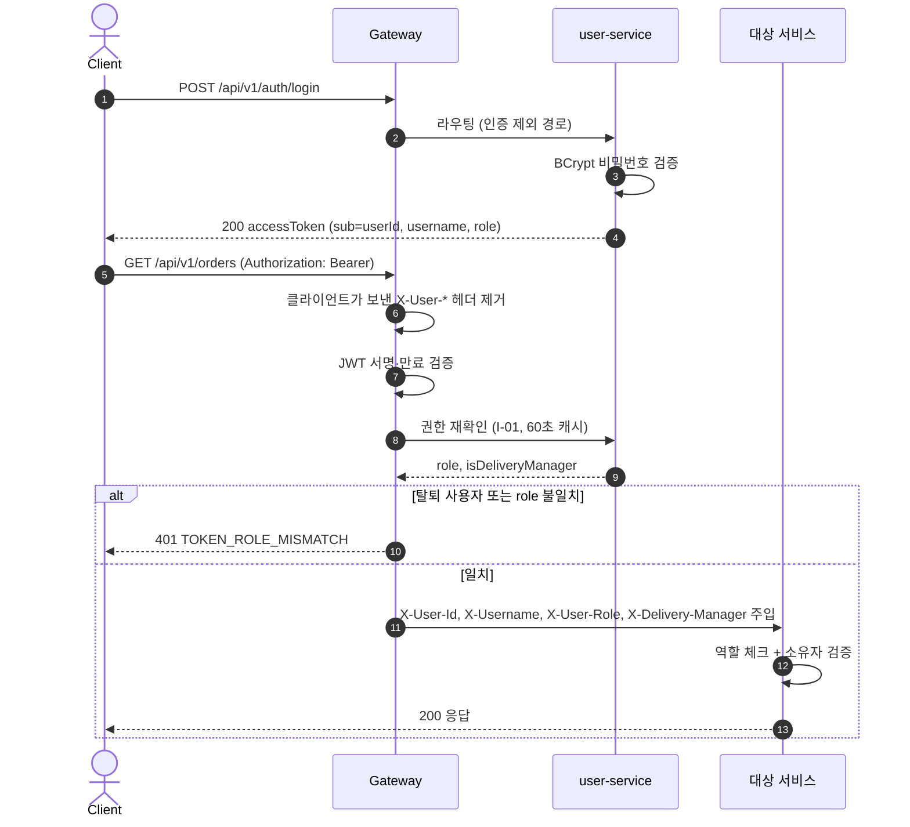

### 8.2 JWT 설계

| 항목 | 내용 |
| --- | --- |
| 알고리즘 | HS256. user-service가 발급하고 Gateway가 검증하며, secret은 환경 변수로 공유 |
| 유효시간 | 60분 (Refresh Token은 이번 범위에서 제외) |
| Claims | `sub`(userId), `username`, `role`, `iat`, `exp` |
| 전달 방식 | `Authorization: Bearer {token}` |
| 권한 재확인 | 요청마다 Gateway가 저장된 role과 비교 (발제 요구사항). 성능을 위해 60초 TTL 로컬 캐시 적용 (권한 변경은 최대 60초 뒤 반영, 팀 결정) |

### 8.3 Gateway 필터 처리 순서

1. 클라이언트가 보낸 `X-User-*` 헤더 제거 (헤더 위조 방지)
2. `/internal/**` 요청은 라우팅하지 않음 (404)
3. 화이트리스트(`/api/v1/auth/signup`, `/api/v1/auth/login`, Swagger 경로)는 인증 없이 통과
4. `Authorization` 헤더에서 토큰 추출 → 서명·만료 검증 (실패 시 401 `UNAUTHORIZED`)
5. user-service 내부 API(I-01)로 role·탈퇴 여부 재확인 (불일치 시 401 `TOKEN_ROLE_MISMATCH`)
6. `X-User-*` 헤더 주입 후 대상 서비스로 라우팅
7. 각 서비스는 커스텀 어노테이션(예: `@RequireRole(MASTER)`) + 인터셉터로 역할을 확인하고, 소유자 검증(업체 `manager_id`, 주문 `orderer_id`, 배송 `manager_id`)은 Application 계층에서 수행

### 8.4 권한 매트릭스

| 리소스 | 생성 | 조회·검색 | 수정 | 삭제 |
| --- | --- | --- | --- | --- |
| 사용자 | Public (회원가입) | 본인 / MASTER 전체 | MASTER | MASTER |
| 허브 | - (초기 데이터) | 로그인 | - | - |
| 허브 간 경로 | - (초기 데이터) | 로그인 | - | - |
| 허브 재고 (고도화) | 입고: MASTER / 초기화: 내부 | 로그인 | 차감·복원: 내부 (주문 연동) | - |
| 업체 | 로그인 (USER는 본인이 관리자) | 로그인 | 업체 관리자 / MASTER | 업체 관리자 / MASTER |
| 상품 | 업체 관리자 / MASTER | 로그인 | 업체 관리자 / MASTER | 업체 관리자 / MASTER |
| 주문 | 요청업체 관리자 / MASTER | 본인 주문 / MASTER 전체 | 요청사항·취소: 주문자 / MASTER | MASTER |
| 배송 | 내부 (주문 생성 시) | 로그인 (배송담당자는 본인 담당만) | 구간 상태: 구간 담당자 / MASTER. 담당자: 생성 시 자동 배정, 재배정은 MASTER (구간 담당 허브 소속만) | 내부 (주문 삭제 시) |

### 8.5 입력값 검증 규칙 (Spring Validation)

| 대상 | 규칙 | 구현 |
| --- | --- | --- |
| username | `^[a-z0-9]{4,10}$` | `@Pattern` |
| password | 8~15자, 대문자·소문자·숫자·특수문자 각 1자 이상: `^(?=.*[a-z])(?=.*[A-Z])(?=.*\d)(?=.*[^A-Za-z0-9]).{8,15}$` | `@Pattern` |
| 비밀번호 저장 | BCrypt 해시 | `BCryptPasswordEncoder` |
| 수량 | 1 이상 | `@Positive` |
| 가격 | 0 이상 | `@PositiveOrZero` |
| 문자열 길이 | 컬럼 길이 이내 | `@Size` |
| 필수 값 | null·공백 불가 | `@NotNull`, `@NotBlank` |
| Enum 값 | 정의된 값만 허용 | Enum 타입 바인딩 실패 시 400 |

---

## 9. 튜터 피드백 요청 사항

발제 문구가 여러 방식으로 해석될 수 있는 부분은 아래와 같이 결정했다. 방향이 맞는지 확인 부탁드립니다.

1. **배송담당자 권한 모델**: role은 `MASTER` / `USER` 2단계로 두고, 배송담당자는 `is_delivery_manager` 플래그로 부여했다. 세 번째 role(`DELIVERY_MANAGER`)로 두는 방식과 비교해 적절한지
2. **일반 사용자의 배송 조회 범위**: 발제 문구대로 일반 USER도 전체 배송을 조회할 수 있게 했다. 주문자 본인 배송만 보이도록 제한해야 하는지
3. **재고 입고 권한**: MASTER 전용으로 두었다. 공급업체 관리자에게도 허용할지 (v2.0: 재고 관리가 고도화로 빠져 지금은 해당 없음)

회의에서 결정되어 질문에서 뺀 항목: 주문 권한(요청업체 관리자 본인만), Gateway 권한 캐시 60초, 같은 허브 내 주문 처리, PK는 UUID 사용

### 9.1 멘토 피드백 반영 결과 (10/13)

| 위치 | 피드백 | 반영 |
| --- | --- | --- |
| 허브 | 상품은 한 업체 소유, 업체는 한 허브 소속. 허브 간 이동은 배송 경로로 처리하고 허브 재고 검색은 고도화로 | 재고 관리 전체를 고도화로 이동(공급업체가 항상 출고). 배송을 집하·허브 이동·업체 배송 3구간으로 재설계 (1.2, 2.5, 5.6) |
| 배송 API | D-04, D-06은 값을 추가하는 개념이라 POST가 적절 | 담당자 배정 API를 구간 단위 D-04(POST)로 통합 |
| 내부 API | 배송담당자 배정은 자동이어야 하므로 내부로, 외부 API와 병행 가능 | 배송 생성(I-09) 때 구간별 자동 배정, 없으면 주문 실패. I-14 추가. MASTER 재배정(D-04) 병행 |
| ERD | 상세 컬럼이 보이는 그림, 서비스별 테이블 명세와 length | 서비스별 ERD에 컬럼·길이 표기 (4장), 명세는 5장, DBML은 10.2 |
| hub ERD | 허브 히스토리는 확장 기능으로 | 재고·재고 이력 테이블을 고도화로 표시 (5.3) |
| order ERD | 주문 금액 `total_price` 별도 저장 | `p_orders.total_price` 추가 |
| delivery ERD | 업체 간 배송에 맞춘 추가 컬럼 | 공급·요청업체 ID, 집하지, 수령인 Slack ID 추가, 구간 유형·구간별 담당자 |
| 인프라 | 처음 보는 사람을 위해 스택이 보이는 다이어그램으로 | 노드별 기술 스택 표시 (3.1). 로고 포함 그림은 후속 작업 |
| 운영 설정 | 외부 연결 시간은 길어질 수 있으니 보수적으로 | Feign connect 5초 / read 20초, Gateway 60초 (3.5) |
| 시스템 구조도 | 유즈케이스에 맞게 분리, 보기 좋게 | 유즈케이스별 구조도 6개 추가 (2.2) |
| 실패 처리 | 단계별 처리 vs total error, 코레오그래피 vs 오케스트레이션 | 오케스트레이션 + 단계별 보상, 실패 단계별 에러 코드 (7.6) |
| 배송 상태 | 업체 to 업체 배송을 고려해 수정 | 집하 상태(`PICKUP_WAITING`, `PICKING_UP`) 추가, 구간 상태에 따라 자동 변경 (2.5) |

### 9.2 후속 작업

- 로고가 들어간 인프라 아키텍처 그림을 별도 이미지로 제작
- 10.2 DBML로 [dbdiagram.io](http://dbdiagram.io) ERD 이미지 제작
- SA 제작 미팅 회의록에 "여러 허브 재고 모아 출고 → 재고 없는 모델로 변경" 기록
- 기본 기능 구현 후 Saga 방식(오케스트레이션 vs 코레오그래피) 재평가

---

## 10. 부록

### 10.1 허브 초기 데이터 (17개)

| # | 허브명 | 주소 |
| --- | --- | --- |
| 1 | 서울특별시 센터 | 서울특별시 송파구 송파대로 55 |
| 2 | 경기 북부 센터 | 경기도 고양시 덕양구 권율대로 570 |
| 3 | 경기 남부 센터 | 경기도 이천시 덕평로 257-21 |
| 4 | 부산광역시 센터 | 부산 동구 중앙대로 206 |
| 5 | 대구광역시 센터 | 대구 북구 태평로 161 |
| 6 | 인천광역시 센터 | 인천 남동구 정각로 29 |
| 7 | 광주광역시 센터 | 광주 서구 내방로 111 |
| 8 | 대전광역시 센터 | 대전 서구 둔산로 100 |
| 9 | 울산광역시 센터 | 울산 남구 중앙로 201 |
| 10 | 세종특별자치시 센터 | 세종특별자치시 한누리대로 2130 |
| 11 | 강원특별자치도 센터 | 강원특별자치도 춘천시 중앙로 1 |
| 12 | 충청북도 센터 | 충북 청주시 상당구 상당로 82 |
| 13 | 충청남도 센터 | 충남 홍성군 홍북읍 충남대로 21 |
| 14 | 전북특별자치도 센터 | 전북특별자치도 전주시 완산구 효자로 225 |
| 15 | 전라남도 센터 | 전남 무안군 삼향읍 오룡길 1 |
| 16 | 경상북도 센터 | 경북 안동시 풍천면 도청대로 455 |
| 17 | 경상남도 센터 | 경남 창원시 의창구 중앙대로 300 |

**시드 적재 방식**

- 허브 좌표: 주소를 지오코딩 API(예: 카카오 로컬 API)로 한 번 변환해 시드 SQL에 고정한다.
- 허브 간 경로: 17 × 16 = 272건(양방향). hub-service 기동 시 `ApplicationRunner`가 테이블이 비어 있을 때만 생성한다.
    - 이동거리 = 두 허브 좌표의 Haversine 직선거리 × 도로 보정계수 1.3
    - 소요시간 = 이동거리 ÷ 평균 시속 70km (분 단위 올림)
    - 보정계수와 평균 시속은 팀 합의로 조정한다. 외부 길찾기 API로 실제 값을 산출해 고정해도 된다.

### 10.2 ERD 코드 (dbdiagram.io / DBML)

[dbdiagram.io](https://dbdiagram.io/)에 아래 코드를 붙여넣으면 서비스별로 묶인 ERD가 생성된다. `logical_` 접두사가 붙은 Ref는 서비스 간 논리 참조로, 다이어그램 표시용일 뿐 실제 DB에는 FK를 만들지 않는다 (SQL로 내보낼 때 제거). 재고 테이블(`p_hub_stocks`, `p_hub_stock_histories`)은 고도화 단계에서 추가하므로 넣지 않았다 (5.3 참고).

```
Project sparta_logistics {
  database_type: 'PostgreSQL'
  Note: '스파르타 물류 MSA - 서비스별 스키마 분리, 서비스 간 참조는 FK 없는 논리 참조'
}

// ========== user-service ==========
Table user_schema.p_users {
  user_id uuid [pk]
  username varchar(10) [not null, unique, note: '소문자/숫자 4~10자']
  password varchar(255) [not null, note: 'BCrypt']
  name varchar(50) [not null]
  slack_id varchar(50) [note: '기존 멤버 ID 보존, 신규 이메일 가입은 NULL, ADR 0016']
  slack_email varchar(254) [note: '선택 Slack 알림 이메일, ADR 0016 로컬 확장·팀 리뷰 대기']
  affiliation_type varchar(20) [not null, note: 'COMPANY, HUB']
  affiliation_name varchar(100) [not null]
  role varchar(20) [not null, default: 'USER', note: 'MASTER, USER']
  is_delivery_manager boolean [not null, default: false]
  hub_id uuid [note: '배송담당자 소속 허브, 논리 참조: hub_schema.p_hubs. 배송담당자가 아니면 NULL']
  created_at timestamp [not null]
  created_by varchar(100) [not null]
  updated_at timestamp [not null]
  updated_by varchar(100) [not null]
  deleted_at timestamp
  deleted_by varchar(100)
}

// ========== hub-service ==========
Table hub_schema.p_hubs {
  hub_id uuid [pk]
  name varchar(50) [not null, unique]
  address varchar(255) [not null]
  latitude decimal(10,7) [not null]
  longitude decimal(10,7) [not null]
  created_at timestamp [not null]
  created_by varchar(100) [not null]
  updated_at timestamp [not null]
  updated_by varchar(100) [not null]
  deleted_at timestamp
  deleted_by varchar(100)
}

Table hub_schema.p_hub_routes {
  hub_route_id uuid [pk]
  departure_hub_id uuid [not null]
  arrival_hub_id uuid [not null]
  duration_minutes int [not null, note: '소요시간(분)']
  distance_km decimal(8,2) [not null, note: '이동거리(km)']
  created_at timestamp [not null]
  created_by varchar(100) [not null]
  updated_at timestamp [not null]
  updated_by varchar(100) [not null]
  deleted_at timestamp
  deleted_by varchar(100)

  indexes {
    (departure_hub_id, arrival_hub_id) [unique, name: 'uk_hub_routes_departure_arrival']
  }
}

// ========== company-service ==========
Table company_schema.p_companies {
  company_id uuid [pk]
  name varchar(100) [not null]
  hub_id uuid [not null, note: '논리 참조: hub_schema.p_hubs']
  address varchar(255) [not null]
  manager_id uuid [not null, note: '논리 참조: user_schema.p_users']
  created_at timestamp [not null]
  created_by varchar(100) [not null]
  updated_at timestamp [not null]
  updated_by varchar(100) [not null]
  deleted_at timestamp
  deleted_by varchar(100)

  indexes {
    hub_id
    manager_id
  }
}

Table company_schema.p_products {
  product_id uuid [pk]
  company_id uuid [not null]
  name varchar(100) [not null]
  description text
  price bigint [not null]
  created_at timestamp [not null]
  created_by varchar(100) [not null]
  updated_at timestamp [not null]
  updated_by varchar(100) [not null]
  deleted_at timestamp
  deleted_by varchar(100)

  indexes {
    company_id
  }
}

// ========== order-service ==========
Table order_schema.p_orders {
  order_id uuid [pk, note: '저장 전 선발급 (Saga 멱등키)']
  orderer_id uuid [not null]
  supplier_company_id uuid [not null]
  receiver_company_id uuid [not null]
  product_id uuid [not null]
  product_name varchar(100) [not null, note: '주문 시점 스냅샷']
  unit_price bigint [not null, note: '주문 시점 스냅샷']
  quantity int [not null]
  total_price bigint [not null, note: 'unit_price × quantity, 주문 시점 저장']
  delivery_id uuid [not null, unique]
  request_note varchar(500)
  status varchar(20) [not null, note: 'ORDERED, CANCELED']
  created_at timestamp [not null]
  created_by varchar(100) [not null]
  updated_at timestamp [not null]
  updated_by varchar(100) [not null]
  deleted_at timestamp
  deleted_by varchar(100)

  indexes {
    orderer_id
    supplier_company_id
    receiver_company_id
    created_at
  }
}

Table order_schema.p_order_creations {
  order_creation_id uuid [pk]
  status varchar(20) [not null, note: 'PROCESSING, COMPLETED, ABORTED, RECOVERY_REQUIRED']
  failure_reason varchar(30) [note: 'RECOVERY_REQUIRED일 때만 필수. DELIVERY_RESULT_UNKNOWN, ORDER_COMMIT_UNKNOWN, DELIVERY_DELETE_FAILED']
  order_id uuid [not null, unique, note: '주문보다 먼저 저장하므로 p_orders로 물리 FK 없음']
  orderer_id uuid [not null, note: '사용자 논리 참조']
  idempotency_key varchar(128) [note: 'O-01 필수, 기존 행 NULL 유지. 대소문자 구별, 자동 만료 없음']
  request_hash varchar(67) [note: 'v1 SHA-256 지문. 키와 함께 NULL 또는 값 보유']
  response_snapshot jsonb [note: '최초 생성 응답 객체. 키 있는 COMPLETED에서 필수']
  delivery_id uuid [note: '확인된 배송 논리 참조, COMPLETED일 때 필수']
  created_at timestamp [not null]
  created_by varchar(100) [not null]
  updated_at timestamp [not null]
  updated_by varchar(100) [not null]
  deleted_at timestamp
  deleted_by varchar(100)

  indexes {
    (orderer_id, idempotency_key) [unique]
    orderer_id
    delivery_id
  }
  Note: '미해결 생성의 created_at 부분 인덱스·상태 CHECK는 V3, 멱등키·응답 CHECK는 V4 SQL 참고. UNIQUE는 삭제 이력 포함'
}

Table order_schema.p_order_cancellations {
  order_cancellation_id uuid [pk]
  status varchar(20) [not null, note: 'PROCESSING, COMPLETED, ABORTED, RECOVERY_REQUIRED']
  failure_reason varchar(30) [note: 'RECOVERY_REQUIRED일 때만 필수. DELIVERY_RESULT_UNKNOWN, ORDER_COMMIT_UNKNOWN, REVERT_FAILED']
  order_id uuid [not null]
  delivery_id uuid [not null, note: 'delivery_schema 논리 참조. 물리 FK 없음']
  created_at timestamp [not null]
  created_by varchar(100) [not null]
  updated_at timestamp [not null]
  updated_by varchar(100) [not null]
  deleted_at timestamp
  deleted_by varchar(100)

  indexes {
    order_id
    delivery_id
  }
  Note: '미해결 시도의 부분 유니크 인덱스는 V2 SQL 참고. deleted_at IS NULL AND status IN (PROCESSING, RECOVERY_REQUIRED)'
}
Ref: order_schema.p_order_cancellations.order_id > order_schema.p_orders.order_id

Table order_schema.p_order_deletions {
  order_deletion_id uuid [pk]
  status varchar(20) [not null, note: 'PROCESSING, COMPLETED, RECOVERY_REQUIRED']
  eligibility varchar(20) [not null, note: 'ORDER_CANCELED, DELIVERY_DELIVERED']
  failure_reason varchar(30) [note: 'RECOVERY_REQUIRED에서만 필수. DELIVERY_DELETE_FAILED, ORDER_WRITE_FAILED, ORDER_COMMIT_UNKNOWN']
  order_id uuid [not null, unique]
  delivery_id uuid [not null, note: '배송 논리 참조, 물리 FK 없음']
  created_at timestamp [not null]
  created_by varchar(100) [not null]
  updated_at timestamp [not null]
  updated_by varchar(100) [not null]
  deleted_at timestamp
  deleted_by varchar(100)
  indexes {
    delivery_id
  }
  Note: '같은 주문 잠금 아래 변경. 미해결 created_at 부분 인덱스·상태 CHECK는 V5 SQL 참고'
}
Ref: order_schema.p_orders.order_id - order_schema.p_order_deletions.order_id

// ========== delivery-service ==========
Table delivery_schema.p_deliveries {
  delivery_id uuid [pk]
  order_id uuid [not null, unique]
  status varchar(30) [not null, note: 'PICKUP_WAITING, PICKING_UP, HUB_WAITING, HUB_MOVING, DEST_HUB_ARRIVED, OUT_FOR_DELIVERY, DELIVERED, CANCELED']
  supplier_company_id uuid [not null, note: '공급업체']
  receiver_company_id uuid [not null, note: '요청업체']
  departure_hub_id uuid [not null, note: '출발 허브 = 공급업체 관리 허브']
  destination_hub_id uuid [not null, note: '목적지 허브 = 요청업체 관리 허브']
  pickup_address varchar(255) [not null, note: '집하지 = 공급업체 주소']
  delivery_address varchar(255) [not null, note: '배송지 = 요청업체 주소']
  recipient_name varchar(100) [not null]
  recipient_slack_id varchar(50)
  created_at timestamp [not null]
  created_by varchar(100) [not null]
  updated_at timestamp [not null]
  updated_by varchar(100) [not null]
  deleted_at timestamp
  deleted_by varchar(100)

  indexes {
    status
    supplier_company_id
    receiver_company_id
    departure_hub_id
    destination_hub_id
  }
}

Table delivery_schema.p_delivery_routes {
  delivery_route_id uuid [pk]
  delivery_id uuid [not null]
  sequence int [not null, note: '구간 순번, 1부터']
  route_type varchar(20) [not null, note: 'PICKUP, HUB_TRANSFER, LAST_MILE']
  departure_hub_id uuid [note: '출발 허브, PICKUP은 NULL']
  arrival_hub_id uuid [note: '도착 허브, LAST_MILE은 NULL']
  expected_distance_km decimal(8,2) [note: 'HUB_TRANSFER만']
  expected_duration_minutes int [note: 'HUB_TRANSFER만']
  actual_distance_km decimal(8,2)
  actual_duration_minutes int
  status varchar(20) [not null, default: 'WAITING', note: 'WAITING, MOVING, ARRIVED, CANCELED']
  manager_id uuid [not null, note: '구간 담당자, 자동 배정']
  created_at timestamp [not null]
  created_by varchar(100) [not null]
  updated_at timestamp [not null]
  updated_by varchar(100) [not null]
  deleted_at timestamp
  deleted_by varchar(100)

  indexes {
    (delivery_id, sequence) [unique, name: 'uk_delivery_routes_delivery_sequence']
    manager_id
    status
  }
}

// ========== 서비스별 그룹 ==========
TableGroup user_service {
  user_schema.p_users
}

TableGroup hub_service {
  hub_schema.p_hubs
  hub_schema.p_hub_routes
}

TableGroup company_service {
  company_schema.p_companies
  company_schema.p_products
}

TableGroup order_service {
  order_schema.p_orders
  order_schema.p_order_cancellations
  order_schema.p_order_creations
  order_schema.p_order_deletions
}

TableGroup delivery_service {
  delivery_schema.p_deliveries
  delivery_schema.p_delivery_routes
}

// ========== 물리 FK (같은 스키마) ==========
Ref: hub_schema.p_hub_routes.departure_hub_id > hub_schema.p_hubs.hub_id
Ref: hub_schema.p_hub_routes.arrival_hub_id > hub_schema.p_hubs.hub_id
Ref: company_schema.p_products.company_id > company_schema.p_companies.company_id
Ref: delivery_schema.p_delivery_routes.delivery_id > delivery_schema.p_deliveries.delivery_id

// ========== 논리 참조 (서비스 간, 실제 FK 없음) ==========
Ref logical_company_manager: company_schema.p_companies.manager_id > user_schema.p_users.user_id
Ref logical_company_hub: company_schema.p_companies.hub_id > hub_schema.p_hubs.hub_id
Ref logical_order_orderer: order_schema.p_orders.orderer_id > user_schema.p_users.user_id
Ref logical_order_supplier: order_schema.p_orders.supplier_company_id > company_schema.p_companies.company_id
Ref logical_order_receiver: order_schema.p_orders.receiver_company_id > company_schema.p_companies.company_id
Ref logical_order_product: order_schema.p_orders.product_id > company_schema.p_products.product_id
Ref logical_delivery_order: delivery_schema.p_deliveries.order_id - order_schema.p_orders.order_id
Ref logical_delivery_departure_hub: delivery_schema.p_deliveries.departure_hub_id > hub_schema.p_hubs.hub_id
Ref logical_delivery_destination_hub: delivery_schema.p_deliveries.destination_hub_id > hub_schema.p_hubs.hub_id
Ref logical_delivery_supplier: delivery_schema.p_deliveries.supplier_company_id > company_schema.p_companies.company_id
Ref logical_delivery_receiver: delivery_schema.p_deliveries.receiver_company_id > company_schema.p_companies.company_id
Ref logical_route_departure_hub: delivery_schema.p_delivery_routes.departure_hub_id > hub_schema.p_hubs.hub_id
Ref logical_route_arrival_hub: delivery_schema.p_delivery_routes.arrival_hub_id > hub_schema.p_hubs.hub_id
Ref logical_route_manager: delivery_schema.p_delivery_routes.manager_id > user_schema.p_users.user_id
Ref logical_user_hub: user_schema.p_users.hub_id > hub_schema.p_hubs.hub_id
```

### 10.3 docker-compose 초안

```yaml
x-service-env: &service-env
  SPRING_PROFILES_ACTIVE: docker
  EUREKA_CLIENT_SERVICEURL_DEFAULTZONE: http://eureka-server:8761/eureka

x-db-service: &db-service
  depends_on:
    postgres:
      condition: service_healthy
    eureka-server:
      condition: service_started   # Eureka 클라이언트는 등록을 자동 재시도
  networks: [logistics-net]

services:
  postgres:
    image: postgres:16
    environment:
      POSTGRES_DB: logistics
      POSTGRES_USER: ${POSTGRES_USER}
      POSTGRES_PASSWORD: ${POSTGRES_PASSWORD}
    ports:
      - "5432:5432"               # 개발 편의용 (선택)
    volumes:
      - pgdata:/var/lib/postgresql/data
      - ./infra/postgres/init.sql:/docker-entrypoint-initdb.d/init.sql
    healthcheck:
      test: ["CMD-SHELL", "pg_isready -U $${POSTGRES_USER} -d logistics"]
      interval: 5s
      retries: 10
    networks: [logistics-net]

  eureka-server:
    build: ./eureka-server
    ports:
      - "8761:8761"
    networks: [logistics-net]

  gateway-service:
    build: ./gateway-service
    ports:
      - "8080:8080"               # 유일한 외부 API 진입점
    environment:
      <<: *service-env
      JWT_SECRET: ${JWT_SECRET}
    depends_on:
      - eureka-server
    networks: [logistics-net]

  user-service:
    <<: *db-service
    build: ./user-service
    environment:
      <<: *service-env
      JWT_SECRET: ${JWT_SECRET}
      SPRING_DATASOURCE_URL: jdbc:postgresql://postgres:5432/logistics?currentSchema=user_schema
      SPRING_DATASOURCE_USERNAME: user_app
      SPRING_DATASOURCE_PASSWORD: ${USER_DB_PASSWORD}

  hub-service:
    <<: *db-service
    build: ./hub-service
    environment:
      <<: *service-env
      SPRING_DATASOURCE_URL: jdbc:postgresql://postgres:5432/logistics?currentSchema=hub_schema
      SPRING_DATASOURCE_USERNAME: hub_app
      SPRING_DATASOURCE_PASSWORD: ${HUB_DB_PASSWORD}

  company-service:
    <<: *db-service
    build: ./company-service
    environment:
      <<: *service-env
      SPRING_DATASOURCE_URL: jdbc:postgresql://postgres:5432/logistics?currentSchema=company_schema
      SPRING_DATASOURCE_USERNAME: company_app
      SPRING_DATASOURCE_PASSWORD: ${COMPANY_DB_PASSWORD}

  order-service:
    <<: *db-service
    build: ./order-service
    environment:
      <<: *service-env
      SPRING_DATASOURCE_URL: jdbc:postgresql://postgres:5432/logistics?currentSchema=order_schema
      SPRING_DATASOURCE_USERNAME: order_app
      SPRING_DATASOURCE_PASSWORD: ${ORDER_DB_PASSWORD}
      SLACK_WEBHOOK_URL: ${SLACK_WEBHOOK_URL}

  delivery-service:
    <<: *db-service
    build: ./delivery-service
    environment:
      <<: *service-env
      SPRING_DATASOURCE_URL: jdbc:postgresql://postgres:5432/logistics?currentSchema=delivery_schema
      SPRING_DATASOURCE_USERNAME: delivery_app
      SPRING_DATASOURCE_PASSWORD: ${DELIVERY_DB_PASSWORD}

networks:
  logistics-net:
    driver: bridge

volumes:
  pgdata:
```

- 비즈니스 서비스는 호스트 포트를 공개하지 않으므로 `docker compose up -d --scale order-service=2`로 인스턴스를 늘릴 수 있다.
- `.env`의 `*_DB_PASSWORD` 값은 `init.sql`에서 만든 계정 비밀번호와 같아야 한다.
