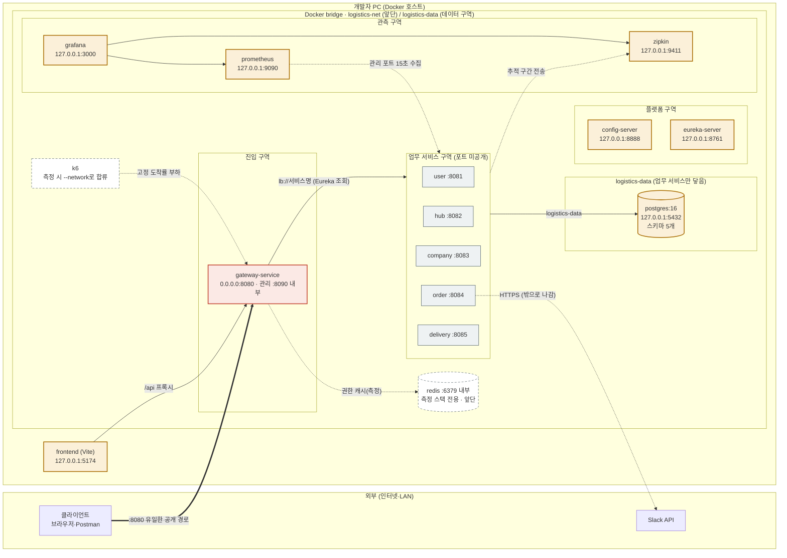

# 로컬 Docker 네트워크 구역도

> 기준: `docker-compose.yml`, `script/perf/compose.perf.yml`, `script/ui-test.sh`, `config-repo/` (2026-10-20 `dev` 브랜치)
> 서버(GCP Swarm) 설계는 [05. 인프라 · 배포 설계](05-infra.md)에 있다. 이 문서는 지금 로컬에서 실제로 뜨는 구성을 그린다.

## 요약
- Docker 네트워크는 bridge 두 개다([ADR 0020](../decisions/0020-docker-network-split.md)). 앞단 `logistics-net`(대역 `10.210.10.0/24`)과 데이터 `logistics-data`.
- 업무 서비스 5개만 두 네트워크에 함께 붙는다. postgres는 `logistics-data`에만 있어 Gateway·Config·Eureka·관측 도구는 DB에 닿지 않는다.
- 외부 노출은 **호스트에 포트를 어디까지 열었는지**로 나뉜다. 외부에 열린 포트는 Gateway `8080` 하나다. 관리 도구는 `127.0.0.1`에만 열고, 업무 서비스는 포트를 열지 않는다.

| 네트워크 | 붙는 컨테이너 |
|---|---|
| `logistics-net` (앞단) | gateway, config, eureka, zipkin, prometheus, grafana, user~delivery, (측정) redis·k6·slack-stub |
| `logistics-data` (데이터) | user~delivery, postgres |

| 노출 수준 | 뜻 | 대상 |
|---|---|---|
| 외부 공개 | `0.0.0.0`에 바인딩. 같은 LAN의 다른 PC도 접근할 수 있다 | `gateway-service` 8080 |
| 이 PC 전용 | `127.0.0.1`에 바인딩. 이 PC의 브라우저·psql만 접근할 수 있다 | `postgres`, `config-server`, `eureka-server`, `zipkin`, `prometheus`, `grafana`, Docker 밖의 Vite(5174) |
| 내부 전용 | 호스트 포트 없음. 같은 Docker 네트워크의 컨테이너만 접근할 수 있다 | `user`~`delivery` 8081~8085, Gateway 관리 포트 8090, `redis`(측정 스택) |

## 구역도



색 구분: 빨강은 외부 공개, 노랑은 이 PC 전용, 회색은 내부 전용, 점선 테두리는 측정 스택에서만 뜨는 컨테이너다. 모든 서비스는 기동할 때 `config-server`에서 설정을 받고 `eureka-server`에 등록한다(선 생략).

## 포트 노출 현황
호스트 포트는 `.env`의 `GATEWAY_PORT`, `POSTGRES_PORT` 등으로 바꿀 수 있다. 아래는 기본값이다.

| 컨테이너 | 내부 주소 | 호스트 공개 | 정의 위치 |
|---|---|---|---|
| `gateway-service` | `gateway-service:8080` | `0.0.0.0:8080` | `docker-compose.yml` |
| Gateway 관리 포트 | `gateway-service:8090` | 없음 | `config-repo/gateway-service.yml` (ADR 0018) |
| `config-server` | `config-server:8888` | `127.0.0.1:8888` | `docker-compose.yml` |
| `eureka-server` | `eureka-server:8761` | `127.0.0.1:8761` | `docker-compose.yml` |
| `user`~`delivery` | `<서비스>:8081`~`8085` | 없음 | `config-repo/<서비스>.yml` |
| `postgres` | `postgres:5432` | `127.0.0.1:5432` | `docker-compose.yml` |
| `redis` (측정) | `redis:6379` | 없음 | `script/perf/compose.perf.yml` |
| `zipkin` | `zipkin:9411` | `127.0.0.1:9411` | `docker-compose.yml` |
| `prometheus` | `prometheus:9090` | `127.0.0.1:9090` | `docker-compose.yml` |
| `grafana` | `grafana:3000` | `127.0.0.1:3000` | `docker-compose.yml` |

## 왜 이렇게 나눴나
- **문은 Gateway 하나다.** 업무 서비스에 `ports`가 없어 밖에서 직접 닿지 않는다. 하위 서비스가 Gateway가 넣은 `X-User-*` 헤더를 믿을 수 있는 전제가 이것이다. 포트가 없으므로 `--scale`로 인스턴스를 늘려도 포트가 충돌하지 않는다.
- **관리 도구는 `127.0.0.1`에만 연다.** DB, Eureka, 대시보드는 개발자에게만 필요하다. 바인딩 주소를 `127.0.0.1`로 적어 같은 LAN의 다른 PC에서는 보이지 않게 한다.
- **메트릭은 별도 관리 포트에 둔다.** actuator를 8080에 두면 외부에서 메트릭이 보인다. 그래서 8090으로 분리하고 공개하지 않는다. Prometheus는 Eureka 메타데이터(`management.port`)로 이 포트를 찾는다(ADR 0018).
- **DB는 데이터 네트워크에만 둔다.** Gateway·관측 도구가 침해돼도 postgres에 네트워크로 닿지 않는다. 업무 서비스는 IP가 둘이라 Eureka에 앞단 IP만 등록하도록 `SPRING_CLOUD_INETUTILS_PREFERREDNETWORKS`를 앞단 대역 접두어로 준다. 데이터 네트워크를 `internal`로 막지 않은 것은 `127.0.0.1:5432` 공개를 유지하기 위해서다(ADR 0020).
- **Redis는 저장소지만 앞단에 둔다.** Gateway가 권한 캐시를 읽고 user-service가 키를 지우므로 둘 다 닿아야 한다.
- **DB 컨테이너는 하나, 스키마는 분리한다.** 서비스마다 스키마와 계정을 따로 만들고 `public` 권한을 회수한다. 다른 서비스의 테이블에는 접근할 수 없다(`infra/postgres/init.sh`).
- **나가는 연결은 order의 Slack 호출뿐이다.** bridge 네트워크는 밖으로 나가는 연결을 막지 않는다. 측정·UI 테스트 스택은 Slack 발송을 설정으로 끈다.

## 같은 구성을 다른 프로젝트로 띄우는 스택
Compose 프로젝트 이름이 다르면 네트워크·볼륨 이름도 달라져 스택끼리 섞이지 않는다. 실제 네트워크 이름은 `<프로젝트>_logistics-net`, `<프로젝트>_logistics-data`다. 앞단 대역은 고정이라 함께 띄우는 스택끼리 겹치지 않게 나눈다: 개발 `10.210.10`, 성능 측정 `10.210.20`, UI 테스트 `10.210.30`(스크립트가 넣는다).

| 스택 | 실행 | 프로젝트 이름 | 개발 스택과 다른 점 |
|---|---|---|---|
| 개발 | `script/run.sh`, `docker compose up` | 폴더 이름(예: `base-setting`) 또는 `.env`의 `COMPOSE_PROJECT_NAME` | 기준 구성 |
| 성능 측정 | `script/perf.sh up` | `logistics-perf` | `redis` 추가, k6를 같은 네트워크로 실행, 컨테이너마다 CPU·메모리 상한(서비스 1 CPU·768MB, DB 2 CPU·1GB), Slack 끔 |
| UI 테스트 | `script/ui-test.sh up` | `logistics-ui-test` | 호스트 포트를 옮긴다. Gateway `127.0.0.1:18080`(외부 공개 아님), DB 15432, Zipkin 19411, Prometheus 19090, Grafana 13000. Slack Webhook 끔 |

개발 스택에 덧붙이는 측정용 설정도 있다. `docker-compose.order-dm.yml`은 같은 `logistics-net`에 `slack-stub`(`127.0.0.1:9900`)을 추가한다. order-service의 Slack Webhook·DM은 실제 Slack 대신 이 대역으로 간다(`delivery-service/docs/load-test.md`).

Vite 개발 서버의 `/api` 프록시 기본 대상은 UI 테스트 스택의 Gateway(`127.0.0.1:18080`)다. 다른 Gateway를 쓰려면 `GATEWAY_URL`을 준다(`frontend/vite.config.ts`).

## 확인 방법
```bash
docker network ls | grep logistics-net                 # 스택별 네트워크
docker network inspect base-setting_logistics-net      # 붙어 있는 컨테이너와 IP
docker network inspect base-setting_logistics-data     # 업무 서비스와 postgres만 보여야 한다
docker compose exec gateway-service getent hosts postgres   # 결과가 없어야 한다(Gateway는 DB 이름을 못 찾는다)
docker compose ps --format 'table {{.Name}}\t{{.Ports}}'  # 호스트 공개 포트(0.0.0.0 / 127.0.0.1)
```
