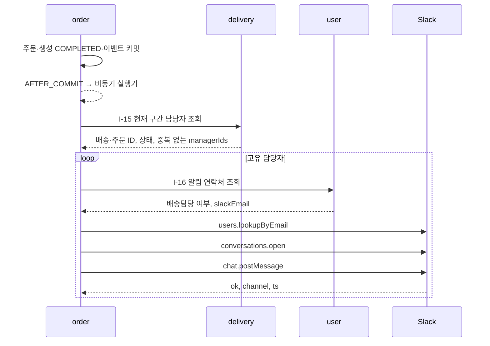

# 배송담당자 이메일로 Slack DM 보내기

주문 커밋 후 현재 배송 구간 담당자를 조회해 앱과 담당자 사이의 DM으로 알린다. 이메일 발송 기능이 아니라 Slack 가입 이메일로 멤버를 찾는 기능이다.
설계는 [ADR 0016](../decisions/0016-delivery-manager-slack-dm.md), 실행 근거는 [검증 기록](../reviews/slack-dm.md)에 있다. user·delivery 확장은 로컬 구현이며 담당자 리뷰를 기다린다.

## Slack 앱 설정

1. 사용할 워크스페이스의 Slack 앱에서 OAuth & Permissions를 연다.
2. Bot Token Scopes에 `users:read.email`, `im:write`, `chat:write`를 추가한다. 2026-10-16 이 앱의 설정 UI는 이메일 권한의 의존 권한으로 `users:read`도 요구했다.
3. 권한을 확인하고 워크스페이스에 재설치한다. 기존 Incoming Webhook을 쓰는 앱이면 기존 채널 선택도 확인한다.
4. Bot User OAuth Token을 서버의 비밀 설정에 저장한다. User Token·Webhook URL·프런트 환경 변수와 혼동하지 않는다.
5. 발송 대상은 앱이 설치된 워크스페이스의 활성 사람 계정이어야 한다. 서버가 응답의 team_id·deleted·is_bot을 검사한다.

이번 로컬 검증은 디스이스스파르타의 Logistics Order Noti 앱에서 추가 4개 권한을 사용자가 승인한 뒤 진행했다. 기존 incoming-webhook 권한과 #물류주문알림 선택은 유지했다. 검증 후 Bot Token 교체 과정에서 기존 Webhook이 무효화돼 사용자 승인으로 같은 채널의 새 URL을 기본 개발 환경에 반영했다. [검증·복구 기록](../reviews/slack-dm.md)을 참고한다.

공식 근거: [이메일 조회](https://docs.slack.dev/reference/methods/users.lookupByEmail/), [DM 열기](https://docs.slack.dev/reference/methods/conversations.open/), [메시지 보내기](https://docs.slack.dev/reference/methods/chat.postMessage/).

## 서버 설정

| 환경 변수 | 의미 | 기본값 |
|---|---|---|
| `SLACK_DM_ENABLED` | DM 기능 활성화 | `false` |
| `SLACK_BOT_TOKEN` | Bot User OAuth Token, 비밀값 | 빈 값 |
| `SLACK_DM_WORKSPACE_ID` | 허용할 워크스페이스 ID | 빈 값 |
| `SLACK_DM_ALLOWED_EMAILS` | 쉼표로 구분한 수신 이메일 허용 목록 | 빈 값(일반 설정에서는 전체 허용) |
| `SLACK_DM_API_BASE_URL` | Slack Web API 주소. 테스트 대역 분리 용도 | `https://slack.com/api` |

활성화·토큰·워크스페이스 ID가 모두 준비돼야 발송한다. `logistics-ui-test` 실행 스크립트는 DM을 켜면서 허용 목록을 비우면 실행을 거부한다.
연결 제한은 1초, 읽기 제한은 2초다. 토큰은 서버에만 전달하고 리다이렉트를 따라가지 않는다. 이메일·토큰·원격 예외 본문은 로그에 남기지 않는다.

개발 환경은 `.env`, 격리 UI 환경은 `.env.ui-test`를 사용한다. 두 파일은 Git에서 제외하며 실제 값은 문서·스크린샷·PR에 넣지 않는다. UI 환경 파일은 파일 권한 600으로 관리한다.
환경 변수 변경은 컨테이너를 새로 만들어야 반영된다. UI 환경에서는 루트에서 `script/ui-test.sh up`을 실행한다. 기존 개발 프로젝트의 `script/run.sh`와 섞지 않는다.
코드 최초 배포에는 config-server·user-service·delivery-service·order-service가 필요하며 user Flyway V2·V3가 적용된다. U-01 호출자는 slackId 대신 필수 slackEmail을 보내야 한다. 토큰·활성화 값만 바꾸는 경우에는 order-service만 다시 만들면 된다.

## 화면에서 연결하고 테스트하기

1. 회원가입의 `Slack 계정 이메일`에 Slack 가입 이메일을 입력한다. 멤버 ID 입력칸은 없으며 서버도 이메일만으로 가입한다. 기존 멤버 ID는 DB에 보존하고 신규 사용자는 null로 둔다.
2. MASTER로 로그인해 사용자 관리 → 사용자 상세 → `Slack DM 알림`에서 이메일을 설정·변경한다. 빈 값 저장은 해제다. 일반 USER에게 수정 권한을 주는 변경은 하지 않았다.
3. 같은 사용자 상세에서 배송담당자로 지정하고 담당 허브를 선택한다. 이메일 저장만으로 배송담당자가 되는 것은 아니다.
4. 공급·수령업체를 그 허브로 연결하고 주문을 생성한다. 해당 사용자가 실제로 배정된 WAITING·MOVING 구간이 있어야 알림 대상이 된다.
5. Slack에서 앱의 DM을 확인한다. 주문 API 201은 주문 성공이고, 알림 접수는 `SLACK_DM_SENT` 로그로 별도 확인한다.

2026-10-16 로컬 상태: UI는 http://127.0.0.1:5174, Gateway는 http://127.0.0.1:18080 이다. `uidriver`(서울 허브)에 사용자가 승인한 본인 이메일을 연결했고, 그 주소 하나만 발송을 허용했다. Webhook은 비활성화했다.
이 상태에서 서울 허브의 새 주문을 직접 만들면 본인 Slack DM을 받는다. 다른 테스트 계정에 같은 이메일을 등록해도 실제 배정 여부가 우선이다. 실제 발송 검증에 사용한 주문은 취소·논리 삭제했다.

자동 테스트를 다시 할 때는 `.env.ui-test`의 `SLACK_DM_ENABLED=false`를 저장하고 `script/ui-test.sh up`으로 반영한다. 그다음 `script/ui-test.sh seed`와 `npm --prefix frontend run test:e2e`를 실행한다. 파일만 수정하고 실행 중인 컨테이너를 그대로 두면 보호 검사가 계속 막는다.
E2E·시드는 실행 중인 전용 order 컨테이너의 실제 설정을 읽고 DM 활성화 또는 Webhook 존재 시 주문을 만들기 전에 중단한다. E2E는 UI 프록시가 전용 DB의 MASTER 계정으로 연결되는지도 확인한다.

## 처리 흐름과 실패 판단

주문 DB 트랜잭션을 끝낸 뒤 원격 조회·발송을 한다. 느린 Slack 때문에 DB 연결·잠금을 오래 점유하거나 이미 커밋된 주문을 취소하지 않기 위해서다. 기존 Webhook과 별도 리스너로 실행하지만 작업 실행기(2개 스레드, 큐 100개)는 공유한다.

| 상황 | 처리·관찰 |
|---|---|
| 주문 롤백, 트랜잭션 밖 이벤트 | 발송하지 않는다 |
| 같은 Idempotency-Key·본문의 완료 재요청 | 최초 응답 재사용, 이벤트 재발행 없음 |
| 완료·취소 배송, ARRIVED·CANCELED 구간 | 대상에서 제외 |
| 삭제 배송·탈퇴 사용자 | 내부 API 404, 발송 실패를 기록하고 주문 유지 |
| 비담당자·이메일 미설정 | `CONTACT_NOT_CONFIGURED`, 생략 |
| 허용 목록 밖 주소 | Slack 호출 없이 `SLACK_DM_NOT_ALLOWED` |
| 사용자 없음·권한 없음·워크스페이스 불일치 | 각각 `USER_NOT_FOUND`·`PERMISSION_DENIED`·`WORKSPACE_MISMATCH`, 발송 중단 |
| HTTP 200이지만 ok=false | 성공으로 보지 않는다. 안전한 실패 분류만 기록 |
| 429, 5xx, 타임아웃, 잘못된 응답 | 실패 기록, 주문 유지. Slack POST 자동 재전송 없음 |
| 한 수신자 실패 | 다른 수신자는 계속 처리 |
| 비동기 큐 포화 | 접수 실패를 기록, 주문 유지 |

같은 이벤트 안에서는 담당자 ID와 대소문자를 무시한 이메일을 각각 중복 제거한다. 응답 유실도 이미 전송됐을 수 있어 Slack POST를 자동 반복하지 않는다.
I-15·I-16 GET은 응답 없는 통신 실패에 최대 3회 시도한다. 기존 Feign 설정대로 5xx 응답은 자동 반복하지 않는다.
비동기 큐는 메모리에 있으므로 프로세스 종료 시 알림이 유실될 수 있다. Outbox·재시작 복구·발송 이력 API·재배정 직후의 경쟁 방지는 후속 범위다. `SLACK_DM_SENT`는 Slack 접수 확인이며 사용자가 읽었다는 뜻은 아니다.
