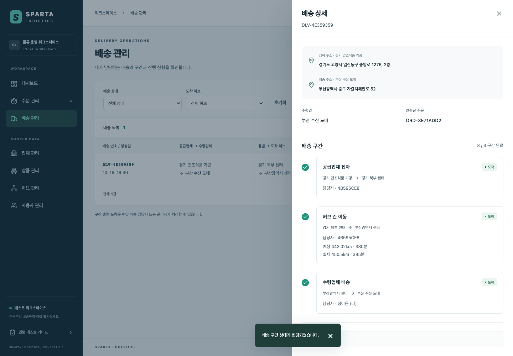

# [내일배움캠프] TIL 10일차 - 261016 / MSA 요청 흐름을 추적하고, 모니터링으로 확인하기

## 오늘의 일기 및 생각

(직접 작성)

## 오늘의 학습 키워드

**분산 추적과 traceId**

여러 서비스를 거치는 요청을 하나의 흐름으로 연결해 보는 방법이다. traceId는 전체 요청 흐름을 식별하고, spanId는 그 안의 개별 처리 구간을 식별한다.

**Micrometer Tracing과 Zipkin**

Micrometer Tracing으로 서비스의 처리 구간과 추적 정보를 연결하고, Zipkin에서 수집한 구간의 관계와 시간을 확인한다. 이번 프로젝트는 Brave 구현체를 연결해 사용한다.

**Prometheus와 Grafana**

Prometheus는 서비스의 메트릭을 주기적으로 가져와 저장한다. Grafana는 그 데이터를 조회해 요청 수, 오류, 응답 시간 같은 지표를 화면에 보여 준다.

**관리 포트와 인증 예외**

사용자 API와 운영용 엔드포인트가 받는 포트를 나눌 수 있다. 포트를 분리한 뒤에도 어떤 경로에 인증 예외를 줄지 별도로 정해야 한다.

**E2E와 테스트 데이터의 전제**

E2E는 브라우저에서 실제 서버를 거쳐 사용자 시나리오를 확인하는 테스트다. 계정·업체·배송담당자 같은 준비 데이터도 결과에 영향을 준다.

## 회의에서 기억에 남는 논의

### 프런트가 생겼어도 API는 하나씩 확인해야 한다

오늘 중간 점검 회의에서는 프런트가 생긴 뒤에도 API를 직접 테스트해야 한다는 이야기가 나왔다. 오후에는 API를 목록으로 만들고 하나씩 확인하면서 버그를 고치고, 내부 요청은 로그를 보자는 방향이었다.

화면에서 주문 하나가 만들어져도 서버 안에서는 여러 일이 일어난다. Gateway가 사용자를 확인하고, 주문 서비스가 업체와 상품을 조회한 뒤 배송 서비스에 생성을 요청한다. 화면에 보이는 성공·실패만으로는 이 흐름의 어느 단계까지 진행됐는지 알기 어렵다.

그래서 Swagger 테스트용 데이터와 로그 확인 도구를 준비하고, 서비스 사이의 요청을 추적할 수 있게 했다. 처음에는 로컬 테스트용 에이전트와 Jaeger로 흐름을 확인했다. 이후 팀 SA에 적힌 Micrometer Tracing과 Zipkin으로 바꾸고 기본 실행 환경에 포함했다.

멘토가 같은 과정을 따라 할 수 있도록 운영 콘솔에 테스트 가이드도 붙였다. 계정, 실행 순서, 기대 결과를 시나리오별로 정리하고, 필요한 계정으로 로그인해 해당 화면으로 이동하게 했다.

성공하는 데이터만 준비하지는 않았다. 배송담당자가 없는 대전 허브를 이용해 주문이 실패하는 시나리오도 넣었다. 이 경우 서버는 `404 DELIVERY_MANAGER_NOT_FOUND`를 반환하고, 주문 목록의 건수는 늘어나지 않는다.

이 실패에서는 배송이 저장되기 전에 거절된다. 주문도 저장되지 않고 생성 시도는 `ABORTED`로 남는다. 이미 만들어진 배송을 삭제하는 보상 시나리오와는 실패 지점이 다르다.

### 팀원의 허브 경로 API가 들어오자 주문 흐름이 이어졌다

어제까지 화면은 같은 허브의 업체 사이에서만 주문을 허용했다. 다른 허브로 배송하려면 필요한 내부 경로 조회 API가 아직 없었기 때문이다.

오늘은 팀원이 구현해 `dev`에 올린 허브 경로 조회 기능과 272건의 시드 데이터를 현재 브랜치에 병합했다. 실제 서버에서 경로 조회와 주문 생성을 확인한 뒤, 프런트의 다른 허브 주문 제한을 풀었다.

경기 북부에서 부산으로 보내는 주문은 세 구간으로 만들어졌다.

| 구간 | 이동 | 배정된 담당자 |
|---|---|---|
| 공급업체 집하 | 경기 공급업체 → 경기 북부 허브 | 출발 허브 담당자 |
| 허브 간 이동 | 경기 북부 허브 → 부산 허브 | 출발 허브 담당자 |
| 수령업체 배송 | 부산 허브 → 부산 수령업체 | 도착 허브 담당자 |

브라우저 테스트에서는 주문을 만들고, 담당자 계정을 바꿔 각 구간을 처리하고, 배송 완료 후 관리자 계정으로 주문을 삭제하는 흐름까지 확인했다. 앞 구간이 도착해야 다음 구간을 출발할 수 있다는 순서도 이 과정에 포함됐다.



화면은 테스트용 주문의 배송 완료 결과다. 예상 443.02km·380분은 경로 시드 값이고, 실제 450.5km·395분은 E2E에서 입력한 값이다. 실제 운송을 측정한 수치는 아니다.

현재 허브 간 이동은 출발 허브에서 도착 허브로 직접 가는 한 구간이다. 여러 중간 허브를 거치는 경로 탐색까지 구현한 것은 아니다.

### 고도화 전에 현재 동작과 남은 범위를 먼저 확인하기

회의에서는 대규모 트래픽 대응, 보안, 모니터링과 장애 알림도 다음 방향으로 나왔다. 동시에 프로젝트의 현재 진행 상황을 먼저 파악해야 하고, 구현한 내용을 이해한 뒤 다음 단계로 가자는 의견도 있었다.

오늘 작업은 요청 흐름과 서비스 상태를 관찰할 수 있는 기반을 붙이는 데 집중했다. 모니터링 화면이 생겼다고 대규모 트래픽을 처리할 수 있다는 뜻은 아니다. 부하를 주고 병목과 처리 한계를 측정하는 일은 다음 과제로 남는다.

장애 알림도 마찬가지다. 오늘 붙인 것은 지표 수집과 대시보드이고, 임계값을 정해 Slack으로 알리는 규칙은 아직 없다.

## 오늘 들었던 의문점 간단히 조사

### 서비스 로그를 한 화면에 모으면 요청 흐름을 알 수 있지 않을까?

요청이 하나일 때는 시간 순서로 로그를 따라갈 수 있다. 여러 요청이 겹치면 주문 서비스의 로그와 배송 서비스의 로그 중 어느 것이 같은 요청에서 나온 것인지 구분하기 어렵다.

여기에 traceId를 붙인다. 서비스가 다른 서비스를 호출할 때 HTTP의 `traceparent` 헤더로 추적 정보를 전달하고, 각 처리 구간은 같은 traceId 아래에 자기 spanId를 가진다.

같은 택배의 이동 기록을 운송장 번호로 묶는 것과 비슷하다. traceId가 운송장 번호라면 span은 접수, 분류, 이동처럼 시간을 기록하는 개별 구간이다.

이번에는 모든 서비스와 Gateway에 다음 의존성을 넣었다. 서비스 간 Feign 호출에는 `feign-micrometer`도 추가했다.

```groovy
implementation 'io.micrometer:micrometer-tracing-bridge-brave'
implementation 'io.zipkin.reporter2:zipkin-reporter-brave'

// Feign을 사용하는 서비스에 추가한다.
implementation 'io.github.openfeign:feign-micrometer'
```

서버에서 요청을 받는 쪽만 추적해서는 하위 호출이 이어지지 않는다. OpenFeign은 `feign-micrometer`와 `ObservationRegistry` 등이 준비돼 있을 때 계측 기능을 붙인다. [Spring Cloud OpenFeign 공식 문서](https://docs.spring.io/spring-cloud-openfeign/reference/spring-cloud-openfeign.html#micrometer-support)

Gateway의 권한 확인용 HTTP 클라이언트는 Spring Boot가 자동 구성한 `WebClient.Builder`를 사용한다. 이 빌더를 거쳐야 자동 추적 전파를 활용할 수 있다. [Spring Boot 3.5 공식 문서](https://docs.spring.io/spring-boot/3.5/reference/actuator/tracing.html#actuator.micrometer-tracing.propagating-traces)

Gateway는 WebFlux라 요청 처리 중 스레드가 바뀔 수 있다. 따라서 스레드에 붙어 있는 로그 정보인 MDC만 생각하면 traceId가 빠질 수 있다. 이번 설정에서는 `spring.reactor.context-propagation: auto`를 켜고 Gateway 로그에도 추적 정보가 남는지 확인했다.

실제 확인에는 없는 상품으로 주문하는 실패 요청을 사용했다. 응답은 `404 PRODUCT_NOT_FOUND`였고, Gateway의 권한 확인과 주문 서비스에서 업체·상품을 조회하는 Feign 호출이 같은 traceId로 묶였다. Zipkin에서는 부모·자식 구간 15개가 확인됐다.

실패한 요청도 어디까지 갔는지 볼 수 있게 된 것이다. 다만 SQL 로그에 traceId가 찍히는 것과 SQL 실행이 별도의 span으로 보이는 것은 다르다. 이번 Micrometer 구성에는 SQL 전용 계측을 추가하지 않았다.

### 로컬에서 추적 샘플링을 100%로 둔 이유는 무엇일까?

Spring Boot 3.5의 기본 추적 샘플링 비율은 10%다. 로컬에서는 요청을 몇 번만 보내고 확인하는 일이 많아서, 기본값을 그대로 두면 방금 보낸 요청이 Zipkin에 없을 수 있다. [Spring Boot 3.5 공식 문서](https://docs.spring.io/spring-boot/3.5/reference/actuator/tracing.html)

그래서 로컬 기본값은 `management.tracing.sampling.probability: 1.0`으로 두었다. 요청량이 많은 환경에서는 저장량과 계측 비용을 고려해 비율을 정해야 한다.

샘플링을 0으로 바꿨을 때도 확인했다. Gateway의 비율을 0으로 바꿔 업체 조회를 세 번 보내도 Zipkin의 trace 수는 늘지 않았지만, 하위 요청에는 기록하지 않음을 나타내는 플래그가 담긴 `traceparent`가 전달됐다. 추적 정보를 전달하는 것과 수집 서버에 span을 보내는 것은 구분해야 했다.

### Zipkin이 있는데 Prometheus와 Grafana는 왜 필요할까?

세 가지 관측 정보는 답하는 질문이 다르다.

| 정보 | 확인하려는 것 | 이번 프로젝트에서 보는 곳 |
|---|---|---|
| 로그 | 해당 시점에 어떤 일이 있었나 | 서비스 로그와 traceId |
| 추적 | 이 요청이 어디를 거쳤고 어느 구간에서 실패하거나 늦어졌나 | Zipkin |
| 메트릭 | 요청 수·오류·응답 시간·자원 사용량이 어떻게 변하나 | Prometheus와 Grafana |

Zipkin에서 요청 하나를 살펴봐도 최근 몇 분간 오류가 얼마나 늘었는지는 별도로 모아 봐야 한다. 그래서 서비스가 `/actuator/prometheus`로 메트릭을 내보내고, Prometheus가 15초마다 가져오게 했다.

수집할 주소는 Eureka에서 찾는다. Gateway는 사용자 API 포트와 관리 포트가 다르므로 Eureka 메타데이터의 `management.port`를 이용해 수집 주소를 바꾼다.

Grafana에서는 요청 수, 4xx·5xx 응답, p95 응답 시간, JVM 메모리, DB 커넥션 풀을 확인하도록 구성했다. p95는 관측한 요청의 약 95%가 그 시간 이내에 끝났다는 뜻이다. 평균만으로 놓칠 수 있는 느린 요청 쪽을 보는 지표다.

대시보드 해석에서도 문제가 있었다. 컨테이너를 다시 만든 뒤 서비스 상태 패널에 이전 인스턴스의 DOWN 값이 남았다. 현재 상태를 보여 주려는 패널이 과거 조회 구간까지 사용하고 있어서, 현재 시점의 값을 조회하는 instant 쿼리로 바꿨다.

차트가 나타나는 것만 확인해서는 부족했다. 지금 상태를 보고 싶은지, 일정 시간 동안의 변화를 보고 싶은지에 맞춰 조회 방식을 골라야 했다.

### Feign 호출은 되는데 지표가 없는 이유는 무엇이었을까?

Prometheus를 붙인 뒤 order와 delivery 로그에서 메트릭 등록 경고가 나왔다.

```text
Prometheus requires that all meters with the same name have the same set of tag keys
```

원인은 같은 메트릭 이름을 서로 다른 라벨 구조로 사용한 것이었다.

| 계측 대상 | 메트릭 이름 | 라벨 키 예시 |
|---|---|---|
| Eureka 클라이언트의 HTTP 호출 | `http.client.requests` | `client_name`, `method`, `uri`, `status` |
| Feign 호출 | `http.client.requests` | `clientName`, `http.method`, `http.url`, `http.status_code` |

프로젝트가 사용하는 Micrometer 1.15의 `PrometheusMeterRegistry`는 같은 이름에 서로 다른 라벨 키 집합을 등록할 수 없다. 따라서 뒤에 등록되는 Feign 메트릭이 빠졌다. API 호출 자체는 성공해도 관측 데이터는 누락될 수 있었던 것이다. [Micrometer 1.15 공식 문서](https://docs.micrometer.io/micrometer/reference/1.15/implementations/prometheus.html)

공통 `MeterFilter`에서 Feign의 `clientName` 태그가 있는 메트릭만 골라 이름을 `feign.client.requests`로 바꿨다. 다른 HTTP 클라이언트의 메트릭은 그대로 두었다.

수정 후에는 실제 호출을 보내 Feign 시계열이 생기는지 확인했다. 의존성을 추가하고 대시보드를 열었다는 것에 더해, 보고 싶은 호출이 지표에 실제로 잡히는지까지 확인해야 했다.

### 관리 포트를 따로 열면 인증 문제도 해결될까?

Gateway의 사용자 API는 8080, 관리 엔드포인트는 8090으로 나눴다. 설정은 다음과 같다.

```yaml
server:
  port: 8080

management:
  server:
    port: 8090
```

Spring Boot는 `management.server.port`로 관리 포트를 분리할 수 있다. 우리 Compose 설정에서는 8090을 호스트에 공개하지 않고 내부 네트워크에서 Prometheus가 접근하도록 했다. [Spring Boot 3.5 공식 문서](https://docs.spring.io/spring-boot/3.5/reference/actuator/monitoring.html)

하지만 포트만 나눈 것으로 끝나지 않았다. 처음에는 관리 포트의 메트릭 요청에도 Security 필터가 적용돼 401이 나왔다. 반대로 관리 포트의 모든 요청을 인증에서 빼면 일반 API 요청까지 인증을 건너뛸 수 있었다.

그래서 관리 기능의 인증 예외를 **실제 관리 서버 포트로 들어왔고, 경로가 `/actuator/**`인 요청**으로 좁혔다. 포트는 설정 문자열을 비교하지 않고 서버 기동 이벤트에서 실제 열린 값을 받는다.

토큰 없는 요청에 대해 다음 세 경우를 테스트했다.

| 요청 | 결과 |
|---|---|
| 관리 포트의 `/actuator/prometheus` | 200 |
| 공개 포트의 `/actuator/prometheus` | 401 |
| 관리 포트의 `/api/v1/hubs` | 401 |

포트 공개 여부와 인증 예외는 서로 다른 설정이었다. 관리용 주소를 만들 때도 정상 접근과 우회 접근을 함께 확인해야 했다.

### 테스트 데이터를 추가했는데 기존 E2E는 왜 깨졌을까?

멘토 가이드에 경기·부산 배송담당자와 예제 업체를 추가하자 기존 담당자 배정 테스트가 실패했다. 테스트는 서울이 아닌 첫 허브를 골라 새 담당자를 지정하고, 그 사람이 배송에 배정될 것이라고 가정하고 있었다.

그런데 그 허브에 시드 담당자가 생겼다. 자동 배정은 후보들의 담당 건수를 보고 결정하므로 새로 만든 사람이 항상 선택된다는 전제가 깨졌다.

테스트가 실제로 필요로 했던 조건은 “서울이 아닌 허브”보다 구체적이었다. 다른 담당자가 없고, 롤백 시나리오용으로 비워 둔 허브도 아닌 곳이 필요했다. 허브를 고르는 조건에 이 전제를 드러냈다.

허브 간 배송 E2E에서도 두 번 막혔다. 배송 상세 다이얼로그가 열려 있으면 배경의 로그아웃 버튼이 접근성 트리에서 숨겨졌다. 또 허브 간 이동을 도착 처리할 때는 실제 거리와 소요시간을 입력해야 했다.

계정 전환은 해당 주소를 다시 열어 로그인하는 방식으로 바꾸고, 상태 변경에는 필요한 입력을 추가했다. 최종 실행에서는 전체 E2E 18개가 통과했다.

### 실제 거리와 소요시간이 필수면 믿을 만한 데이터가 쌓일까?

허브 간 이동을 도착 처리하면서 실제 거리와 시간을 꼭 입력해야 하는 이유도 살펴봤다. 발제문은 예상·실제 거리와 소요시간 필드를 요구하고, 허브 이동의 도착 시점에 두 값을 필수로 받는 규칙은 팀 SA에 있다.

현재 구현은 누락과 음수를 거절한다. 그런데 `@PositiveOrZero`를 사용하므로 0km·0분은 통과한다. 실제 개발 환경에서 두 값을 0으로 보내 200 응답과 저장 결과를 확인했다.

필드를 채웠다는 사실만으로 운송 실적이 의미 있는 값이 되지는 않았다. 현재 구간에는 출발·도착 시각이 따로 없어 소요시간도 사람이 입력한다.

출발·도착 시각으로 시간을 계산하는 방안과 거리 검증 기준을 배송 담당자에게 검토 요청으로 남겼다. 동시 상태 변경과 조회 응답 범위도 함께 검토 대상으로 올렸다. 이 부분은 아직 수정된 기능이 아니며, 팀 계약을 확인하고 결정해야 한다.

## 구현과 검증 범위

오늘은 전날부터 이어진 이메일 가입·배송담당자 Slack DM 연동을 마무리하고, 분산 추적·메트릭 수집·멘토 가이드·다른 허브 간 주문 화면을 이어 붙였다. 허브 경로 기능은 팀원이 구현한 내용을 병합해 연동했다.

오늘 작업 당시의 검증 결과는 다음과 같다.

| 확인 범위 | 명령 또는 확인 방식 | 결과 |
|---|---|---|
| 백엔드 빌드·테스트 | 허브 기능 병합 후 `./gradlew build` | 전체 테스트 결과 766개, 실패·오류·skip 0 |
| 프런트 빌드·정적 검사 | `npm --prefix frontend run build`, `lint`, `format:check` | 통과 |
| 프런트 단위 테스트 | `npm --prefix frontend run test` | 46개 통과 |
| 브라우저 E2E | `npm --prefix frontend run test:e2e` | 최종 전체 실행 18개 통과 |
| 메트릭 수집 | Prometheus 수집 대상과 실제 요청 확인 | Gateway 포함 서비스 6개 UP, Feign 시계열 확인 |
| 관리 포트 경계 | HTTP 테스트와 실제 실행 확인 | 메트릭 200, 공개 포트·관리 포트 일반 API 401 |
| 문서 동기화 | `script/docs-check.sh origin/dev` | 통과 |

백엔드 766개는 재사용된 결과를 포함한 전체 XML 집계다. 모든 테스트를 오늘 처음부터 다시 실행했다는 의미는 아니다. 브라우저 보고서는 마지막 전체 실행의 18개 성공, 실패·불안정·skip 0을 기록한다.

E2E에서는 실제 Slack 발송을 껐다. 허브 간 주문을 브라우저에서 끝까지 처리한 검증과 정상 주문 전체가 Zipkin에서 하나의 trace로 이어지는지 확인하는 검증도 구분해야 한다. 후자의 전체 흐름과 비동기 Slack 스레드까지의 추적 전파는 아직 확인하지 않았다.

메트릭·멘토 가이드·허브 간 주문 화면 변경은 PR로 올렸다. 배송의 동시 변경 보호와 실적 입력 정책은 검토 요청으로 남겼고, 부하 테스트와 장애 알림은 후속 작업이다.

## 오늘의 AI 활용 팁: 화면의 기대 결과를 실제 요청으로 확인하기

**상황:** 멘토가 프로젝트를 편하게 테스트할 수 있도록 가이드, 절차, 테스트 데이터를 넣어 달라고 요청했다.

**결과:** 계정별 시나리오와 바로 시작하는 버튼이 생겼다. 하지만 설명이 자연스럽다는 이유만으로 기대 결과를 믿을 수는 없었다. 담당자가 없는 주문에서 어떤 오류가 나오는지, 주문이 남는지, 다른 담당자가 배송을 볼 수 있는지 실제 API로 확인하는 과정이 필요했다.

**근거:** 대전 주문의 `404 DELIVERY_MANAGER_NOT_FOUND`와 주문 수 유지, 다른 담당자의 403 응답, 경기→부산 주문의 3구간 완료를 각각 확인했다. 테스트 데이터를 늘리면서 깨진 E2E도 어떤 전제가 달라졌는지 찾아 수정했다.

**어디까지 믿었나:** API 응답, 저장 결과, 브라우저 테스트로 확인한 범위까지다. 가이드에 “성공한다”고 적힌 것만으로 구현 완료로 보지는 않았다. 허브 경로 API가 들어오기 전에는 화면의 제한을 유지했고, 실제 연동을 확인한 뒤 풀었다.

다음에 비슷한 작업을 맡길 때는 “각 시나리오에 준비 데이터, 실행 절차, 기대 응답, 확인 근거를 함께 적고 미구현 항목은 구분해 줘”라고 요청하면 검토할 지점이 분명해진다.

## 회고

(직접 작성)
