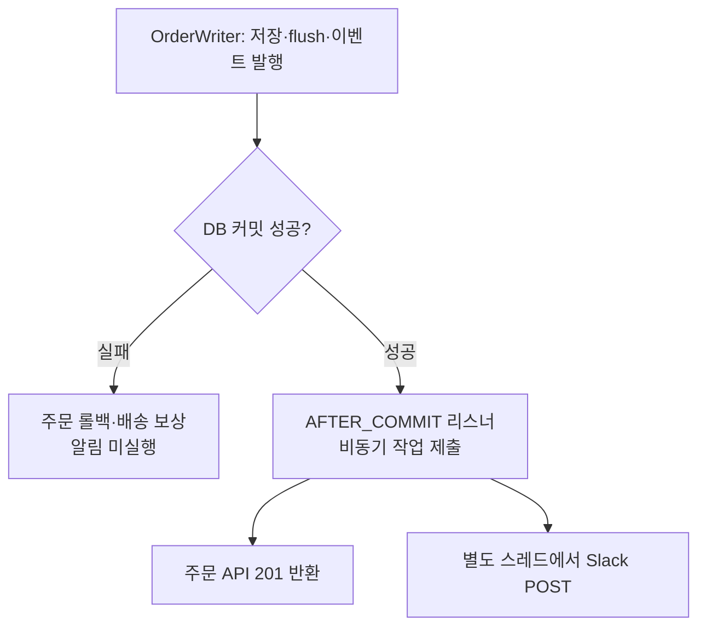

# 39. 주문 커밋 후 비동기 Slack 알림

- 날짜: 2026-10-15
- 브랜치: `feat/order-create`
- 이전 작업 커밋: `9b48adc feat(order): 주문 생성 Feign과 Controller 연결`
- 현재 변경: Slack 알림·검증·문서, 미커밋. 푸시는 수행하지 않았다.

## 만든 것

| 위치 | 역할 |
|---|---|
| `application/OrderWriter` | 저장 트랜잭션 안에서 주문 생성 이벤트 발행 |
| `application/event/OrderCreatedEvent` | 주문 ID·업체명·상품명·수량·요청사항의 불변 스냅샷 |
| `application/event/OrderCreatedEventListener` | AFTER_COMMIT 시 작업 제출, 제출 실패 격리 |
| `application/OrderNotificationSender` | 주문 알림의 외부 전송 경계 |
| `infrastructure/notification/SlackOrderNotificationSender` | @Async에서 Webhook POST, 전송 실패 기록 |
| `infrastructure/notification/SlackProperties` | URL·연결/읽기 제한을 받는 설정 record, URL 출력 방지 |
| `infrastructure/config/OrderNotificationConfig` | 전용 스레드 풀과 사용자 헤더·재시도 없는 RestClient |
| `config-repo/order-service.yml` | 기존 SLACK_WEBHOOK_URL 환경 변수 연결 |

## 왜 이렇게 연결했는가

알림 기준은 DB 트랜잭션의 COMMIT 성공이다. 저장 메서드가 `saveAndFlush`를 마쳐도 지연 제약 때문에 커밋이 실패할 수 있다. 이벤트는 트랜잭션 안에서 등록하고, 실제 알림은 커밋 후에만 실행한다.



작업 제출 후 요청 스레드는 Slack 응답을 기다리지 않는다. 업체명은 이미 조회한 결과를 복사하므로 알림 스레드에서 외부 조회를 다시 하지 않으며 JPA Entity도 넘기지 않는다.
리스너와 전송 빈을 분리해 `@Async` 프록시를 거치고, 큐 포화에 따른 제출 거부와 실제 HTTP 오류를 각각 기록한다. 알림 실패 때문에 주문을 실패로 바꾸거나 배송을 보상하지 않는다.

설정은 스레드 2개·대기열 100개, 연결 1초·읽기 2초다. 같은 Webhook POST의 중복 알림을 피하기 위해 자동 재시도하지 않는다.
프로세스 종료·전송 실패·대기열 포화 때 알림은 유실될 수 있다. 발송 이력과 재처리를 보장해야 한다면 아웃박스·중복 처리 설계가 별도로 필요하다.

자세한 개념 비교는 [질문 노트](../qna/2026-10-15-order-notification-after-commit-async.md), 결정은 [order ADR 0003](../../../services/order/decisions/0003-slack-notification-after-commit.md)에 있다.

## 검증

- `./gradlew :order-service:test --console=plain`: 108개 통과, 실패·오류·skip 0.
- `./gradlew build --console=plain`: 성공. 전체 테스트 XML 합계 206개, 실패·오류·skip 0. 주문은 직전 실행 결과를 재사용했고 config-server 테스트는 새 설정 리소스로 다시 실행했다.
- `script/docs-check.sh`, `script/error-codes-check.sh`, `git diff --check`와 변경 파일 26개의 공백·문서 로컬 링크 검사를 통과했다.
- PostgreSQL 테스트: 커밋 전 미발송, flush 실패·지연 제약 커밋 실패 후 미발송, 트랜잭션 밖 이벤트 무시.
- 실제 Tomcat·비동기 프록시·HTTP 테스트 대역: Slack 수신 시 별도 DB 연결에서 주문 조회, Webhook 응답을 막아도 주문 201 반환.
- Slack 400·429·500, 읽기 타임아웃, 실행 풀·큐 포화에서 주문 201·DB 저장 유지, 배송 보상 없음. HTTP 재시도 없음.
- JSON의 한글·요청사항·업체명 스냅샷, 멘션 제어 문자 이스케이프, 인증 헤더 미전달, 로그의 URL·응답 본문 제외, URL 미설정 시 발송 생략 확인.
- 최초 테스트 컴파일에서 잘못 참조한 `IS_DELIVERY_MANAGER`를 공통 정본의 `DELIVERY_MANAGER`로 고쳤다. 공통 계약은 바꾸지 않았다(TS-009).
- 실제 Slack 채널 발송, 팀 서비스 실제 데이터 연동, 기존 Compose의 새 이미지·설정 반영은 하지 않았다.

## 직접 해보기

1. Docker 실행 상태에서 `./gradlew :order-service:test --tests '*OrderNotificationIntegrationTest'`를 실행한다. Slack 대역을 사용한 6개 시나리오가 통과하면 된다. IntelliJ에서는 클래스 옆 실행 버튼을 사용한다.
2. `./gradlew :order-service:test --tests '*OrderCreationIntegrationTest'`로 커밋·실패 경계 6개를 확인한다. `notifiesOnlyAfterCommit`의 이벤트 발행 직후에는 알림 호출이 없고, 트랜잭션 반환 후에만 호출된다.
3. `./gradlew :order-service:test`로 전체 108개를 실행한다. 결과는 `order-service/build/reports/tests/test/index.html`에서 본다.
4. 실제 Slack 연동 시에는 `.env`의 `SLACK_WEBHOOK_URL`을 설정한다. URL을 저장소나 채팅에 붙이지 않는다. IDE 실행에서는 order 실행 설정의 환경 변수에 넣는다.
5. Compose 반영 시 config-repo도 config-server 이미지에 포함되므로 config-server와 order 이미지를 모두 갱신한다. 아래 명령은 이번 작업에서 실행하지 않았다. 기존 의존 서비스가 정상인 환경에서 적용하며, 이 시점부터 정상 주문은 실제 채널에 알림을 보낸다.

```sh
docker compose build config-server order-service
docker compose up -d --no-deps --no-build --wait config-server
docker compose up -d --no-deps --no-build --wait order-service
```

`.env` 변경은 단순 `restart`로 반영되지 않는다. `SLACK_WEBHOOK_URL`이 빈 값이면 주문은 생성하되 알림은 생략한다.

## 함께 확인한 Git 상태

`git rev-parse --show-toplevel`은 이 저장소 루트를, `--is-inside-work-tree`는 `true`를 반환했다. 루트의 README·build.gradle·settings.gradle·AGENTS.md는 추적 중이다.
`??`는 Git이 없는 것이 아니라 새 파일이 아직 추적되지 않는다는 표시다. `.env`, IDE 개인 설정, build 산출물은 의도적으로 무시한다. 각 서비스는 루트 Git 저장소에서 함께 관리한다.
