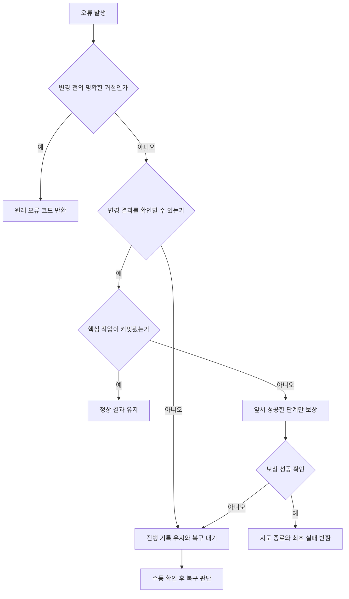

# 주문 실패·예외 처리 설계

- 작성: Junhyun An 작업 / 2026-10-15
- 기준: 현재 O-01~O-06 코드, [SA 7장](../../SA/sparta-logistics-sa.md), 주문 ADR 0006~0009
- 상태: 생성·취소·삭제 진행 기록·커밋 재확인, 생성 멱등키와 삭제 재요청을 구현했다. 생성·취소의 운영 복구 API·자동 재실행은 후속 설계다. 타 서비스 담당자는 [연동 계약](integration-contract.md)을 함께 읽는다.

## 1. 오류 코드보다 먼저 결정할 것

실패 응답을 받았다는 사실과 데이터가 바뀌지 않았다는 사실은 다르다. **변경 결과가 확정됐는지**를 먼저 구분한다.

| 분류 | 예 | 처리 원칙 |
|---|---|---|
| 변경 전 거절 | 입력 오류, 타인 주문, 배송 시작 후 취소 409 | 원래 오류를 반환한다. 바뀐 것이 없으므로 보상하지 않는다. |
| 변경 성공 확인 | 배송 취소 응답의 status=CANCELED | 다음 단계를 진행할 수 있다. 이후 단계 실패 시 보상 대상이다. |
| 로컬 롤백 확인 | 새 트랜잭션에서 주문 ORDERED·시도 PROCESSING 확인 | 앞서 성공한 배송 취소를 원복한다. |
| 결과 불확실 | 타임아웃, 5xx, 커밋 중 연결 단절, 잘못된 성공 본문 | 성공·실패를 추측하지 않는다. 실행권을 보존하고 확인 대상으로 남긴다. |
| 핵심 커밋 후 부가 기능 실패 | Slack 타임아웃·큐 포화 | 주문 성공을 유지한다. 주문·배송을 되돌리지 않는다. |

외부 서비스가 4xx를 반환한 경우 해당 변경이 롤백되었다는 내부 API 계약을 전제로 한다. 상태를 바꾼 뒤 4xx를 반환하는 구현이라면 제공 서비스에서 먼저 계약을 바로잡아야 한다.



## 2. 계층별 책임

| 계층 | 책임 | 현재 연결 |
|---|---|---|
| Controller·Request | 형식·필수값 검증, 성공 응답 변환 | @Valid, ApiResponse, 전용 Response |
| Entity | 허용 상태 전이·값의 불변식 | Order.cancel, updateRequestNote, OrderCancellation 전이 |
| application | 단계 순서, 소유자 확인, 트랜잭션·보상 판단 | OrderService, OrderWriter, OrderCancellationService·Writer |
| Feign 어댑터 | HTTP 계약, 응답 확인, API별 재시도 정책 | DeliveryClientAdapter, Cancel·Revert 클라이언트 |
| 공통 예외 처리 | 예외를 일관된 HTTP 오류 본문으로 변환 | BusinessException, FeignErrorDecoder, GlobalExceptionHandler |

Controller마다 try/catch를 반복하지 않는다. application에서는 **보상 여부나 후속 상태가 달라지는 경계**에서 예외를 잡는다.
예측 가능한 업무 거절은 BusinessException으로 구분한다. 예상하지 못한 오류도 application의 복구 판단을 거친 뒤 공통 500으로 반환한다.

## 3. 주문 생성 O-01: 구현한 실패 흐름

정상 경로는 두 단계다([ADR 0010](decisions/0010-order-creation-async-acceptance.md), 이슈 #16).
접수(요청 스레드): `사용자·키 조회 → 새 키이면 업체·상품·권한 확인 → PROCESSING 커밋 → 작업 제출 → 202`.
처리(별도 스레드): `I-09 → 주문·COMPLETED·최초 응답 커밋`. 진행 기록 시작을 커밋하지 못하면 I-09를 호출하지 않는다.
접수 전 단계의 실패는 아래 표대로 요청 응답이 된다. **처리 단계의 실패는 요청 응답으로 돌아오지 않고** 진행 조회 O-07의 `ABORTED`(`failureCode`·`failureMessage`)·`RECOVERY_REQUIRED`로 확인한다. 표의 "응답" 열 중 처리 단계 항목은 해당 상태와 코드를 뜻한다.
같은 키·본문 재요청은 처리 중이면 202(같은 orderId), 완료면 201이며 `ORDER_CREATION_IN_PROGRESS`는 HTTP로 보내지 않는다. 실행기(스레드 4개·대기열 50개)가 가득 차면 원격 호출 없이 시도를 ABORTED(`SERVICE_UNAVAILABLE`)로 닫고 503이다.

| 실패 지점 | 응답 | 현재 처리 |
|---|---|---|
| 헤더 누락·형식, 본문·수량 검증 | 400 VALIDATION_ERROR | Controller에서 종료, 새 생성 기록 없음 |
| 같은 사용자·키, 다른 유효한 본문 | 409 ORDER_IDEMPOTENCY_KEY_CONFLICT | 기존 요청 유지, 회사·배송 호출 없음 |
| 같은 키·본문, 완료 | 201 | 최초 생성 스냅샷 재사용, 생성·알림 재실행 없음 |
| 같은 키·본문, 처리 중 | 202 (같은 orderId) | 기존 요청 유지, 새 키로 우회하지 않음. 결과는 O-07 |
| 같은 키·본문, 실패 종료 | 409 ORDER_CREATION_ABORTED | 같은 키 재실행 없음 |
| 같은 키·본문, 복구 대기·기록 삭제 | 409 ORDER_CREATION_RECOVERY_REQUIRED | 결과 확인 전 재실행 없음 |
| 요청업체 관리자 권한 | 403 FORBIDDEN | 배송 생성 전 종료, 생성 기록 없음 |
| 업체·상품 조회의 명확한 4xx | 하위 오류 코드 유지 | 배송 생성 전 종료 |
| 업체·상품 조회 통신 실패 | 503 SERVICE_UNAVAILABLE | GET 통신 재시도 종료 후 반환 |
| 동시 생성 기록 INSERT의 유니크 충돌 | 기존 결과에 따라 201·409 | 실패한 트랜잭션 종료 후 기존 키 재조회. 충돌한 요청의 I-09 호출 없음 |
| 다른 생성 기록 시작의 DB 예외 | 500 INTERNAL_SERVER_ERROR | I-09 호출 없음. 시작 기록이 커밋됐을 수도 있어 로그의 orderId·attemptId로 확인 |
| I-09의 명확한 4xx | 하위 오류 코드 유지 | ABORTED 기록, 삭제 보상 없음 |
| I-09 타임아웃·5xx·잘못된 성공 응답 | 503 SERVICE_UNAVAILABLE | I-13 보상이 성공하고 I-17이 CLOSED면 ABORTED(SERVICE_UNAVAILABLE). 보상 실패·I-17이 ACTIVE·NONE·조회 실패면 DELIVERY_RESULT_UNKNOWN으로 복구 대기 |
| 배송 생성 뒤 엔티티 검증·저장 예외, 미저장 확인 | 원래 업무 오류 또는 500 | I-13 성공이면 ABORTED, 실패이면 DELIVERY_DELETE_FAILED |
| 저장 예외 후 실제 커밋 확인 | 201 유지 | 저장된 OrderResult 반환, I-13·이벤트 재발행 없음 |
| 저장 결과 조회 실패·상태 불일치 | 최초 실패 유지 | ORDER_COMMIT_UNKNOWN, 자동 삭제 없음 |
| 종료·복구 기록 갱신 실패 | 최초 실패 유지 | 기존 PROCESSING·COMPLETED 등을 덮지 않고 식별자를 로그에 남김 |
| 커밋 후 Slack 실패 | 201 유지 | 전송 실패 로그, 배송 보상 없음 |

기존의 저장 예외마다 배송을 삭제하던 방식은 [ADR 0007](decisions/0007-order-creation-progress.md)로 대체했다.
OrderWriter.save와 resolveCreation이 같은 생성 기록을 먼저 잠근다. 원래 트랜잭션의 커밋·롤백이 끝난 뒤 주문과 COMPLETED 기록, 주문자·배송 ID가 일치하는지 확인한다.
PROCESSING이고 주문이 없을 때만 미저장으로 판정한다. 그 외의 조합을 추측해서 보상하지 않는다.

생성 기록은 주문보다 먼저 저장하므로 p_orders에 FK를 두지 않는다. 실패한 요청도 주문 행 없이 추적한다. 요청 지문은 저장하지만 실패 요청의 원본 전체 본문은 보관하지 않으며, 성공 시 가격을 포함한 최초 응답을 JSONB로 저장한다.
기록은 결과 확인과 배송 정리를 위한 것이며, 실패한 요청을 자동으로 다시 주문하는 기능은 아니다. 기존 키 없는 기록과 이전 주문에는 멱등키를 역으로 채우지 않는다.

사용자가 응답을 못 받으면 같은 키·본문으로 재요청한다. `(orderer_id, idempotency_key)` UNIQUE가 동시 요청을 막으며, 키는 자동 만료하지 않는다. JSON 표현이 달라도 파싱한 필드가 같으면 같은 요청이다([ADR 0008](decisions/0008-order-idempotency-key.md)).
ABORTED는 원인을 해결한 뒤 별도 새 주문에 새 키를 사용할 수 있다. PROCESSING·RECOVERY_REQUIRED는 새 키로 우회하지 않는다. 상세 규칙은 [호출자 계약](integration-contract.md)에 있다.

**진행 조회·지연 생성:** 진행 조회는 O-07로 제공한다. 운영 복구 API·자동 재처리는 아직 없다. I-13이 먼저 끝난 뒤 지연된 I-09는 delivery의 종료 표시가 409 `DELIVERY_CREATION_CLOSED`로 거절하고(이슈 #14), 배송 ID 없는 시도의 결과는 I-17(`GET /internal/deliveries/orders/{orderId}`)로 확인한다. 서버가 처리 중 종료되면 시도가 PROCESSING으로 남으며 시간만으로 해제하지 않는다. 계약은 [DELIVERY-002](../delivery/README.md#delivery-002-지연-생성과-삭제의-순서-역전-방지-계약-검토)에 있고 팀 리뷰가 남아 있다.

## 4. 주문 취소 O-05: 구현한 실패 흐름

정상 경로는 `실행권 커밋 → I-11 → 주문 CANCELED와 시도 COMPLETED를 함께 커밋`이다. 원격 호출 중에는 DB 트랜잭션을 유지하지 않는다.

| 상황 | HTTP | 주문·시도 상태 | 보상과 재요청 |
|---|---|---|---|
| 없음·타인 주문·이미 취소 | 404·403·409 | 새 시도 없음 | 배송 호출 없음 |
| PROCESSING·RECOVERY_REQUIRED가 존재 | 409 | 기존 상태 유지 | 새 원격 취소 없음 |
| 실행권 기록의 DB 예외 | 500 | PROCESSING이 남았을 수도 있음 | 배송을 호출하지 않음. 로그의 attemptId로 확인 |
| I-11의 명확한 4xx | 원래 코드 | ORDERED·ABORTED | 원복 없음. 조건 해결 후 새 시도 가능 |
| I-11 타임아웃·5xx·잘못된 성공 응답 | 503 | ORDERED·RECOVERY_REQUIRED | DELIVERY_RESULT_UNKNOWN, 자동 원복·재실행 없음 |
| 주문과 완료 기록의 커밋 성공 | 200 | CANCELED·COMPLETED | 이후 같은 주문 취소는 409 |
| 커밋 예외 후 실제 완료 재확인 | 200 | CANCELED·COMPLETED | 정상 취소를 원복하지 않음 |
| 로컬 롤백 확인, I-12 성공 | 500 | ORDERED·ABORTED | 원복 완료 후 새 취소 가능 |
| 로컬 롤백 확인, I-12 실패·결과 불확실 | 500 | ORDERED·RECOVERY_REQUIRED | REVERT_FAILED, 새 취소 차단 |
| 로컬 커밋 결과 확인 불가 | 500 | 재확인 필요·RECOVERY_REQUIRED | ORDER_COMMIT_UNKNOWN, 자동 원복 없음 |
| 종료·복구 기록 갱신 실패 | 최초 코드 유지 | PROCESSING 등이 남음 | 실행권을 시간만으로 해제하지 않음 |

배송 상태를 먼저 GET한 뒤 취소 가능하다고 단정하지 않는다. GET과 취소 사이에 집하가 시작될 수 있기 때문이다.
집하 시작 여부의 판단과 배송·구간 취소는 I-11 제공자인 delivery가 한 로컬 트랜잭션에서 처리해야 한다.

주문 저장 실패를 잡은 뒤 `resolveCompletion`은 새로운 트랜잭션에서 주문과 시도를 잠가 확인한다.
둘 다 취소 완료이면 성공으로 반환하고, ORDERED·PROCESSING이면 롤백으로 판단해 I-12를 호출한다. 이외의 조합이나 DB 조회 실패는 수동 확인 대상으로 남긴다.

취소 진행 기록이 있으면 여러 요청의 원격 취소와 보상이 겹치지 않는다. 부분 유니크 인덱스는 같은 주문에 미해결 시도가 둘 생기는 것을 DB에서도 막는다.
메모리 잠금에 의존하지 않으며 서버 재시작 후에도 기록이 남는다. 실제 다중 JVM 동시 요청·강제 종료 시험은 후속 검증 대상이다.

## 5. 주문 삭제 실패·재시도 정책·시간 예산

### O-06 삭제의 실패 흐름

삭제 전에 확인한 `ORDER_CANCELED`·`DELIVERY_DELIVERED` 근거를 p_order_deletions에 먼저 커밋한다. 최초 I-10의 404는 삭제 허가가 아니다.
배송만 삭제된 뒤 주문 DB가 롤백되면 같은 DELETE는 저장된 근거로 이어간다. 이미 삭제한 배송을 다시 GET해 DELIVERED를 확인하려 하지 않는다([ADR 0009](decisions/0009-order-deletion-progress.md)).

| 실패 지점 | 응답·기록 | 이후 처리 |
|---|---|---|
| 권한·없음·조건 미충족·미해결 취소 | 403·404·409, 새 기록 없음 | 원격 삭제 없음 |
| 최초 I-10 거절·장애·응답 참조 오류 | 하위 4xx·503, 새 기록 없음 | 조건 확인 전 삭제하지 않음 |
| 시작 기록 DB 실패 | 500, 원격 삭제 없음 | 기록이 커밋됐을 수도 있으므로 같은 주문으로 확인 |
| I-13 5xx·타임아웃·204 이외의 2xx | 503, 로컬 삭제 롤백·DELIVERY_DELETE_FAILED | 기록을 보존하고 같은 DELETE로 재개 |
| 로컬 flush·완료 기록·커밋 실패, 미커밋 확인 | 500·ORDER_WRITE_FAILED | 같은 DELETE는 저장된 근거로 I-13·로컬 삭제 재개 |
| 삭제·COMPLETED 커밋 확인 | 200 유지 | 원격 호출 반복·완료 기록 덮기 없음 |
| 재확인 실패·불일치 | 최초 오류·ORDER_COMMIT_UNKNOWN | 근거 보존. 삭제된 기록·참조 불일치는 수동 확인 |

삭제 실행은 같은 주문 잠금을 유지한다. 원격 실패가 로컬 삭제를 롤백시켜도 이미 적용된 원격 삭제까지 취소되는 것은 아니다.
삭제는 완료 상태로 향하는 같은 멱등 작업을 다시 수행한다. 생성·취소의 미확정 새 시도를 자동으로 실행하는 정책과 구분한다.
삭제 기록이 생기면 새 취소를 409로 막으며, 이미 삭제된 주문에 새 DELETE를 보내면 404다. 생성 멱등키·최초 응답과 과거 취소 기록은 유지한다.

### 호출별 재시도

| 호출 | 담당 위치 | 횟수·조건 |
|---|---|---|
| 외부 O-01 생성 | 같은 사용자·Idempotency-Key·본문으로 재확인 | 완료는 최초 201, 처리 중·실패·복구 대기는 409. 새 키를 만들며 재시도하지 않음 |
| 외부 O-05 취소 | 진행 기록으로 중복 실행 차단 | 처리 중·미확정·이미 취소는 409. 무조건 반복하지 않음 |
| 외부 O-06 삭제 | 삭제 허가 기록으로 같은 주문의 삭제 재개 | MASTER만 재요청. 이미 로컬 삭제됐으면 404 |
| I-07·I-08 GET | IdempotentRetryConfig | 응답 없는 통신 실패에 최대 3회 |
| I-09 배송 생성 | IdempotentRetryConfig | 같은 orderId, 응답 없는 통신 실패에 최대 3회 |
| I-10 배송 조회 | IdempotentRetryConfig | 최초 ORDERED 삭제에서만, 응답 없는 통신 실패 최대 3회 |
| I-11 배송 취소 | DeliveryNoRetryFeignConfig | 1회. 서버의 중복 CANCELED 처리와 별개로 SA 3.5 정책 유지 |
| I-12 원복 | IdempotentRetryConfig | 같은 deliveryId, 응답 없는 통신 실패에 최대 3회. 5xx 응답은 재시도하지 않음 |
| I-13 삭제 | 생성 보상은 OrderService 루프, O-06은 Writer | 생성 보상 총 3회, O-06 요청당 1회. Feign 자체 재시도 없음 |
| Slack | 전용 비동기 전송기 | 자동 재시도 없음, 주문 결과 유지 |

재시도 횟수는 최초 호출을 포함한다. I-12에 application 재시도 루프를 추가하면 Feign 재시도와 곱해지므로 중첩시키지 않는다.

### O-01 시간 예산 (이슈 #16, [ADR 0010](decisions/0010-order-creation-async-acceptance.md))

공통 Feign의 기본값은 연결 5초·읽기 20초이고 Gateway 응답 제한은 60초, 프런트 fetch는 20초다. 읽기 제한 20초를 세 번 사용하는 것만으로도 60초에 도달하므로 Gateway의 시간 초과가 서버 작업 종료나 롤백을 뜻하지 않는다.
그래서 O-01을 두 단계로 나누고 order-service 로컬 설정(`config-repo/order-service.yml`의 클라이언트별 값)만으로 단계별 상한을 정했다. 공통 설정·Gateway·프런트 타임아웃은 바꾸지 않았다. 아래는 설정에서 계산한 상한이며 실측값이 아니다.

| 단계 | 호출 | 연결·읽기 | 재시도 | 단계 최악 |
|---|---|---|---|---|
| 접수(요청 스레드) | 업체·상품 조회 3건(order-company) | 1초·1.5초 | 공통 정책 최대 3회 | 접수 마감 8초 + 호출 1건(약 8초) = 약 16초. 브라우저 20초·Gateway 60초 안 |
| 처리(별도 스레드) | I-09(order-delivery-create) | 1초·12초 | 공통 정책 최대 3회 | 약 39초 |
| 처리 보상 | I-13(order-delivery-delete) | 1초·3초 | OrderService 루프 3회 | 약 12초 |

접수 단계는 호출 사이마다 8초 마감을 확인한다. 처리 단계는 사용자 응답과 분리돼 있어 브라우저·Gateway 제한에 걸리지 않고, 사용자는 진행 조회로 결과를 본다. order가 먼저 끊고 보상한 뒤 delivery에 늦게 도착한 I-09는 종료 표시가 거절한다(이슈 #14).
취소(I-11·I-12)·삭제(I-10)·알림 호출의 시간 예산은 이번에 바꾸지 않았다.
O-06의 I-13은 SA 7.5에 따라 DB 트랜잭션·주문 잠금 안에서 실행한다. 연결·잠금 점유 비용이 있으며 그 안에서 재시도를 중첩하지 않는다. 최초 I-10은 트랜잭션 밖이다.

## 6. 복구 대상을 찾고 판단하는 순서

생성과 취소 모두 기록과 로그를 확인한다. 아래 SQL은 읽기 전용이며 주문 서비스 소유 스키마만 조회한다.

### 생성 진행 기록

```sql
SELECT c.order_creation_id AS attempt_id, c.order_id, c.orderer_id,
       c.idempotency_key, c.status AS creation_status, c.failure_reason,
       c.delivery_id AS recorded_delivery_id, o.delivery_id AS saved_delivery_id,
       o.status AS order_status, c.created_at, c.updated_at
FROM order_schema.p_order_creations c
LEFT JOIN order_schema.p_orders o ON o.order_id = c.order_id
WHERE c.deleted_at IS NULL
  AND c.status IN ('PROCESSING', 'RECOVERY_REQUIRED')
ORDER BY c.created_at;
```

- 생성 기록과 주문이 모두 완료된 경우에는 배송 삭제·이벤트 재발행을 하지 않는다. 특정 실패 로그를 조사할 때는 orderId로 COMPLETED 기록도 함께 확인한다.
- 주문이 없더라도 I-09가 진행 중일 수 있다. 원래 원격 작업 종료와 실제 배송 상태를 확인한 후에만 정리 완료를 기록한다.
- deliveryId를 못 받은 경우에는 delivery 담당자가 orderId로 결과를 확인해야 한다. I-10은 deliveryId를 요구하므로 현재 계약만으로 모든 미확정 요청을 조회할 수 없다.
- 실패한 원래 주문을 자동 재생성하지 않는다. 원본 전체 요청이 없는 상태에서 현재 상품·주소를 다시 조회해 옛 요청을 복원하면 다른 주문이 될 수 있다.
- 주문 없음·확인된 배송 삭제이면 ABORTED 종료를 검토하고, 원격 결과가 미확정이면 RECOVERY_REQUIRED를 유지한다.

### 취소 진행 기록

현재는 기록과 로그를 이용한 수동 확인 단계다. 복구 API·자동 재처리 스케줄러는 구현하지 않았다.

먼저 아래 읽기 전용 쿼리로 미해결 시도를 찾는다. PROCESSING은 전송 전 중단, 전송 중 중단, 원격 성공 후 중단을 모두 포함할 수 있다.

```sql
SELECT c.order_cancellation_id AS attempt_id,
       c.order_id, c.delivery_id, c.status AS attempt_status,
       c.failure_reason, o.status AS order_status,
       o.deleted_at AS order_deleted_at, c.created_at, c.updated_at
FROM order_schema.p_order_cancellations c
JOIN order_schema.p_orders o ON o.order_id = c.order_id
WHERE c.deleted_at IS NULL
  AND c.status IN ('PROCESSING', 'RECOVERY_REQUIRED')
ORDER BY c.created_at;
```

1. orderId·attemptId로 원격 요청과 DB 오류 로그를 맞춘다. 주문의 실제 상태, 배송 I-10 상태, 원래 요청이 아직 실행 중인지 확인한다.
2. DB 커밋 결과부터 확정한다. 주문 CANCELED·시도 COMPLETED이면 원복하지 않는다. 읽기 복제본의 지연된 결과로 판단해서는 안 된다.
3. 원래 배송 요청의 종료가 확인되지 않으면 기록을 유지한다. I-10 한 번의 PICKUP_WAITING 응답만으로 지연 취소가 끝났다고 단정하지 않는다.
4. 결과가 확정됐을 때 아래 결정표를 적용한다. 수정 작업은 잠금·예상 상태 비교·시도 ID 검증·Audit를 갖춘 복구 유스케이스로 수행하도록 설계한다.
5. 외부 조치와 로컬 상태가 맞는지 다시 읽어 검증한 뒤 기록을 종료한다. DB 복구 중 실패하면 실행권을 계속 보존한다.

| 확정된 조합 | 복구 판단 |
|---|---|
| 주문 CANCELED·시도 COMPLETED | 정상 종료. 배송 원복 금지 |
| 주문 ORDERED·배송 PICKUP_WAITING·원래 호출 종료 | 취소가 적용되지 않았거나 원복 완료. ABORTED로 종료 가능 |
| 주문 ORDERED·배송 CANCELED·취소 의도 유효 | 원래 취소를 완료하는 방안 검토. 주문 CANCELED·시도 COMPLETED를 같은 트랜잭션으로 기록 |
| 주문 ORDERED·배송 CANCELED·로컬 취소를 완료할 수 없음 | I-12 원복을 확인한 후 ABORTED. 원복 결과 불명확 시 유지 |
| 주문 CANCELED·배송 진행 중, 또는 삭제·참조 불일치 | 자동 재실행 금지. 원인·배송 영향부터 확인 |

**후속 복구 API 설계:** 관리자 또는 내부 운영 경로에서 attemptId, 기대 주문·시도 상태, 복구 동작, 조치 사유를 받는다.
복구 동작은 `FINALIZE_CANCELLATION`, `CONFIRM_ABORTED`, `REVERT_DELIVERY`처럼 명시하고, 완료된 같은 복구 요청은 동일 결과를 반환하도록 한다.
기존 Writer는 RECOVERY_REQUIRED에서 임의로 완료·중단할 수 없게 막는다. DB 상태를 직접 바꾸어 이를 우회하는 SQL을 정상 운영 절차로 삼지 않는다.
지연된 원격 작업까지 자동 처리하려면 배송 측 시도 토큰 계약이 필요하며, 이 부분은 팀 합의 후 별도 구현한다.

## 7. 클라이언트와 운영자가 보는 정보

삭제 확인은 아래 읽기 전용 쿼리로 허가 근거·현재 주문·실패 사유를 함께 본다. 정상적인 재개는 MASTER의 동일 O-06 요청으로 수행하며 수동 SQL로 기록을 지우지 않는다.

```sql
SELECT d.order_id, d.delivery_id, d.eligibility, d.status, d.failure_reason,
       d.created_at, d.updated_at, o.deleted_at AS order_deleted_at
FROM order_schema.p_order_deletions d
JOIN order_schema.p_orders o ON o.order_id = d.order_id
WHERE d.deleted_at IS NULL AND d.status IN ('PROCESSING', 'RECOVERY_REQUIRED')
ORDER BY d.created_at;
```

- 클라이언트는 공통 status·code·message·path·timestamp와 검증 오류의 errors를 받는다. 내부 예외 종류와 외부 응답 본문을 그대로 반환하지 않는다.
- 400은 입력 수정, 401은 인증, 403은 권한, 404는 대상 확인, 409는 현재 상태 확인으로 안내한다. 500·503을 무조건 재시도하라고 안내하지 않는다.
- 현재 O-05의 복구 로그는 orderId·attemptId·reason·예외 종류를 포함한다. DB에는 원문 예외 대신 정해진 failureReason을 저장한다.
- 후속으로 requestId·traceId와 단계·소요 시간·시도 횟수를 구조화하면 요청과 보상을 연결하기 쉽다. 실제 Webhook·토큰·인증 헤더는 기록 대상에서 제외한다.
- PROCESSING 장기 체류·RECOVERY_REQUIRED 발생·보상 실패를 관측 대상으로 삼는다. 모니터·알림·자동 작업은 별도 구현 대상이다.

## 8. 검증 근거와 남은 시험

O-05 61개, 생성 진행 기록 40개, 멱등키 55개에 이어 O-06 테스트 74개를 추가했다. 현재 주문 421개·전체 XML 519개, 실패·오류·skip 0이며 전체 build가 통과했다. 실제 PostgreSQL·HTTP 테스트와 별도 Gateway·JWT 검증을 사용했다.

| 항목 | 현재 근거 |
|---|---|
| 취소 권한·이미 취소·집하 시작 거절 | 실제 HTTP/Feign·DB 테스트 |
| 로컬 flush 실패·커밋 시점 실패 | PostgreSQL CHECK·지연 제약 트리거 주입 |
| 같은 주문 중복·다른 주문 독립 진행·동시 요청사항 수정 | 실제 트랜잭션과 동시 호출 테스트 |
| I-11 타임아웃 뒤 지연 완료 | HTTP 대역 지연, RECOVERY_REQUIRED와 재실행 차단 확인 |
| I-12 통신 3회·5xx 1회, 복구 기록 | 실제 Feign·HTTP 호출 횟수 확인 |
| O-01 커밋 뒤 반환 예외·조회 실패 | 실제 DB 커밋 후 transaction advice 바깥에서 예외 주입. 주문·배송 보존·알림 1회 확인. 네트워크 패킷 유실 주입은 미실행 |
| O-01 미완료 저장 중 재확인 | 실제 PostgreSQL 잠금 대기 후 커밋·롤백 결과 구분 |
| O-01 I-13 선행 후 지연 I-09 완료 | 실제 Feign·HTTP 대역에서 I-17 CLOSED면 ABORTED, ACTIVE·NONE이면 RECOVERY_REQUIRED 확인(`OrderHttpIntegrationTest`) |
| O-01 같은 키 동시 실행·본문 충돌 | PostgreSQL의 실제 UNIQUE 경쟁 후 한 주문·배송·이벤트만 생성, 패자는 201 또는 전용 409 |
| O-01 완료·실패·복구 상태 재요청 | HTTP에서 최초 스냅샷 201·상태별 409, 회사·배송 재호출 없음 |
| O-01 V3 기존 행·삭제된 생성 기록 | V3 데이터에 V4 적용 후 보존, 삭제된 키 재사용 차단 |
| O-06 배송 삭제 뒤 로컬 롤백·재요청 | 실제 PostgreSQL flush·완료 기록 CHECK·커밋 지연 트리거, I-10 없이 같은 I-13으로 완료 |
| O-06 커밋 뒤 반환·재확인 실패 | 실제 커밋 뒤 경계 예외 주입, 삭제·COMPLETED 보존. 네트워크 패킷 유실 시험은 미실행 |
| O-06 중복·취소 충돌·I-10/I-13 오류 | 실제 DB 잠금 대기·진행 기록, HTTP/Feign 응답·횟수 검증 |
| O-05 커밋 예외 뒤 COMMITTED·UNKNOWN 분기 | application 단위 테스트. 실제 커밋 응답 패킷 유실 주입은 미실행 |
| 다중 JVM·프로세스 강제 종료·DB 전체 장애 | 미실행, 후속 장애 시험 |
| 팀 delivery의 실제 취소·구간 변경·원복 | 미확인. 이번 외부 응답은 HTTP 대역 |

## 9. 다음 구현 순서 제안

기본 O-01~O-06을 구현했다. 생성 보강은 ADR 0007·0008, 삭제 보강은 ADR 0009를 따른다. 아래는 필수 API 이후의 추가 보강 제안이다.

1. **생성 진행 상태 조회.** 타임아웃·409 이후 클라이언트가 기존 시도를 확인할 읽기 경로와 권한·응답 계약을 정한다.
2. **복구 유스케이스와 delivery 지연 처리 계약.** 수동 확인 결과를 안전하게 반영하고, 시도 토큰·종료 표시로 오래된 요청의 영향을 제어한다.
3. **시간 예산·관측·알림 신뢰성.** Gateway 제한과 Saga 재시도를 맞추고, Slack 전달 보장이 필요해지면 Outbox·재전송을 검토한다.

1~3은 미구현 제안이다. [중앙 서비스 창구](../README.md), [company 협업 로그](../company/README.md), [delivery 협업 로그](../delivery/README.md)에서 실제 제공 서비스의 구현·합의 상태를 확인한다.
